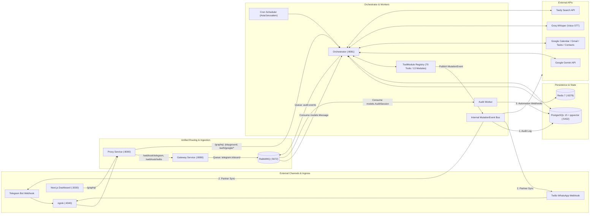

# MyPA — System Architecture, Storage, API & Feature Playbook (`SYSTEM.md`)

> [!IMPORTANT]
> **Living Architecture Reference (Mandatory Maintenance):**  
> This document is the canonical technical blueprint for the **MyPA** codebase, referenced by [`AGENTS.md`](./AGENTS.md).  
> - **Before implementing any feature, bug fix, schema change, or API:** Read the relevant sections of this document to align with existing conventions, interfaces, and storage schemas.  
> - **Whenever adding or modifying models, database tables, Redis keys, RabbitMQ queues, `ToolModule` tools, GraphQL types/resolvers, or Dashboard routes:** You **MUST** update this `SYSTEM.md` file in the same commit/milestone so it remains 100% accurate.

---

## 1. System Overview & High-Level Architecture

**MyPA** is an event-driven, multi-tenant Personal and Family AI Operating System written in Go (`1.26`) and Next.js (`16` / React `19`), accessible via **Telegram**, **WhatsApp (Twilio)**, and a **Web Control Dashboard**.



### 1.1 Service & Container Topology ([`docker-compose.yml`](./docker-compose.yml) & [`Dockerfile`](./Dockerfile))

| Service | Entrypoint | Runtime Base Image | Port(s) | Responsibility |
| :--- | :--- | :--- | :---: | :--- |
| **`proxy`** | [`cmd/proxy/main.go`](./cmd/proxy/main.go) | `gcr.io/distroless/static-debian12` | `8000` | Unified reverse proxy routing `/webhook/*` to `gateway:8080` and `/graphql`, `/playground`, `/auth/google/*` to `orchestrator:8081`. |
| **`gateway`** | [`cmd/gateway/main.go`](./cmd/gateway/main.go) | `gcr.io/distroless/static-debian12` | `8080` | High-throughput HTTP webhook receiver for Telegram (`/webhook/telegram`) and Twilio WhatsApp (`/webhook/twilio`); normalizes payloads into [`models.Message`](./internal/models/models.go#L9-L22) and publishes to RabbitMQ `telegram.inbound`. |
| **`orchestrator`** | [`cmd/orchestrator/main.go`](./cmd/orchestrator/main.go) | `debian:12-slim` (includes `postgresql-client` for `pg_dump`/`pg_restore`) | `8081` | Core brain: consumes `telegram.inbound`, runs Gemini multi-turn tool calling, hosts the [`ToolModule`](./internal/orchestrator/registry.go#L30-L43) registry (70 modular tools across 13 modules), dual-lane [`EventBus`](./internal/events/bus.go), Google OAuth2 callback (`/auth/google/callback`), `gqlgen` GraphQL API (`/graphql`), and Cron [`scheduler`](./internal/scheduler/scheduler.go). |
| **`audit-worker`** | [`cmd/audit-worker/main.go`](./cmd/audit-worker/main.go) | `gcr.io/distroless/static-debian12` | — | Consumes `audit.events` from RabbitMQ, persists [`models.AuditSession`](./internal/models/models.go#L80-L92) rows to PostgreSQL, and runs a 24h ticker archiving sessions older than 30 days. |
| **`dashboard`** | [`dashboard/`](./dashboard/package.json) | `node:20-alpine` (Next.js standalone) | `3030:3000` | Next.js App Router web console for managing family spaces, memories, baby logs, house assets, finances, automations, pairing codes, and mutation rollbacks. |
| **`postgres`** | `pgvector/pgvector:pg15` | Official Postgres 15 + `pgvector` | `5432` | Primary relational + vector store (29 tables). |
| **`redis`** | `redis:7-alpine` | Official Redis 7 (`--appendonly yes`) | `6379` | Hot rolling conversation state (`chat:<userID>`) and OAuth token cache (`token:<userID>`). |
| **`rabbitmq`** | `rabbitmq:3.13-management-alpine` | Official RabbitMQ 3.13 | `5672`, `15672` | Durable AMQP 0-9-1 broker decoupling webhook ingestion and audit telemetry. |
| **`ngrok`** | `ngrok/ngrok:3.39.8@sha256:14d8…` (digest-pinned, *P3-5*) | Official Ngrok container | `4040` | Tunnels public HTTPS webhook traffic to `proxy:8000`. Requires `NGROK_DOMAIN` (no committed default). |
| **`pgadmin`** | `dpage/pgadmin4:9.17@sha256:2f4c…` (digest-pinned, *P3-5*) | Official pgAdmin 4 | `5050:80` | Web UI for inspecting PostgreSQL tables. **Opt-in** (`profiles: [tools]`): `docker compose --profile tools up -d pgadmin`; no default password. |

---

## 2. Repository & Package Structure

```text
mypa/
├── AGENTS.md                       # Global AI agent development rules & guardrails
├── SYSTEM.md                       # THIS FILE: Canonical architecture, schema, API & feature playbook
├── README.md                       # User-facing overview & quickstart guide
├── Dockerfile                      # Unified multi-target Go Dockerfile (gateway, orchestrator, proxy, audit-worker)
├── docker-compose.yml              # Full stack container orchestration
├── gqlgen.yml                      # gqlgen GraphQL code generation config (must be UTF-8 without BOM)
├── config/config.yaml              # Default Viper YAML configuration
├── cmd/
│   ├── gateway/main.go             # Webhook ingestion HTTP service (:8080)
│   ├── orchestrator/main.go        # LLM engine, ToolRegistry, EventBus, OAuth & GraphQL server (:8081)
│   ├── proxy/main.go               # Unified reverse proxy (:8000)
│   └── audit-worker/main.go        # Async RabbitMQ telemetry consumer & 30-day session archiver
├── internal/
│   ├── audio/                      # Groq Whisper API client (`whisper-large-v3`) for voice transcription
│   ├── broker/                     # RabbitMQ AMQP 0-9-1 `Publisher` and `Consumer`
│   ├── calendar/                   # Google Calendar v3 client & OAuth2 config/token helpers
│   ├── config/                     # Viper + godotenv loader & `ALLOWED_USERS` parser
│   ├── contacts/                   # Google People API v1 client (search & create contacts)
│   ├── crypto/                     # AES-256-GCM encryption/decryption at rest (`ENCRYPTION_KEY`)
│   ├── db/                         # GORM PostgreSQL client, dynamic migration registry, backup/restore & domain repos:
│   │   ├── db.go                   # `db.Client` initialization, `vector` extension & core Wave 0 queries
│   │   ├── migrations.go           # `RegisterModel`, `RegisterWave1Models`, `RegisterWave2Models`
│   │   ├── backup.go               # `pg_dump` / `pg_restore` streaming backup/restore, age encryption, GFS retention (P3-4)
│   │   ├── durability_repo.go      # `DurabilityRepository` (EncryptedCredential, MutationLog, IdempotencyRecord)
│   │   ├── memory_v2_repo.go       # `MemoryV2Repo` (TopicMemory, EntityProfile)
│   │   ├── shared_repo.go          # `SharedRepository` (SharedSpace, SharedTaskReminder)
│   │   ├── schedule_repo.go        # `ScheduleRepository` (ScheduleEvent, TopicCalendarConfig)
│   │   ├── baby_repo.go            # `BabyRepository` (BabyProfile, BabyCareLog, BabyInventoryItem)
│   │   ├── house_repo.go           # `HouseRepository` (HouseContractRecord, HomeMaintenanceItem, VehicleAsset)
│   │   ├── finance_repo.go         # `FinanceRepository` (FinancialTransaction, CategoryBudget, RecurringBill)
│   │   └── automation_repo.go      # `AutomationRepository` (ExternalAPIConnector, AutomationRule, UserPreference, PersonalCRMContact)
│   ├── domains/                    # Modular `orchestrator.ToolModule` implementations. Large modules (house, automation,
│   │                               #   schedule, baby, finance — P4-2) are split: module.go (struct, NewModule/options, Name,
│   │                               #   SystemPromptSection), declarations.go (genai tool schemas), handlers.go (Execute +
│   │                               #   execute* per tool), service.go (helpers/business logic without genai types):
│   │   ├── toolutil/               # Shared typed argument extractors & mutation publishing helpers
│   │   ├── workspace_calendar/     # 4 Calendar tools (create, list, update, delete) emitting schedule mutations
│   │   ├── workspace_gmail/        # 9 Gmail tools (search, read, reply, archive, delete, labels, unsubscribe)
│   │   ├── workspace_tasks/        # 6 Google Tasks tools (lists & tasks CRUD) emitting tasks mutations
│   │   ├── workspace_contacts/     # 2 Google Contacts tools (search, create) emitting contacts mutations
│   │   ├── web_research/           # 2 Web research tools (search_web, fetch_webpage with SSRF netguard)
│   │   ├── durability/             # Topic 1: Audit listener, `/undo` (`undo_last_action`), CSV/JSON export
│   │   ├── memory/                 # Topic 2: Topic memories, conflict superseding, living entity profiles & consolidation
│   │   ├── shared/                 # Topic 9: Shared spaces, partner `Notifier` on `EventBus`, shared reminders
│   │   ├── schedule/               # Topic 3: Virtual `[Topic]` sub-calendars & bidirectional partner Google Calendar sync
│   │   ├── baby/                   # Topic 4: Baby profile, Wonder Weeks milestones, medication safety guardrails, inventory
│   │   ├── house/                  # Topic 5 & 8.1: Leases/warranties/contracts, preventive maintenance, vehicle vault
│   │   ├── finance/                # Topic 6: Expense/income ledger, category budgets, >30% anomaly detector, recurring bills
│   │   └── automation/             # Topics 7, 8.2 & 8.3: SSRF-guarded external APIs, `EventBus` rule `Runner`, preferences, CRM
│   ├── events/                     # Thread-safe internal `EventBus` & `MutationEvent` pub/sub
│   ├── gmail/                      # Gmail v1 client (search, read, draft reply, archive, trash, labels, unsubscribe)
│   ├── graph/                      # gqlgen GraphQL layer:
│   │   ├── schema.graphqls         # GraphQL schema definition (types, queries, mutations)
│   │   ├── resolver.go             # Root `Resolver` struct holding `*db.Client`
│   │   ├── schema.resolvers.go     # Resolver implementations & model mappers
│   │   ├── generated.go            # Auto-generated gqlgen runtime (DO NOT EDIT)
│   │   └── model/models_gen.go     # Auto-generated GraphQL Go structs (DO NOT EDIT)
│   ├── llm/                        # Google Gemini (`google.golang.org/genai`) client, embeddings (`gemini-embedding-001`) & base tools
│   ├── markdown/                   # Markdown-to-Telegram HTML (`ToTelegramHTML`) & WhatsApp (`ToWhatsApp`) formatters
│   ├── models/                     # All shared domain DTOs & GORM database models
│   ├── orchestrator/               # Core `Engine`, `ToolModule` & `Registry`, and service port interfaces
│   ├── scheduler/                  # `robfig/cron/v3` background jobs (backups, morning briefings, reminders, dynamic workflows)
│   ├── scraper/                    # `go-readability` + `html-to-markdown` webpage extractor
│   ├── state/                      # Redis `Store` for rolling chat history & OAuth tokens
│   ├── tasks/                      # Google Tasks v1 client (task lists & tasks CRUD)
│   ├── tavily/                     # Tavily web search REST client
│   ├── telegram/                   # Telegram Bot API client & webhook update parser
│   └── twilio/                     # Twilio WhatsApp REST client, webhook handler & message chunker
├── dashboard/                      # Next.js 16 + React 19 + Tailwind CSS v4 Web Control Dashboard
│   └── src/app/                    # App Router pages (`/`, `/audit`, `/automations`, `/baby`, `/finance`, `/house`, `/logs`, `/memory`, `/oauth`, `/sessions`, `/settings`, `/shared`, `/tools`, `/users`)
└── tests/                          # Testcontainers end-to-end integration tests (`e2e_test.go`)
```

---

## 3. Core Architectural Contracts & Conventions

### 3.1 Multi-Turn Agent Execution Lifecycle ([`internal/orchestrator/engine.go`](./internal/orchestrator/engine.go))

1. **Ingress & Queuing:** Telegram or Twilio sends an HTTP POST to `proxy:8000` -> `gateway:8080`, which parses it into a [`models.Message`](./internal/models/models.go#L9-L22) (`ID`, `UserID`, `ChatID`, `Text`, `VoiceFileID`, `PhotoFileID`, `MediaURL`, `MediaContentType`, `Source`) and publishes to RabbitMQ queue `telegram.inbound`.
2. **Consumption & Pre-Processing:** `orchestrator` consumes `models.Message` with a 5-minute context timeout (`Engine.Start` in [`engine.go`](./internal/orchestrator/engine.go)).
   - **Code layout (*P4-1*):** `ProcessMessage` (`engine.go`, ~95 lines) only orchestrates: dedup claim → telemetry/retry defers → auth → `handleConfirmation` / `dispatchCommand` ([`commands.go`](./internal/orchestrator/commands.go), a command table for `/help`, `/connect`, `/backup`, `/restore`, `/undo`) → `ingestMedia` ([`media.go`](./internal/orchestrator/media.go), normalized `mediaAttachment`) → `runTurn` ([`turn.go`](./internal/orchestrator/turn.go): history, tool selection, memory, prompt via [`prompt.go`](./internal/orchestrator/prompt.go), LLM loop, reply, persistence).
   - **Idempotency (*P1-4*):** the first step of `ProcessMessage` claims `inbound:<source>:<chat|user>:<messageID>` (`SET NX`, 24h); duplicates are acked and skipped. A per-turn `turnEffects` flag is set when a tool executes (read-only built-ins such as `get_current_time` excepted), an admin command acts, pairing state changes, or the final reply is delivered; any later error is wrapped in `broker.ErrNonRetryable` (acked, never re-run). Retryable failures release the claim so the redelivery is processed. The user-facing "internal error" notice is sent only on the final attempt or a non-retryable failure (`shouldNotifyUserOfFailure`). On a crash mid-turn the claim survives → the redelivery is skipped (at-most-once by design).
   - Slash commands (`/help`, `/connect`, `/backup`, `/restore`, `/undo`) are handled directly (`/undo` invokes `durability.Module.RollbackLast` or rolls back a specific mutation ID; `/restore` stages a confirmation — see §Security).
   - Voice messages (`VoiceFileID` or WhatsApp `audio/*`) are downloaded and transcribed via Groq Whisper (`whisper-large-v3`).
   - Images and PDFs (`PhotoFileID` or WhatsApp `image/*`, `application/pdf`) are downloaded into `photoData []byte` for multimodal Gemini input; text attachments (`text/*`, `json`, `csv`, `yaml`) are appended directly to `msg.Text`.
3. **Authorization & Pairing:** `e.db.GetUser(msg.UserID)` checks if the user's `PlatformID` exists in `users`. If not, `msg.Text` is checked against active 6-digit `pairing_codes` (`RedeemPairingCode`).
4. **System Prompt Assembly & Dynamic Two-Tier Tool Selection:**
   - **Assembly order (*P2-6*, [`prompt.go`](./internal/orchestrator/prompt.go) `buildSystemPrompt`), most-stable first for Gemini implicit prefix caching:** `staticInstructions` (package constant, identical for all users) → calendar conventions (`WEEK_START_DAY`/`WEEKEND_DAYS`, per deployment) → user profile (name, role, family group) → tool guidance filtered to the tools selected this turn (`toolGuidance`; nothing about tools the model cannot call) → module sections → retrieved memories → current date/time at minute precision **in the configured timezone** (last). Tool selection therefore runs *before* prompt assembly.
   - Semantic vector memory retrieval (skipped for trivial acknowledgements — empty/emoji-only or ≤ `maxTrivialTokens` (3) words that are all filler like "thanks", "ok", "תודה", "כן"; `isTrivialMessage`, *P2-5*): embeds `msg.Text` via `gemini-embedding-001` (3072 dims) and queries top-5 cosine matches from `topic_memories` (the single memory store since *P2-4*) via `DBClient.SearchSimilarMemories(ctx, userID, familyGroup, …)`: the user's personal memories plus their family group's shared ones. No legacy `memories` fallback.
   - Dynamic Domain Sections (SCALE-01): calls [`e.toolRegistry.CombinedSystemPrompt(ctx, callCtx)`](./internal/orchestrator/registry.go), leveraging Redis `MGet` dynamic prompt caching (`ctx_prompt:<familyGroup>:<userID>:<module>`, 10m TTL, **per user** — sections render personal data such as pinned memories and standing instructions) with `EventBus` cache invalidation and concurrent `errgroup.Group` evaluation bounded to an 800ms context timeout on cache misses.
   - Dynamic Two-Tier Tool Scoping (SCALE-01): [`KeywordIntentMatcher`](./internal/orchestrator/intent_matcher.go) inspects query text across English and Hebrew prefixes to classify intent into Domain Groups (`baby`, `finance`, `house`, `calendar`, `gmail`, `tasks`, `contacts`, `automation`, `shared`). [`SelectDeclarations`](./internal/orchestrator/registry.go) injects Tier 1 Core Tools (8 ubiquitous tools) + only matching Tier 2 Domain Groups via `llm.WithActiveTools(ctx, activeTools)`, dropping tool schema overhead from ~9,500 to ~1,680–2,380 tokens per call (75%–82% reduction).
5. **LLM Chat & Bounded Multi-Turn Execution Loop (SCALE-03):**
   - Calls `e.llm.Chat(ctx, systemPrompt, history, promptText, photoData, photoMimeType)` (with automatic retry normalizing Hebrew preposition numbers like `ב18` -> `ב-18` via [`NormalizeHebrewPrepositionNumbers`](./internal/orchestrator/engine.go) if flagged by safety filters).
   - If `resp.ToolCalls` is non-empty, [`handleToolCalls`](./internal/orchestrator/engine.go) delegates to `executeToolsConcurrently` which executes parallel tool calls concurrently via `errgroup.WithContext(ctx)` bounded by `MaxConcurrentTools = 8` with index-based slice assignment preserving strict 1:1 ordering and per-goroutine panic recovery. After checking the SEC-09 interactive confirmation gate for meta-tools, `executeSingleTool` dynamically dispatches the call via `e.toolRegistry.Execute(ctx, callCtx, toolCall.Name, toolCall.Args)`, building `callCtx` from the user resolved once at the start of the turn (`withTurnUser`, *P2-7*; a `GetUser` lookup happens only for calls outside a turn). All tools receive standardized canonical identity through `callCtx.ActorID()` and `callCtx.TenantFamilyGroup()`.
   - Tool execution appends `Role: "assistant"` (`ToolCalls`) and `Role: "function"` (`ToolResponses`), and recurses up to a strict limit of 8 iterations (`const MaxToolRecursionDepth = 8`). Upon reaching iteration 8, the engine forces a final summary call via `llm.WithNoTools(ctx)` to guarantee clean conversational termination without further tool loops.
6. **Delivery, State & Telemetry (SCALE-02):**
   - Formats markdown for WhatsApp (`markdown.ToWhatsApp`) or single-pass Telegram HTML (`markdown.ToTelegramHTML`), safely chunking messages via `markdown.SafeChunkTelegramHTML` (which preserves balanced HTML open-tag stacks across chunks up to 4,000 characters) and sends via `twClient` or `tgClient`.
   - Appends the user message, then (*P2-9*) the turn's tool activity as a Gemini-native pair — an assistant message with `tool_calls` (string args ≤ 200 chars) followed by a `function` message with `tool_responses` (results ≤ `maxToolResultChars` = 400 runes; read-only built-ins omitted) — then the assistant reply, to Redis (`chat:<userID>`). On load, `sanitizeHistory` drops call/response halves split by `LTRIM` and leading non-user messages (Gemini rejects both). SCALE-02 strips raw `PhotoData` bytes and formats a concise attachment metadata marker (`[Attachment: <mime> (<size>)]`), keeping Redis list size < 10KB while preserving active-turn vision reasoning.
   - Asynchronously publishes [`models.AuditSession`](./internal/models/models.go#L80-L92) to RabbitMQ `audit.events` via `defer`.

### 3.2 `ToolModule` & `Registry` Contract ([`internal/orchestrator/registry.go`](./internal/orchestrator/registry.go))

Every life domain in `internal/domains/<domain>/` implements the [`orchestrator.ToolModule`](./internal/orchestrator/registry.go#L30-L43) interface:

```go
type CallContext struct {
    User             *models.User
    Message          models.Message
    DB               DBClient
    LLM              LLMClient
    EventBus         *events.EventBus
    SendNotification NotificationSender
    Extra            map[string]interface{}
}

type ToolModule interface {
    Name() string
    Declarations() []*genai.FunctionDeclaration
    Execute(ctx context.Context, callCtx CallContext, toolName string, args map[string]interface{}) (string, error)
    SystemPromptSection(ctx context.Context, callCtx CallContext) string
}
```

**Registered Domain Modules (13 total wired in [`cmd/orchestrator/main.go`](./cmd/orchestrator/main.go)):**
- **5 Workspace Base Modules:** `workspace_calendar` (4 tools), `workspace_gmail` (9 tools), `workspace_tasks` (6 tools), `workspace_contacts` (2 tools), `web_research` (2 tools).
- **8 Life Domain Modules:** `durability` (Topic 1 & `/undo`), `memory` (Topic 2 & `remember_fact`), `shared` (Topic 9 & `schedule_reminder`), `schedule` (Topic 3), `baby` (Topic 4), `house` (Topic 5 & 8.1), `finance` (Topic 6), `automation` (Topics 7, 8.2, 8.3 & workflow management).

**Two-Tier Tool Domain Grouping (SCALE-01):**
Rather than injecting all 70 registered tool schemas on every call (~9,500 input tokens), the orchestrator dynamically scopes tools into two tiers:
1. **Tier 1 Core Tools (8 ubiquitous tools, ~1,120 tokens):** Always injected into every user turn.
   - `remember_fact`, `save_topic_memory`, `search_topic_memories` (`memory`)
   - `schedule_reminder` (`shared`)
   - `search_web`, `fetch_webpage` (`web_research`)
   - `undo_last_action` (`durability`)
   - `get_current_time` (`registry`)
2. **Tier 2 Domain Groups (Injected on-demand via `KeywordIntentMatcher`):**
   - `DomainBaby` (5 tools): `upsert_baby_profile`, `log_baby_care`, `query_baby_logs_and_trends`, `get_baby_milestone_suggestions`, `manage_baby_inventory`.
   - `DomainFinance` (4 tools): `log_financial_transaction`, `get_financial_summary`, `set_category_budget`, `manage_recurring_bills`.
   - `DomainHouse` (4 tools): `save_house_contract_or_receipt`, `list_house_contracts`, `manage_home_maintenance`, `manage_vehicle_asset`.
   - `DomainCalendar` (9 tools): `create_calendar_event`, `list_calendar_events`, `update_calendar_event`, `delete_calendar_event`, `schedule_topic_event`, `list_topic_schedule`, `configure_topic_calendar`, `delete_topic_event`, `update_topic_event`.
   - `DomainGmail` (9 tools): `search_emails`, `read_email`, `draft_email_reply`, `archive_emails`, `soft_delete_emails`, `list_email_labels`, `apply_email_labels`, `create_email_label`, `unsubscribe_email`.
   - `DomainTasks` (6 tools): `list_task_lists`, `create_task_list`, `list_tasks`, `create_task`, `complete_task`, `delete_task`.
   - `DomainContacts` (4 tools): `search_contacts`, `create_contact`, `upsert_personal_crm`, `query_personal_crm`.
   - `DomainAutomation` (11 tools): `register_external_api`, `list_external_apis`, `call_external_api`, `create_automation_rule`, `list_automation_rules`, `delete_automation_rule`, `update_user_preferences`, `get_user_preferences`, `schedule_workflow`, `list_workflows`, `delete_workflow`.
   - `DomainShared` (4 tools): `configure_shared_topic`, `create_shared_reminder`, `complete_shared_reminder`, `list_shared_activity`.
   - `DomainMemory` (2 tools, *P2-1*): `upsert_entity_profile`, `get_entity_profile` (keywords: remember, recall, profile, who is / זוכר, תזכור, פרופיל, מי זה…).
   - `DomainHistory` (2 tools, *P2-1*): `list_recent_changes`, `export_topic_data` (keywords: history, changes, what changed, export, undo / היסטוריה, שינויים, מה השתנה, ייצוא, בטל…).
   - *Sticky follow-ups (*P2-2*):* the selection is `MatchDomains(text) ∪ turn_domains:<userID>`; after the LLM loop the engine stores this turn's matched domains plus `Registry.DomainsForTools(called tools)`, so "yes, delete the second one" keeps the previous turn's Gmail tools.
   - *Reachability invariant:* `TestEveryRegisteredToolIsReachable` (`internal/orchestrator/tool_reachability_test.go`) builds every production module and fails if any declared tool is neither Tier 1 core nor mapped (`ModuleDomainMapping`) to a domain the matcher can select.
   - *Token Savings:* Average turn consumes ~1,680 to ~2,380 tokens across 12–20 tools, representing a 75% to 82% token reduction per LLM interaction.

**Unified Durability Rollback Engine (`internal/domains/durability`):**
All undo paths—the `/undo` chat command, LLM `undo_last_action` tool, and GraphQL `RollbackMutation`—delegate to `durability.Module.Rollback(ctx, actorID, familyGroup, mutationID)` and `RollbackLast(ctx, actorID, familyGroup)`.
- **Entity Allowlist (`allowlist.go`):** Centralized `ResolveRollbackTable` validates 19 allowed domain entity types and rejects system tables (`users`, `pairing_codes`, `encrypted_credentials`, `audit_sessions`, `audit_events`, `schema_migrations`).
- **Snapshot Restoration (`durability_repo.go`):** Executes in an atomic ACID transaction (`RollbackSnapshot`). For `action == "create"`, deletes the inserted record; for `action == "delete"`, recreates the record from `before_json`; for `action == "update"`, restores the exact prior state from `before_json`. Upon commit, marks `is_undone = true`.

### 3.3 Internal `EventBus` & `MutationEvent` Contract ([`internal/events/bus.go`](./internal/events/bus.go))

Whenever a domain tool creates, updates, completes, or deletes state, it publishes a [`MutationEvent`](./internal/events/bus.go#L16-L28) to `callCtx.EventBus`:

```go
type MutationEvent struct {
    ID          string    `json:"id"`            // UUID v4 (auto-generated if empty)
    Topic       string    `json:"topic"`         // Lowercase topic: "baby", "house", "finance", "schedule", "memory", "shared", "automation"
    Action      string    `json:"action"`        // e.g. "create", "update", "delete", "complete", "configure", "undo"
    EntityType  string    `json:"entity_type"`   // Exact model struct name (e.g. "BabyCareLog", "FinancialTransaction")
    EntityID    string    `json:"entity_id"`     // Stringified primary key of the mutated record
    ActorUserID string    `json:"actor_user_id"` // PlatformID / UserID of the user who triggered the change
    FamilyGroup string    `json:"family_group"`  // Tenant family group name
    BeforeJSON  string    `json:"before_json"`   // JSON snapshot before mutation (empty on "create")
    AfterJSON   string    `json:"after_json"`    // JSON snapshot after mutation (empty on "delete")
    Summary     string    `json:"summary"`       // Human-readable description of the change
    Timestamp   time.Time `json:"timestamp"`     // UTC timestamp (auto-populated if zero)
}
```

**Dual-Lane EventBus Architecture (SCALE-05 Part A):**
To prevent slow network I/O, external partner notifications, and automation webhooks from blocking the synchronous LLM tool execution pipeline while guaranteeing ACID durability, `EventBus` operates two distinct execution lanes:
1. **Sync Lane (`SubscribeSync`, `SubscribeSyncTopic`, `Subscribe`, `SubscribeTopic`):**
   - Executes synchronously on the publisher's goroutine with full error propagation via `errors.Join`.
   - Strictly deterministic FIFO subscriber ordering via sequential `[]orderedHandler` slice iteration.
   - Dedicated exclusively to ACID audit logging and rollback consistency.
   - Guarded by panic recovery (`recover()`) logging the stack trace without crashing the server.
   - **Active Subscribers:**
     - [`durability.Module.HandleMutationEvent`](./internal/domains/durability/module.go): Writes immutable audit snapshots to `mutation_logs` before tool completion.
     - [`orchestrator.RegisterPromptInvalidator`](./internal/orchestrator/prompt_cache.go): Evicts cached Redis system prompt sections for **every user** in the event's family/actor scope (`SCAN MATCH ctx_prompt:<scope>:*` filtered by module, glob-escaped) synchronously to guarantee cache consistency.
2. **Async Lane (`SubscribeAsync`, `SubscribeAsyncTopic`):**
   - Dispatches jobs to a bounded background worker pool (default: **4 workers**, configurable via `WithWorkerCount`).
   - Buffered job queue with default capacity of **1,024 events** (`WithQueueCapacity`) preserving deterministic FIFO task submission.
   - **Non-blocking Backpressure:** If the queue is saturated, incoming async events are dropped without blocking callers, logging a warning and incrementing the atomic drop counter (`DroppedCount()`).
   - **Detached Context:** Jobs run under a detached context (`context.WithoutCancel` with default **30s timeout**, `WithAsyncTimeout`), preventing cancellation of the parent chat turn from aborting background webhooks or partner notifications.
   - **Per-Worker Panic Isolation:** Each worker catches panics with stack trace logging (`debug.Stack()`), ensuring rogue handlers cannot terminate background workers.
   - **Race-Free Draining & Shutdown:** `Close(ctx ...context.Context) error` and `Shutdown(ctx context.Context) error` synchronize via `closeMu sync.RWMutex` and an atomic `closed` flag, safely rejecting new submissions, closing the channel, draining pending queued jobs, and awaiting worker completion within the supplied context timeout.
   - **Active Subscribers:**
     - [`shared.Notifier.HandleMutationEvent`](./internal/domains/shared/notifier.go): Sends instant Telegram/WhatsApp notifications to partner family members.
     - [`automation.Runner.HandleMutationEvent`](./internal/domains/automation/runner.go): Evaluates triggered `AutomationRule` conditions and executes external webhook HTTP calls.

### 3.4 Security Architecture & Defense-in-Depth

Milestone 1A hardens the entire system across ingress, internal execution, storage, and egress:

1. **Pre-Auth Gate & Admin RBAC (`internal/orchestrator/engine.go`):**
   - At the very top of `ProcessMessage`, `e.db.GetUser(msg.UserID)` verifies caller identity before downloading media, transcribing voice, or running LLM prompts.
   - Unauthenticated senders are routed strictly to `handleUnauthenticatedUser`, which permits only 6-digit pairing code redemption (`RedeemPairingCode`).
   - Pairing attempts are rate-limited via Redis (`rate_limit:pairing:<userID>`): 5 failed attempts within 15 minutes trigger a 1-hour account lockout (`rate_limit:pairing:lockout:<userID>`).
   - `/backup` and `/restore` commands strictly verify `user.Role == "admin"`, rejecting non-admin attempts with an explicit permission denied alert.
   - **`/restore` is two-step (*P1-5*, [`restore.go`](./internal/orchestrator/restore.go)):** `/restore` only stages a pending action (`pending_meta_tool:<userID>`, `ToolName="restore"`, 5-min TTL) recording the *exact* backup file, and replies with its name and timestamp. Only `CONFIRM RESTORE` executes it — a bare `CONFIRM` is refused for destructive actions (`isDestructiveAction`). On confirmation the admin role is re-checked, the staged path is validated (a `.dump` directly in the backup dir), a **safety backup** of the current DB is taken (restore aborts if it fails), and then the staged file is restored. `restore` is not an LLM tool name, so the model cannot stage or trigger it.

2. **Ingress Webhook Signatures & Proxy Guard (`cmd/gateway`, `internal/twilio`, `cmd/proxy`):**
   - Telegram webhooks require `X-Telegram-Bot-Api-Secret-Token` matching `cfg.Telegram.SecretToken` using constant-time comparison (`subtle.ConstantTimeCompare`). **Fail closed:** `telegramSecretValid` rejects every request when the configured secret is empty, and `validateGatewayConfig` aborts gateway startup if `TELEGRAM_BOT_TOKEN`/`TELEGRAM_WEBHOOK_URL` is set without a valid `TELEGRAM_SECRET_TOKEN` (1–256 chars `[A-Za-z0-9_-]`).
   - On startup, when `TELEGRAM_WEBHOOK_URL` is set, the gateway calls `telegram.Client.SetWebhook(url, secret_token)` in the background (`registerWebhookWithRetry`: 8 attempts, exponential backoff from 2 s capped at 2 min; never crashes the gateway; errors are redacted so the bot token is never logged).
   - Twilio WhatsApp webhooks verify `X-Twilio-Signature` using HMAC-SHA1 over the full request URL and sorted POST parameters with `cfg.Twilio.AuthToken`. **Fail closed:** the handler returns 403 for every request when no auth token is configured (an empty-key HMAC is forgeable), and gateway startup aborts if `TWILIO_ACCOUNT_SID` is set without `TWILIO_AUTH_TOKEN`.
   - `proxy` restricts public ingress to `/webhook/*`, `/graphql`, and `/auth/google/*`. `/playground` returns HTTP 404 in production, and unauthenticated `/graphql` requests are rejected at the edge with HTTP 401.

3. **GraphQL Authentication Middleware (`internal/graph/auth_middleware.go`):**
   - Inspects `Authorization: Bearer <token>` on all requests to `/graphql`.
   - Supports constant-time `DASHBOARD_API_SECRET` comparison and HS256 Bearer JWT claims (`user_id`, `role`, `family_group`, `exp`).
   - **Hardening (*P3-2*):** JWT header `alg` must be exactly `HS256`; `exp` is mandatory, must be in the future and at most `MaxTokenLifetime` (24 h) ahead. The dashboard secret yields an admin **bound to `DASHBOARD_FAMILY_GROUP`** (`AuthClaims.TenantBound`, server-side only, `json:"-"`); without `DASHBOARD_FAMILY_GROUP` the secret authenticates nothing. Cross-tenant bypasses use `claims.IsGlobalAdmin()` (admin and not tenant-bound) instead of `Role == "admin"`; per-user targets go through `resolveTargetUser`/`canActOnUser` (tenant-bound admins only reach users of their own family). Missing claims are an error in `resolveTenantAndActor` and `RollbackMutation` (no default tenant, no implicit "system" rollback). `JWT_SECRET` no longer falls back to `ENCRYPTION_KEY`.
   - Injects authenticated claims into request context (`ForContext` / `GetAuthClaims`).

4. **Multi-Tenant Isolation & Anti-IDOR (`internal/orchestrator/registry.go`, `internal/db/`, domain modules):**
   - `CallContext` exposes canonical identity helpers: `ActorID()` (platform ID) and `TenantFamilyGroup()` (family group falling back to `ActorID()`).
   - All tool argument overrides (`family_group`, `user_id`, `fgOverride`) have been removed from schemas and handlers across `baby`, `house`, `automation`, and `schedule`.
   - Repositories enforce compound scoping: `WHERE ((family_group = ? AND family_group != '') OR user_id = ?)`.
   - **Positive Authorization Pattern (SEC-04 Remediation):**
     Domain tool execution guards (`house`, `automation`, `schedule`, `finance`, `shared`, `durability`) and repository operations strictly apply positive authorization validation:
     `isAuthorized := record != nil && ((familyGroup != "" && record.FamilyGroup == familyGroup) || (record.UserID != "" && record.UserID == userID))`
     For family-level entities without a user ID (`VehicleAsset`, `RecurringBill`):
     `isAuthorized := record != nil && record.FamilyGroup != "" && record.FamilyGroup == familyGroup`
     This eliminates fail-open De Morgan boolean fallacies (`record.FamilyGroup != "" && record.FamilyGroup != familyGroup`) ensuring records with unpopulated or legacy `FamilyGroup` fail closed.
   - Operations mutating by ID (`CompleteMaintenanceItem`, `CompleteSharedReminder`, `manage_recurring_bills`, `DeleteAutomationRule`, `executeUpsertPersonalCRM`, `undo_last_action`) verify tenant authorization prior to mutation and propagate `familyGroup ...string` into repository queries.

    - **GraphQL Resolvers Anti-IDOR & Scoping Enforcement (Milestone 1C):**
      - `ToggleAutomationRule` and `DeleteAutomationRule` enforce tenant boundaries: non-admins are denied with `permission denied: unauthorized access to automation rule` if `rule.FamilyGroup` does not match the caller's family group (or `rule.UserID != actorID` for personal rules).
      - `UserPreference` enforces `targetUserID = actorID` for non-admin callers, preventing user preference disclosure or modification across users.
      - `AuditSessions` and `UserSessions` are positively scoped via `r.resolveTenantAndActor(ctx, familyGroup)` (defaulting to the caller's family group for non-admins, while preserving system-wide access for admins when `familyGroup` is empty or `"*"`), and utilize type-cast JOIN predicates `JOIN users ON (users.id::text = audit_sessions.user_id OR users.platform_id = audit_sessions.user_id)` to prevent PostgreSQL `SQLSTATE 42883` (`uuid = text`) mismatches.
      - `CompleteSharedTask` pre-fetches the target task with `r.sharedRepo().GetSharedReminder` to populate `BeforeJSON` in the emitted `MutationEvent`, ensuring full rollback durability.

5. **Centralized SSRF Protection (`internal/netguard/netguard.go`):**
   - Provides `SafeClient(timeout time.Duration)` with a custom `DialContext` resolving hostnames prior to connection.
   - Blocks IPv4/IPv6 loopback (`127.0.0.0/8`, `::1`), RFC1918 private subnets (`10.0.0.0/8`, `172.16.0.0/12`, `192.168.0.0/16`), cloud metadata (`169.254.169.254`), carrier-grade NAT (`100.64.0.0/10`), link-local multicast, and Docker single-label container names (`!strings.Contains(host, ".") && host != "localhost"`).
   - Validates redirect target URLs via `CheckRedirect`.
   - Wired into `scraper.FetchAndExtractText`, `gmail.UnsubscribeEmail`, `automation.runner`, and `RegisterExternalAPI`.

6. **Twilio Media Security (`internal/twilio/client.go`):**
   - `DownloadMedia` enforces HTTPS scheme, validates hostnames against an allowlist (`api.twilio.com`, `media.twiliocdn.com`), attaches HTTP BasicAuth only when matching trusted Twilio domains, and enforces a 25MB response size limit.

7. **Durability Rollback Allowlisting & Transactions (`internal/graph/schema.resolvers.go`):**
   - `tableNameForEntity` enforces a strict entity allowlist and explicitly rejects system tables (`users`, `pairing_codes`, `encrypted_credentials`, `audit_sessions`, `audit_events`, `schema_migrations`).
   - `RollbackMutation` verifies caller tenant permissions, wraps inversions in an ACID database transaction (`tx := r.DB.DB.Begin()`), checks row mutation counts, rolls back on any error, and sets `is_undone = true` only upon commit.

8. **OAuth Hardening & Cryptographic Key Management (`internal/crypto/aes.go`, `internal/state/store.go`):**
   - `ENCRYPTION_KEY` is validated at startup by `cfg.Validate("orchestrator")` and `crypto.ValidateKeyConfigured()`; a missing key is a clean startup error (no panic). At runtime `Encrypt`/`Decrypt` return `crypto.ErrKeyNotConfigured` instead of panicking.
   - The deterministic dev key is used **only** inside `go test` binaries (`flag.Lookup("test.v") != nil`, via the overridable `testBinaryDetector`). `ENV=test`/`GO_ENV=test` no longer unlock it.
   - Key derivation implements HKDF-SHA256 with 16-byte cryptographically random salt (`[16-byte Salt][12-byte Nonce][Ciphertext + 16-byte Tag]`), maintaining backward compatibility with legacy unsalted ciphertexts.
   - OAuth tokens in Redis (`token:<userID>`) are AES-256-GCM encrypted.
   - `/connect` generates 32-byte cryptographically random hex CSRF nonces stored in Redis (`oauth_state:<nonce> -> userID`) with 10-minute TTL.
   - `/auth/google/callback` atomically validates and deletes the nonce before exchanging the code, then persists an encrypted fallback in PostgreSQL (`encrypted_credentials`) via `durabilityModule.SaveCredentialFallback`.

9. **Prompt Injection Boundaries & Sensitive-Tool Gates (`internal/orchestrator/security.go`, `engine.go`; broadened in *P3-1*):**
   - **Untrusted sources (single list `untrustedOutputTools`):** `read_email`, `search_emails`, `fetch_webpage`, `search_web`, `call_external_api`. After any of them runs, `executeSingleTool` marks the turn untrusted and returns the output wrapped in `<untrusted_external_content …>`. Images and PDFs from any channel (Telegram photos, WhatsApp images/PDFs) and WhatsApp text documents also mark the turn untrusted. (Telegram documents are not ingested at all.) Voice notes are the user's own speech and are not marked.
   - **Gate (single list `confirmationRequiredWhenUntrusted`):** in an untrusted turn these tools are staged in `pending_meta_tool:<userID>` and require `CONFIRM <TOOL>`: `update_user_preferences`, `create_automation_rule`, `schedule_workflow`, `register_external_api`, `call_external_api`, `soft_delete_emails`, `unsubscribe_email`, `delete_calendar_event`, `delete_task`, `create_shared_reminder`, `remember_fact`, `save_topic_memory`, `upsert_entity_profile`.
   - **Stored user data is data, not instructions:** standing instructions, pinned memories, entity profiles and retrieved memories are wrapped with `WrapUserProvidedData` (`<user_provided_data kind=…>`): honoured as preferences/context, but cannot override rules, grant permissions or justify actions on their own. Nothing is labelled "STRICT REQUIREMENT" any more.
   - **Breakout protection:** both wrappers neutralize their own closing tag inside the wrapped content (`neutralizeTag` inserts U+200B), so a payload containing `</untrusted_external_content>` cannot end the block early.

10. **Logging hygiene (*P3-3*, [`internal/logging`](./internal/logging/logging.go)):** user message text is never logged at INFO — `logging.LogMessageText` emits `message_id` + `text_len` (no content hash: short messages are dictionary-reversible) and the text only in a separate DEBUG record (`LOG_LEVEL=debug`). Covers the gateway, Twilio webhook, engine (incl. the Hebrew content-block retry), and the broker's unparseable-payload log (`body_bytes` only). Every Telegram client error is passed through `redactURLError` so the bot token (part of the API URL) never reaches logs. All compose services use the `x-logging` anchor: `json-file`, `max-size: 10m`, `max-file: 5`.

11. **Backups (*P3-4*, [`internal/db/backup.go`](./internal/db/backup.go)):** `pg_dump` output is piped through `age` encryption (X25519 recipients from `BACKUP_AGE_RECIPIENTS`) straight into a `0600` temp file, fsynced and renamed — no plaintext dump ever touches disk; without recipients the backup is written unencrypted with a warning (a missing backup is worse). Restores decrypt in-stream into `pg_restore`'s stdin using the private key at `BACKUP_AGE_IDENTITY_FILE` (keep it off the server; mount only to restore). The DB password is passed via `PGPASSWORD` in the child environment, never in argv. Retention: `KeepLatest` 3 (protects a `/restore`'s staged file from its own safety backup) + 7 daily + 4 weekly. Off-machine copies: not yet (owner decision pending).

### 3.5 Redis Key Inventory Reference

| Key Pattern | Type | TTL | Purpose |
| :--- | :---: | :---: | :--- |
| `chat:<userID>` | List | 24 hours / Rolling (last 30) | Rolling conversational history (`models.ChatMessage` JSON incl. per-turn tool call/response pairs with truncated results — *P2-9*; raw `PhotoData` bytes stripped, metadata markers preserved) |
| `token:<userID>` | String | None | AES-256-GCM encrypted Google OAuth2 token JSON |
| `oauth_state:<nonce>` | String | 10 minutes | CSRF protection nonce mapping to `userID` |
| `pending_meta_tool:<userID>` | String | 5 minutes | Staged privileged tool action pending `CONFIRM` redemption; also holds a staged `/restore` (`ToolName="restore"`, `Args.backup_path`) redeemable only by `CONFIRM RESTORE` |
| `turn_domains:<userID>` | String (JSON) | 15 minutes | Tool domains used by the user's last turn (text-matched ∪ domains of called tools), unioned into the next turn's tool selection (*P2-2*) |
| `rate_limit:pairing:<userID>` | String (Int) | 15 minutes | Failed pairing code attempts counter |
| `inbound:<source>:<chatID\|userID>:<messageID>` | String | 24 hours | Inbound message dedup claim (`SET NX`); released on retryable failure (*P1-4*) |
| `rate_limit:pairing:lockout:<userID>` | String | 1 hour | Lockout flag set after 5 failed pairing attempts |
| `ctx_prompt:<familyGroup>:<userID>:<module>` | String | 10 minutes | Dynamic system prompt section cached **per user** (segments percent-encode `%`/`:`), invalidated for all family members on domain `MutationEvent`s |

### 3.6 RabbitMQ Enterprise Broker Topology & Resilience (SCALE-04)

The message broker layer ([`internal/broker/`](./internal/broker/)) provides decoupled, thread-safe asynchronous messaging between the API gateway, orchestrator, and background workers:

1. **Exchange & Dead Letter Queue (DLQ) Topology ([`topology.go`](./internal/broker/topology.go)):**
   - **Exchanges:** Primary direct exchange `mypa.direct` and dedicated Dead Letter Exchange `mypa.dlx` (both durable, direct).
   - **Primary Queues:** `telemetry`, `reminders`, `workflows`, and `chat-ingress` are declared durable with dead-letter attributes:
     - `x-dead-letter-exchange`: `"mypa.dlx"`
     - `x-dead-letter-routing-key`: `"<queue>.dlq"` (e.g. `telemetry.dlq`)
     - `x-max-priority`: `10`
   - **DLQ Queues:** Dedicated durable dead-letter queues (`<queue>.dlq`) bound to `mypa.dlx` with routing key `<queue>.dlq`.
   - **Idempotency:** Topology initialization is idempotent and runs automatically upon broker client startup.

2. **Thread-Safe `SafePublisher` with Confirms ([`publisher.go`](./internal/broker/publisher.go)):**
   - RabbitMQ channels are not concurrent-safe. `SafePublisher` wraps the AMQP channel with a `sync.Mutex` around all channel operations.
   - **Publisher Confirms:** Enables AMQP publisher confirms (`ch.Confirm(false)`) and uses `PublishWithDeferredConfirmWithContext` to block until the RabbitMQ broker acknowledges (`Ack`) persistent storage, eliminating message loss during broker failovers.
   - **Automatic Reconnection:** Subscribes to `ch.NotifyClose` in a background monitor goroutine and provides lazy on-demand reconnection in `PublishWithPriority` if the connection or channel drops.
   - Type alias `Publisher = SafePublisher` guarantees complete backward compatibility across all call sites.

3. **Resilient `Consumer` with Supervisor & Backoff Retries ([`consumer.go`](./internal/broker/consumer.go)):**
   - **Supervisor Loop:** Wraps message consumption in an auto-reconnecting loop with exponential backoff (1s up to 30s) on connection loss.
   - **Bounded Retries:** Transient handler failures are retried up to 3 times with exponential delays (1s, 2s, 4s) tracked via AMQP headers (`x-retries`, `x-last-error`). Upon exhausting retries, messages are rejected without requeue (`Reject(false)`), routing them directly to the corresponding DLQ.
   - **Non-retryable failures (*P1-4*):** a handler error wrapping `broker.ErrNonRetryable` (`broker.NonRetryable(err)`) is **acked** without redelivery — used once a turn has produced side effects (tool executed, admin command acted, reply delivered, pairing state changed), because re-running the turn would duplicate calendar events/emails/ledger rows. Policy lives in `broker/retry_policy.go` (`decideFailure`). Handlers registered via `ConsumeWithInfo` receive `broker.DeliveryInfo{Attempt, MaxAttempts}`.
   - **Poison-Pill Protection:** Malformed JSON payloads that fail deserialization are immediately rejected without requeue (`Reject(false)`), instantly shunting toxic payloads to the DLQ without stalling consumers.
   - **Graceful Shutdown:** `Stop()` cancels the consumption context and closes the AMQP channel cleanly.

---

## 4. PostgreSQL + `pgvector` Database Schema Reference

### 4.1 Migration Registration Mechanism ([`internal/db/migrations.go`](./internal/db/migrations.go))
- On startup, [`db.NewClient(dsn)`](./internal/db/db.go#L23-L53) enables `pgvector` (`CREATE EXTENSION IF NOT EXISTS vector`) and runs `db.AutoMigrate(allModels...)` combining core Wave 0 models with all models registered via `db.RegisterModel(...)`, `db.RegisterWave1Models()`, and `db.RegisterWave2Models()`. Models are automatically deduplicated by `reflect.TypeOf`, guaranteeing idempotent execution.
- **Connection Pool Sizing (SCALE-05 Part B):** Configures production-grade pool limits on `*sql.DB`:
  - `SetMaxOpenConns(25)`: Prevents exhausting PostgreSQL's `max_connections` (100) across services (`orchestrator` 25 + `audit-worker` 10 + headroom 65).
  - `SetMaxIdleConns(10)`: Maintains warm connections for instantaneous tool queries.
  - `SetConnMaxLifetime(30 * time.Minute)`: Replaces stale connections before infrastructure firewall timeouts.
  - `SetConnMaxIdleTime(5 * time.Minute)`: Reclaims unused idle connections after traffic bursts.
  - `Ping()` & `Close()`: Startup verifies connectivity via `sqlDB.Ping()`, and `Close()` safely drains the connection pool on orchestrator shutdown.
- **Multi-Tenant Composite B-Tree Indexes ([`internal/db/migrations.go`](./internal/db/migrations.go)):**
  - `idx_mutation_logs_family_created`: `(family_group, created_at DESC)` on `mutation_logs`
  - `idx_financial_transactions_family_date`: `(family_group, transaction_date DESC)` on `financial_transactions`
  - `idx_baby_care_logs_family_timestamp`: `(family_group, timestamp DESC)` on `baby_care_logs`
  - `idx_schedule_events_family_start`: `(family_group, start_time ASC)` on `schedule_events`
  - `idx_topic_memories_family_created`: `(family_group, created_at DESC)` on `topic_memories`
  - `idx_shared_task_reminders_due_completed`: `(due_time, is_completed)` on `shared_task_reminders`
  - *Secondary Composite Lookups:* `idx_audit_sessions_user_start`, `idx_financial_transactions_fam_cat`, `idx_baby_care_logs_baby_timestamp`, `idx_house_contracts_fam_exp`.
- **pgvector HNSW Cosine Distance Vector Indexes:**
  - `idx_topic_memories_embedding`: `CREATE INDEX IF NOT EXISTS idx_topic_memories_embedding ON topic_memories USING hnsw ((embedding::halfvec(3072)) halfvec_cosine_ops)`
  - `idx_memories_embedding`: `CREATE INDEX IF NOT EXISTS idx_memories_embedding ON memories USING hnsw ((embedding::halfvec(3072)) halfvec_cosine_ops)`
  - Uses `halfvec(3072)` casting to enable HNSW indexing on 3,072-dimensional Gemini embeddings within PostgreSQL pgvector's 2,000-dimension limit for standard vector indexes. Fallback logging ensures compatibility with pgvector versions lacking halfvec.
- **Total Database Tables:** **29 tables** across 9 model files in [`internal/models/`](./internal/models/).

### 4.2 Complete Table & GORM Model Inventory (29 Tables)

#### A. Core / Wave 0 Models ([`internal/models/models.go`](./internal/models/models.go))

| # | Struct Name | Table Name | Primary Key | Fields, Types & Indexes |
| :---: | :--- | :--- | :--- | :--- |
| 1 | **`User`** (`L111`) | `users` | `ID` (`uuid`, `default:gen_random_uuid()`) | `PlatformID` (`string`, `uniqueIndex`), `Name` (`string`), `Role` (`string`: `"admin"`\|`"family"`), `FamilyGroup` (`string`), `CreatedAt` (`time.Time`) |
| 2 | **`PairingCode`** (`L121`) | `pairing_codes` | `ID` (`uuid`, `default:gen_random_uuid()`) | `Code` (`string`, `uniqueIndex`, 6-digit), `Role` (`string`), `FamilyGroup` (`string`), `ExpiresAt` (`time.Time`), `IsUsed` (`bool`, `default:false`), `CreatedAt` (`time.Time`) |
| 3 | **`Memory`** (`L132`) — **legacy, read-only (*P2-4*)** | `memories` | `ID` (`uint`) | `UserID` (`string`, `index`), `Scope` (`string`, `index`, `default:'personal'`), `Fact` (`string`), `Embedding` (`pgvector.Vector`, `type:vector(3072)`), `CreatedAt` (`time.Time`). No code writes or reads it at runtime; `db.MigrateLegacyMemories` copies rows into `topic_memories` at every startup (idempotent: skips facts already present for the user; `family_group` from `users`; scope `family` → topic `family`). Kept until the migration is verified in production, then drop manually. |
| 4 | **`ScheduledReminder`** (`L142`) | `scheduled_reminders` | `ID` (`uint`) | `UserID` (`string`, `index`), `Message` (`string`), `DueTime` (`time.Time`, `index`), `IsSent` (`bool`, `index`), `CreatedAt` (`time.Time`) |
| 5 | **`Workflow`** (`L152`) | `workflows` | `ID` (`uint`) | `UserID` (`string`, `index`), `Name` (`string`), `CronExpression` (`string`), `Instruction` (`string`), `IsActive` (`bool`, `index`), `CreatedAt` (`time.Time`) |
| 6 | **`AuditSession`** (`L80`) | `audit_sessions` | `ID` (`uuid`) | `UserID` (`string`, `index`), `ChatID` (`string`), `Source` (`string`), `UserPrompt` (`string`), `FinalResponse` (`string`), `StartTime` (`time.Time`), `EndTime` (`time.Time`), `TotalDurationMs` (`int64`), `TotalTokens` (`int`), `Status` (`string`), `ToolSummary` (`text`, *P2-9*: bounded one-line record of the turn's tool calls/results) |
| 7 | **`AuditEvent`** (`L95`) | `audit_events` | `ID` (`uuid`) | `SessionID` (`string`, `index`), `EventType` (`string`), `ActionName` (`string`), `RequestPayload` (`jsonb`), `ResponsePayload` (`jsonb`), `ErrorMessage` (`string`), `StartTime` (`time.Time`), `EndTime` (`time.Time`), `DurationMs` (`int64`), `PromptTokens` (`int`), `CompletionTokens` (`int`) |

#### B. Topic 1: Durability & Rollback Models ([`internal/models/durability.go`](./internal/models/durability.go)) — Repo: [`internal/db/durability_repo.go`](./internal/db/durability_repo.go)

| # | Struct Name | Table Name | Primary Key | Fields, Types & Indexes |
| :---: | :--- | :--- | :--- | :--- |
| 8 | **`EncryptedCredential`** (`L9`) | `encrypted_credentials` | Composite: `(UserID, Provider)` | `UserID` (`string`, `primaryKey`), `Provider` (`string`, `primaryKey`), `Ciphertext` (`[]byte`, `type:bytea`), `UpdatedAt` (`time.Time`) |
| 9 | **`MutationLog`** (`L18`) | `mutation_logs` | `ID` (`string`) | `UserID` (`string`, `index`), `FamilyGroup` (`string`, `index`), `Topic` (`string`, `index`), `Action` (`string`), `EntityType` (`string`, `index`), `EntityID` (`string`, `index`), `BeforeJSON` (`jsonb`), `AfterJSON` (`jsonb`), `Summary` (`string`), `IsUndone` (`bool`, `default:false;index`), `CreatedAt` (`time.Time`, `index`) |
| 10 | **`IdempotencyRecord`** (`L35`) | `idempotency_records` | `Key` (`string`) | `UserID` (`string`, `index`), `ToolName` (`string`), `ResponseSummary` (`string`), `ExpiresAt` (`time.Time`, `index`) |

#### C. Topic 2: Topic-Mapped Memory & Knowledge Graph ([`internal/models/memory_v2.go`](./internal/models/memory_v2.go)) — Repo: [`internal/db/memory_v2_repo.go`](./internal/db/memory_v2_repo.go)

| # | Struct Name | Table Name | Primary Key | Fields, Types & Indexes |
| :---: | :--- | :--- | :--- | :--- |
| 11 | **`TopicMemory`** (`L30`) | `topic_memories` | `ID` (`uint`) | `UserID` (`string`, `index`), `FamilyGroup` (`string`, `index`), `Topic` (`string`, `index`), `Subtopic` (`string`, `index`), `TagsJSON` (`jsonb`), `Fact` (`string`), `Scope` (`string`, `index;default:'personal'`), `CreatedByUserID` (`string`), `SupersededByID` (`*uint`, `index`), `ValidFrom` (`time.Time`), `ValidUntil` (`*time.Time`), `IsPinned` (`bool`, `default:false`), `Embedding` (`pgvector.Vector`, `type:vector(3072)`), `CreatedAt` (`time.Time`). *Lifecycle Hooks: `BeforeCreate` & `BeforeSave` auto-populate uninitialized vectors with 3072-dimensional zero vectors (`pgvector.NewVector(make([]float32, 3072))`) to prevent PostgreSQL SQLSTATE 22000.* |
| 12 | **`EntityProfile`** (`L91`) | `entity_profiles` | `ID` (`uint`) | `UserID` (`string`, `index`), `FamilyGroup` (`string`, `index`), `Topic` (`string`, `index`), `EntityType` (`string`, `index`), `EntityName` (`string`, `index`), `AttributesJSON` (`jsonb`), `UpdatedByUserID` (`string`), `UpdatedAt` (`time.Time`) |

#### D. Topic 9: Shared Family Spaces ([`internal/models/shared.go`](./internal/models/shared.go)) — Repo: [`internal/db/shared_repo.go`](./internal/db/shared_repo.go)
*Repository & Client API: Provides `UpsertSharedSpace`, `GetSharedSpacesForFamily`, `GetSharedSpace`, `CreateSharedReminder`, `GetSharedReminder(id uint, familyGroup ...string)` (tenant-scoped single reminder query), `CompleteSharedReminder`, `ListSharedReminders`, `GetDueSharedReminders`, `MarkSharedReminderSent`.*

| # | Struct Name | Table Name | Primary Key | Fields, Types & Indexes |
| :---: | :--- | :--- | :--- | :--- |
| 13 | **`SharedSpace`** (`L22`) | `shared_spaces` | `ID` (`uint`) | `FamilyGroup` (`string`, `index;size:100;not null`), `Topic` (`string`, `index;size:100;not null`), `OwnerUserID` (`string`, `size:100`), `SharedWithUserID` (`string`, `size:100`), `CanView` (`bool`, `default:true`), `CanEdit` (`bool`, `default:true`), `NotifyMode` (`string`, `size:20;default:'instant'`: `"instant"`\|`"digest"`\|`"silent"`), `UpdatedAt` (`time.Time`) |
| 14 | **`SharedTaskReminder`** (`L36`) | `shared_task_reminders` | `ID` (`uint`) | `FamilyGroup` (`string`, `index;size:100;not null`), `Topic` (`string`, `index;size:100;not null`), `Title` (`text;not null`), `DueTime` (`*time.Time`, `index`), `CreatedByUserID` (`string`, `size:100;not null`), `AssignedToUserID` (`string`, `size:100`), `IsCompleted` (`bool`, `index;default:false`), `CompletedByUserID` (`string`, `size:100`), `CompletedAt` (`*time.Time`), `IsSent` (`bool`, `index;default:false`), `RemindedAt` (`*time.Time`), `CreatedAt` (`time.Time`) |

#### E. Topic 3: Multi-Schedule Engine ([`internal/models/schedule.go`](./internal/models/schedule.go)) — Repo: [`internal/db/schedule_repo.go`](./internal/db/schedule_repo.go)

| # | Struct Name | Table Name | Primary Key | Fields, Types & Indexes |
| :---: | :--- | :--- | :--- | :--- |
| 15 | **`ScheduleEvent`** (`L13`) | `schedule_events` | `ID` (`uint`) | `ExternalGoogleEventID` (`string`, `index`), `PartnerGoogleEventID` (`string`, `index`), `UserID` (`string`, `index`), `FamilyGroup` (`string`, `index`), `Topic` (`string`, `index`), `TagsJSON` (`jsonb`), `Title` (`string`), `Description` (`string`), `StartTime` (`time.Time`, `index`), `EndTime` (`time.Time`, `index`), `RecurrenceRule` (`string`), `SyncToGoogle` (`bool`, `default:true`), `IsShared` (`bool`, `default:false`), `CreatedByUserID` (`string`), `CreatedAt` (`time.Time`) |
| 16 | **`TopicCalendarConfig`** (`L34`) | `topic_calendar_configs` | `ID` (`uint`) | `UserID` (`string`, `uniqueIndex:idx_user_topic`), `Topic` (`string`, `uniqueIndex:idx_user_topic`), `ColorID` (`string`), `PrefixTag` (`string`), `TargetCalendarID` (`string`), `IncludeInMorningBriefing` (`bool`, `default:true`), `SyncToGoogleDefault` (`*bool`), `UpdatedAt` (`time.Time`) |

#### F. Topic 4: Baby & Family Care Tracker ([`internal/models/baby.go`](./internal/models/baby.go)) — Repo: [`internal/db/baby_repo.go`](./internal/db/baby_repo.go)

| # | Struct Name | Table Name | Primary Key | Fields, Types & Indexes |
| :---: | :--- | :--- | :--- | :--- |
| 17 | **`BabyProfile`** (`L8`) | `baby_profiles` | `ID` (`uint`) | `FamilyGroup` (`string`, `index`), `Name` (`string`), `DateOfBirth` (`time.Time`), `DueDate` (`*time.Time`), `Gender` (`string`), `BirthWeightGrams` (`int`), `CurrentWeightGrams` (`int`), `HeightCm` (`float64`), `PediatricianInfo` (`string`), `AllergiesNotes` (`string`), `UpdatedByUserID` (`string`), `UpdatedAt` (`time.Time`) |
| 18 | **`BabyCareLog`** (`L27`) | `baby_care_logs` | `ID` (`uint`) | `BabyID` (`uint`, `index`), `FamilyGroup` (`string`, `index`), `LogType` (`string`, `index`: `"feeding"`\|`"sleep"`\|`"diaper"`\|`"temperature"`\|`"medication"`\|`"milestone"`\|`"measurement"`), `ValueNumeric` (`float64`), `Unit` (`string`), `Details` (`string`), `Timestamp` (`time.Time`, `index`), `LoggedByUserID` (`string`) |
| 19 | **`BabyInventoryItem`** (`L40`) | `baby_inventory_items` | `ID` (`uint`) | `FamilyGroup` (`string`, `index`), `ItemName` (`string`), `QuantityRemaining` (`float64`), `Unit` (`string`), `LowThreshold` (`float64`), `UpdatedAt` (`time.Time`) |

#### G. Topic 5 & 8.1: House Maintenance, Contracts & Vehicles ([`internal/models/house.go`](./internal/models/house.go)) — Repo: [`internal/db/house_repo.go`](./internal/db/house_repo.go)

| # | Struct Name | Table Name | Primary Key | Fields, Types & Indexes |
| :---: | :--- | :--- | :--- | :--- |
| 20 | **`HouseContractRecord`** (`L31`) | `house_contract_records` | `ID` (`uint`) | `FamilyGroup` (`string`, `index`), `RecordType` (`string`, `index`: `"lease"`\|`"mortgage"`\|`"utility"`\|`"warranty"`\|`"insurance"`\|`"receipt"`), `Title` (`string`), `VendorOrLandlord` (`string`), `ContactDetails` (`string`), `Amount` (`float64`), `Currency` (`string`), `StartDate` (`*time.Time`), `ExpirationOrRenewalDate` (`*time.Time`, `index`), `NoticePeriodDays` (`int`), `KeyTermsJSON` (`jsonb`), `CreatedByUserID` (`string`), `CreatedAt` (`time.Time`) |
| 21 | **`HomeMaintenanceItem`** (`L94`) | `home_maintenance_items` | `ID` (`uint`) | `FamilyGroup` (`string`, `index`), `TaskName` (`string`), `Category` (`string`: `"hvac"`\|`"plumbing"`\|`"appliance"`\|`"pest_control"`\|`"general"`), `IntervalDays` (`int`), `LastCompletedAt` (`*time.Time`), `NextDueAt` (`time.Time`, `index`), `ContractorInfo` (`string`), `Notes` (`string`), `UpdatedByUserID` (`string`) |
| 22 | **`VehicleAsset`** (`L129`) | `vehicle_assets` | `ID` (`uint`) | `FamilyGroup` (`string`, `index`), `Name` (`string`), `LicensePlate` (`string`), `InsuranceExpiry` (`*time.Time`), `AnnualTestExpiry` (`*time.Time`), `LastServiceDate` (`*time.Time`), `CurrentMileageKm` (`int`), `NextServiceMileageKm` (`int`), `Notes` (`string`) |

#### H. Topic 6: Financial Tracking & Budgets ([`internal/models/finance.go`](./internal/models/finance.go)) — Repo: [`internal/db/finance_repo.go`](./internal/db/finance_repo.go)

| # | Struct Name | Table Name | Primary Key | Fields, Types & Indexes |
| :---: | :--- | :--- | :--- | :--- |
| 23 | **`FinancialTransaction`** (`L40`) | `financial_transactions` | `ID` (`uint`) | `UserID` (`string`, `index`), `FamilyGroup` (`string`, `index`), `Type` (`string`, `index`: `"expense"`\|`"income"`), `Category` (`string`, `index`), `Merchant` (`string`, `index`), `Amount` (`float64`), `Currency` (`string`), `TransactionDate` (`time.Time`, `index`), `IsShared` (`bool`, `default:true`), `Source` (`string`: `"chat"`\|`"receipt_photo"`\|`"email"`\|`"dashboard"`), `Notes` (`string`), `CreatedAt` (`time.Time`) |
| 24 | **`CategoryBudget`** (`L58`) | `category_budgets` | `ID` (`uint`) | `FamilyGroup` (`string`, `index;uniqueIndex:idx_fam_cat`), `Category` (`string`, `uniqueIndex:idx_fam_cat`), `MonthlyLimit` (`float64`), `Currency` (`string`), `AlertThresholdPct` (`float64`), `CreatedAt` (`time.Time`), `UpdatedAt` (`time.Time`) |
| 25 | **`RecurringBill`** (`L82`) | `recurring_bills` | `ID` (`uint`) | `FamilyGroup` (`string`, `index`), `Name` (`string`), `Category` (`string`), `ExpectedAmount` (`float64`), `Currency` (`string`), `BillingCycle` (`string`: `"monthly"`\|`"yearly"`), `NextDueDay` (`int`: 1..31), `AutoRenew` (`bool`, `default:true`), `CreatedAt` (`time.Time`), `UpdatedAt` (`time.Time`) |

#### I. Topics 7, 8.2 & 8.3: External APIs, Automations, Preferences & CRM ([`internal/models/automation.go`](./internal/models/automation.go)) — Repo: [`internal/db/automation_repo.go`](./internal/db/automation_repo.go)

| # | Struct Name | Table Name | Primary Key | Fields, Types & Indexes |
| :---: | :--- | :--- | :--- | :--- |
| 26 | **`ExternalAPIConnector`** (`L9`) | `external_api_connectors` | `ID` (`uint`) | `UserID` (`string`, `index`), `FamilyGroup` (`string`, `index`), `Name` (`string`, `index`), `BaseURL` (`string`), `DefaultMethod` (`string`), `EncryptedAuthHeaders` (`[]byte`, `type:bytea`), `Description` (`string`), `CreatedAt` (`time.Time`) |
| 27 | **`AutomationRule`** (`L23`) | `automation_rules` | `ID` (`uint`) | `UserID` (`string`, `index`), `FamilyGroup` (`string`, `index`), `Name` (`string`), `TriggerType` (`string`: `"event_mutation"`\|`"keyword"`\|`"threshold"`\|`"cron"`), `TriggerTopic` (`string`, `index`), `ConditionJSON` (`jsonb`), `ActionInstruction` (`string`), `IsActive` (`bool`, `default:true;index`), `CreatedAt` (`time.Time`) |
| 28 | **`UserPreference`** (`L38`) | `user_preferences` | `UserID` (`string`) | `PreferredLanguage` (`string`), `TonePersona` (`string`), `DefaultCurrency` (`string`), `QuietHoursStart` (`string`), `QuietHoursEnd` (`string`), `BriefingTopicsJSON` (`jsonb`), `StandingInstructions` (`string`), `UpdatedAt` (`time.Time`) |
| 29 | **`PersonalCRMContact`** (`L52`) | `personal_crm_contacts` | `ID` (`uint`) | `UserID` (`string`, `index`), `FamilyGroup` (`string`, `index`), `PersonName` (`string`, `index`), `Relationship` (`string`), `ImportantDatesJSON` (`jsonb`), `GiftIdeasAndSizes` (`string`), `MedicalNotes` (`string`), `UpdatedAt` (`time.Time`) |

### 4.3 Database Performance Optimization & Index Architecture (SCALE-05 Part B)

#### Connection Pool Sizing & Lifecycle ([`internal/db/db.go`](./internal/db/db.go))
The underlying `*sql.DB` connection pool is explicitly tuned on initialization to eliminate connection starvation and TCP handshake churn:
- **`MaxOpenConns = 25`:** Caps open database connections well within PostgreSQL's `max_connections` (100) across all services.
- **`MaxIdleConns = 10`:** Retains a hot pool of idle connections to handle sudden bursts of concurrent LLM tool executions without reconnect overhead.
- **`ConnMaxLifetime = 30m`:** Recycles long-lived connections periodically to clear server-side resource state and balance across Postgres restarts.
- **`ConnMaxIdleTime = 5m`:** Closes idle connections after 5 minutes of inactivity to conserve database memory.
- **Startup Verification & Client Lifecycle:** `NewClient` immediately runs `sqlDB.Ping()` to fail fast if credentials or connectivity are invalid. Clean process shutdown is supported via `Client.Close() error` and `Client.Ping() error`.

#### Vector HNSW & Composite Multi-Tenant Database Indexes ([`internal/db/migrations.go`](./internal/db/migrations.go))
Applied automatically during migration initialization via `ApplyCustomIndexes`:
1. **`pgvector` HNSW `halfvec(3072)` Indexes:**
   - `idx_topic_memories_embedding` on `topic_memories USING hnsw ((embedding::halfvec(3072)) halfvec_cosine_ops)`.
   - `idx_memories_embedding` on `memories USING hnsw ((embedding::halfvec(3072)) halfvec_cosine_ops)`.
   - **Query contract (*P2-3*, [`internal/db/vector.go`](./internal/db/vector.go)):** every similarity search must `ORDER BY embedding::halfvec(3072) <=> ?::halfvec(3072)` (`halfvecCosineDistanceSQL`) — the exact index expression — via `cosineOrder()`, which returns a `clause.OrderBy`. *Never* pass `gorm.Expr` to `Order()`: GORM v1.31 silently drops it (before P2-3 no vector query had an `ORDER BY` at all, so retrieval returned arbitrary rows). Queries run through `withVectorScan`, which on pgvector ≥ 0.8 sets `SET LOCAL hnsw.iterative_scan = strict_order` so tenant-filtered searches keep scanning until `LIMIT` rows pass the filter (plain HNSW + filter returned 0 of a user's rows in tests when other tenants owned the nearest neighbours). On pgvector < 0.8 a warning is logged once.
   - *Impact:* Uses 16-bit float representation to fit high-dimensional 3,072 embeddings within PostgreSQL's 2,000-byte index tuple limit while delivering sub-millisecond approximate nearest neighbor searches without table scans.
2. **Composite Multi-Tenant B-Tree Indexes:**
   - `idx_mutation_logs_fam_undone_created`: `mutation_logs (family_group, is_undone, created_at DESC)` — Accelerates `/undo` and Dashboard mutation queries.
   - `idx_financial_transactions_fam_cat`: `financial_transactions (family_group, category)` — Accelerates category budget aggregations.
   - `idx_financial_transactions_fam_type_cat_date`: `financial_transactions (family_group, type, category, transaction_date DESC)` — Accelerates monthly spending summaries and 30% anomaly detection.
   - `idx_baby_care_logs_baby_timestamp`: `baby_care_logs (baby_id, timestamp DESC)` — Accelerates baby trend analysis and feeding intervals.
   - `idx_schedule_events_fam_topic_start`: `schedule_events (family_group, topic, start_time)` — Accelerates topic calendar listings.
   - `idx_house_contracts_fam_exp`: `house_contract_records (family_group, expiration_or_renewal_date)` — Accelerates upcoming expiry and renewal alerts.

---

## 5. Redis State & RabbitMQ Message Broker Reference

### 5.1 Redis Key Schema ([`internal/state/store.go`](./internal/state/store.go))

| Key Pattern | Redis Type | Value Schema | Capacity / Retention | TTL | Methods |
| :--- | :---: | :--- | :--- | :---: | :--- |
| `chat:<userID>` | `LIST` | JSON [`models.ChatMessage`](./internal/models/models.go#L58-L66) (`role`, `content`, `tool_calls`, `tool_responses`). *SCALE-02:* Raw `PhotoData` bytes are stripped before Redis persistence to avoid memory bloat, replaced with a concise `[Attachment: <mime> (<size>)]` metadata tag. | Last **30** messages (`LTRIM -30 -1`, `ChatHistoryMaxMessages`) | `24h` (sliding on write, `ChatHistoryTTL`) | `AppendChatHistory`, `GetChatHistory` |
| `token:<userID>` | `STRING` | Encrypted AES-256-GCM token bytes (`oauth2.Token` JSON) | 1 encrypted payload per user | `0` (no expiry) | `SetOAuthToken`, `GetOAuthToken` |
| `ctx_prompt:<familyGroup>:<userID>:<module>` | `STRING` | Dynamic system prompt section text for one user and life domain (*SCALE-01*, per-user since P1-3). Key built by `state.PromptCacheKey`; `familyGroup` falls back to the user ID when the user has no family group; not cached when the caller's ID is unknown | 1 cached section per user per domain module | `10m` | `SetPromptSection`, `GetPromptSection`, `GetPromptSections` (`MGET`), `InvalidateFamilyPromptSections` (`SCAN`+`DEL`), `InvalidatePromptSections` (`DEL`) |
| `oauth_state:<nonce>` | `STRING` | Hex string mapping to `userID` | 1 nonce per in-flight OAuth exchange | `10m` | `SaveOAuthState`, `ValidateAndDeleteOAuthState` (`GETDEL`) |
| `pending_meta_tool:<userID>` | `STRING` | JSON `PendingMetaToolAction` interactive confirmation payload (*SEC-09*) | 1 pending action per user | `5m` | `StagePendingMetaTool`, `GetAndClearPendingMetaTool` (`GETDEL`) |
| `turn_domains:<userID>` | `STRING` | JSON array of `DomainGroup` names used by the last turn: domains matched by its text plus domains of tools it actually executed (inherited sticky domains are not re-saved, so they decay after one unused turn). Empty set deletes the key (*P2-2*) | 1 small array per user | `15m` | `SetTurnDomains`, `GetTurnDomains` |
| `rate_limit:pairing:<userID>` | `STRING` | Integer counter of failed pairing attempts | 1 integer counter per user | `15m` (rolling from 1st failure) | `RecordFailedPairingAttempt`, `ResetPairingRateLimit` |
| `inbound:<source>:<chatID\|userID>:<messageID>` | `STRING` | Inbound message idempotency claim (claim timestamp). Telegram `message_id` is per chat → scoped by chat ID; WhatsApp `MessageSid` is global → user ID scope. Messages without an ID skip dedup (warning logged) (*P1-4*) | 1 key per processed inbound message | `24h` | `ClaimInbound` (`SET NX EX`), `ReleaseInbound` (`DEL`, on retryable failure) |
| `rate_limit:pairing:lockout:<userID>` | `STRING` | String sentinel (`"locked"`) | Set upon 5 consecutive failed attempts | `1h` | `CheckPairingLockout`, `RecordFailedPairingAttempt`, `ResetPairingRateLimit` |

### 5.2 RabbitMQ Queues, Topology & Reliable Messaging ([`internal/broker/`](./internal/broker/))

#### Queue & DLQ Topology Architecture (SCALE-04)
Primary queues are declared with dead-letter exchange bindings ensuring zero message loss and complete poison-pill isolation:
- **Dead-Letter Exchange (DLX):** Direct exchange `mypa.dlx` (`durable: true`, `autoDelete: false`).
- **Primary Queue Bindings:** Declared with `x-dead-letter-exchange: mypa.dlx` and `x-dead-letter-routing-key: <queue>.dlq`.
- **Dead-Letter Queues (DLQs):** Dedicated durable queues (`telegram.inbound.dlq`, `audit.events.dlq`) bound to `mypa.dlx` with routing keys matching their primary queue names plus `.dlq`.
- **Consumer concurrency (*P2-8*):** `Qos(prefetch)` (`RABBITMQ_PREFETCH`, default 4) bounds deliveries in flight. Each delivery is routed by `consumeLoop` to a `keyedDispatcher` lane keyed by `source:userID` ([`keyed_dispatcher.go`](./internal/broker/keyed_dispatcher.go)): different users are processed in parallel, one user's messages strictly in arrival order. Lanes exist only while they have work. Retry backoff sleeps inside the lane's worker, so it delays only that user. Handler panics are converted to errors (normal retry/DLQ path) so a delivery can never stay unacked and pin a prefetch slot. Before reconnecting, in-flight work is drained so a redelivery never runs alongside its original. `ConsumeRaw` (audit-worker) uses a single lane (serial). amqp091-go `Ack`/`Nack`/`Reject` take the channel mutex, so concurrent settlement is safe. Note: a retried message is republished to the queue tail, so after a *failure* a user's later message can be processed before the retry (pre-existing).

| Queue Name | Dead-Letter Queue | Producer | Consumer | Go Payload Struct | JSON Fields |
| :--- | :--- | :--- | :--- | :--- | :--- |
| **`telegram.inbound`** | `telegram.inbound.dlq` | `cmd/gateway` (`/webhook/telegram` & `/webhook/twilio`) | `cmd/orchestrator` (`Engine.Start`) | [`models.Message`](./internal/models/models.go#L9-L22) | `id`, `user_id`, `chat_id`, `text`, `voice_file_id`, `photo_file_id`, `audio_file_id`, `media_url`, `media_content_type`, `source` (`"telegram"`\|`"whatsapp"`), `timestamp` |
| **`audit.events`** | `audit.events.dlq` | `cmd/orchestrator` (`Engine.ProcessMessage` defer) | `cmd/audit-worker` | [`models.AuditSession`](./internal/models/models.go#L80-L92) | `id`, `user_id`, `chat_id`, `source`, `user_prompt`, `final_response`, `start_time`, `end_time`, `total_duration_ms`, `total_tokens`, `status` |

#### SafePublisher: Thread-Safety, Confirms & Auto-Reconnect ([`internal/broker/publisher.go`](./internal/broker/publisher.go))
All message publishing across the gateway and orchestrator utilizes `SafePublisher` (`broker.NewSafePublisher`):
- **Concurrency Guard:** All channel access is protected by an internal `sync.Mutex`, preventing AMQP race conditions under concurrent webhook ingestion or parallel tool executions.
- **Publisher Confirms:** AMQP channels are initialized with `ch.Confirm(false)`. Each publish invokes `PublishWithDeferredConfirmWithContext` and awaits broker acknowledgment (`confirmation.Wait()`), ensuring durability before acknowledging upstream webhook clients.
- **Dual-Listener Auto-Reconnect:** Concurrently monitors `NotifyClose` channels on both `*amqp.Connection` and `*amqp.Channel`. Upon broker restarts or TCP drops, a background supervisor loop re-establishes the connection and channel with exponential backoff while blocking in-flight publishers until recovery.

#### Consumer Supervisor, Bounded Retries & Poison Pill Protection ([`internal/broker/consumer.go`](./internal/broker/consumer.go))
The consumer loop guarantees resilient, bounded message processing:
- **Auto-Reconnect Supervisor:** Automatically recovers consumer channels upon broker disconnection or unexpected channel closures.
- **Bounded Retries with Exponential Backoff:** Transient processing errors retry up to **3 attempts** (`DefaultMaxRetries = 3`). Retries publish to the tail of the primary queue with exponential delay (`2^attempt * 500ms`) and increment the AMQP header `x-retries`.
- **Non-Retryable Acks (*P1-4*):** errors wrapping `broker.ErrNonRetryable` are acked immediately (no retry, no DLQ) — the orchestrator returns these once a turn has side effects.
- **Poison Pill Isolation:** If processing fails after 3 attempts, the message is rejected with `d.Reject(false)` (requeue disabled), immediately routing the payload to its designated dead-letter queue without broker redelivery loops.
- **Malformed JSON Handling:** Unparseable payloads fail immediately on the first attempt and are rejected directly to the DLQ (`d.Reject(false)`), protecting consumers from infinite JSON unmarshal loops.

---

## 6. Complete AI Agent Tool Catalog (All 70 Tools)

### 6.1 Base Workspace & System Tools (28 Base Tools + Built-in System Tools — [`internal/llm/tools.go`](./internal/llm/tools.go) & [`internal/orchestrator/registry.go`](./internal/orchestrator/registry.go))

| Tool Name | Category | Required & Optional Parameters (`*` = required) | Description |
| :--- | :--- | :--- | :--- |
| `get_current_time` | System / Time | `timezone` (optional IANA timezone, e.g. `'Asia/Jerusalem'`) | Returns the current ISO8601 date, time, weekday, and unix timestamp in the requested or default timezone. |
| `create_calendar_event` | Google Calendar | `title`*, `start_time`* (RFC3339), `end_time`* (RFC3339), `timezone`*, `description`, `recurrence` (`[]string`) | Creates an event on the user's primary Google Calendar. |
| `list_calendar_events` | Google Calendar | `time_min` (RFC3339), `time_max` (RFC3339), `query` | Lists/searches events from primary Google Calendar. |
| `update_calendar_event` | Google Calendar | `id`*, `title`, `start_time`, `end_time`, `description`, `timezone`, `recurrence` | Updates an existing Google Calendar event. |
| `delete_calendar_event` | Google Calendar | `id`* | Deletes an event from primary Google Calendar. |
| `remember_fact` | Memory | `fact`*, `scope` (`"personal"`\|`"family"`) | Alias that embeds the fact and writes one `TopicMemory` (topic `personal`, or `family` for family scope; subtopic `fact`) — *P2-4*. |
| `search_emails` | Gmail | `query`*, `max_results` (default 5) | Searches user's Gmail via Gmail query syntax. |
| `read_email` | Gmail | `message_id`* | Reads the full body of a Gmail message. |
| `draft_email_reply` | Gmail | `message_id`*, `reply_text`* | Creates a reply draft in Gmail. |
| `archive_emails` | Gmail | `message_ids`* (`[]string`) | Removes `INBOX` label from messages. |
| `soft_delete_emails` | Gmail | `message_ids`* (`[]string`) | Moves Gmail messages to Trash. |
| `list_email_labels` | Gmail | *(none)* | Lists all Gmail label names and IDs. |
| `apply_email_labels` | Gmail | `message_ids`* (`[]string`), `label_id`* | Applies a label to a batch of Gmail messages. |
| `create_email_label` | Gmail | `label_name`* | Creates a new Gmail label. |
| `unsubscribe_email` | Gmail | `message_id`* | Extracts `List-Unsubscribe` link and triggers unsubscribe. |
| `list_task_lists` | Google Tasks | *(none)* | Lists all Google Tasks lists. |
| `create_task_list` | Google Tasks | `title`* | Creates a new Google Tasks list. |
| `list_tasks` | Google Tasks | `list_id` (default `@default`) | Lists pending tasks in a task list. |
| `create_task` | Google Tasks | `title`*, `list_id`, `notes`, `due` (RFC3339) | Creates a new task in Google Tasks. |
| `complete_task` | Google Tasks | `task_id`*, `list_id` | Marks a Google Task as completed. |
| `delete_task` | Google Tasks | `task_id`*, `list_id` | Deletes a task from Google Tasks. |
| `search_web` | Web Search | `query`* | Searches the live web via Tavily API (declared in `CalendarEventTool`, handled by the `web_research` module). |
| `fetch_webpage` | Web Scraper | `url`* | Extracts readable markdown from a URL and summarizes/processes it. |
| `search_contacts` | Google Contacts | `query`* | Searches Google People API contacts. |
| `create_contact` | Google Contacts | `name`*, `email`, `phone` | Creates a contact in Google Contacts. |
| `schedule_reminder` | Reminders v1 | `message`*, `due_time`* (RFC3339) | Saves a one-time reminder in `scheduled_reminders` (polled every minute). |
| `schedule_workflow` | Workflows v1 | `name`*, `cron_expression`*, `instruction`* | Saves a recurring natural-language cron workflow in `workflows`. |
| `list_workflows` | Workflows v1 | *(none)* | Lists active recurring workflows for the user. |
| `delete_workflow` | Workflows v1 | `id`* | Deletes a workflow by ID and reloads cron scheduler. |

### 6.2 Modular Domain Tools (42 Tools Across 8 `ToolModule` Packages)

| Module (`Name()`) | Package Path | `SystemPromptSection` Injects | Registered Tools (`*` = required param) | Emits `MutationEvent`? |
| :--- | :--- | :--- | :--- | :---: |
| **`durability`** | [`internal/domains/durability`](./internal/domains/durability/module.go) | Undo (`undo_last_action`), change history, and JSON/CSV export instructions. | • `undo_last_action` (`reason`, `mutation_id`)<br>• `list_recent_changes` (`topic`, `limit`)<br>• `export_topic_data` (`topic`*, `format`, `limit`) | `undo_last_action`: Yes (`action: "undo"`) |
| **`memory`** | [`internal/domains/memory`](./internal/domains/memory/module.go) | Active `EntityProfile` cards + pinned `TopicMemory` facts for the user/family. | • `save_topic_memory` (`topic`*, `fact`*, `subtopic`, `tags`, `scope`, `is_pinned`, `supersedes_memory_id`)<br>• `search_topic_memories` (`topic`, `query`, `tags`, `scope`)<br>• `upsert_entity_profile` (`topic`*, `entity_type`*, `entity_name`*, `attributes`*)<br>• `get_entity_profile` (`topic`*, `entity_name`*) | `save_topic_memory`: Yes<br>`upsert_entity_profile`: Yes |
| **`shared`** | [`internal/domains/shared`](./internal/domains/shared/module.go) | Configured `SharedSpace` topics, permissions, and notify modes for the family. | • `configure_shared_topic` (`topic`*, `can_view`, `can_edit`, `notify_mode`, `shared_with_user_id`)<br>• `create_shared_reminder` (`title`*, `topic`, `due_time`, `assigned_to_user_id`)<br>• `complete_shared_reminder` (`id`*)<br>• `list_shared_activity` (`topic`, `include_completed`) | `configure_shared_topic`: Yes<br>`create_shared_reminder`: Yes<br>`complete_shared_reminder`: Yes |
| **`schedule`** | [`internal/domains/schedule`](./internal/domains/schedule/module.go) | Configured `TopicCalendarConfig` prefixes/colors + upcoming 7-day `ScheduleEvent` items. | • `schedule_topic_event` (`title`*, `topic`*, `start_time`*, `end_time`, `description`, `tags`, `sync_to_google`, `is_shared`, `recurrence`)<br>• `list_topic_schedule` (`topic`, `tags`, `start_time`, `end_time`, `include_google`)<br>• `configure_topic_calendar` (`topic`*, `prefix_tag`, `color_id`, `target_calendar_id`, `sync_to_google_default`, `include_in_morning_briefing`)<br>• `delete_topic_event` (`event_id`*)<br>• `update_topic_event` (`event_id`*, `title`, `start_time`, `end_time`, `description`, `tags`) | All except `list_topic_schedule`: Yes |
| **`baby`** | [`internal/domains/baby`](./internal/domains/baby/module.go) | Exact baby age (days/weeks/months + adjusted age), current developmental leap, medication cooldown status, and low inventory alerts. | • `upsert_baby_profile` (`name`*, `date_of_birth`*, `id`, `due_date`, `gender`, `birth_weight_grams`, `current_weight_grams`, `height_cm`, `pediatrician_info`, `allergies_notes`)<br>• `log_baby_care` (`log_type`*, `baby_id`, `baby_name`, `value_numeric`, `unit`, `details`, `timestamp`, `force`)<br>• `query_baby_logs_and_trends` (`baby_id`, `baby_name`, `log_type`, `time_range`, `start_time`, `end_time`, `limit`)<br>• `get_baby_milestone_suggestions` (`baby_id`, `baby_name`, `category`)<br>• `manage_baby_inventory` (`action`*, `item_name`, `quantity`, `delta`, `unit`, `low_threshold`) | `upsert_baby_profile`: Yes<br>`log_baby_care`: Yes<br>`manage_baby_inventory` (`set`/`adjust`): Yes |
| **`house`** | [`internal/domains/house`](./internal/domains/house/module.go) | Expiring contracts/warranties within notice window, overdue/upcoming maintenance tasks, and vehicle test/insurance/service alerts. | • `save_house_contract_or_receipt` (`record_type`*, `title`*, `contract_id`, `vendor_or_landlord`, `contact_details`, `amount`, `currency`, `start_date`, `expiration_date`, `notice_period_days`, `key_terms`)<br>• `list_house_contracts` (`record_type`, `expiring_within_days`, `search_query`)<br>• `manage_home_maintenance` (`action`*, `item_id`, `task_name`, `category`, `interval_days`, `next_due_at`, `contractor_info`, `notes`, `overdue_only`)<br>• `manage_vehicle_asset` (`action`*, `asset_id`, `name`, `license_plate`, `insurance_expiry`, `annual_test_expiry`, `last_service_date`, `current_mileage_km`, `next_service_mileage_km`, `notes`) | All mutating actions: Yes |
| **`finance`** | [`internal/domains/finance`](./internal/domains/finance/module.go) | Current month spending vs. `CategoryBudget` thresholds and upcoming `RecurringBill` due dates (next 7 days). | • `log_financial_transaction` (`amount`*, `category`*, `merchant`, `type`, `currency`, `transaction_date`, `notes`, `source`, `is_shared`)<br>• `get_financial_summary` (`start_date`, `end_date`, `category`)<br>• `set_category_budget` (`category`*, `monthly_limit`*, `currency`, `alert_threshold_pct`)<br>• `manage_recurring_bills` (`action`*, `bill_id`, `name`, `category`, `expected_amount`, `currency`, `billing_cycle`, `next_due_day`, `auto_renew`) | All mutating actions: Yes |
| **`automation`** | [`internal/domains/automation`](./internal/domains/automation/module.go) | User's `PreferredLanguage`, `TonePersona`, `DefaultCurrency`, `QuietHours`, `StandingInstructions`, and upcoming 30-day CRM birthdays/anniversaries. | • `register_external_api` (`name`*, `base_url`*, `default_method`, `auth_headers`, `description`)<br>• `list_external_apis` (`family_group`)<br>• `call_external_api` (`connector_name`, `connector_id`, `url`, `path`, `method`, `query_params`, `body`)<br>• `create_automation_rule` (`name`*, `trigger_type`*, `trigger_topic`*, `action_instruction`*, `condition_json`, `is_active`)<br>• `list_automation_rules` (`trigger_topic`)<br>• `delete_automation_rule` (`rule_id`*)<br>• `update_user_preferences` (`preferred_language`, `tone_persona`, `default_currency`, `quiet_hours_start`, `quiet_hours_end`, `briefing_topics`, `standing_instructions`)<br>• `get_user_preferences` ()<br>• `upsert_personal_crm` (`person_name`*, `id`, `relationship`, `important_dates`, `gift_ideas_and_sizes`, `medical_notes`)<br>• `query_personal_crm` (`query`, `relationship`) | `register_external_api`, `create_automation_rule`, `delete_automation_rule`, `update_user_preferences`, `upsert_personal_crm`: Yes |

---

## 7. GraphQL API & Next.js Dashboard Reference

### 7.1 GraphQL Schema ([`internal/graph/schema.graphqls`](./internal/graph/schema.graphqls)) & Resolvers ([`internal/graph/schema.resolvers.go`](./internal/graph/schema.resolvers.go))

- **Endpoint:** `POST /graphql` (proxied via `http://proxy:8000/graphql` to `http://orchestrator:8081/graphql`).
- **Code Generation:** Configured via [`gqlgen.yml`](./gqlgen.yml). Run `go run github.com/99designs/gqlgen generate` after editing `internal/graph/schema.graphqls` (always save files with UTF-8 encoding without BOM).
- **Resolver Decoupling & Positive Authorization (Milestone 1C):** `graph.Resolver` receives explicit domain repository interfaces (`BabyRepo`, `FinanceRepo`, `HouseRepo`, `ScheduleRepo`, `SharedRepo`, `MemoryRepo`, `AutomationRepo`, `UserRepo`), `durability.RollbackEngine`, and `events.EventBus`. Direct `r.DB.DB` calls are eliminated across domain resolvers.
  - **Safe ID Parsing:** All string entity IDs are strictly validated via [`toolutil.ParseID`](./internal/domains/toolutil/toolutil.go), rejecting empty, non-numeric, or `<= 0` values.
  - **Positive Multi-Tenant Authorization:** Enforced via `resolveTenantAndActor`. Only *global* admins (`IsGlobalAdmin`: JWT role admin) can target any `familyGroup`; tenant-bound admins (the dashboard) and members are strictly bounded to their authenticated `familyGroup`; missing claims are rejected (*P3-2*).
  - **MutationEvent Emission:** Every state-changing GraphQL mutation captures `BeforeJSON` and `AfterJSON` snapshots and publishes an [`events.MutationEvent`](./internal/events/bus.go) to `r.EventBus`, triggering audit logging, partner sync notifications, and automation rules across the system.

| Domain | GraphQL Object Types | Queries (`type Query`) | Mutations (`type Mutation`) |
| :--- | :--- | :--- | :--- |
| **Core / Auth** | `User`, `PairingCode` | `users`, `activePairingCodes` | `generatePairingCode` |
| **System / Audit** | `AuditSession`, `UserSessionSummary` | `auditSessions`, `userSessions` | — |
| **Topic 1: Durability** | `MutationLog` | `mutationLogs` | `rollbackMutation` |
| **Topic 2: Memory** | `TopicMemory`, `EntityProfile` | `topicMemories`, `entityProfiles` | `saveTopicMemory`, `deleteTopicMemory`, `pinTopicMemory`, `upsertEntityProfile` |
| **Topic 3: Schedule** | `ScheduleEvent`, `TopicCalendarConfig` | `scheduleEvents`, `topicCalendarConfigs` | `createScheduleEvent`, `deleteScheduleEvent`, `saveTopicCalendarConfig` |
| **Topic 4: Baby** | `BabyProfile`, `BabyCareLog`, `BabyInventoryItem` | `babyProfiles`, `babyCareLogs`, `babyInventory` | `upsertBabyProfile`, `logBabyCare`, `updateBabyInventory` |
| **Topic 5: House & Vehicles** | `HouseContractRecord`, `HomeMaintenanceItem`, `VehicleAsset` | `houseContracts`, `homeMaintenanceItems`, `vehicleAssets` | `saveHouseContract`, `saveHomeMaintenanceItem`, `completeHomeMaintenance`, `saveVehicleAsset` |
| **Topic 6: Finance** | `FinancialTransaction`, `CategoryBudget`, `RecurringBill` | `financialTransactions`, `categoryBudgets`, `recurringBills` | `logFinancialTransaction`, `setCategoryBudget`, `saveRecurringBill` |
| **Topics 7 & 8: Automation & CRM** | `ExternalAPIConnector`, `AutomationRule`, `UserPreference`, `PersonalCRMContact` | `externalApiConnectors`, `automationRules`, `userPreference`, `personalCrmContacts` | `registerExternalApi`, `saveAutomationRule`, `toggleAutomationRule`, `deleteAutomationRule`, `saveUserPreference`, `savePersonalCrmContact` |
| **Topic 9: Shared** | `SharedSpace`, `SharedTaskReminder` | `sharedSpaces`, `sharedTasks` | `updateSharedSpace`, `createSharedTask`, `completeSharedTask` |

### 7.2 Next.js Dashboard Architecture & Routes ([`dashboard/`](./dashboard/))

- **Decoupled Frontend Tier (Milestone 1C):** Direct `pg.Pool` usage, raw SQL queries, and local database connection strings are 100% eliminated from Next.js. `pg` and `@types/pg` packages are removed from `dashboard/package.json`.
- **Centralized Typed Client ([`dashboard/src/lib/graphql.ts`](./dashboard/src/lib/graphql.ts)):** Implements `graphqlFetch<TData, TVariables>` with automatic `Authorization: Bearer <DASHBOARD_API_SECRET>` header injection, endpoint discovery via `GRAPHQL_ENDPOINT` / `NEXT_PUBLIC_PROXY_URL`, and complete TypeScript type declarations for all domain entities.
- **Clean Empty States & Zero Mock Data:** Hardcoded mock statistics in `dashboard/src/app/baby/page.tsx` and other life domain consoles are completely removed. All pages render clean empty states when database records are absent.
- **Client Error Boundary ([`dashboard/src/app/error.tsx`](./dashboard/src/app/error.tsx)):** React client error boundary component catching uncaught rendering errors, displaying user-friendly diagnostics, and providing a clean reset/retry action.
- **Comprehensive Vitest Component Test Suite:** Automated component testing with Vitest and `@testing-library/react` (31 tests across 4 suites in `dashboard/src/__tests__/`: `graphql_client.test.ts`, `error_boundary.test.tsx`, `baby_page.test.tsx`, `domain_pages.test.tsx`), verifying typed GraphQL client queries, error boundaries, empty states, and form interactions.

| Route | Source File | Primary GraphQL Operations Used |
| :--- | :--- | :--- |
| `/` | [`src/app/page.tsx`](./dashboard/src/app/page.tsx) | System overview KPIs & navigation cards |
| `/audit` | [`src/app/audit/page.tsx`](./dashboard/src/app/audit/page.tsx) | `mutationLogs`, `rollbackMutation` |
| `/automations` | [`src/app/automations/page.tsx`](./dashboard/src/app/automations/page.tsx) | `externalApiConnectors`, `automationRules`, `userPreference`, `personalCrmContacts`, `registerExternalApi`, `toggleAutomationRule`, `deleteAutomationRule`, `saveUserPreference` |
| `/baby` | [`src/app/baby/page.tsx`](./dashboard/src/app/baby/page.tsx) | `babyProfiles`, `babyCareLogs`, `babyInventory`, `logBabyCare`, `updateBabyInventory` |
| `/finance` | [`src/app/finance/page.tsx`](./dashboard/src/app/finance/page.tsx) | `financialTransactions`, `categoryBudgets`, `recurringBills`, `logFinancialTransaction`, `setCategoryBudget` |
| `/house` | [`src/app/house/page.tsx`](./dashboard/src/app/house/page.tsx) | `houseContracts`, `homeMaintenanceItems`, `vehicleAssets`, `completeHomeMaintenance`, `saveHouseContract` |
| `/logs` | [`src/app/logs/page.tsx`](./dashboard/src/app/logs/page.tsx) | `auditSessions` |
| `/memory` | [`src/app/memory/page.tsx`](./dashboard/src/app/memory/page.tsx) | `topicMemories`, `entityProfiles`, `pinTopicMemory`, `deleteTopicMemory` |
| `/sessions` | [`src/app/sessions/page.tsx`](./dashboard/src/app/sessions/page.tsx) | `userSessions` |
| `/shared` | [`src/app/shared/page.tsx`](./dashboard/src/app/shared/page.tsx) | `sharedSpaces`, `sharedTasks`, `updateSharedSpace`, `completeSharedTask`, `createSharedTask` |
| `/users` | [`src/app/users/page.tsx`](./dashboard/src/app/users/page.tsx) | `users`, `activePairingCodes`, `generatePairingCode` |
| `/oauth`, `/tools`, `/settings` | `src/app/{oauth,tools,settings}/page.tsx` | System inspection & configuration consoles |

---

## 8. Configuration, Environment Variables & Cron Schedules

### 8.1 Environment Variables ([`internal/config/config.go`](./internal/config/config.go) & [`internal/crypto/aes.go`](./internal/crypto/aes.go))

**Startup validation:** every `cmd/*/main.go` calls `cfg.Validate(<service>)` ([`internal/config/validate.go`](./internal/config/validate.go)) right after `config.Load()` and exits non-zero, listing *all* problems at once (`errors.Join`), if a required key is missing, whitespace-only, or still an `.env.example` placeholder (`your-…` / `<YOUR_…>`).

| Service | Always required | Conditional |
| :--- | :--- | :--- |
| `gateway` | `RABBITMQ_URL` | `TELEGRAM_SECRET_TOKEN` (valid format) if `TELEGRAM_BOT_TOKEN`/`TELEGRAM_WEBHOOK_URL` set; `TELEGRAM_BOT_TOKEN` if `TELEGRAM_WEBHOOK_URL` set; `TWILIO_AUTH_TOKEN` if `TWILIO_ACCOUNT_SID` set |
| `orchestrator` | `ENCRYPTION_KEY`, `JWT_SECRET` (≠ `ENCRYPTION_KEY`), `DASHBOARD_API_SECRET`, `DASHBOARD_FAMILY_GROUP`, `DATABASE_URL`, `REDIS_URL`, `RABBITMQ_URL`, `GEMINI_API_KEY` | `TWILIO_AUTH_TOKEN` if `TWILIO_ACCOUNT_SID` set |
| `proxy` | `GATEWAY_URL`, `ORCHESTRATOR_URL` | — |
| `audit-worker` | `DATABASE_URL`, `RABBITMQ_URL` | — |

`TestEnvExampleListsEveryRequiredKey` enforces that `.env.example` documents every key `Validate` can demand.

| Environment Variable | Viper Config Key | Default | Used By | Description |
| :--- | :--- | :--- | :--- | :--- |
| `ALLOWED_USERS` | `server.allowed_users` | `""` | `orchestrator` | Comma-separated bootstrap users: `"platform_id:Name:Role:FamilyGroup"` |
| `LOG_LEVEL` | *(direct `os.Getenv`, `internal/logging`)* | `info` | all Go services | `debug`/`info`/`warn`/`error`. Message content is logged only at `debug` (*P3-3*); at `info` user messages appear as `message_id` + `text_len` |
| `DEFAULT_TIMEZONE` | `server.default_timezone` | `"UTC"` | `orchestrator` | Default IANA timezone injected into system prompt |
| `WEEK_START_DAY` | `server.week_start_day` | `"Sunday"` | `orchestrator` | First day of the household week, stated in the system prompt (*P2-6*); invalid values fall back to the default |
| `WEEKEND_DAYS` | `server.weekend_days` | `"Friday,Saturday"` | `orchestrator` | Comma-separated weekend days for the system prompt (*P2-6*) |
| `GATEWAY_URL` | `server.gateway_url` | `http://gateway:8080` | `proxy` | Internal upstream URL for webhook proxy |
| `ORCHESTRATOR_URL` | `server.orchestrator_url` | `http://orchestrator:8081` | `proxy` | Internal upstream URL for GraphQL/OAuth proxy |
| `BACKUP_AGE_RECIPIENTS` | *(direct `os.Getenv`, `db.BackupOptionsFromEnv`)* | `""` | `orchestrator` | Comma-separated age public keys (`age1…`) used to encrypt backups; empty → unencrypted backups with a warning (*P3-4*) |
| `BACKUP_AGE_IDENTITY_FILE` | *(direct `os.Getenv`, `db.RestoreOptionsFromEnv`)* | `""` | `orchestrator` | Path to the age private key; needed only to `/restore` an encrypted backup (*P3-4*) |
| `DATABASE_URL` | `database.url` | — | `orchestrator`, `audit-worker` | PostgreSQL connection string (`postgres://...`) |
| `REDIS_URL` | `redis.url` | — | `orchestrator` | Redis connection string (`redis://redis:6379/0`) |
| `RABBITMQ_URL` | `rabbitmq.url` | — | `gateway`, `orchestrator`, `audit-worker` | AMQP 0-9-1 URL (`amqp://...`) |
| `RABBITMQ_PREFETCH` | `rabbitmq.prefetch` | `4` | `orchestrator` | Max concurrent conversation turns; users run in parallel, each user's messages in order (*P2-8*) |
| `ENCRYPTION_KEY` | `encryption.key` | **Required** (orchestrator) | `orchestrator` (`internal/crypto`) | Primary secret for HKDF-SHA256 salted AES-256-GCM encryption at rest; orchestrator refuses to start if missing/placeholder. Dev fallback key only inside `go test` binaries |
| `TELEGRAM_SECRET_TOKEN` | `telegram.secret_token` | Required if Telegram configured | `gateway` | Shared webhook secret token verified via `X-Telegram-Bot-Api-Secret-Token` header using constant-time compare; also sent as `secret_token` in `setWebhook`. 1–256 chars `[A-Za-z0-9_-]`. Gateway refuses to start if missing while `TELEGRAM_BOT_TOKEN`/`TELEGRAM_WEBHOOK_URL` is set |
| `TELEGRAM_WEBHOOK_URL` | `telegram.webhook_url` | `""` | `gateway` | Public URL of `/webhook/telegram`; when set, the gateway registers it via `setWebhook` on startup (requires `TELEGRAM_BOT_TOKEN`) |
| `DASHBOARD_API_SECRET` | `server.dashboard_api_secret` | **Required** (orchestrator) | `orchestrator`, `proxy`, `dashboard` | Secret token used by web dashboard / proxy to authenticate to `/graphql` |
| `DASHBOARD_FAMILY_GROUP` | `server.dashboard_family_group` | **Required** (orchestrator) | `orchestrator`, `dashboard` | Family group the dashboard secret is bound to (tenant-bound admin, *P3-2*); the dashboard sends it on every query (`getDashboardFamilyGroup`) |
| `GRAPHQL_ENDPOINT` | *(dashboard env)* | `http://proxy:8000/graphql` | `dashboard` | Upstream GraphQL URL used by Next.js server actions and SSR data fetching |
| `JWT_SECRET` | `server.jwt_secret` | **Required** (orchestrator); must differ from `ENCRYPTION_KEY` | `orchestrator`, `proxy` | Secret key used for signing and verifying HMAC-SHA256 Bearer JWT claims on `/graphql` |
| `GEMINI_API_KEY` | `gemini.api_key` | — | `orchestrator` | Google AI Studio API key |
| `GEMINI_MODEL` | `gemini.model` | `"gemini-2.5-flash"` | `orchestrator` | Primary Gemini chat/tool-calling model |
| `TELEGRAM_BOT_TOKEN` | `telegram.bot_token` | — | `orchestrator`, `gateway` | Telegram Bot token (gateway uses it only for `setWebhook`) |
| `TWILIO_ACCOUNT_SID` | `twilio.account_sid` | — | `orchestrator`, `gateway` | Twilio Account SID for WhatsApp; when set, the gateway requires `TWILIO_AUTH_TOKEN` at startup |
| `TWILIO_AUTH_TOKEN` | `twilio.auth_token` | — | `orchestrator`, `gateway` | Twilio Auth Token for WhatsApp; gateway verifies `X-Twilio-Signature` with it and rejects all WhatsApp webhooks when it is empty |
| `TWILIO_FROM_NUMBER` | `twilio.from_number` | — | `orchestrator` | Twilio WhatsApp sender (`whatsapp:+14155238886`) |
| `GOOGLE_CLIENT_ID` | `google.client_id` | — | `orchestrator` | Google OAuth2 Client ID |
| `GOOGLE_CLIENT_SECRET` | `google.client_secret` | — | `orchestrator` | Google OAuth2 Client Secret |
| `GOOGLE_REDIRECT_URL` | `google.redirect_url` | — | `orchestrator` | OAuth2 callback URL (`.../auth/google/callback`) |
| `GROQ_API_KEY` | `groq.api_key` | — | `orchestrator` | Groq API key for `whisper-large-v3` audio transcription |
| `TAVILY_API_KEY` | `tavily.api_key` | — | `orchestrator` | Tavily API key for real-time web search |
| `AUDIT_ARCHIVE_DIR` | *(direct `os.Getenv`)* | `"/app/archives"` | `audit-worker` | Target directory for 30-day session archives, written as gzip JSONL `audit_archive_<unix>.jsonl.gz` via the `ArchiveSink` interface (atomic temp+rename; *P2-9*) (mounted to `audit_archives` volume) |
| `NGROK_AUTHTOKEN` | *(Docker Compose)* | — | `ngrok` | Ngrok authentication token |
| `NGROK_DOMAIN` | *(Docker Compose)* | — (required; no default since *P3-5*) | `ngrok` | Static Ngrok domain tunneling to `proxy:8000`. Without it ngrok fails at startup |
| `PGADMIN_DEFAULT_PASSWORD` | *(Docker Compose)* | — (no default since *P3-5*) | `pgadmin` | pgAdmin login password; pgAdmin refuses to start without it (only used with `--profile tools`) |

### 8.2 Built-In Cron Schedules ([`internal/scheduler/scheduler.go`](./internal/scheduler/scheduler.go))

All cron schedules run in the `Asia/Jerusalem` timezone (`scheduler.go:20`):
- **`0 2 * * *` (02:00 AM daily):** Runs [`db.BackupDatabase`](./internal/db/backup.go#L15-L43) to `/backups`: streamed and age-encrypted when `BACKUP_AGE_RECIPIENTS` is set (`backup_<ts>.dump.age`), retention 3 latest + 7 daily + 4 weekly (*P3-4*).
- **`0 8 * * *` (08:00 AM daily):** Calls `engine.BroadcastProactiveMessage` to send personalized Morning Briefings to all active users.
- **`* * * * *` (Every 1 minute):** Calls `engine.CheckAndSendReminders()` to deliver due personal reminders from `scheduled_reminders` and due collaborative reminders from `shared_task_reminders` (updating `is_sent = true` and `reminded_at`).
- **`*/5 * * * *` (Every 5 minutes) + On-Change Hook:** Calls `ReloadWorkflows(engine, dbClient, runner)` (thread-safe via `workflowMu sync.Mutex`) to rebuild the active cron runner for both legacy workflows (`workflows` table) and active cron automation rules (`automation_rules` table WHERE `trigger_type = 'cron' AND is_active = true`, parsing cron expressions via `automation.ExtractCronSchedule` and executing actions via `automation.Runner.ExecuteAction`).

---

## 9. Step-by-Step Feature Development Playbook (8 Architectural Sections)

Follow this canonical 8-section playbook whenever adding a new feature or life domain so that **domain modeling, typed parsing, AI tools, persistence, undo/rollback, partner notifications, automations, GraphQL, Dashboard UI, and documentation** stay completely synchronized with the MyPA production architecture:

### Section 1: Domain Modeling, PostgreSQL Migrations & Index Architecture
1. **Model Definition (`internal/models/<domain>.go`):**
   - Include multi-tenant identifiers on all domain entities: `FamilyGroup string` (`gorm:"index"`) and `UserID string` (`gorm:"index"`).
   - Use `snake_case` JSON tags matching GraphQL schemas and snapshot conventions.
   - For high-dimensional vector fields, declare `Embedding pgvector.Vector` (`gorm:"type:vector(3072)"`) and attach `BeforeCreate` / `BeforeSave` hooks initializing zero vectors to prevent PostgreSQL `SQLSTATE 22000`.
2. **Deduplicated Model Registration (`internal/db/migrations.go`):**
   - Register models via `RegisterModel(...)`, `RegisterWave1Models()`, or `RegisterWave2Models()`.
   - Registration is protected by `registeredModelsMu sync.RWMutex` and automatically deduplicates structs by `reflect.TypeOf`, guaranteeing idempotent execution on startup.
3. **Database Connection Pool Tuning (`internal/db/db.go`):**
   - Always operate within production pool limits: `SetMaxOpenConns(25)` (capped to avoid exhausting Postgres 100-connection ceiling across microservices), `SetMaxIdleConns(10)` (warm pool for instant tool responses), `SetConnMaxLifetime(30m)`, and `SetConnMaxIdleTime(5m)`.
   - Enforce fail-fast startup health checks via `sqlDB.Ping()` and clean connection draining via `Client.Close()`.
4. **pgvector Halfvec Vector Indexes (`ApplyCustomIndexes`):**
   - Because standard PostgreSQL pgvector indexes enforce a hard 2,000-dimension ceiling, 3,072-dimensional Gemini embeddings must be cast to `halfvec(3072)`:
     ```sql
     CREATE INDEX IF NOT EXISTS idx_topic_memories_embedding ON topic_memories 
     USING hnsw ((embedding::halfvec(3072)) halfvec_cosine_ops);
     ```
   - Wrap creation in graceful warning logging to ensure backward compatibility with older pgvector environments without aborting startup.
5. **High-Volume Multi-Tenant Composite B-Tree Indexes:**
   - Define composite indexes on tenant and temporal/lookup keys to eliminate sequential scans:
     - `idx_mutation_logs_family_created`: `(family_group, created_at DESC)` on `mutation_logs`
     - `idx_financial_transactions_family_date`: `(family_group, transaction_date DESC)` on `financial_transactions`
     - `idx_baby_care_logs_family_timestamp`: `(family_group, timestamp DESC)` on `baby_care_logs`
     - `idx_schedule_events_family_start`: `(family_group, start_time ASC)` on `schedule_events`
     - `idx_topic_memories_family_created`: `(family_group, created_at DESC)` on `topic_memories`
     - `idx_shared_task_reminders_due_completed`: `(due_time, is_completed)` on `shared_task_reminders`

### Section 2: Domain Services, Repositories & Tool Utilities
1. **Decoupled Domain Repositories (`internal/db/<domain>_repo.go`):**
   - Define explicit repository interfaces (`<Domain>Repository`) decoupling data access from business logic and GraphQL resolvers.
   - Every read, update, and delete query **MUST** enforce positive tenant authorization:
     ```go
     isAuthorized := record != nil && ((familyGroup != "" && record.FamilyGroup == familyGroup) || (record.UserID != "" && record.UserID == userID))
     ```
   - For family-level assets without a user ID (`VehicleAsset`, `RecurringBill`):
     ```go
     isAuthorized := record != nil && record.FamilyGroup != "" && record.FamilyGroup == familyGroup
     ```
2. **Centralized Typed Argument Parsing (`internal/domains/toolutil/toolutil.go`):**
   - Eliminate duplicated type assertions across domain modules by utilizing `toolutil` parsers:
     - `toolutil.String(args, key, defaultVal)`
     - `toolutil.StringSlice(args, key)`
     - `toolutil.Int(args, key, defaultVal)`
     - `toolutil.Float64(args, key, defaultVal)`
     - `toolutil.Bool(args, key, defaultVal)`
     - `toolutil.ParseID(idStr)`: Positively validates primary key IDs (rejects empty, non-numeric, or `<= 0` IDs).
3. **Timezone Normalization (`toolutil.ParseTimeInLocation`):**
   - Parse all user and tool timestamps with `toolutil.ParseTimeInLocation(str, loc)`:
     - Explicit RFC3339 zone offsets (e.g. `2026-11-07T15:00:00+03:00`) take absolute precedence.
     - Naive date/time strings (e.g. `2026-11-07 15:00:00` or `2026-11-07`) are interpreted within the user's localized timezone (`loc`) and normalized to UTC.

### Section 3: Modular LLM Tool Integration & Two-Tier Routing
1. **Unified `orchestrator.ToolModule` Plugin Contract:**
   - Implement `orchestrator.ToolModule` across all 70 modular tools (28 migrated base workspace tools + 42 domain tools across 8 life domains):
     - `Name() string`: Unique domain identifier (e.g., `"baby"`, `"finance"`, `"durability"`).
     - `Declarations() []*genai.FunctionDeclaration`: Standardized schemas without tool-arg tenant overrides.
     - `Execute(ctx, callCtx, toolName, args) (string, error)`: Resolves tenant identity strictly from `callCtx.ActorID()` and `callCtx.TenantFamilyGroup()`.
     - `SystemPromptSection(ctx, callCtx) string`: Concise domain briefing.
2. **Two-Tier Intent Routing (`internal/orchestrator/registry.go`):**
   - **Tier 1 Core Tools (8 tools):** Always injected into every prompt turn (`remember_fact`, `save_topic_memory`, `search_topic_memories`, `schedule_reminder`, `search_web`, `fetch_webpage`, `undo_last_action`, `get_current_time`).
   - **Tier 2 Domain Groups:** Injected on-demand via `KeywordIntentMatcher` based on English and Hebrew query intent prefixes, reducing prompt token overhead by ~75% (from ~9,500 to ~1,680–2,380 tokens).
3. **Bounded Multi-Turn Tool Recursion (`internal/orchestrator/engine.go`):**
   - Enforce a strict ceiling of `MaxToolRecursionDepth = 8` iterations per conversational turn.
   - Upon reaching iteration 8, terminate tool execution and force a final natural-language summary from Gemini via `llm.WithNoTools(ctx)`.
4. **Concurrent Tool Execution (`errgroup.Group`):**
   - Parallel tool calls generated by Gemini are executed concurrently using `errgroup.WithContext(ctx)` bounded to `MaxConcurrentTools = 8`.
   - Use index-based slice assignment to preserve strict 1:1 response ordering with per-goroutine panic recovery.

### Section 4: GraphQL Schema, Resolvers & Mutation Durability
1. **Schema & Code Generation (`internal/graph/`):**
   - Define Object types, queries, and mutations in `schema.graphqls`.
   - Always run `go run github.com/99designs/gqlgen generate` with files saved in **UTF-8 without BOM**.
2. **Resolver Delegation & Positive Authorization:**
   - Route all 28 GraphQL queries and mutations through injected Domain Repositories (`r.babyRepo()`, `r.financeRepo()`, etc.).
   - Zero direct SQL queries or database handles (`r.DB.DB`) in resolvers.
   - Enforce tenant isolation via `resolveTenantAndActor`: non-admin callers are strictly bounded to their authenticated context `familyGroup`.
3. **State Mutation Durability:**
   - Every mutating resolver pre-fetches `BeforeJSON` snapshots, performs the repository mutation, captures `AfterJSON`, and publishes an `events.MutationEvent` to `r.EventBus`.
   - Rollback operations delegate to `durability.Module.Rollback` with strict entity allowlist validation.

### Section 5: Dual-Lane EventBus & Asynchronous Workflows
1. **Dual-Lane Execution Architecture (`internal/events/bus.go`):**
   - **Sync Lane (`SubscribeSync`):** Executes on publisher goroutine for ACID durability logging (`durability.Module.HandleMutationEvent`) and instant prompt cache eviction (`RegisterPromptInvalidator`).
   - **Async Lane (`SubscribeAsync`):** Dispatches to a bounded worker pool (4 workers, 1,024 queue buffer) for cross-user partner notifications (`shared.Notifier`) and external automation webhooks (`automation.Runner`).
2. **Deterministic FIFO Ordering:**
   - Subscriptions are held in sequential `[]orderedHandler` slices, guaranteeing strictly deterministic first-registered, first-executed sequence.
3. **Panic Isolation & Detached Context:**
   - Each worker catches panics with `debug.Stack()` logging without terminating the worker pool.
   - Async tasks execute under detached contexts (`context.WithoutCancel` with 30s timeout), ensuring background partner notifications survive chat turn cancellations.
4. **Race-Free Draining & Shutdown:**
   - Bus termination coordinates via `closeMu sync.RWMutex` and an atomic `closed` flag, rejecting new submissions, closing channels, draining pending queue items, and awaiting worker completion within the context timeout.

### Section 6: Redis State, Token Encryption & Session Management
1. **AES-256-GCM Token Encryption (`internal/crypto/aes.go`):**
   - Encrypt OAuth tokens and API headers using HKDF-SHA256 salted key derivation (`[16-byte Salt][12-byte Nonce][Ciphertext + 16-byte Tag]`).
   - Validate `ENCRYPTION_KEY` on startup (`cfg.Validate(service)` + `crypto.ValidateKeyConfigured()`), exiting cleanly with an error (never panicking) if missing.
2. **Cryptographic CSRF Nonces (`oauth_state:<nonce>`):**
   - Generate 32-byte cryptographically random hex nonces stored in Redis with 10-minute TTL.
   - Atomically validate and delete nonces via `GETDEL` on OAuth callback.
3. **PhotoData Stripping (`SCALE-02`):**
   - Strip raw `PhotoData` bytes from `models.ChatMessage` prior to Redis persistence, storing lightweight metadata tags (`[Attachment: <mime> (<size>)]`) to drop chat list memory from >5MB to <10KB per user.
4. **Dynamic Prompt Caching (`ctx_prompt:<familyGroup>:<userID>:<module>`):**
   - Cache domain system prompt sections in Redis with 10-minute TTL, keyed per user (never per family only — sections contain personal data).
   - Check cache with Redis `MGet` (< 1ms); on cache miss, evaluate concurrently via `errgroup.Group` bounded to 800ms.
   - Synchronously invalidate prompt cache for all members of the affected family via EventBus subscribers on any state mutation (`SCAN`, never `KEYS`).

### Section 7: RabbitMQ Broker, SafePublisher & DLQ Topology
1. **Thread-Safe `SafePublisher` (`internal/broker/publisher.go`):**
   - Mutex-serialize all channel operations (`sync.Mutex`) to prevent AMQP channel race conditions.
   - Enable AMQP publisher confirms (`ch.Confirm(false)`) and wait for broker acknowledgment on publish.
   - Provide dual-listener auto-reconnect monitoring `NotifyClose` channels on both connection and channel.
2. **Declarative Exchange & DLQ Topology (`internal/broker/topology.go`):**
   - Direct primary exchange `mypa.direct` and dead-letter exchange `mypa.dlx`.
   - Queues declared durable with dead-letter attributes routing failed messages to `telegram.inbound.dlq` and `audit.events.dlq`.
3. **Resilient Consumer Supervisor (`internal/broker/consumer.go`):**
   - Auto-reconnecting consumer loop with exponential backoff on broker loss.
   - Bounded retries: transient errors retry up to 3 times with exponential backoff tracked via `x-retries` headers.
   - Poison-pill rejection: unrecoverable or malformed JSON payloads are immediately rejected without requeue (`Reject(false)`), shunting them directly to the DLQ.

### Section 8: Next.js Web Dashboard & Client Verification
1. **Decoupled GraphQL Frontend (`dashboard/src/lib/graphql.ts`):**
   - Connect exclusively through the Proxy GraphQL endpoint (`http://proxy:8000/graphql`) with automatic `Authorization: Bearer <DASHBOARD_API_SECRET>` header injection.
   - Zero direct `pg.Pool` or local SQL connections; `pg` package completely removed from `dashboard/package.json`.
2. **Clean Empty States & Zero Mock Data:**
   - Eliminate all hardcoded mock figures and placeholder charts from domain consoles (`/baby`, `/finance`, `/house`, etc.).
   - Render clean empty states displaying helpful onboarding prompts when no data is present.
3. **Client Error Boundary (`dashboard/src/app/error.tsx`):**
   - Implement React client error boundaries displaying user-friendly error diagnostics with a recovery button.
4. **Comprehensive Vitest Component Test Suites:**
   - Maintain and run Vitest component tests (31 tests across 4 suites in `dashboard/src/__tests__/`: `graphql_client.test.ts`, `error_boundary.test.tsx`, `baby_page.test.tsx`, `domain_pages.test.tsx`).
   - Run tests before completion: `npm test --prefix dashboard`.
5. **Full Container Build Verification:**
   - Always verify the complete multi-stage container build succeeds: `docker-compose build`.
