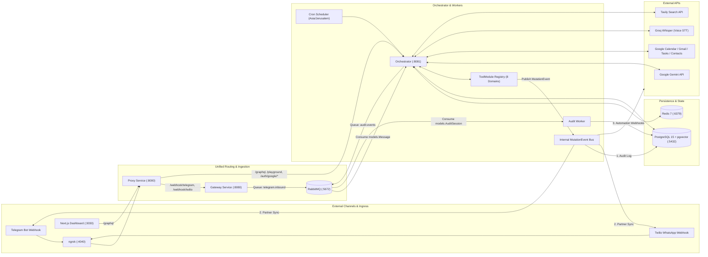

# MyPA — System Architecture, Storage, API & Feature Playbook (`SYSTEM.md`)

> [!IMPORTANT]
> **Living Architecture Reference (Mandatory Maintenance):**  
> This document is the canonical technical blueprint for the **MyPA** codebase, referenced by [`AGENTS.md`](file:///d:/MyPA/AGENTS.md).  
> - **Before implementing any feature, bug fix, schema change, or API:** Read the relevant sections of this document to align with existing conventions, interfaces, and storage schemas.  
> - **Whenever adding or modifying models, database tables, Redis keys, RabbitMQ queues, `ToolModule` tools, GraphQL types/resolvers, or Dashboard routes:** You **MUST** update this `SYSTEM.md` file in the same commit/milestone so it remains 100% accurate.

---

## 1. System Overview & High-Level Architecture

**MyPA** is an event-driven, multi-tenant Personal and Family AI Operating System written in Go (`1.26`) and Next.js (`16` / React `19`), accessible via **Telegram**, **WhatsApp (Twilio)**, and a **Web Control Dashboard**.



### 1.1 Service & Container Topology ([`docker-compose.yml`](file:///d:/MyPA/docker-compose.yml) & [`Dockerfile`](file:///d:/MyPA/Dockerfile))

| Service | Entrypoint | Runtime Base Image | Port(s) | Responsibility |
| :--- | :--- | :--- | :---: | :--- |
| **`proxy`** | [`cmd/proxy/main.go`](file:///d:/MyPA/cmd/proxy/main.go) | `gcr.io/distroless/static-debian12` | `8000` | Unified reverse proxy routing `/webhook/*` to `gateway:8080` and `/graphql`, `/playground`, `/auth/google/*` to `orchestrator:8081`. |
| **`gateway`** | [`cmd/gateway/main.go`](file:///d:/MyPA/cmd/gateway/main.go) | `gcr.io/distroless/static-debian12` | `8080` | High-throughput HTTP webhook receiver for Telegram (`/webhook/telegram`) and Twilio WhatsApp (`/webhook/twilio`); normalizes payloads into [`models.Message`](file:///d:/MyPA/internal/models/models.go#L9-L22) and publishes to RabbitMQ `telegram.inbound`. |
| **`orchestrator`** | [`cmd/orchestrator/main.go`](file:///d:/MyPA/cmd/orchestrator/main.go) | `debian:12-slim` (includes `postgresql-client` for `pg_dump`/`pg_restore`) | `8081` | Core brain: consumes `telegram.inbound`, runs Gemini multi-turn tool calling, hosts the [`ToolModule`](file:///d:/MyPA/internal/orchestrator/registry.go#L30-L43) registry, [`EventBus`](file:///d:/MyPA/internal/events/bus.go), Google OAuth2 callback (`/auth/google/callback`), `gqlgen` GraphQL API (`/graphql`), and Cron [`scheduler`](file:///d:/MyPA/internal/scheduler/scheduler.go). |
| **`audit-worker`** | [`cmd/audit-worker/main.go`](file:///d:/MyPA/cmd/audit-worker/main.go) | `gcr.io/distroless/static-debian12` | — | Consumes `audit.events` from RabbitMQ, persists [`models.AuditSession`](file:///d:/MyPA/internal/models/models.go#L80-L92) rows to PostgreSQL, and runs a 24h ticker archiving sessions older than 30 days. |
| **`dashboard`** | [`dashboard/`](file:///d:/MyPA/dashboard/package.json) | `node:20-alpine` (Next.js standalone) | `3030:3000` | Next.js App Router web console for managing family spaces, memories, baby logs, house assets, finances, automations, pairing codes, and mutation rollbacks. |
| **`postgres`** | `pgvector/pgvector:pg15` | Official Postgres 15 + `pgvector` | `5432` | Primary relational + vector store (29 tables). |
| **`redis`** | `redis:7-alpine` | Official Redis 7 (`--appendonly yes`) | `6379` | Hot rolling conversation state (`chat:<userID>`) and OAuth token cache (`token:<userID>`). |
| **`rabbitmq`** | `rabbitmq:3.13-management-alpine` | Official RabbitMQ 3.13 | `5672`, `15672` | Durable AMQP 0-9-1 broker decoupling webhook ingestion and audit telemetry. |
| **`ngrok`** | `ngrok/ngrok:latest` | Official Ngrok container | `4040` | Tunnels public HTTPS webhook traffic to `proxy:8000`. |
| **`pgadmin`** | `dpage/pgadmin4` | Official pgAdmin 4 | `5050:80` | Web UI for inspecting PostgreSQL tables. |

---

## 2. Repository & Package Structure

```text
d:\MyPA\
├── AGENTS.md                       # Global AI agent development rules & guardrails
├── SYSTEM.md                       # THIS FILE: Canonical architecture, schema, API & feature playbook
├── REVIEW.md                       # Senior Principal Engineer code & security audit report
├── README.md                       # User-facing overview & quickstart guide
├── Dockerfile                      # Unified multi-target Go Dockerfile (gateway, orchestrator, proxy, audit-worker)
├── docker-compose.yml              # Full stack container orchestration
├── gqlgen.yml                      # gqlgen GraphQL code generation config (must be UTF-8 without BOM)
├── config/config.yaml              # Default Viper YAML configuration
├── cmd/
│   ├── gateway/main.go             # Webhook ingestion HTTP service (:8080)
│   ├── orchestrator/main.go        # LLM engine, ToolRegistry, EventBus, OAuth & GraphQL server (:8081)
│   ├── proxy/main.go               # Unified reverse proxy (:8000)
│   └── audit-worker/main.go        # Async RabbitMQ telemetry consumer & 30-day session archiver
├── internal/
│   ├── audio/                      # Groq Whisper API client (`whisper-large-v3`) for voice transcription
│   ├── broker/                     # RabbitMQ AMQP 0-9-1 `Publisher` and `Consumer`
│   ├── calendar/                   # Google Calendar v3 client & OAuth2 config/token helpers
│   ├── config/                     # Viper + godotenv loader & `ALLOWED_USERS` parser
│   ├── contacts/                   # Google People API v1 client (search & create contacts)
│   ├── crypto/                     # AES-256-GCM encryption/decryption at rest (`ENCRYPTION_KEY`)
│   ├── db/                         # GORM PostgreSQL client, dynamic migration registry, backup/restore & domain repos:
│   │   ├── db.go                   # `db.Client` initialization, `vector` extension & core Wave 0 queries
│   │   ├── migrations.go           # `RegisterModel`, `RegisterWave1Models`, `RegisterWave2Models`
│   │   ├── backup.go               # `pg_dump` / `pg_restore` backup & rotation helpers
│   │   ├── durability_repo.go      # `DurabilityRepository` (EncryptedCredential, MutationLog, IdempotencyRecord)
│   │   ├── memory_v2_repo.go       # `MemoryV2Repo` (TopicMemory, EntityProfile)
│   │   ├── shared_repo.go          # `SharedRepository` (SharedSpace, SharedTaskReminder)
│   │   ├── schedule_repo.go        # `ScheduleRepository` (ScheduleEvent, TopicCalendarConfig)
│   │   ├── baby_repo.go            # `BabyRepository` (BabyProfile, BabyCareLog, BabyInventoryItem)
│   │   ├── house_repo.go           # `HouseRepository` (HouseContractRecord, HomeMaintenanceItem, VehicleAsset)
│   │   ├── finance_repo.go         # `FinanceRepository` (FinancialTransaction, CategoryBudget, RecurringBill)
│   │   └── automation_repo.go      # `AutomationRepository` (ExternalAPIConnector, AutomationRule, UserPreference, PersonalCRMContact)
│   ├── domains/                    # Modular `orchestrator.ToolModule` implementations:
│   │   ├── toolutil/               # Shared typed argument extractors & mutation publishing helpers
│   │   ├── workspace_calendar/     # 4 Calendar tools (create, list, update, delete) emitting schedule mutations
│   │   ├── workspace_gmail/        # 9 Gmail tools (search, read, reply, archive, delete, labels, unsubscribe)
│   │   ├── workspace_tasks/        # 6 Google Tasks tools (lists & tasks CRUD) emitting tasks mutations
│   │   ├── workspace_contacts/     # 2 Google Contacts tools (search, create) emitting contacts mutations
│   │   ├── web_research/           # 2 Web research tools (search_web, fetch_webpage with SSRF netguard)
│   │   ├── durability/             # Topic 1: Audit listener, `/undo` (`undo_last_action`), CSV/JSON export
│   │   ├── memory/                 # Topic 2: Topic memories, conflict superseding, living entity profiles & consolidation
│   │   ├── shared/                 # Topic 9: Shared spaces, partner `Notifier` on `EventBus`, shared reminders
│   │   ├── schedule/               # Topic 3: Virtual `[Topic]` sub-calendars & bidirectional partner Google Calendar sync
│   │   ├── baby/                   # Topic 4: Baby profile, Wonder Weeks milestones, medication safety guardrails, inventory
│   │   ├── house/                  # Topic 5 & 8.1: Leases/warranties/contracts, preventive maintenance, vehicle vault
│   │   ├── finance/                # Topic 6: Expense/income ledger, category budgets, >30% anomaly detector, recurring bills
│   │   └── automation/             # Topics 7, 8.2 & 8.3: SSRF-guarded external APIs, `EventBus` rule `Runner`, preferences, CRM
│   ├── events/                     # Thread-safe internal `EventBus` & `MutationEvent` pub/sub
│   ├── gmail/                      # Gmail v1 client (search, read, draft reply, archive, trash, labels, unsubscribe)
│   ├── graph/                      # gqlgen GraphQL layer:
│   │   ├── schema.graphqls         # GraphQL schema definition (types, queries, mutations)
│   │   ├── resolver.go             # Root `Resolver` struct holding `*db.Client`
│   │   ├── schema.resolvers.go     # Resolver implementations & model mappers
│   │   ├── generated.go            # Auto-generated gqlgen runtime (DO NOT EDIT)
│   │   └── model/models_gen.go     # Auto-generated GraphQL Go structs (DO NOT EDIT)
│   ├── llm/                        # Google Gemini (`google.golang.org/genai`) client, embeddings (`gemini-embedding-001`) & base tools
│   ├── markdown/                   # Markdown-to-Telegram HTML (`ToTelegramHTML`) & WhatsApp (`ToWhatsApp`) formatters
│   ├── models/                     # All shared domain DTOs & GORM database models
│   ├── orchestrator/               # Core `Engine`, `ToolModule` & `Registry`, and service port interfaces
│   ├── scheduler/                  # `robfig/cron/v3` background jobs (backups, morning briefings, reminders, dynamic workflows)
│   ├── scraper/                    # `go-readability` + `html-to-markdown` webpage extractor
│   ├── state/                      # Redis `Store` for rolling chat history & OAuth tokens
│   ├── tasks/                      # Google Tasks v1 client (task lists & tasks CRUD)
│   ├── tavily/                     # Tavily web search REST client
│   ├── telegram/                   # Telegram Bot API client & webhook update parser
│   └── twilio/                     # Twilio WhatsApp REST client, webhook handler & message chunker
├── dashboard/                      # Next.js 16 + React 19 + Tailwind CSS v4 Web Control Dashboard
│   └── src/app/                    # App Router pages (`/`, `/audit`, `/automations`, `/baby`, `/finance`, `/house`, `/logs`, `/memory`, `/oauth`, `/sessions`, `/settings`, `/shared`, `/tools`, `/users`)
└── tests/                          # Testcontainers end-to-end integration tests (`e2e_test.go`)
```

---

## 3. Core Architectural Contracts & Conventions

### 3.1 Multi-Turn Agent Execution Lifecycle ([`internal/orchestrator/engine.go`](file:///d:/MyPA/internal/orchestrator/engine.go))

1. **Ingress & Queuing:** Telegram or Twilio sends an HTTP POST to `proxy:8000` -> `gateway:8080`, which parses it into a [`models.Message`](file:///d:/MyPA/internal/models/models.go#L9-L22) (`ID`, `UserID`, `ChatID`, `Text`, `VoiceFileID`, `PhotoFileID`, `MediaURL`, `MediaContentType`, `Source`) and publishes to RabbitMQ queue `telegram.inbound`.
2. **Consumption & Pre-Processing:** `orchestrator` consumes `models.Message` with a 5-minute context timeout ([`engine.go:184`](file:///d:/MyPA/internal/orchestrator/engine.go#L184)).
   - Slash commands (`/help`, `/connect`, `/backup`, `/restore`, `/undo`) are handled directly (`/undo` invokes `durability.Module.RollbackLast` or rolls back a specific mutation ID).
   - Voice messages (`VoiceFileID` or WhatsApp `audio/*`) are downloaded and transcribed via Groq Whisper (`whisper-large-v3`).
   - Images and PDFs (`PhotoFileID` or WhatsApp `image/*`, `application/pdf`) are downloaded into `photoData []byte` for multimodal Gemini input; text attachments (`text/*`, `json`, `csv`, `yaml`) are appended directly to `msg.Text`.
3. **Authorization & Pairing:** `e.db.GetUser(msg.UserID)` checks if the user's `PlatformID` exists in `users`. If not, `msg.Text` is checked against active 6-digit `pairing_codes` (`RedeemPairingCode`).
4. **System Prompt Assembly:**
   - Base persona, user role/family group, current timestamp, timezone, and workspace tool instructions ([`engine.go:515-537`](file:///d:/MyPA/internal/orchestrator/engine.go#L515-L537)).
   - Semantic vector memory retrieval: embeds `msg.Text` via `gemini-embedding-001` (3072 dims) and queries top-5 cosine matches from `TopicMemory` vector embeddings (falling back to legacy `memories`) across the user and their `FamilyGroup`.
   - Dynamic Domain Sections: calls [`e.toolRegistry.CombinedSystemPrompt(ctx, callCtx)`](file:///d:/MyPA/internal/orchestrator/registry.go#L144-L163), concatenating live state from all registered `ToolModule` plugins.
5. **LLM Chat & Multi-Turn Dynamic Dispatch Loop:**
   - Calls `e.llm.Chat(ctx, systemPrompt, history, promptText, photoData, photoMimeType)` (with automatic retry normalizing Hebrew preposition numbers like `ב18` -> `ב-18` via [`NormalizeHebrewPrepositionNumbers`](file:///d:/MyPA/internal/orchestrator/engine.go#L58-L60) if flagged by safety filters).
   - If `resp.ToolCalls` is non-empty, [`handleToolCalls`](file:///d:/MyPA/internal/orchestrator/engine.go#L648-L692) executes each tool via `executeSingleTool`. After checking the SEC-09 interactive confirmation gate for meta-tools, `executeSingleTool` dynamically dispatches the call via `e.toolRegistry.Execute(ctx, callCtx, toolCall.Name, toolCall.Args)`. All tools receive standardized canonical identity through `callCtx.ActorID()` and `callCtx.TenantFamilyGroup()`.
   - Tool execution appends `Role: "assistant"` (`ToolCalls`) and `Role: "function"` (`ToolResponses`), and recurses until Gemini produces a final text summary.
6. **Delivery, State & Telemetry:**
   - Formats markdown for WhatsApp (`markdown.ToWhatsApp`) or single-pass Telegram HTML (`markdown.ToTelegramHTML`), safely chunking messages via `markdown.SafeChunkTelegramHTML` (which preserves balanced HTML open-tag stacks across chunks up to 4,000 characters) and sends via `twClient` or `tgClient`.
   - Appends user and assistant [`models.ChatMessage`](file:///d:/MyPA/internal/models/models.go#L58-L66) turns to Redis (`chat:<userID>`).
   - Asynchronously publishes [`models.AuditSession`](file:///d:/MyPA/internal/models/models.go#L80-L92) to RabbitMQ `audit.events` via `defer`.

### 3.2 `ToolModule` & `Registry` Contract ([`internal/orchestrator/registry.go`](file:///d:/MyPA/internal/orchestrator/registry.go))

Every life domain in `internal/domains/<domain>/` implements the [`orchestrator.ToolModule`](file:///d:/MyPA/internal/orchestrator/registry.go#L30-L43) interface:

```go
type CallContext struct {
    User             *models.User
    Message          models.Message
    DB               DBClient
    LLM              LLMClient
    EventBus         *events.EventBus
    SendNotification NotificationSender
    Extra            map[string]interface{}
}

type ToolModule interface {
    Name() string
    Declarations() []*genai.FunctionDeclaration
    Execute(ctx context.Context, callCtx CallContext, toolName string, args map[string]interface{}) (string, error)
    SystemPromptSection(ctx context.Context, callCtx CallContext) string
}
```

**Registered Domain Modules (13 total wired in [`cmd/orchestrator/main.go`](file:///d:/MyPA/cmd/orchestrator/main.go)):**
- **5 Workspace Base Modules:** `workspace_calendar` (4 tools), `workspace_gmail` (9 tools), `workspace_tasks` (6 tools), `workspace_contacts` (2 tools), `web_research` (2 tools).
- **8 Life Domain Modules:** `durability` (Topic 1 & `/undo`), `memory` (Topic 2 & `remember_fact`), `shared` (Topic 9 & `schedule_reminder`), `schedule` (Topic 3), `baby` (Topic 4), `house` (Topic 5 & 8.1), `finance` (Topic 6), `automation` (Topics 7, 8.2, 8.3 & workflow management).

**Unified Durability Rollback Engine (`internal/domains/durability`):**
All undo paths—the `/undo` chat command, LLM `undo_last_action` tool, and GraphQL `RollbackMutation`—delegate to `durability.Module.Rollback(ctx, actorID, familyGroup, mutationID)` and `RollbackLast(ctx, actorID, familyGroup)`.
- **Entity Allowlist (`allowlist.go`):** Centralized `ResolveRollbackTable` validates 19 allowed domain entity types and rejects system tables (`users`, `pairing_codes`, `encrypted_credentials`, `audit_sessions`, `audit_events`, `schema_migrations`).
- **Snapshot Restoration (`durability_repo.go`):** Executes in an atomic ACID transaction (`RollbackSnapshot`). For `action == "create"`, deletes the inserted record; for `action == "delete"`, recreates the record from `before_json`; for `action == "update"`, restores the exact prior state from `before_json`. Upon commit, marks `is_undone = true`.

### 3.3 Internal `EventBus` & `MutationEvent` Contract ([`internal/events/bus.go`](file:///d:/MyPA/internal/events/bus.go))

Whenever a domain tool creates, updates, completes, or deletes state, it publishes a [`MutationEvent`](file:///d:/MyPA/internal/events/bus.go#L16-L28) to `callCtx.EventBus`:

```go
type MutationEvent struct {
    ID          string    `json:"id"`            // UUID v4 (auto-generated if empty)
    Topic       string    `json:"topic"`         // Lowercase topic: "baby", "house", "finance", "schedule", "memory", "shared", "automation"
    Action      string    `json:"action"`        // e.g. "create", "update", "delete", "complete", "configure", "undo"
    EntityType  string    `json:"entity_type"`   // Exact model struct name (e.g. "BabyCareLog", "FinancialTransaction")
    EntityID    string    `json:"entity_id"`     // Stringified primary key of the mutated record
    ActorUserID string    `json:"actor_user_id"` // PlatformID / UserID of the user who triggered the change
    FamilyGroup string    `json:"family_group"`  // Tenant family group name
    BeforeJSON  string    `json:"before_json"`   // JSON snapshot before mutation (empty on "create")
    AfterJSON   string    `json:"after_json"`    // JSON snapshot after mutation (empty on "delete")
    Summary     string    `json:"summary"`       // Human-readable description of the change
    Timestamp   time.Time `json:"timestamp"`     // UTC timestamp (auto-populated if zero)
}
```

**Active Global `EventBus` Subscribers (wired in [`cmd/orchestrator/main.go`](file:///d:/MyPA/cmd/orchestrator/main.go#L156-L210)):**
1. **[`durability.Module`](file:///d:/MyPA/internal/domains/durability/module.go#L95-L115):** Records every `MutationEvent` (except `Action == "undo"`) into the `mutation_logs` PostgreSQL table to power `/undo` (`undo_last_action`) and Dashboard rollbacks.
2. **[`shared.Notifier`](file:///d:/MyPA/internal/domains/shared/notifier.go#L50-L152):** Checks if `event.Topic` is shared via `shared_spaces` for `event.FamilyGroup` with `NotifyMode == "instant"`, and pushes a real-time notification (`"📢 [Shared • <Topic>] <Summary>"`) to partner users via Telegram/WhatsApp.
3. **[`automation.Runner`](file:///d:/MyPA/internal/domains/automation/runner.go#L593-L667):** Evaluates active `AutomationRule` records matching `event.Topic`, checks `ConditionJSON` (`action`, `keyword`, `min_amount`, `field`/`equals`), and executes the configured webhook or notification action.

### 3.4 Security Architecture & Defense-in-Depth

Milestone 1A hardens the entire system across ingress, internal execution, storage, and egress:

1. **Pre-Auth Gate & Admin RBAC (`internal/orchestrator/engine.go`):**
   - At the very top of `ProcessMessage`, `e.db.GetUser(msg.UserID)` verifies caller identity before downloading media, transcribing voice, or running LLM prompts.
   - Unauthenticated senders are routed strictly to `handleUnauthenticatedUser`, which permits only 6-digit pairing code redemption (`RedeemPairingCode`).
   - Pairing attempts are rate-limited via Redis (`rate_limit:pairing:<userID>`): 5 failed attempts within 15 minutes trigger a 1-hour account lockout (`rate_limit:pairing:lockout:<userID>`).
   - `/backup` and `/restore` commands strictly verify `user.Role == "admin"`, rejecting non-admin attempts with an explicit permission denied alert.

2. **Ingress Webhook Signatures & Proxy Guard (`cmd/gateway`, `internal/twilio`, `cmd/proxy`):**
   - Telegram webhooks require `X-Telegram-Bot-Api-Secret-Token` matching `cfg.Telegram.SecretToken` using constant-time comparison (`subtle.ConstantTimeCompare`).
   - Twilio WhatsApp webhooks verify `X-Twilio-Signature` using HMAC-SHA1 over the full request URL and sorted POST parameters with `cfg.Twilio.AuthToken`.
   - `proxy` restricts public ingress to `/webhook/*`, `/graphql`, and `/auth/google/*`. `/playground` returns HTTP 404 in production, and unauthenticated `/graphql` requests are rejected at the edge with HTTP 401.

3. **GraphQL Authentication Middleware (`internal/graph/auth_middleware.go`):**
   - Inspects `Authorization: Bearer <token>` on all requests to `/graphql`.
   - Supports both constant-time `DASHBOARD_API_SECRET` comparison (granting admin role) and HMAC-SHA256 Bearer JWT claims (`user_id`, `role`, `family_group`, `exp`).
   - Injects authenticated claims into request context (`ForContext` / `GetAuthClaims`).

4. **Multi-Tenant Isolation & Anti-IDOR (`internal/orchestrator/registry.go`, `internal/db/`, domain modules):**
   - `CallContext` exposes canonical identity helpers: `ActorID()` (platform ID) and `TenantFamilyGroup()` (family group falling back to `ActorID()`).
   - All tool argument overrides (`family_group`, `user_id`, `fgOverride`) have been removed from schemas and handlers across `baby`, `house`, `automation`, and `schedule`.
   - Repositories enforce compound scoping: `WHERE ((family_group = ? AND family_group != '') OR user_id = ?)`.
   - **Positive Authorization Pattern (SEC-04 Remediation):**
     Domain tool execution guards (`house`, `automation`, `schedule`, `finance`, `shared`, `durability`) and repository operations strictly apply positive authorization validation:
     `isAuthorized := record != nil && ((familyGroup != "" && record.FamilyGroup == familyGroup) || (record.UserID != "" && record.UserID == userID))`
     For family-level entities without a user ID (`VehicleAsset`, `RecurringBill`):
     `isAuthorized := record != nil && record.FamilyGroup != "" && record.FamilyGroup == familyGroup`
     This eliminates fail-open De Morgan boolean fallacies (`record.FamilyGroup != "" && record.FamilyGroup != familyGroup`) ensuring records with unpopulated or legacy `FamilyGroup` fail closed.
   - Operations mutating by ID (`CompleteMaintenanceItem`, `CompleteSharedReminder`, `manage_recurring_bills`, `DeleteAutomationRule`, `executeUpsertPersonalCRM`, `undo_last_action`) verify tenant authorization prior to mutation and propagate `familyGroup ...string` into repository queries.

    - **GraphQL Resolvers Anti-IDOR & Scoping Enforcement (Milestone 1C):**
      - `ToggleAutomationRule` and `DeleteAutomationRule` enforce tenant boundaries: non-admins are denied with `permission denied: unauthorized access to automation rule` if `rule.FamilyGroup` does not match the caller's family group (or `rule.UserID != actorID` for personal rules).
      - `UserPreference` enforces `targetUserID = actorID` for non-admin callers, preventing user preference disclosure or modification across users.
      - `AuditSessions` and `UserSessions` are positively scoped via `r.resolveTenantAndActor(ctx, familyGroup)` (defaulting to the caller's family group for non-admins, while preserving system-wide access for admins when `familyGroup` is empty or `"*"`), and utilize type-cast JOIN predicates `JOIN users ON (users.id::text = audit_sessions.user_id OR users.platform_id = audit_sessions.user_id)` to prevent PostgreSQL `SQLSTATE 42883` (`uuid = text`) mismatches.
      - `CompleteSharedTask` pre-fetches the target task with `r.sharedRepo().GetSharedReminder` to populate `BeforeJSON` in the emitted `MutationEvent`, ensuring full rollback durability.

5. **Centralized SSRF Protection (`internal/netguard/netguard.go`):**
   - Provides `SafeClient(timeout time.Duration)` with a custom `DialContext` resolving hostnames prior to connection.
   - Blocks IPv4/IPv6 loopback (`127.0.0.0/8`, `::1`), RFC1918 private subnets (`10.0.0.0/8`, `172.16.0.0/12`, `192.168.0.0/16`), cloud metadata (`169.254.169.254`), carrier-grade NAT (`100.64.0.0/10`), link-local multicast, and Docker single-label container names (`!strings.Contains(host, ".") && host != "localhost"`).
   - Validates redirect target URLs via `CheckRedirect`.
   - Wired into `scraper.FetchAndExtractText`, `gmail.UnsubscribeEmail`, `automation.runner`, and `RegisterExternalAPI`.

6. **Twilio Media Security (`internal/twilio/client.go`):**
   - `DownloadMedia` enforces HTTPS scheme, validates hostnames against an allowlist (`api.twilio.com`, `media.twiliocdn.com`), attaches HTTP BasicAuth only when matching trusted Twilio domains, and enforces a 25MB response size limit.

7. **Durability Rollback Allowlisting & Transactions (`internal/graph/schema.resolvers.go`):**
   - `tableNameForEntity` enforces a strict entity allowlist and explicitly rejects system tables (`users`, `pairing_codes`, `encrypted_credentials`, `audit_sessions`, `audit_events`, `schema_migrations`).
   - `RollbackMutation` verifies caller tenant permissions, wraps inversions in an ACID database transaction (`tx := r.DB.DB.Begin()`), checks row mutation counts, rolls back on any error, and sets `is_undone = true` only upon commit.

8. **OAuth Hardening & Cryptographic Key Management (`internal/crypto/aes.go`, `internal/state/store.go`):**
   - `ENCRYPTION_KEY` is validated at startup (`crypto.ValidateKeyConfigured()`); fails fast (panics) if empty in production.
   - Key derivation implements HKDF-SHA256 with 16-byte cryptographically random salt (`[16-byte Salt][12-byte Nonce][Ciphertext + 16-byte Tag]`), maintaining backward compatibility with legacy unsalted ciphertexts.
   - OAuth tokens in Redis (`token:<userID>`) are AES-256-GCM encrypted.
   - `/connect` generates 32-byte cryptographically random hex CSRF nonces stored in Redis (`oauth_state:<nonce> -> userID`) with 10-minute TTL.
   - `/auth/google/callback` atomically validates and deletes the nonce before exchanging the code, then persists an encrypted fallback in PostgreSQL (`encrypted_credentials`) via `durabilityModule.SaveCredentialFallback`.

9. **Prompt Injection Boundaries & Meta-Tool Gates (`internal/orchestrator/security.go`, `engine.go`):**
   - External inputs (`read_email`, `fetch_webpage`, WhatsApp document attachments) are demarcated with semantic XML delimiters: `<untrusted_external_content source="..."> ... </untrusted_external_content>`.
   - Any ingestion of external content sets `TurnSecurityState.HasUntrustedContent = true`.
   - If untrusted content was ingested during the turn, meta-tools (`update_user_preferences`, `create_automation_rule`, `schedule_workflow`, `register_external_api`) are blocked from automatic execution, staged in Redis (`pending_meta_tool:<userID>`), and require explicit conversational confirmation: `CONFIRM <TOOL_NAME>`.

### 3.5 Redis Key Inventory Reference

| Key Pattern | Type | TTL | Purpose |
| :--- | :---: | :---: | :--- |
| `chat:<userID>` | List | None / Rolling | Rolling conversational history (`models.ChatMessage` JSON) |
| `token:<userID>` | String | None | AES-256-GCM encrypted Google OAuth2 token JSON |
| `oauth_state:<nonce>` | String | 10 minutes | CSRF protection nonce mapping to `userID` |
| `pending_meta_tool:<userID>` | String | 5 minutes | Staged privileged tool action pending `CONFIRM` redemption |
| `rate_limit:pairing:<userID>` | String (Int) | 15 minutes | Failed pairing code attempts counter |
| `rate_limit:pairing:lockout:<userID>` | String | 1 hour | Lockout flag set after 5 failed pairing attempts |

---

## 4. PostgreSQL + `pgvector` Database Schema Reference

### 4.1 Migration Registration Mechanism ([`internal/db/migrations.go`](file:///d:/MyPA/internal/db/migrations.go))
- On startup, [`db.NewClient(dsn)`](file:///d:/MyPA/internal/db/db.go#L23-L53) enables `pgvector` (`CREATE EXTENSION IF NOT EXISTS vector`) and runs `db.AutoMigrate(allModels...)` combining core Wave 0 models with all models registered via `db.RegisterModel(...)`, `db.RegisterWave1Models()`, and `db.RegisterWave2Models()`. Models are automatically deduplicated by `reflect.TypeOf`, guaranteeing idempotent execution.
- **Total Database Tables:** **29 tables** across 9 model files in [`internal/models/`](file:///d:/MyPA/internal/models/).

### 4.2 Complete Table & GORM Model Inventory (29 Tables)

#### A. Core / Wave 0 Models ([`internal/models/models.go`](file:///d:/MyPA/internal/models/models.go))

| # | Struct Name | Table Name | Primary Key | Fields, Types & Indexes |
| :---: | :--- | :--- | :--- | :--- |
| 1 | **`User`** (`L111`) | `users` | `ID` (`uuid`, `default:gen_random_uuid()`) | `PlatformID` (`string`, `uniqueIndex`), `Name` (`string`), `Role` (`string`: `"admin"`\|`"family"`), `FamilyGroup` (`string`), `CreatedAt` (`time.Time`) |
| 2 | **`PairingCode`** (`L121`) | `pairing_codes` | `ID` (`uuid`, `default:gen_random_uuid()`) | `Code` (`string`, `uniqueIndex`, 6-digit), `Role` (`string`), `FamilyGroup` (`string`), `ExpiresAt` (`time.Time`), `IsUsed` (`bool`, `default:false`), `CreatedAt` (`time.Time`) |
| 3 | **`Memory`** (`L132`) | `memories` | `ID` (`uint`) | `UserID` (`string`, `index`), `Scope` (`string`, `index`, `default:'personal'`), `Fact` (`string`), `Embedding` (`pgvector.Vector`, `type:vector(3072)`), `CreatedAt` (`time.Time`) |
| 4 | **`ScheduledReminder`** (`L142`) | `scheduled_reminders` | `ID` (`uint`) | `UserID` (`string`, `index`), `Message` (`string`), `DueTime` (`time.Time`, `index`), `IsSent` (`bool`, `index`), `CreatedAt` (`time.Time`) |
| 5 | **`Workflow`** (`L152`) | `workflows` | `ID` (`uint`) | `UserID` (`string`, `index`), `Name` (`string`), `CronExpression` (`string`), `Instruction` (`string`), `IsActive` (`bool`, `index`), `CreatedAt` (`time.Time`) |
| 6 | **`AuditSession`** (`L80`) | `audit_sessions` | `ID` (`uuid`) | `UserID` (`string`, `index`), `ChatID` (`string`), `Source` (`string`), `UserPrompt` (`string`), `FinalResponse` (`string`), `StartTime` (`time.Time`), `EndTime` (`time.Time`), `TotalDurationMs` (`int64`), `TotalTokens` (`int`), `Status` (`string`) |
| 7 | **`AuditEvent`** (`L95`) | `audit_events` | `ID` (`uuid`) | `SessionID` (`string`, `index`), `EventType` (`string`), `ActionName` (`string`), `RequestPayload` (`jsonb`), `ResponsePayload` (`jsonb`), `ErrorMessage` (`string`), `StartTime` (`time.Time`), `EndTime` (`time.Time`), `DurationMs` (`int64`), `PromptTokens` (`int`), `CompletionTokens` (`int`) |

#### B. Topic 1: Durability & Rollback Models ([`internal/models/durability.go`](file:///d:/MyPA/internal/models/durability.go)) — Repo: [`internal/db/durability_repo.go`](file:///d:/MyPA/internal/db/durability_repo.go)

| # | Struct Name | Table Name | Primary Key | Fields, Types & Indexes |
| :---: | :--- | :--- | :--- | :--- |
| 8 | **`EncryptedCredential`** (`L9`) | `encrypted_credentials` | Composite: `(UserID, Provider)` | `UserID` (`string`, `primaryKey`), `Provider` (`string`, `primaryKey`), `Ciphertext` (`[]byte`, `type:bytea`), `UpdatedAt` (`time.Time`) |
| 9 | **`MutationLog`** (`L18`) | `mutation_logs` | `ID` (`string`) | `UserID` (`string`, `index`), `FamilyGroup` (`string`, `index`), `Topic` (`string`, `index`), `Action` (`string`), `EntityType` (`string`, `index`), `EntityID` (`string`, `index`), `BeforeJSON` (`jsonb`), `AfterJSON` (`jsonb`), `Summary` (`string`), `IsUndone` (`bool`, `default:false;index`), `CreatedAt` (`time.Time`, `index`) |
| 10 | **`IdempotencyRecord`** (`L35`) | `idempotency_records` | `Key` (`string`) | `UserID` (`string`, `index`), `ToolName` (`string`), `ResponseSummary` (`string`), `ExpiresAt` (`time.Time`, `index`) |

#### C. Topic 2: Topic-Mapped Memory & Knowledge Graph ([`internal/models/memory_v2.go`](file:///d:/MyPA/internal/models/memory_v2.go)) — Repo: [`internal/db/memory_v2_repo.go`](file:///d:/MyPA/internal/db/memory_v2_repo.go)

| # | Struct Name | Table Name | Primary Key | Fields, Types & Indexes |
| :---: | :--- | :--- | :--- | :--- |
| 11 | **`TopicMemory`** (`L30`) | `topic_memories` | `ID` (`uint`) | `UserID` (`string`, `index`), `FamilyGroup` (`string`, `index`), `Topic` (`string`, `index`), `Subtopic` (`string`, `index`), `TagsJSON` (`jsonb`), `Fact` (`string`), `Scope` (`string`, `index;default:'personal'`), `CreatedByUserID` (`string`), `SupersededByID` (`*uint`, `index`), `ValidFrom` (`time.Time`), `ValidUntil` (`*time.Time`), `IsPinned` (`bool`, `default:false`), `Embedding` (`pgvector.Vector`, `type:vector(3072)`), `CreatedAt` (`time.Time`). *Lifecycle Hooks: `BeforeCreate` & `BeforeSave` auto-populate uninitialized vectors with 3072-dimensional zero vectors (`pgvector.NewVector(make([]float32, 3072))`) to prevent PostgreSQL SQLSTATE 22000.* |
| 12 | **`EntityProfile`** (`L91`) | `entity_profiles` | `ID` (`uint`) | `UserID` (`string`, `index`), `FamilyGroup` (`string`, `index`), `Topic` (`string`, `index`), `EntityType` (`string`, `index`), `EntityName` (`string`, `index`), `AttributesJSON` (`jsonb`), `UpdatedByUserID` (`string`), `UpdatedAt` (`time.Time`) |

#### D. Topic 9: Shared Family Spaces ([`internal/models/shared.go`](file:///d:/MyPA/internal/models/shared.go)) — Repo: [`internal/db/shared_repo.go`](file:///d:/MyPA/internal/db/shared_repo.go)
*Repository & Client API: Provides `UpsertSharedSpace`, `GetSharedSpacesForFamily`, `GetSharedSpace`, `CreateSharedReminder`, `GetSharedReminder(id uint, familyGroup ...string)` (tenant-scoped single reminder query), `CompleteSharedReminder`, `ListSharedReminders`, `GetDueSharedReminders`, `MarkSharedReminderSent`.*

| # | Struct Name | Table Name | Primary Key | Fields, Types & Indexes |
| :---: | :--- | :--- | :--- | :--- |
| 13 | **`SharedSpace`** (`L22`) | `shared_spaces` | `ID` (`uint`) | `FamilyGroup` (`string`, `index;size:100;not null`), `Topic` (`string`, `index;size:100;not null`), `OwnerUserID` (`string`, `size:100`), `SharedWithUserID` (`string`, `size:100`), `CanView` (`bool`, `default:true`), `CanEdit` (`bool`, `default:true`), `NotifyMode` (`string`, `size:20;default:'instant'`: `"instant"`\|`"digest"`\|`"silent"`), `UpdatedAt` (`time.Time`) |
| 14 | **`SharedTaskReminder`** (`L36`) | `shared_task_reminders` | `ID` (`uint`) | `FamilyGroup` (`string`, `index;size:100;not null`), `Topic` (`string`, `index;size:100;not null`), `Title` (`text;not null`), `DueTime` (`*time.Time`, `index`), `CreatedByUserID` (`string`, `size:100;not null`), `AssignedToUserID` (`string`, `size:100`), `IsCompleted` (`bool`, `index;default:false`), `CompletedByUserID` (`string`, `size:100`), `CompletedAt` (`*time.Time`), `IsSent` (`bool`, `index;default:false`), `RemindedAt` (`*time.Time`), `CreatedAt` (`time.Time`) |

#### E. Topic 3: Multi-Schedule Engine ([`internal/models/schedule.go`](file:///d:/MyPA/internal/models/schedule.go)) — Repo: [`internal/db/schedule_repo.go`](file:///d:/MyPA/internal/db/schedule_repo.go)

| # | Struct Name | Table Name | Primary Key | Fields, Types & Indexes |
| :---: | :--- | :--- | :--- | :--- |
| 15 | **`ScheduleEvent`** (`L13`) | `schedule_events` | `ID` (`uint`) | `ExternalGoogleEventID` (`string`, `index`), `PartnerGoogleEventID` (`string`, `index`), `UserID` (`string`, `index`), `FamilyGroup` (`string`, `index`), `Topic` (`string`, `index`), `TagsJSON` (`jsonb`), `Title` (`string`), `Description` (`string`), `StartTime` (`time.Time`, `index`), `EndTime` (`time.Time`, `index`), `RecurrenceRule` (`string`), `SyncToGoogle` (`bool`, `default:true`), `IsShared` (`bool`, `default:false`), `CreatedByUserID` (`string`), `CreatedAt` (`time.Time`) |
| 16 | **`TopicCalendarConfig`** (`L34`) | `topic_calendar_configs` | `ID` (`uint`) | `UserID` (`string`, `uniqueIndex:idx_user_topic`), `Topic` (`string`, `uniqueIndex:idx_user_topic`), `ColorID` (`string`), `PrefixTag` (`string`), `TargetCalendarID` (`string`), `IncludeInMorningBriefing` (`bool`, `default:true`), `SyncToGoogleDefault` (`*bool`), `UpdatedAt` (`time.Time`) |

#### F. Topic 4: Baby & Family Care Tracker ([`internal/models/baby.go`](file:///d:/MyPA/internal/models/baby.go)) — Repo: [`internal/db/baby_repo.go`](file:///d:/MyPA/internal/db/baby_repo.go)

| # | Struct Name | Table Name | Primary Key | Fields, Types & Indexes |
| :---: | :--- | :--- | :--- | :--- |
| 17 | **`BabyProfile`** (`L8`) | `baby_profiles` | `ID` (`uint`) | `FamilyGroup` (`string`, `index`), `Name` (`string`), `DateOfBirth` (`time.Time`), `DueDate` (`*time.Time`), `Gender` (`string`), `BirthWeightGrams` (`int`), `CurrentWeightGrams` (`int`), `HeightCm` (`float64`), `PediatricianInfo` (`string`), `AllergiesNotes` (`string`), `UpdatedByUserID` (`string`), `UpdatedAt` (`time.Time`) |
| 18 | **`BabyCareLog`** (`L27`) | `baby_care_logs` | `ID` (`uint`) | `BabyID` (`uint`, `index`), `FamilyGroup` (`string`, `index`), `LogType` (`string`, `index`: `"feeding"`\|`"sleep"`\|`"diaper"`\|`"temperature"`\|`"medication"`\|`"milestone"`\|`"measurement"`), `ValueNumeric` (`float64`), `Unit` (`string`), `Details` (`string`), `Timestamp` (`time.Time`, `index`), `LoggedByUserID` (`string`) |
| 19 | **`BabyInventoryItem`** (`L40`) | `baby_inventory_items` | `ID` (`uint`) | `FamilyGroup` (`string`, `index`), `ItemName` (`string`), `QuantityRemaining` (`float64`), `Unit` (`string`), `LowThreshold` (`float64`), `UpdatedAt` (`time.Time`) |

#### G. Topic 5 & 8.1: House Maintenance, Contracts & Vehicles ([`internal/models/house.go`](file:///d:/MyPA/internal/models/house.go)) — Repo: [`internal/db/house_repo.go`](file:///d:/MyPA/internal/db/house_repo.go)

| # | Struct Name | Table Name | Primary Key | Fields, Types & Indexes |
| :---: | :--- | :--- | :--- | :--- |
| 20 | **`HouseContractRecord`** (`L31`) | `house_contract_records` | `ID` (`uint`) | `FamilyGroup` (`string`, `index`), `RecordType` (`string`, `index`: `"lease"`\|`"mortgage"`\|`"utility"`\|`"warranty"`\|`"insurance"`\|`"receipt"`), `Title` (`string`), `VendorOrLandlord` (`string`), `ContactDetails` (`string`), `Amount` (`float64`), `Currency` (`string`), `StartDate` (`*time.Time`), `ExpirationOrRenewalDate` (`*time.Time`, `index`), `NoticePeriodDays` (`int`), `KeyTermsJSON` (`jsonb`), `CreatedByUserID` (`string`), `CreatedAt` (`time.Time`) |
| 21 | **`HomeMaintenanceItem`** (`L94`) | `home_maintenance_items` | `ID` (`uint`) | `FamilyGroup` (`string`, `index`), `TaskName` (`string`), `Category` (`string`: `"hvac"`\|`"plumbing"`\|`"appliance"`\|`"pest_control"`\|`"general"`), `IntervalDays` (`int`), `LastCompletedAt` (`*time.Time`), `NextDueAt` (`time.Time`, `index`), `ContractorInfo` (`string`), `Notes` (`string`), `UpdatedByUserID` (`string`) |
| 22 | **`VehicleAsset`** (`L129`) | `vehicle_assets` | `ID` (`uint`) | `FamilyGroup` (`string`, `index`), `Name` (`string`), `LicensePlate` (`string`), `InsuranceExpiry` (`*time.Time`), `AnnualTestExpiry` (`*time.Time`), `LastServiceDate` (`*time.Time`), `CurrentMileageKm` (`int`), `NextServiceMileageKm` (`int`), `Notes` (`string`) |

#### H. Topic 6: Financial Tracking & Budgets ([`internal/models/finance.go`](file:///d:/MyPA/internal/models/finance.go)) — Repo: [`internal/db/finance_repo.go`](file:///d:/MyPA/internal/db/finance_repo.go)

| # | Struct Name | Table Name | Primary Key | Fields, Types & Indexes |
| :---: | :--- | :--- | :--- | :--- |
| 23 | **`FinancialTransaction`** (`L40`) | `financial_transactions` | `ID` (`uint`) | `UserID` (`string`, `index`), `FamilyGroup` (`string`, `index`), `Type` (`string`, `index`: `"expense"`\|`"income"`), `Category` (`string`, `index`), `Merchant` (`string`, `index`), `Amount` (`float64`), `Currency` (`string`), `TransactionDate` (`time.Time`, `index`), `IsShared` (`bool`, `default:true`), `Source` (`string`: `"chat"`\|`"receipt_photo"`\|`"email"`\|`"dashboard"`), `Notes` (`string`), `CreatedAt` (`time.Time`) |
| 24 | **`CategoryBudget`** (`L58`) | `category_budgets` | `ID` (`uint`) | `FamilyGroup` (`string`, `index;uniqueIndex:idx_fam_cat`), `Category` (`string`, `uniqueIndex:idx_fam_cat`), `MonthlyLimit` (`float64`), `Currency` (`string`), `AlertThresholdPct` (`float64`), `CreatedAt` (`time.Time`), `UpdatedAt` (`time.Time`) |
| 25 | **`RecurringBill`** (`L82`) | `recurring_bills` | `ID` (`uint`) | `FamilyGroup` (`string`, `index`), `Name` (`string`), `Category` (`string`), `ExpectedAmount` (`float64`), `Currency` (`string`), `BillingCycle` (`string`: `"monthly"`\|`"yearly"`), `NextDueDay` (`int`: 1..31), `AutoRenew` (`bool`, `default:true`), `CreatedAt` (`time.Time`), `UpdatedAt` (`time.Time`) |

#### I. Topics 7, 8.2 & 8.3: External APIs, Automations, Preferences & CRM ([`internal/models/automation.go`](file:///d:/MyPA/internal/models/automation.go)) — Repo: [`internal/db/automation_repo.go`](file:///d:/MyPA/internal/db/automation_repo.go)

| # | Struct Name | Table Name | Primary Key | Fields, Types & Indexes |
| :---: | :--- | :--- | :--- | :--- |
| 26 | **`ExternalAPIConnector`** (`L9`) | `external_api_connectors` | `ID` (`uint`) | `UserID` (`string`, `index`), `FamilyGroup` (`string`, `index`), `Name` (`string`, `index`), `BaseURL` (`string`), `DefaultMethod` (`string`), `EncryptedAuthHeaders` (`[]byte`, `type:bytea`), `Description` (`string`), `CreatedAt` (`time.Time`) |
| 27 | **`AutomationRule`** (`L23`) | `automation_rules` | `ID` (`uint`) | `UserID` (`string`, `index`), `FamilyGroup` (`string`, `index`), `Name` (`string`), `TriggerType` (`string`: `"event_mutation"`\|`"keyword"`\|`"threshold"`\|`"cron"`), `TriggerTopic` (`string`, `index`), `ConditionJSON` (`jsonb`), `ActionInstruction` (`string`), `IsActive` (`bool`, `default:true;index`), `CreatedAt` (`time.Time`) |
| 28 | **`UserPreference`** (`L38`) | `user_preferences` | `UserID` (`string`) | `PreferredLanguage` (`string`), `TonePersona` (`string`), `DefaultCurrency` (`string`), `QuietHoursStart` (`string`), `QuietHoursEnd` (`string`), `BriefingTopicsJSON` (`jsonb`), `StandingInstructions` (`string`), `UpdatedAt` (`time.Time`) |
| 29 | **`PersonalCRMContact`** (`L52`) | `personal_crm_contacts` | `ID` (`uint`) | `UserID` (`string`, `index`), `FamilyGroup` (`string`, `index`), `PersonName` (`string`, `index`), `Relationship` (`string`), `ImportantDatesJSON` (`jsonb`), `GiftIdeasAndSizes` (`string`), `MedicalNotes` (`string`), `UpdatedAt` (`time.Time`) |

---

## 5. Redis State & RabbitMQ Message Broker Reference

### 5.1 Redis Key Schema ([`internal/state/store.go`](file:///d:/MyPA/internal/state/store.go))

| Key Pattern | Redis Type | Value Schema | Capacity / Retention | TTL | Methods |
| :--- | :---: | :--- | :--- | :---: | :--- |
| `chat:<userID>` | `LIST` | JSON [`models.ChatMessage`](file:///d:/MyPA/internal/models/models.go#L58-L66) (`role`, `content`, `tool_calls`, `tool_responses`, `photo_data`, `photo_mime_type`) | Last **20** messages (`LTRIM -20 -1`) | `1h` (sliding on write) | `AppendChatHistory`, `GetChatHistory` |
| `token:<userID>` | `STRING` | JSON `oauth2.Token` (`access_token`, `token_type`, `refresh_token`, `expiry`) | 1 JSON object per user | `0` (no expiry) | `SetOAuthToken`, `GetOAuthToken` |
| `rate_limit:pairing:<userID>` | `STRING` | Integer counter of failed pairing attempts | 1 integer counter per user | `15m` (rolling from 1st failure) | `RecordFailedPairingAttempt`, `ResetPairingRateLimit` |
| `rate_limit:pairing:lockout:<userID>` | `STRING` | String sentinel (`"locked"`) | Set upon 5 consecutive failed attempts | `1h` | `CheckPairingLockout`, `RecordFailedPairingAttempt`, `ResetPairingRateLimit` |

### 5.2 RabbitMQ Queues & Payloads ([`internal/broker/`](file:///d:/MyPA/internal/broker/publisher.go))

Both queues are declared on the default direct exchange (`""`) with `durable: true`, `autoDelete: false`, `DeliveryMode: amqp.Persistent`, and consumer QoS `prefetchCount: 1`.

| Queue Name | Producer | Consumer | Go Payload Struct | JSON Fields |
| :--- | :--- | :--- | :--- | :--- |
| **`telegram.inbound`** | `cmd/gateway` (`/webhook/telegram` & `/webhook/twilio`) | `cmd/orchestrator` (`Engine.Start`) | [`models.Message`](file:///d:/MyPA/internal/models/models.go#L9-L22) | `id`, `user_id`, `chat_id`, `text`, `voice_file_id`, `photo_file_id`, `audio_file_id`, `media_url`, `media_content_type`, `source` (`"telegram"`\|`"whatsapp"`), `timestamp` |
| **`audit.events`** | `cmd/orchestrator` (`Engine.ProcessMessage` defer) | `cmd/audit-worker` | [`models.AuditSession`](file:///d:/MyPA/internal/models/models.go#L80-L92) | `id`, `user_id`, `chat_id`, `source`, `user_prompt`, `final_response`, `start_time`, `end_time`, `total_duration_ms`, `total_tokens`, `status` |

---

## 6. Complete AI Agent Tool Catalog (All 69 Tools)

### 6.1 Base Workspace & System Tools (28 Tools — [`internal/llm/tools.go`](file:///d:/MyPA/internal/llm/tools.go) & [`internal/orchestrator/engine.go`](file:///d:/MyPA/internal/orchestrator/engine.go#L707-L1203))

| Tool Name | Category | Required & Optional Parameters (`*` = required) | Description |
| :--- | :--- | :--- | :--- |
| `create_calendar_event` | Google Calendar | `title`*, `start_time`* (RFC3339), `end_time`* (RFC3339), `timezone`*, `description`, `recurrence` (`[]string`) | Creates an event on the user's primary Google Calendar. |
| `list_calendar_events` | Google Calendar | `time_min` (RFC3339), `time_max` (RFC3339), `query` | Lists/searches events from primary Google Calendar. |
| `update_calendar_event` | Google Calendar | `id`*, `title`, `start_time`, `end_time`, `description`, `timezone`, `recurrence` | Updates an existing Google Calendar event. |
| `delete_calendar_event` | Google Calendar | `id`* | Deletes an event from primary Google Calendar. |
| `remember_fact` | Memory v1 | `fact`*, `scope` (`"personal"`\|`"family"`) | Embeds and stores a fact in `memories` (`vector(3072)`). |
| `search_emails` | Gmail | `query`*, `max_results` (default 5) | Searches user's Gmail via Gmail query syntax. |
| `read_email` | Gmail | `message_id`* | Reads the full body of a Gmail message. |
| `draft_email_reply` | Gmail | `message_id`*, `reply_text`* | Creates a reply draft in Gmail. |
| `archive_emails` | Gmail | `message_ids`* (`[]string`) | Removes `INBOX` label from messages. |
| `soft_delete_emails` | Gmail | `message_ids`* (`[]string`) | Moves Gmail messages to Trash. |
| `list_email_labels` | Gmail | *(none)* | Lists all Gmail label names and IDs. |
| `apply_email_labels` | Gmail | `message_ids`* (`[]string`), `label_id`* | Applies a label to a batch of Gmail messages. |
| `create_email_label` | Gmail | `label_name`* | Creates a new Gmail label. |
| `unsubscribe_email` | Gmail | `message_id`* | Extracts `List-Unsubscribe` link and triggers unsubscribe. |
| `list_task_lists` | Google Tasks | *(none)* | Lists all Google Tasks lists. |
| `create_task_list` | Google Tasks | `title`* | Creates a new Google Tasks list. |
| `list_tasks` | Google Tasks | `list_id` (default `@default`) | Lists pending tasks in a task list. |
| `create_task` | Google Tasks | `title`*, `list_id`, `notes`, `due` (RFC3339) | Creates a new task in Google Tasks. |
| `complete_task` | Google Tasks | `task_id`*, `list_id` | Marks a Google Task as completed. |
| `delete_task` | Google Tasks | `task_id`*, `list_id` | Deletes a task from Google Tasks. |
| `search_web` | Web Search | `query`* | Searches the live web via Tavily API (declared in `CalendarEventTool`, handled in `engine.go:1032`). |
| `fetch_webpage` | Web Scraper | `url`* | Extracts readable markdown from a URL and summarizes/processes it. |
| `search_contacts` | Google Contacts | `query`* | Searches Google People API contacts. |
| `create_contact` | Google Contacts | `name`*, `email`, `phone` | Creates a contact in Google Contacts. |
| `schedule_reminder` | Reminders v1 | `message`*, `due_time`* (RFC3339) | Saves a one-time reminder in `scheduled_reminders` (polled every minute). |
| `schedule_workflow` | Workflows v1 | `name`*, `cron_expression`*, `instruction`* | Saves a recurring natural-language cron workflow in `workflows`. |
| `list_workflows` | Workflows v1 | *(none)* | Lists active recurring workflows for the user. |
| `delete_workflow` | Workflows v1 | `id`* | Deletes a workflow by ID and reloads cron scheduler. |

### 6.2 Modular Domain Tools (42 Tools Across 8 `ToolModule` Packages)

| Module (`Name()`) | Package Path | `SystemPromptSection` Injects | Registered Tools (`*` = required param) | Emits `MutationEvent`? |
| :--- | :--- | :--- | :--- | :---: |
| **`durability`** | [`internal/domains/durability`](file:///d:/MyPA/internal/domains/durability/module.go) | Undo (`undo_last_action`), change history, and JSON/CSV export instructions. | • `undo_last_action` (`reason`, `mutation_id`)<br>• `list_recent_changes` (`topic`, `limit`)<br>• `export_topic_data` (`topic`*, `format`, `limit`) | `undo_last_action`: Yes (`action: "undo"`) |
| **`memory`** | [`internal/domains/memory`](file:///d:/MyPA/internal/domains/memory/module.go) | Active `EntityProfile` cards + pinned `TopicMemory` facts for the user/family. | • `save_topic_memory` (`topic`*, `fact`*, `subtopic`, `tags`, `scope`, `is_pinned`, `supersedes_memory_id`)<br>• `search_topic_memories` (`topic`, `query`, `tags`, `scope`)<br>• `upsert_entity_profile` (`topic`*, `entity_type`*, `entity_name`*, `attributes`*)<br>• `get_entity_profile` (`topic`*, `entity_name`*) | `save_topic_memory`: Yes<br>`upsert_entity_profile`: Yes |
| **`shared`** | [`internal/domains/shared`](file:///d:/MyPA/internal/domains/shared/module.go) | Configured `SharedSpace` topics, permissions, and notify modes for the family. | • `configure_shared_topic` (`topic`*, `can_view`, `can_edit`, `notify_mode`, `shared_with_user_id`)<br>• `create_shared_reminder` (`title`*, `topic`, `due_time`, `assigned_to_user_id`)<br>• `complete_shared_reminder` (`id`*)<br>• `list_shared_activity` (`topic`, `include_completed`) | `configure_shared_topic`: Yes<br>`create_shared_reminder`: Yes<br>`complete_shared_reminder`: Yes |
| **`schedule`** | [`internal/domains/schedule`](file:///d:/MyPA/internal/domains/schedule/module.go) | Configured `TopicCalendarConfig` prefixes/colors + upcoming 7-day `ScheduleEvent` items. | • `schedule_topic_event` (`title`*, `topic`*, `start_time`*, `end_time`, `description`, `tags`, `sync_to_google`, `is_shared`, `recurrence`)<br>• `list_topic_schedule` (`topic`, `tags`, `start_time`, `end_time`, `include_google`)<br>• `configure_topic_calendar` (`topic`*, `prefix_tag`, `color_id`, `target_calendar_id`, `sync_to_google_default`, `include_in_morning_briefing`)<br>• `delete_topic_event` (`event_id`*)<br>• `update_topic_event` (`event_id`*, `title`, `start_time`, `end_time`, `description`, `tags`) | All except `list_topic_schedule`: Yes |
| **`baby`** | [`internal/domains/baby`](file:///d:/MyPA/internal/domains/baby/module.go) | Exact baby age (days/weeks/months + adjusted age), current developmental leap, medication cooldown status, and low inventory alerts. | • `upsert_baby_profile` (`name`*, `date_of_birth`*, `id`, `due_date`, `gender`, `birth_weight_grams`, `current_weight_grams`, `height_cm`, `pediatrician_info`, `allergies_notes`)<br>• `log_baby_care` (`log_type`*, `baby_id`, `baby_name`, `value_numeric`, `unit`, `details`, `timestamp`, `force`)<br>• `query_baby_logs_and_trends` (`baby_id`, `baby_name`, `log_type`, `time_range`, `start_time`, `end_time`, `limit`)<br>• `get_baby_milestone_suggestions` (`baby_id`, `baby_name`, `category`)<br>• `manage_baby_inventory` (`action`*, `item_name`, `quantity`, `delta`, `unit`, `low_threshold`) | `upsert_baby_profile`: Yes<br>`log_baby_care`: Yes<br>`manage_baby_inventory` (`set`/`adjust`): Yes |
| **`house`** | [`internal/domains/house`](file:///d:/MyPA/internal/domains/house/module.go) | Expiring contracts/warranties within notice window, overdue/upcoming maintenance tasks, and vehicle test/insurance/service alerts. | • `save_house_contract_or_receipt` (`record_type`*, `title`*, `contract_id`, `vendor_or_landlord`, `contact_details`, `amount`, `currency`, `start_date`, `expiration_date`, `notice_period_days`, `key_terms`)<br>• `list_house_contracts` (`record_type`, `expiring_within_days`, `search_query`)<br>• `manage_home_maintenance` (`action`*, `item_id`, `task_name`, `category`, `interval_days`, `next_due_at`, `contractor_info`, `notes`, `overdue_only`)<br>• `manage_vehicle_asset` (`action`*, `asset_id`, `name`, `license_plate`, `insurance_expiry`, `annual_test_expiry`, `last_service_date`, `current_mileage_km`, `next_service_mileage_km`, `notes`) | All mutating actions: Yes |
| **`finance`** | [`internal/domains/finance`](file:///d:/MyPA/internal/domains/finance/module.go) | Current month spending vs. `CategoryBudget` thresholds and upcoming `RecurringBill` due dates (next 7 days). | • `log_financial_transaction` (`amount`*, `category`*, `merchant`, `type`, `currency`, `transaction_date`, `notes`, `source`, `is_shared`)<br>• `get_financial_summary` (`start_date`, `end_date`, `category`)<br>• `set_category_budget` (`category`*, `monthly_limit`*, `currency`, `alert_threshold_pct`)<br>• `manage_recurring_bills` (`action`*, `bill_id`, `name`, `category`, `expected_amount`, `currency`, `billing_cycle`, `next_due_day`, `auto_renew`) | All mutating actions: Yes |
| **`automation`** | [`internal/domains/automation`](file:///d:/MyPA/internal/domains/automation/module.go) | User's `PreferredLanguage`, `TonePersona`, `DefaultCurrency`, `QuietHours`, `StandingInstructions`, and upcoming 30-day CRM birthdays/anniversaries. | • `register_external_api` (`name`*, `base_url`*, `default_method`, `auth_headers`, `description`)<br>• `list_external_apis` (`family_group`)<br>• `call_external_api` (`connector_name`, `connector_id`, `url`, `path`, `method`, `query_params`, `body`)<br>• `create_automation_rule` (`name`*, `trigger_type`*, `trigger_topic`*, `action_instruction`*, `condition_json`, `is_active`)<br>• `list_automation_rules` (`trigger_topic`)<br>• `delete_automation_rule` (`rule_id`*)<br>• `update_user_preferences` (`preferred_language`, `tone_persona`, `default_currency`, `quiet_hours_start`, `quiet_hours_end`, `briefing_topics`, `standing_instructions`)<br>• `get_user_preferences` ()<br>• `upsert_personal_crm` (`person_name`*, `id`, `relationship`, `important_dates`, `gift_ideas_and_sizes`, `medical_notes`)<br>• `query_personal_crm` (`query`, `relationship`) | `register_external_api`, `create_automation_rule`, `delete_automation_rule`, `update_user_preferences`, `upsert_personal_crm`: Yes |

---

## 7. GraphQL API & Next.js Dashboard Reference

### 7.1 GraphQL Schema ([`internal/graph/schema.graphqls`](file:///d:/MyPA/internal/graph/schema.graphqls)) & Resolvers ([`internal/graph/schema.resolvers.go`](file:///d:/MyPA/internal/graph/schema.resolvers.go))

- **Endpoint:** `POST /graphql` (proxied via `http://proxy:8000/graphql` to `http://orchestrator:8081/graphql`).
- **Code Generation:** Configured via [`gqlgen.yml`](file:///d:/MyPA/gqlgen.yml). Run `go run github.com/99designs/gqlgen generate` after editing `internal/graph/schema.graphqls` (always save files with UTF-8 encoding without BOM).
- **Resolver Decoupling & Positive Authorization (Milestone 1C):** `graph.Resolver` receives explicit domain repository interfaces (`BabyRepo`, `FinanceRepo`, `HouseRepo`, `ScheduleRepo`, `SharedRepo`, `MemoryRepo`, `AutomationRepo`, `UserRepo`), `durability.RollbackEngine`, and `events.EventBus`. Direct `r.DB.DB` calls are eliminated across domain resolvers.
  - **Safe ID Parsing:** All string entity IDs are strictly validated via [`toolutil.ParseID`](file:///d:/MyPA/internal/domains/toolutil/toolutil.go), rejecting empty, non-numeric, or `<= 0` values.
  - **Positive Multi-Tenant Authorization:** Enforced via `resolveTenantAndActor`. Admin roles can target any `familyGroup`; non-admin callers are strictly bounded to their authenticated JWT/Context `familyGroup`.
  - **MutationEvent Emission:** Every state-changing GraphQL mutation captures `BeforeJSON` and `AfterJSON` snapshots and publishes an [`events.MutationEvent`](file:///d:/MyPA/internal/events/bus.go) to `r.EventBus`, triggering audit logging, partner sync notifications, and automation rules across the system.

| Domain | GraphQL Object Types | Queries (`type Query`) | Mutations (`type Mutation`) |
| :--- | :--- | :--- | :--- |
| **Core / Auth** | `User`, `PairingCode` | `users`, `activePairingCodes` | `generatePairingCode` |
| **System / Audit** | `AuditSession`, `UserSessionSummary` | `auditSessions`, `userSessions` | — |
| **Topic 1: Durability** | `MutationLog` | `mutationLogs` | `rollbackMutation` |
| **Topic 2: Memory** | `TopicMemory`, `EntityProfile` | `topicMemories`, `entityProfiles` | `saveTopicMemory`, `deleteTopicMemory`, `pinTopicMemory`, `upsertEntityProfile` |
| **Topic 3: Schedule** | `ScheduleEvent`, `TopicCalendarConfig` | `scheduleEvents`, `topicCalendarConfigs` | `createScheduleEvent`, `deleteScheduleEvent`, `saveTopicCalendarConfig` |
| **Topic 4: Baby** | `BabyProfile`, `BabyCareLog`, `BabyInventoryItem` | `babyProfiles`, `babyCareLogs`, `babyInventory` | `upsertBabyProfile`, `logBabyCare`, `updateBabyInventory` |
| **Topic 5: House & Vehicles** | `HouseContractRecord`, `HomeMaintenanceItem`, `VehicleAsset` | `houseContracts`, `homeMaintenanceItems`, `vehicleAssets` | `saveHouseContract`, `saveHomeMaintenanceItem`, `completeHomeMaintenance`, `saveVehicleAsset` |
| **Topic 6: Finance** | `FinancialTransaction`, `CategoryBudget`, `RecurringBill` | `financialTransactions`, `categoryBudgets`, `recurringBills` | `logFinancialTransaction`, `setCategoryBudget`, `saveRecurringBill` |
| **Topics 7 & 8: Automation & CRM** | `ExternalAPIConnector`, `AutomationRule`, `UserPreference`, `PersonalCRMContact` | `externalApiConnectors`, `automationRules`, `userPreference`, `personalCrmContacts` | `registerExternalApi`, `saveAutomationRule`, `toggleAutomationRule`, `deleteAutomationRule`, `saveUserPreference`, `savePersonalCrmContact` |
| **Topic 9: Shared** | `SharedSpace`, `SharedTaskReminder` | `sharedSpaces`, `sharedTasks` | `updateSharedSpace`, `createSharedTask`, `completeSharedTask` |

### 7.2 Next.js Dashboard Architecture & Routes ([`dashboard/`](file:///d:/MyPA/dashboard/))

- **Decoupled Frontend Tier (Milestone 1C):** Direct `pg.Pool` usage, raw SQL queries, and local database connection strings are 100% eliminated from Next.js. `pg` and `@types/pg` packages are removed from `dashboard/package.json`.
- **Centralized Typed Client ([`dashboard/src/lib/graphql.ts`](file:///d:/MyPA/dashboard/src/lib/graphql.ts)):** Implements `graphqlFetch<TData, TVariables>` with automatic `Authorization: Bearer <DASHBOARD_API_SECRET>` header injection, endpoint discovery via `GRAPHQL_ENDPOINT` / `NEXT_PUBLIC_PROXY_URL`, and complete TypeScript type declarations for all domain entities.

| Route | Source File | Primary GraphQL Operations Used |
| :--- | :--- | :--- |
| `/` | [`src/app/page.tsx`](file:///d:/MyPA/dashboard/src/app/page.tsx) | System overview KPIs & navigation cards |
| `/audit` | [`src/app/audit/page.tsx`](file:///d:/MyPA/dashboard/src/app/audit/page.tsx) | `mutationLogs`, `rollbackMutation` |
| `/automations` | [`src/app/automations/page.tsx`](file:///d:/MyPA/dashboard/src/app/automations/page.tsx) | `externalApiConnectors`, `automationRules`, `userPreference`, `personalCrmContacts`, `registerExternalApi`, `toggleAutomationRule`, `deleteAutomationRule`, `saveUserPreference` |
| `/baby` | [`src/app/baby/page.tsx`](file:///d:/MyPA/dashboard/src/app/baby/page.tsx) | `babyProfiles`, `babyCareLogs`, `babyInventory`, `logBabyCare`, `updateBabyInventory` |
| `/finance` | [`src/app/finance/page.tsx`](file:///d:/MyPA/dashboard/src/app/finance/page.tsx) | `financialTransactions`, `categoryBudgets`, `recurringBills`, `logFinancialTransaction`, `setCategoryBudget` |
| `/house` | [`src/app/house/page.tsx`](file:///d:/MyPA/dashboard/src/app/house/page.tsx) | `houseContracts`, `homeMaintenanceItems`, `vehicleAssets`, `completeHomeMaintenance`, `saveHouseContract` |
| `/logs` | [`src/app/logs/page.tsx`](file:///d:/MyPA/dashboard/src/app/logs/page.tsx) | `auditSessions` |
| `/memory` | [`src/app/memory/page.tsx`](file:///d:/MyPA/dashboard/src/app/memory/page.tsx) | `topicMemories`, `entityProfiles`, `pinTopicMemory`, `deleteTopicMemory` |
| `/sessions` | [`src/app/sessions/page.tsx`](file:///d:/MyPA/dashboard/src/app/sessions/page.tsx) | `userSessions` |
| `/shared` | [`src/app/shared/page.tsx`](file:///d:/MyPA/dashboard/src/app/shared/page.tsx) | `sharedSpaces`, `sharedTasks`, `updateSharedSpace`, `completeSharedTask`, `createSharedTask` |
| `/users` | [`src/app/users/page.tsx`](file:///d:/MyPA/dashboard/src/app/users/page.tsx) | `users`, `activePairingCodes`, `generatePairingCode` |
| `/oauth`, `/tools`, `/settings` | `src/app/{oauth,tools,settings}/page.tsx` | System inspection & configuration consoles |

---

## 8. Configuration, Environment Variables & Cron Schedules

### 8.1 Environment Variables ([`internal/config/config.go`](file:///d:/MyPA/internal/config/config.go) & [`internal/crypto/aes.go`](file:///d:/MyPA/internal/crypto/aes.go))

| Environment Variable | Viper Config Key | Default | Used By | Description |
| :--- | :--- | :--- | :--- | :--- |
| `ALLOWED_USERS` | `server.allowed_users` | `""` | `orchestrator` | Comma-separated bootstrap users: `"platform_id:Name:Role:FamilyGroup"` |
| `DEFAULT_TIMEZONE` | `server.default_timezone` | `"UTC"` | `orchestrator` | Default IANA timezone injected into system prompt |
| `GATEWAY_URL` | `server.gateway_url` | `http://gateway:8080` | `proxy` | Internal upstream URL for webhook proxy |
| `ORCHESTRATOR_URL` | `server.orchestrator_url` | `http://orchestrator:8081` | `proxy` | Internal upstream URL for GraphQL/OAuth proxy |
| `DATABASE_URL` | `database.url` | — | `orchestrator`, `audit-worker` | PostgreSQL connection string (`postgres://...`) |
| `REDIS_URL` | `redis.url` | — | `orchestrator` | Redis connection string (`redis://redis:6379/0`) |
| `RABBITMQ_URL` | `rabbitmq.url` | — | `gateway`, `orchestrator`, `audit-worker` | AMQP 0-9-1 URL (`amqp://...`) |
| `ENCRYPTION_KEY` | `encryption.key` | Required in prod | `orchestrator` (`internal/crypto`) | Primary 32-byte secret for HKDF-SHA256 salted AES-256-GCM encryption at rest; fails fast on boot in production if missing |
| `TELEGRAM_SECRET_TOKEN` | `telegram.secret_token` | `""` | `gateway` | Shared webhook secret token verified via `X-Telegram-Bot-Api-Secret-Token` header using constant-time compare |
| `DASHBOARD_API_SECRET` | `server.dashboard_api_secret` | `""` | `orchestrator`, `proxy`, `dashboard` | Secret token used by web dashboard / proxy to authenticate to `/graphql` |
| `GRAPHQL_ENDPOINT` | *(dashboard env)* | `http://proxy:8000/graphql` | `dashboard` | Upstream GraphQL URL used by Next.js server actions and SSR data fetching |
| `JWT_SECRET` | `server.jwt_secret` | `ENCRYPTION_KEY` | `orchestrator`, `proxy` | Secret key used for signing and verifying HMAC-SHA256 Bearer JWT claims on `/graphql` |
| `GEMINI_API_KEY` | `gemini.api_key` | — | `orchestrator` | Google AI Studio API key |
| `GEMINI_MODEL` | `gemini.model` | `"gemini-2.5-flash"` | `orchestrator` | Primary Gemini chat/tool-calling model |
| `TELEGRAM_BOT_TOKEN` | `telegram.bot_token` | — | `orchestrator` | Telegram Bot token |
| `TWILIO_ACCOUNT_SID` | `twilio.account_sid` | — | `orchestrator` | Twilio Account SID for WhatsApp |
| `TWILIO_AUTH_TOKEN` | `twilio.auth_token` | — | `orchestrator` | Twilio Auth Token for WhatsApp |
| `TWILIO_FROM_NUMBER` | `twilio.from_number` | — | `orchestrator` | Twilio WhatsApp sender (`whatsapp:+14155238886`) |
| `GOOGLE_CLIENT_ID` | `google.client_id` | — | `orchestrator` | Google OAuth2 Client ID |
| `GOOGLE_CLIENT_SECRET` | `google.client_secret` | — | `orchestrator` | Google OAuth2 Client Secret |
| `GOOGLE_REDIRECT_URL` | `google.redirect_url` | — | `orchestrator` | OAuth2 callback URL (`.../auth/google/callback`) |
| `GROQ_API_KEY` | `groq.api_key` | — | `orchestrator` | Groq API key for `whisper-large-v3` audio transcription |
| `TAVILY_API_KEY` | `tavily.api_key` | — | `orchestrator` | Tavily API key for real-time web search |
| `AUDIT_ARCHIVE_DIR` | *(direct `os.Getenv`)* | `"/app/archives"` | `audit-worker` | Target directory for writing 30-day session archive JSONL files (mounted to `audit_archives` volume) |
| `NGROK_AUTHTOKEN` | *(Docker Compose)* | — | `ngrok` | Ngrok authentication token |
| `NGROK_DOMAIN` | *(Docker Compose)* | — | `ngrok` | Static Ngrok domain tunneling to `proxy:8000` |

### 8.2 Built-In Cron Schedules ([`internal/scheduler/scheduler.go`](file:///d:/MyPA/internal/scheduler/scheduler.go))

All cron schedules run in the `Asia/Jerusalem` timezone (`scheduler.go:20`):
- **`0 2 * * *` (02:00 AM daily):** Runs [`db.BackupDatabase`](file:///d:/MyPA/internal/db/backup.go#L15-L43) to `/backups` (retaining last 3 backups).
- **`0 8 * * *` (08:00 AM daily):** Calls `engine.BroadcastProactiveMessage` to send personalized Morning Briefings to all active users.
- **`* * * * *` (Every 1 minute):** Calls `engine.CheckAndSendReminders()` to deliver due personal reminders from `scheduled_reminders` and due collaborative reminders from `shared_task_reminders` (updating `is_sent = true` and `reminded_at`).
- **`*/5 * * * *` (Every 5 minutes) + On-Change Hook:** Calls `ReloadWorkflows(engine, dbClient, runner)` (thread-safe via `workflowMu sync.Mutex`) to rebuild the active cron runner for both legacy workflows (`workflows` table) and active cron automation rules (`automation_rules` table WHERE `trigger_type = 'cron' AND is_active = true`, parsing cron expressions via `automation.ExtractCronSchedule` and executing actions via `automation.Runner.ExecuteAction`).

---

## 9. Step-by-Step Playbook: Adding a New Feature or Life Domain

Follow this exact 8-step checklist whenever adding a new domain module or extending an existing domain so that **AI tools, persistence, undo/rollback, partner notifications, automations, GraphQL, Dashboard UI, and documentation** stay completely synchronized:

### Step 1: Define GORM Models & Register Migrations
1. Create or update the model file in [`internal/models/<domain>.go`](file:///d:/MyPA/internal/models/).
   - Include `FamilyGroup string` (`gorm:"index"`) and `UserID string` (`gorm:"index"`) on all multi-tenant entities.
   - Add JSON tags (`snake_case`) matching your GraphQL and snapshot conventions.
2. Register the new model struct(s) in [`internal/db/migrations.go`](file:///d:/MyPA/internal/db/migrations.go) (inside `Wave2Models()` or `RegisterModel()`).

### Step 2: Implement the GORM Repository
1. Create [`internal/db/<domain>_repo.go`](file:///d:/MyPA/internal/db/) defining a `<Domain>Repository` interface and implementing its CRUD/query methods.
2. **Security Rule:** Every read, update, and delete method **MUST** scope queries by `family_group` (and/or `user_id`) and reject empty tenant identifiers to prevent cross-tenant IDOR.

### Step 3: Implement `orchestrator.ToolModule` & Emit `MutationEvent`s
1. Create [`internal/domains/<domain>/module.go`](file:///d:/MyPA/internal/domains/) implementing `orchestrator.ToolModule`:
   - `Name() string`: Unique lowercase topic identifier (e.g., `"health"`, `"travel"`).
   - `Declarations() []*genai.FunctionDeclaration`: Clear tool names (`snake_case`), descriptions, and typed parameter schemas.
   - `Execute(ctx, callCtx, toolName, args) (string, error)`:
     - Resolve tenant identity exclusively from `callCtx.User` (never allow tool `args` to override `family_group` or `user_id`).
     - For every create/update/delete operation, capture `BeforeJSON` (for updates/deletes) and `AfterJSON` (for creates/updates) and publish an [`events.MutationEvent`](file:///d:/MyPA/internal/events/bus.go#L16-L28) to `callCtx.EventBus`. This automatically gives your feature **Audit Logging, `/undo` Rollback, Partner Notifications, and `When -> If -> Then` Automation triggers**!
   - `SystemPromptSection(ctx, callCtx) string`: Return a concise summary of active/urgent domain state for the user's family group (or `""` if none).

### Step 4: Wire Module & Rollback Mapping in `cmd/orchestrator` & `internal/graph`
1. In [`cmd/orchestrator/main.go`](file:///d:/MyPA/cmd/orchestrator/main.go#L159-L221), instantiate `<domain>.NewModule(dbClient, <domain>.WithEventBus(eventBus))` and register it with `registry.Register(<domain>Module)`.
2. Register the new `EntityType -> table_name` mapping in [`tableNameForEntity`](file:///d:/MyPA/internal/graph/schema.resolvers.go#L27-L71) and any custom `UndoHandler` on `durabilityModule` if external API side effects need reversal.

### Step 5: Expose via GraphQL (`internal/graph/`)
1. Add the new Object types, `Query` fields, and `Mutation` fields to [`internal/graph/schema.graphqls`](file:///d:/MyPA/internal/graph/schema.graphqls) (always include `familyGroup: String!` on tenant-scoped queries and mutations).
2. Run `go run github.com/99designs/gqlgen generate` (ensure `gqlgen.yml` and `.graphqls` files are saved as **UTF-8 without BOM** per `AGENTS.md` Rule 7).
3. Implement the resolver methods in [`internal/graph/schema.resolvers.go`](file:///d:/MyPA/internal/graph/schema.resolvers.go), delegating to the domain repository/module and publishing `MutationEvent`s on mutations.

### Step 6: Add or Update the Next.js Dashboard Console
1. Add or update the route in `dashboard/src/app/<domain>/page.tsx` and link it in the sidebar in [`dashboard/src/app/layout.tsx`](file:///d:/MyPA/dashboard/src/app/layout.tsx).
2. Communicate exclusively through the Proxy GraphQL endpoint (`http://proxy:8000/graphql`) per `AGENTS.md` Rule 7—do not create new direct `pg.Pool` connections in the frontend.

### Step 7: Write Unit & Integration Tests and Verify Container Build
1. Add unit tests in `internal/domains/<domain>/module_test.go` covering tool declarations, execution, validation errors, `MutationEvent` emission, and `SystemPromptSection`.
2. Run `go test -v ./internal/...` and `docker-compose build` (`AGENTS.md` Rule 1) to verify all container stages compile cleanly.

### Step 8: Update `SYSTEM.md` & `README.md` (Mandatory)
1. Update **Section 4** (Database Tables), **Section 6** (Tool Catalog), and **Section 7** (GraphQL & Dashboard Routes) in this [`SYSTEM.md`](file:///d:/MyPA/SYSTEM.md) file.
2. Update [`README.md`](file:///d:/MyPA/README.md) if user-facing capabilities or setup steps changed.
