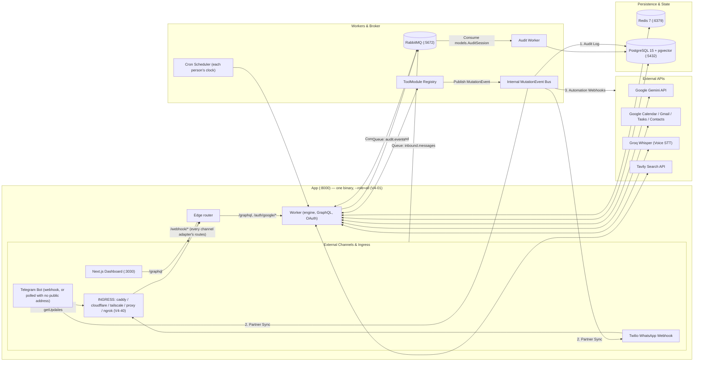

# MyPA — System Architecture, Storage, API & Feature Playbook (`SYSTEM.md`)

> [!IMPORTANT]
> **Living Architecture Reference (Mandatory Maintenance):**  
> This document is the canonical technical blueprint for the **MyPA** codebase, referenced by [`AGENTS.md`](./AGENTS.md).  
> - **Before implementing any feature, bug fix, schema change, or API:** Read the relevant sections of this document to align with existing conventions, interfaces, and storage schemas.  
> - **Whenever adding or modifying models, database tables, Redis keys, RabbitMQ queues, `ToolModule` tools, GraphQL types/resolvers, or Dashboard routes:** You **MUST** update this `SYSTEM.md` file in the same commit/milestone so it remains 100% accurate.

---

## 1. System Overview & High-Level Architecture

**MyPA** is an event-driven, multi-tenant Personal and Family AI Operating System written in Go (`1.26`) and Next.js (`16` / React `19`), accessible via **Telegram**, **WhatsApp (Twilio)**, and a **Web Control Dashboard**.



### 1.1 Service & Container Topology ([`docker-compose.yml`](./docker-compose.yml) & [`Dockerfile`](./Dockerfile))

| Service | Entrypoint | Runtime Base Image | Port(s) | Responsibility |
| :--- | :--- | :--- | :---: | :--- |
| **`app`** | [`cmd/mypa/main.go`](./cmd/mypa/main.go) (`mypa`, default `--role=all`) | `debian:12.15-slim` (includes `postgresql-client` for `pg_dump`/`pg_restore`) | `8000` | One binary with roles (*V4-01*, ADR 0001 option 1c), replacing `proxy`, `gateway` and `orchestrator`. **Edge** ([`edge.go`](./cmd/mypa/edge.go), role `all`): the public surface the proxy had — `/webhook/*` (10 MB, every channel adapter's routes, *V4-31*) to the ingress, `/auth/google*` (1 MB) and `/graphql*` (1 MB, only with an `Authorization` header, else 401) to the worker, `/favicon.ico` 204, everything else 404 (including `/playground` and `/health`). **Ingress** ([`ingress.go`](./cmd/mypa/ingress.go), roles `all`, `ingress`): mounts the webhook routes of every registered channel adapter (§3.10); each adapter verifies its platform's requests, normalizes them into [`channel.Inbound`](./internal/channel/types.go) and the ingress publishes them to RabbitMQ `inbound.messages` — the durable hand-off is kept inside one process. On start it runs each adapter's registration (Telegram with a public address: `setWebhook`) or its outward connection (Telegram without one: polling, *V4-40*, §3.11). The WhatsApp adapter also receives Twilio delivery reports on `/webhook/twilio/status` (signature-verified, never published; `failed`/`undelivered` → WARN `whatsapp message not delivered` with `message_sid`, `error_code`, `hint`, *BL-8*). **Worker** ([`worker.go`](./cmd/mypa/worker.go), roles `all`, `worker`): consumes `inbound.messages`, runs Gemini multi-turn tool calling, hosts the [`ToolModule`](./internal/orchestrator/registry.go#L56-L67) registry (<!-- gen:tool-summary -->63 tools across 13 modules<!-- /gen:tool-summary -->), dual-lane [`EventBus`](./internal/events/bus.go), Google OAuth2 callback (`/auth/google/callback`), `gqlgen` GraphQL API (`/graphql`), and Cron [`scheduler`](./internal/scheduler/scheduler.go). `--role=ingress` serves the webhooks plus `/health`; `--role=worker` serves `/graphql`, the OAuth callback and, outside `ENV=production`, `/playground`. Split roles need an external reverse proxy, and exactly one worker (the scheduler has no leader election). |
| **`audit-worker`** | [`cmd/audit-worker/main.go`](./cmd/audit-worker/main.go) | `gcr.io/distroless/static-debian12` | — | Consumes `audit.events` from RabbitMQ, persists [`models.AuditSession`](./internal/models/models.go#L51-L66) rows to PostgreSQL, and runs a 24h ticker archiving sessions older than 30 days. |
| **`migrate`** | [`cmd/mypa/main.go`](./cmd/mypa/main.go) (`-migrate-only`) | app image | — | One-shot (*P4-3*): applies goose migrations ([`internal/db/migrations/`](./internal/db/migrations)) and exits. `app` and `audit-worker` depend on it with `condition: service_completed_successfully`. |
| **`transfer`** | [`cmd/mypa/transfer.go`](./cmd/mypa/transfer.go) (`mypa transfer …`) | app image | — | One-shot, opt-in (compose profile `tools`, *V4-43*): the restore-and-migrate tool. Run next to a stopped app with `docker compose --profile tools run --rm transfer <command>`; mounts `./backups` and `audit_archives` (§3.9) |
| **`dashboard`** | [`dashboard/`](./dashboard/package.json) | `node:24.22.3-alpine` (digest-pinned; Next.js 16.4 standalone) | `3030:3000` | Next.js App Router web console for managing family spaces, memories, baby logs, house assets, finances, automations, pairing codes, and mutation rollbacks. |
| **`postgres`** | `pgvector/pgvector:0.8.6-pg15` (digest-pinned) | Official Postgres 15 + `pgvector` 0.8.6 | `5432` | Primary relational + vector store (35 tables, §4.2). |
| **`redis`** | `redis:7.4.11-alpine` (digest-pinned) | Official Redis 7.4 (`--appendonly yes`) | `6379` | Hot rolling conversation state per person (`chat:person:<personID>`, V4-32) and OAuth token cache (`token:<userID>`). |
| **`rabbitmq`** | `rabbitmq:4.3.7-management-alpine` (digest-pinned) | Official RabbitMQ 4.3 | `5672`, `15672` | Durable AMQP 0-9-1 broker decoupling webhook ingestion and audit telemetry. `hostname: rabbitmq` keeps the node name (`rabbit@rabbitmq`) stable so the `rabbitmq_data` volume survives container recreation (*P5-4*). |
| **`ngrok`** | `ngrok/ngrok:3.39.8@sha256:14d8…` (digest-pinned, *P3-5*) | Official Ngrok container | `4040` | `INGRESS=ngrok`, **opt-in** (`profiles: [ngrok]`, *V4-40*). Tunnels `PUBLIC_URL` (`--url`, no committed default) to `app:8000`. |
| **`cloudflare`** | `cloudflare/cloudflared:2026.11.1` (digest-pinned) | Official cloudflared | — | `INGRESS=cloudflare`, **opt-in** (`profiles: [cloudflare]`, *V4-40*). Connects outward to a Cloudflare Tunnel with `CLOUDFLARE_TUNNEL_TOKEN`; the tunnel's hostname (`PUBLIC_URL`) and target `http://app:8000` are set in the Cloudflare dashboard. |
| **`tailscale`** | `tailscale/tailscale:v1.104.7` (digest-pinned) | Official Tailscale | — | `INGRESS=tailscale`, **opt-in** (`profiles: [tailscale]`, *V4-40*). Joins the tailnet as `TAILSCALE_HOSTNAME` (`TAILSCALE_AUTHKEY`, userspace networking, state in `tailscale_state`) and publishes `app:8000` with Funnel ([`deploy/tailscale-serve.json`](./deploy/tailscale-serve.json)). |
| **`caddy`** | `caddy:2.11.9-alpine` (digest-pinned) | Official Caddy | host `80`, `443` | `INGRESS=caddy`, the single-server path (DE-9), **opt-in** (`profiles: [caddy]`, *V4-40*). Obtains and renews the TLS certificate for `PUBLIC_URL` and forwards to `127.0.0.1:8000` ([`deploy/Caddyfile`](./deploy/Caddyfile), admin endpoint off, certificates in `caddy_data`). `network_mode: host`, so it listens on the server's own ports and compose still publishes nothing beyond loopback (`TestDockerComposeNetworkIsolation`). For a Linux server. |
| **`pgadmin`** | `dpage/pgadmin4:9.17@sha256:2f4c…` (digest-pinned, *P3-5*) | Official pgAdmin 4 | `5050:80` | Web UI for inspecting PostgreSQL tables. **Opt-in** (`profiles: [tools]`): `docker compose --profile tools up -d pgadmin`; no default password. |

**Local or deployed (*V4-40*).** One compose file serves a home PC and a server; settings choose, never edits. `INGRESS` names how the install is reached (§3.11); its bundled tunnel or proxy is the service, and the compose profile, of the same name, started by `COMPOSE_PROFILES` in `.env`, so `docker compose up` with no profile starts none (`TestCompose_EachIngressIsItsOwnOptInProfile`). Managed services: `EXTERNAL_DATABASE_URL`, `EXTERNAL_REDIS_URL` and `EXTERNAL_RABBITMQ_URL` replace the bundled containers' addresses in every service that loads `.env`; unset, the bundled `postgres`, `redis` and `rabbitmq` are used. The bundled containers still start when a managed service is used (*BL-36*). No ingress forwards to the dashboard, which is not exposed publicly before V4-35.

Every external image (compose services and the `FROM` lines of both Dockerfiles) is pinned as `tag@sha256:digest` (*BL-7*), enforced by `TestAllExternalImagesArePinnedByDigest`; Dependabot proposes tag+digest bumps. Base images: `golang:1.26.11-alpine3.24` (build), `gcr.io/distroless/static-debian12` (audit-worker), `debian:12.15-slim` (app).

---

## 2. Repository & Package Structure

```text
mypa/
├── AGENTS.md                       # Global AI agent development rules & guardrails
├── SYSTEM.md                       # THIS FILE: Canonical architecture, schema, API & feature playbook
├── README.md                       # User-facing overview & quickstart guide
├── Dockerfile                      # Unified multi-target Go Dockerfile (app, audit-worker)
├── docker-compose.yml              # Full stack container orchestration
├── gqlgen.yml                      # gqlgen GraphQL code generation config (must be UTF-8 without BOM)
├── config/config.yaml              # Default Viper YAML configuration
├── deploy/                         # Bundled ingress configuration (V4-40): Caddyfile, tailscale-serve.json
├── cmd/
│   ├── mypa/                       # The app, one binary with --role=all|ingress|worker (:8000, V4-01):
│   │   ├── main.go                 #   flags, roles, the HTTP server and the shutdown order
│   │   ├── edge.go                 #   public routes of role all (the former proxy)
│   │   ├── ingress.go              #   webhook verification and enqueueing (the former gateway)
│   │   ├── worker.go               #   LLM engine, ToolRegistry, EventBus, OAuth & GraphQL (the former orchestrator)
│   │   └── transfer.go, doctor.go  #   `mypa transfer` (V4-43) and the /doctor wiring (V4-17)
│   ├── audit-worker/main.go        # Async RabbitMQ telemetry consumer & 30-day session archiver
│   ├── devtools/listmodels/        # Dev-only utility (lists Gemini models); not in any image
│   └── devtools/gendocs/           # Regenerates the generated sections of SYSTEM.md/README.md: tool catalogue (P5-5), channel capability matrix (V4-34)
├── .github/dependabot.yml          # Weekly updates → PRs to dev: gomod, npm, docker, docker-compose, github-actions (P5-4)
├── .github/workflows/ci.yml       # CI (P5-3): go test -race, golangci-lint (.golangci.yml), govulncheck, dashboard, compose build
├── scripts/clean.{ps1,sh}          # Remove local build artefacts (bin/, root *.exe/*.test, coverage)
├── docs/                           # ROADMAP.md, BACKLOG.md, DECISIONS_LOG.md, adr/ (architecture decisions), archive/ (completed plans); reviews/ is gitignored
├── internal/
│   ├── audio/                      # Groq Whisper API client (`whisper-large-v3`) for voice transcription
│   ├── broker/                     # RabbitMQ AMQP 0-9-1 `Publisher` and `Consumer`
│   ├── calendar/                   # Google Calendar v3 client & OAuth2 config/token helpers
│   ├── channel/                    # Channel layer (V4-31): adapter interface, neutral Inbound/Outbound, registry, fallback renderer (§3.10)
│   │   └── adapters/               #   the one list of shipped adapters and their settings; `adapterstest` builds it around mocks
│   ├── conformance/                # Channel conformance suite (V4-34): every scenario on every registered adapter over a fake transport (tests only, §3.7)
│   ├── config/                     # Viper + godotenv loader & `ALLOWED_USERS` parser (fresh-install seed only, V4-30)
│   ├── contacts/                   # Google People API v1 client (search & create contacts)
│   ├── crypto/                     # AES-256-GCM encryption/decryption at rest (`ENCRYPTION_KEY`)
│   ├── deploy/                     # How the install is reached (V4-40): INGRESS, PUBLIC_URL and the addresses derived from it (§3.11)
│   ├── db/                         # GORM PostgreSQL client, goose migrations (migrations/), backup/restore & domain repos:
│   │   ├── db.go                   # `db.Client` initialization, `vector` extension & core Wave 0 queries
│   │   ├── household_repo.go       # Households (V4-30): `identity.Store`, settings, members, `scoped`/`stamp` helpers
│   │   ├── bootstrap.go            # `BootstrapHouseholds`: ALLOWED_USERS seeds a fresh install once (V4-30)
│   │   ├── migrations.go           # `RegisterModel`, `RegisterWave1Models`, `RegisterWave2Models`
│   │   ├── backup.go               # `pg_dump` / `pg_restore` streaming backup/restore, age encryption, GFS retention (P3-4)
│   │   ├── backup_set.go           # Backup sets (V4-43): dump + archive files + manifest, verification, archive extraction
│   │   ├── durability_repo.go      # `DurabilityRepository` (EncryptedCredential, MutationLog, IdempotencyRecord)
│   │   ├── memory_v2_repo.go       # `MemoryV2Repo` (TopicMemory, EntityProfile)
│   │   ├── shared_repo.go          # `SharedRepository` (SharedSpace, SharedTaskReminder)
│   │   ├── schedule_repo.go        # `ScheduleRepository` (ScheduleEvent, TopicCalendarConfig)
│   │   ├── baby_repo.go            # `BabyRepository` (BabyProfile, BabyCareLog, BabyInventoryItem)
│   │   ├── house_repo.go           # `HouseRepository` (HouseContractRecord, HomeMaintenanceItem, VehicleAsset)
│   │   ├── finance_repo.go         # `FinanceRepository` (FinancialTransaction, CategoryBudget, RecurringBill)
│   │   └── automation_repo.go      # `AutomationRepository` (ExternalAPIConnector, AutomationRule, UserPreference, PersonalCRMContact)
│   ├── docgen/                     # Every generated doc region in one map (tool catalogue, channel matrix) for gendocs and its drift test
│   ├── doctor/                     # `/doctor` health checks (V4-17): Google sign-ins, queues, backups, schema; each channel adapter brings its own (§3.8)
│   ├── domains/                    # Modular `orchestrator.ToolModule` implementations. Large modules (house, automation,
│   │                               #   schedule, baby, finance — P4-2) are split: module.go (struct, NewModule/options, Name,
│   │                               #   SystemPromptSection), declarations.go (genai tool schemas), handlers.go (Execute +
│   │                               #   execute* per tool), service.go (helpers/business logic without genai types):
│   │   ├── toolutil/               # Shared typed argument extractors & mutation publishing helpers
│   │   ├── workspace_gmail/        # 9 Gmail tools (search, read, reply, archive, delete, labels, unsubscribe)
│   │   ├── workspace_tasks/        # 6 Google Tasks tools (lists & tasks CRUD) emitting tasks mutations
│   │   ├── workspace_contacts/     # 2 Google Contacts tools (search, create) emitting contacts mutations
│   │   ├── web_research/           # 2 Web research tools (search_web, fetch_webpage with SSRF netguard)
│   │   ├── durability/             # Topic 1: Audit listener, `/undo` (`undo_last_action`), CSV/JSON export
│   │   ├── memory/                 # Topic 2: Topic memories, conflict superseding, living entity profiles & consolidation
│   │   ├── shared/                 # Topic 9: Shared spaces, partner `Notifier` on `EventBus`, shared reminders
│   │   ├── schedule/               # Topic 3: the calendar domain's 5 tools (V4-08): MyPA events, Google sync flag, `[Topic]` sub-calendars, partner sync
│   │   ├── baby/                   # Topic 4: Baby profile, Wonder Weeks milestones, medication safety guardrails, inventory
│   │   ├── house/                  # Topic 5 & 8.1: Leases/warranties/contracts, preventive maintenance, vehicle vault
│   │   ├── finance/                # Topic 6: Expense/income ledger, category budgets, >30% anomaly detector, recurring bills
│   │   ├── automation/             # Topics 7 & 8.2 (the Automations pack, V4-27): SSRF-guarded external APIs, `EventBus` rule `Runner`, workflows
│   │   └── preferences/            # Topic 8.3 (Core since V4-27): preferences, standing instructions, personal CRM
│   ├── events/                     # Thread-safe internal `EventBus` & `MutationEvent` pub/sub
│   ├── gmail/                      # Gmail v1 client (search, read, draft reply, archive, trash, labels, unsubscribe)
│   ├── identity/                   # Households (V4-30): `Scope` (built only by ForUser/ForStoredRow), roles and `Can` (V4-35), `Member`, sign-in secrets (§3.12, §3.14)
│   │   └── identitytest/           #   in-memory household store for tests without a database
│   ├── packs/                      # Feature packs (V4-27): the catalogue of opt-in packs, their modules, topics and pages, and `Set` (§3.15)
│   ├── quiet/                      # Quiet hours and time zones (V4-05): a person's `Clock`, read by the scheduler and the engine (§3.16)
│   ├── graph/                      # gqlgen GraphQL layer:
│   │   ├── schema.graphqls         # GraphQL schema definition (types, queries, mutations)
│   │   ├── resolver.go             # Root `Resolver` struct holding `*db.Client`
│   │   ├── schema.resolvers.go     # Resolver implementations & model mappers
│   │   ├── packs.go                # `PackGuard` (fields of a switched-off pack are refused), `NewServer`, `setPackEnabled` (V4-27)
│   │   ├── generated.go            # Auto-generated gqlgen runtime (DO NOT EDIT)
│   │   └── model/models_gen.go     # Auto-generated GraphQL Go structs (DO NOT EDIT)
│   ├── llm/                        # Google Gemini (`google.golang.org/genai`) client, embeddings (`gemini-embedding-001`) & base tools
│   ├── models/                     # All shared domain DTOs & GORM database models
│   ├── orchestrator/               # Core `Engine`, `ToolModule` & `Registry`, and service port interfaces
│   ├── scheduler/                  # `robfig/cron/v3` background jobs (backups, morning briefings, reminders, dynamic workflows)
│   ├── scraper/                    # `go-readability` + `html-to-markdown` webpage extractor
│   ├── state/                      # Redis `Store` for rolling chat history & OAuth tokens
│   ├── tasks/                      # Google Tasks v1 client (task lists & tasks CRUD)
│   ├── tavily/                     # Tavily web search REST client
│   ├── telegram/                   # Telegram channel adapter (V4-31): Bot API client, webhook route & update parser, HTML formatter & splitter, settings, /doctor webhook check
│   ├── toolcatalog/                # ProductionModules() list + Markdown rendering of the tool catalogue (drift-guarded)
│   ├── transfer/                   # Restore and migrate (V4-43): export, import, key export, sign-in copies (§3.9)
│   └── twilio/                     # WhatsApp channel adapter over Twilio (V4-31): REST client, webhook routes, markup formatter & splitter, settings, /doctor check
├── dashboard/                      # Next.js 16 + React 19 + Tailwind CSS v4 Web Control Dashboard
│   └── src/app/                    # App Router pages (`/`, `/audit`, `/automations`, `/baby`, `/finance`, `/house`, `/logs`, `/memory`, `/oauth`, `/sessions`, `/settings`, `/shared`, `/tools`, `/users`)
└── tests/                          # Testcontainers end-to-end integration tests (`e2e_test.go`)
```

---

## 3. Core Architectural Contracts & Conventions

### 3.1 Multi-Turn Agent Execution Lifecycle ([`internal/orchestrator/engine.go`](./internal/orchestrator/engine.go))

1. **Ingress & Queuing:** a platform sends an HTTP POST to `app:8000`; the route belongs to that platform's channel adapter (§3.10), which verifies it and turns it into a neutral [`channel.Inbound`](./internal/channel/types.go) (`Channel`, `MessageID`, `Sender`, `Conversation{ID, Kind, Addressed}`, `Text`, `ChoiceID`, `Attachments[]{ID, Kind, ContentType, Size, Label}`, `ReplyContext`, `SentAt`) that the ingress publishes to RabbitMQ queue `inbound.messages`.
2. **Consumption & Pre-Processing:** the app's worker consumes `channel.Inbound` with a 5-minute context timeout (`Engine.Start` in [`engine.go`](./internal/orchestrator/engine.go)). The engine names no platform: it replies to `msg.ReplyAddress()` and fetches attachments through the registry (`channel.Registry.SendText`, `FetchAll`).
   - **Code layout (*P4-1*):** `ProcessMessage` (`engine.go`, ~95 lines) only orchestrates: dedup claim → telemetry/retry defers → auth → `handleConfirmation` / `dispatchCommand` ([`commands.go`](./internal/orchestrator/commands.go), a command table for `/help`, `/connect`, `/backup`, `/restore`, `/undo`, `/doctor`, since V4-32 `/link`, `/accounts`, `/unlink`, `/notify` and the `CONFIRM LINK` reply ([`link.go`](./internal/orchestrator/link.go), §3.13), and since V4-35 `/dashboard` and `/signout` ([`dashboard.go`](./internal/orchestrator/dashboard.go), §3.14); a sender whose role may not use the assistant, a guest for now, is refused before any of them) → `ingestMedia` ([`media.go`](./internal/orchestrator/media.go), normalized `mediaAttachment`) → `runTurn` ([`turn.go`](./internal/orchestrator/turn.go): history, tool selection, memory, prompt via [`prompt.go`](./internal/orchestrator/prompt.go), LLM loop, reply, persistence).
   - **Idempotency (*P1-4*):** the first step of `ProcessMessage` claims `inbound:<source>:<chat|user>:<messageID>` (`SET NX`, 24h); duplicates are acked and skipped. A per-turn `turnEffects` flag is set when a tool executes (read-only built-ins such as `get_current_time` excepted), an admin command acts, pairing state changes, or the final reply is delivered; any later error is wrapped in `broker.ErrNonRetryable` (acked, never re-run). Retryable failures release the claim so the redelivery is processed. The user-facing "internal error" notice is sent only on the final attempt or a non-retryable failure (`shouldNotifyUserOfFailure`). On a crash mid-turn the claim survives → the redelivery is skipped (at-most-once by design).
   - Slash commands (`/help`, `/connect`, `/backup`, `/restore`, `/undo`, `/doctor`, `/link`, `/accounts`, `/unlink`, `/notify`, `/dashboard`, `/signout`) are handled directly (`/undo` invokes `durability.Module.RollbackLast` or rolls back a specific mutation ID; `/restore` only replies with the steps to restore the newest backup with `transfer import --replace` — see §Security).
   - The first attachment is handled by kind (`ingestMedia`, [`media.go`](./internal/orchestrator/media.go)): `audio` is fetched and transcribed via Groq Whisper (`whisper-large-v3`); `image` and PDF `document`s are fetched into `photoData []byte` for multimodal Gemini input; text documents (`text/*`, `json`, `csv`, `yaml`) are appended to `msg.Text` as untrusted content; other documents get the "unsupported attachment" reply. Untrusted marks use the label the adapter gave the attachment (`telegram_photo`, `whatsapp_image`, `whatsapp_pdf`, `whatsapp_document:<url>`).
3. **Authorization & Pairing:** `e.db.UserForAccount(ctx, msg.Channel, msg.Sender)` finds the person who owns the channel account the message came from and returns that person's `users` row (V4-32; every account of one person returns the same row). If the account belongs to nobody, `msg.Text` is checked for a link code (`/link CODE`, §3.13) and then against active 6-digit `pairing_codes` (`RedeemPairingCode`, which creates the user, their person and the account the code was typed on). The account's `last_inbound_at` is recorded for every real message (not for a briefing the assistant starts).
4. **System Prompt Assembly & Dynamic Two-Tier Tool Selection:**
   - **Assembly order (*P2-6*, [`prompt.go`](./internal/orchestrator/prompt.go) `buildSystemPrompt`), most-stable first for Gemini implicit prefix caching:** `staticInstructions` (package constant, identical for all users) → calendar conventions (`WEEK_START_DAY`/`WEEKEND_DAYS`, per deployment) → user profile (name, role, family group) and the household's topics (*V4-27*, §3.15) → tool guidance filtered to the tools selected this turn (`toolGuidance`; nothing about tools the model cannot call) → module sections → retrieved memories → current date/time at minute precision **in the configured timezone** (last). Tool selection therefore runs *before* prompt assembly.
   - Semantic vector memory retrieval (skipped for trivial acknowledgements — empty/emoji-only or ≤ `maxTrivialTokens` (3) words that are all filler like "thanks", "ok", "תודה", "כן"; `isTrivialMessage`, *P2-5*): embeds `msg.Text` via `gemini-embedding-001` (3072 dims) and queries top-5 cosine matches from `topic_memories` (the single memory store since *P2-4*) via `DBClient.SearchSimilarMemories(ctx, scope, …)`: the scope person's personal memories plus their household's shared ones (V4-30). No legacy `memories` fallback.
   - Dynamic Domain Sections (SCALE-01): calls [`e.toolRegistry.CombinedSystemPrompt(ctx, callCtx)`](./internal/orchestrator/registry.go), leveraging Redis `MGet` dynamic prompt caching (`ctx_prompt:<householdID>:<userID>:<module>`, 10m TTL, **per user** — sections render personal data such as pinned memories and standing instructions) with `EventBus` cache invalidation and concurrent `errgroup.Group` evaluation bounded to an 800ms context timeout on cache misses.
   - Dynamic Two-Tier Tool Scoping (SCALE-01): [`KeywordIntentMatcher`](./internal/orchestrator/intent_matcher.go) inspects query text across English and Hebrew prefixes to classify intent into Domain Groups (`baby`, `finance`, `house`, `calendar`, `gmail`, `tasks`, `contacts`, `automation`, `preferences`, `shared`, `memory`, `history`). [`SelectDeclarationsFor`](./internal/orchestrator/registry.go) (with the household's packs, *V4-27*: a switched-off pack's domains and tools are left out, §3.15) injects Tier 1 Core Tools (7 ubiquitous tools) + only matching Tier 2 Domain Groups via `llm.WithActiveTools(ctx, activeTools)`, dropping tool schema overhead from ~9,500 to ~1,680–2,380 tokens per call (75%–82% reduction).
5. **LLM Chat & Bounded Multi-Turn Execution Loop (SCALE-03):**
   - Calls `e.llm.Chat(ctx, systemPrompt, history, promptText, photoData, photoMimeType)` (with automatic retry normalizing Hebrew preposition numbers like `ב18` -> `ב-18` via [`NormalizeHebrewPrepositionNumbers`](./internal/orchestrator/engine.go) if flagged by safety filters).
   - If `resp.ToolCalls` is non-empty, [`handleToolCalls`](./internal/orchestrator/engine.go) delegates to `executeToolsConcurrently` which executes parallel tool calls concurrently via `errgroup.WithContext(ctx)` bounded by `MaxConcurrentTools = 8` with index-based slice assignment preserving strict 1:1 ordering and per-goroutine panic recovery. After checking the SEC-09 interactive confirmation gate for meta-tools, `executeSingleTool` dynamically dispatches the call via `e.toolRegistry.Execute(ctx, callCtx, toolCall.Name, toolCall.Args)`, building `callCtx` from the user resolved once at the start of the turn (`withTurnUser`, *P2-7*; a `GetUser` lookup happens only for calls outside a turn). All tools receive standardized canonical identity through `callCtx.Scope` (the household, built once per message by `identity.ForUser` from the sender's row; a sender without a usable household is refused before any tool or model call, V4-30) and `callCtx.ActorID()`.
   - Tool execution appends `Role: "assistant"` (`ToolCalls`) and `Role: "function"` (`ToolResponses`), and recurses up to a strict limit of 8 iterations (`const MaxToolRecursionDepth = 8`). Upon reaching iteration 8, the engine forces a final summary call via `llm.WithNoTools(ctx)` to guarantee clean conversational termination without further tool loops. Both summary requests (`continuationPrompt`, `toolLimitSummaryPrompt` in `turn.go`) and `staticInstructions` scope the reply to the user's **latest message**: since *P2-9* the history also holds earlier turns' tool calls, and an unscoped "summarize all your actions" made the model recap those as new (*BL-9*).
6. **Delivery, State & Telemetry (SCALE-02):**
   - Sends the reply through the channel registry: `channel.Render` applies the fallbacks for what the destination cannot show, then the adapter converts and splits the text — Telegram: single-pass HTML (`telegram.ToTelegramHTML`) chunked by `telegram.SafeChunkTelegramHTML` (balanced open-tag stacks, 4,000 bytes); WhatsApp: `twilio.ToWhatsApp`, split at 1,500 bytes (`twilio.SplitMessage`). The converters and split functions are the ones the engine used before V4-31, unchanged.
   - Appends the user message, then (*P2-9*) the turn's tool activity as a Gemini-native pair — an assistant message with `tool_calls` (string args ≤ 200 chars) followed by a `function` message with `tool_responses` (results ≤ `maxToolResultChars` = 400 runes; read-only built-ins omitted) — then the assistant reply, to Redis (`chat:person:<personID>`, one history per person whichever account they write from, V4-32). On load, `sanitizeHistory` drops call/response halves split by `LTRIM` and leading non-user messages (Gemini rejects both). SCALE-02 strips raw `PhotoData` bytes and formats a concise attachment metadata marker (`[Attachment: <mime> (<size>)]`), keeping Redis list size < 10KB while preserving active-turn vision reasoning.
   - Asynchronously publishes [`models.AuditSession`](./internal/models/models.go#L51-L66) to RabbitMQ `audit.events` via `defer`.

### 3.2 `ToolModule` & `Registry` Contract ([`internal/orchestrator/registry.go`](./internal/orchestrator/registry.go))

Every life domain in `internal/domains/<domain>/` implements the [`orchestrator.ToolModule`](./internal/orchestrator/registry.go#L56-L67) interface:

```go
type CallContext struct {
    User             *models.User
    Message          channel.Inbound
    DB               DBClient
    LLM              LLMClient
    EventBus         *events.EventBus
    SendNotification NotificationSender
    Extra            map[string]interface{}
}

type ToolModule interface {
    Name() string
    Declarations() []*genai.FunctionDeclaration
    Execute(ctx context.Context, callCtx CallContext, toolName string, args map[string]interface{}) (string, error)
    SystemPromptSection(ctx context.Context, callCtx CallContext) string
}
```

**Registered Domain Modules (<!-- gen:module-count -->13<!-- /gen:module-count --> wired in [`cmd/mypa/worker.go`](./cmd/mypa/worker.go)):**
- **4 Workspace Base Modules:** `workspace_gmail`, `workspace_tasks`, `workspace_contacts`, `web_research` (per-module tool lists: §6). Google Calendar has no module of its own: since *V4-08* the calendar domain is `schedule`, below.
- **9 Life Domain Modules:** `durability` (Topic 1 & `/undo`), `memory` (Topic 2; `save_topic_memory` stores each fact with its embedding, which is what per-turn recall searches by, *V4-06*), `shared` (Topic 9 & `schedule_reminder`), `schedule` (Topic 3), `baby` (Topic 4), `house` (Topic 5 & 8.1), `finance` (Topic 6), `automation` (Topics 7, 8.2 & workflow management), `preferences` (Topic 8.3: preferences and the personal CRM, Core since *V4-27*).
- **Packs (*V4-27*, §3.15):** `baby`, `house`, `finance`, `workspace_gmail` and `automation` each belong to an opt-in pack; the other eight modules are Core.

**Two-Tier Tool Domain Grouping (SCALE-01):**
Rather than injecting all <!-- gen:tool-count -->63<!-- /gen:tool-count --> registered tool schemas on every call (~9,500 input tokens), the orchestrator dynamically scopes tools into two tiers:
<!-- BEGIN GENERATED: tool-tiers -->
1. **Tier 1 Core Tools (7 tools):** always injected into every user turn: `get_current_time` (`registry`), `search_web` (`web_research`), `fetch_webpage` (`web_research`), `undo_last_action` (`durability`), `save_topic_memory` (`memory`), `search_topic_memories` (`memory`), `schedule_reminder` (`shared`).
2. **Tier 2 Domain Groups** (injected on demand via `KeywordIntentMatcher`):
   - `gmail` (9 tools): `search_emails`, `read_email`, `draft_email_reply`, `archive_emails`, `soft_delete_emails`, `list_email_labels`, `apply_email_labels`, `create_email_label`, `unsubscribe_email`.
   - `tasks` (6 tools): `list_task_lists`, `create_task_list`, `list_tasks`, `create_task`, `complete_task`, `delete_task`.
   - `contacts` (2 tools): `search_contacts`, `create_contact`.
   - `history` (2 tools): `list_recent_changes`, `export_topic_data`.
   - `memory` (2 tools): `upsert_entity_profile`, `get_entity_profile`.
   - `shared` (4 tools): `configure_shared_topic`, `create_shared_reminder`, `complete_shared_reminder`, `list_shared_activity`.
   - `calendar` (5 tools): `create_calendar_event`, `list_calendar_events`, `update_calendar_event`, `delete_calendar_event`, `configure_topic_calendar`.
   - `baby` (5 tools): `upsert_baby_profile`, `log_baby_care`, `query_baby_logs_and_trends`, `get_baby_milestone_suggestions`, `manage_baby_inventory`.
   - `house` (4 tools): `save_house_contract_or_receipt`, `list_house_contracts`, `manage_home_maintenance`, `manage_vehicle_asset`.
   - `finance` (4 tools): `log_financial_transaction`, `get_financial_summary`, `set_category_budget`, `manage_recurring_bills`.
   - `automation` (9 tools): `register_external_api`, `list_external_apis`, `call_external_api`, `create_automation_rule`, `list_automation_rules`, `delete_automation_rule`, `schedule_workflow`, `list_workflows`, `delete_workflow`.
   - `preferences` (4 tools): `update_user_preferences`, `get_user_preferences`, `upsert_personal_crm`, `query_personal_crm`.
<!-- END GENERATED: tool-tiers -->
   - *Sticky follow-ups (*P2-2*):* the selection is `MatchDomains(text) ∪ turn_domains:<userID>`; after the LLM loop the engine stores this turn's matched domains plus `Registry.DomainsForTools(called tools)`, so "yes, delete the second one" keeps the previous turn's Gmail tools.
   - *Reachability invariant:* `TestEveryRegisteredToolIsReachable` (`internal/orchestrator/tool_reachability_test.go`) builds every production module and fails if any declared tool is neither Tier 1 core nor mapped (`ModuleDomainMapping`) to a domain the matcher can select.
   - *Token Savings:* Average turn consumes ~1,680 to ~2,380 tokens across 12–20 tools, representing a 75% to 82% token reduction per LLM interaction.

**Unified Durability Rollback Engine (`internal/domains/durability`):**
All undo paths—the `/undo` chat command, LLM `undo_last_action` tool, and GraphQL `RollbackMutation`—delegate to `durability.Module.Rollback(ctx, scope, mutationID)` and `RollbackLast(ctx, scope)` (V4-30): the actor is `scope.PersonKey()`, the log must belong to the scope's household (reloaded inside the rollback transaction), every statement filters by household, and a restored snapshot is forced into the scope's household (`household_id`, legacy label), so a pre-V4-30 snapshot restores and a crafted one cannot move a row. `households`, `users` and `pairing_codes` are never undoable.
- **Entity Allowlist (`allowlist.go`):** Centralized `ResolveRollbackTable` validates 19 allowed domain entity types and rejects system tables (`users`, `pairing_codes`, `encrypted_credentials`, `audit_sessions`, `audit_events`, `schema_migrations`).
- **Snapshot Restoration (`durability_repo.go`):** Executes in an atomic ACID transaction (`RollbackSnapshot`). For `action == "create"`, deletes the inserted record; for `action == "delete"`, recreates the record from `before_json`; for `action == "update"`, restores the exact prior state from `before_json`. Upon commit, marks `is_undone = true`.

### 3.3 Internal `EventBus` & `MutationEvent` Contract ([`internal/events/bus.go`](./internal/events/bus.go))

Whenever a domain tool creates, updates, completes, or deletes state, it publishes a [`MutationEvent`](./internal/events/bus.go#L16-L28) to `callCtx.EventBus`:

```go
type MutationEvent struct {
    ID          string    `json:"id"`            // UUID v4 (auto-generated if empty)
    Topic       string    `json:"topic"`         // Lowercase topic: "baby", "house", "finance", "schedule", "memory", "shared", "automation"
    Action      string    `json:"action"`        // e.g. "create", "update", "delete", "complete", "configure", "undo"
    EntityType  string    `json:"entity_type"`   // Exact model struct name (e.g. "BabyCareLog", "FinancialTransaction")
    EntityID    string    `json:"entity_id"`     // Stringified primary key of the mutated record
    ActorUserID string    `json:"actor_user_id"` // PlatformID / UserID of the user who triggered the change
    HouseholdID string    `json:"household_id"`  // The tenant (V4-30); subscribers key by it
    FamilyGroup string    `json:"family_group"`  // The household's legacy label, still written until V4-44
    BeforeJSON  string    `json:"before_json"`   // JSON snapshot before mutation (empty on "create")
    AfterJSON   string    `json:"after_json"`    // JSON snapshot after mutation (empty on "delete")
    Summary     string    `json:"summary"`       // Human-readable description of the change
    Timestamp   time.Time `json:"timestamp"`     // UTC timestamp (auto-populated if zero)
}
```

**Dual-Lane EventBus Architecture (SCALE-05 Part A):**
To prevent slow network I/O, external partner notifications, and automation webhooks from blocking the synchronous LLM tool execution pipeline while guaranteeing ACID durability, `EventBus` operates two distinct execution lanes:
1. **Sync Lane (`SubscribeSync`, `SubscribeSyncTopic`, `Subscribe`, `SubscribeTopic`):**
   - Executes synchronously on the publisher's goroutine with full error propagation via `errors.Join`.
   - Strictly deterministic FIFO subscriber ordering via sequential `[]orderedHandler` slice iteration.
   - Dedicated exclusively to ACID audit logging and rollback consistency.
   - Guarded by panic recovery (`recover()`) logging the stack trace without crashing the server.
   - **Active Subscribers:**
     - [`durability.Module.HandleMutationEvent`](./internal/domains/durability/module.go): Writes immutable audit snapshots to `mutation_logs` before tool completion.
     - [`orchestrator.RegisterPromptInvalidator`](./internal/orchestrator/prompt_cache.go): Evicts cached Redis system prompt sections for **every user** in the event's household (`SCAN MATCH ctx_prompt:<householdID>:*` filtered by module, glob-escaped; V4-30: every user has a household, so there is no per-user fallback scope) synchronously to guarantee cache consistency.
2. **Async Lane (`SubscribeAsync`, `SubscribeAsyncTopic`):**
   - Dispatches jobs to a bounded background worker pool (default: **4 workers**, configurable via `WithWorkerCount`).
   - Buffered job queue with default capacity of **1,024 events** (`WithQueueCapacity`) preserving deterministic FIFO task submission.
   - **Non-blocking Backpressure:** If the queue is saturated, incoming async events are dropped without blocking callers, logging a warning and incrementing the atomic drop counter (`DroppedCount()`).
   - **Detached Context:** Jobs run under a detached context (`context.WithoutCancel` with default **30s timeout**, `WithAsyncTimeout`), preventing cancellation of the parent chat turn from aborting background webhooks or partner notifications.
   - **Per-Worker Panic Isolation:** Each worker catches panics with stack trace logging (`debug.Stack()`), ensuring rogue handlers cannot terminate background workers.
   - **Race-Free Draining & Shutdown:** `Close(ctx ...context.Context) error` and `Shutdown(ctx context.Context) error` synchronize via `closeMu sync.RWMutex` and an atomic `closed` flag, safely rejecting new submissions, closing the channel, draining pending queued jobs, and awaiting worker completion within the supplied context timeout.
   - **Active Subscribers:**
     - [`shared.Notifier.HandleMutationEvent`](./internal/domains/shared/notifier.go): Sends instant Telegram/WhatsApp notifications to partner family members.
     - [`automation.Runner.HandleMutationEvent`](./internal/domains/automation/runner.go): Evaluates triggered `AutomationRule` conditions and executes external webhook HTTP calls.

### 3.4 Security Architecture & Defense-in-Depth

Milestone 1A hardens the entire system across ingress, internal execution, storage, and egress:

- **Request body limits:** `http.MaxBytesReader` caps bodies at 10 MB for webhooks (the edge and the ingress router, `/webhook/*`) and 1 MB for GraphQL (the edge and the app router) and the Google sign-in (the edge only; the app router does not cap `/auth/google/callback`, as the orchestrator did not).

1. **Pre-Auth Gate & Admin RBAC (`internal/orchestrator/engine.go`):**
   - At the very top of `ProcessMessage`, `e.db.UserForAccount(ctx, msg.Channel, msg.Sender)` verifies caller identity (the channel account must belong to a person, V4-32) before downloading media, transcribing voice, or running LLM prompts.
   - Unauthenticated senders are routed strictly to `handleUnauthenticatedUser`, which permits only a link code (`/link CODE`, which links nothing until the issuing account confirms, §3.13) and 6-digit pairing code redemption (`RedeemPairingCode`).
   - Pairing attempts are rate-limited via Redis (`rate_limit:pairing:<userID>`): 5 failed attempts within 15 minutes trigger a 1-hour account lockout (`rate_limit:pairing:lockout:<userID>`).
   - `/backup`, `/restore` and `/doctor` require the operator flag (`scope.Can(identity.RunBackup)` etc., V4-35), rejecting anyone else with an explicit permission denied alert.
   - **`/restore` restores nothing (*BL-21*, [`restore.go`](./internal/orchestrator/restore.go)):** the chat restore is retired, because a restore needs the app stopped, an emptied schema and the migrations afterwards, which only the restore tool does (§3.9). `/restore` names the newest backup in the backup directory (its manifest when it is a set, else the dump) and replies with the steps for `transfer import <name> --replace`, pointing to [`docs/RESTORE_AND_MIGRATE.md`](./docs/RESTORE_AND_MIGRATE.md). The backup is named by its file name only. The one path in the reply is the fixed key location of the documented command (`/backups/backup-key.txt`, shown only for an encrypted backup), and no error text is ever shown; with no backup it says so. It takes no backup and stages nothing, so `CONFIRM RESTORE` is an ordinary confirmation. A `restore` action staged by the retired command before the upgrade is dropped when confirmed and answered as if nothing were pending (`legacyRestoreActionName`, `handleConfirmation`). `TestOrchestrator_HasNoRestorePath` fails if the orchestrator package calls a restore function of `internal/db` or `internal/transfer` again.

2. **Ingress Webhook Signatures & Edge Guard (`cmd/mypa`, and each channel adapter: `internal/telegram`, `internal/twilio`):**
   - Telegram webhooks require `X-Telegram-Bot-Api-Secret-Token` matching `telegram.Config.SecretToken` (`cfg.Channels.Telegram`) using constant-time comparison (`subtle.ConstantTimeCompare`). **Fail closed:** the adapter's `secretValid` ([`internal/telegram/webhook.go`](./internal/telegram/webhook.go)) rejects every request when the configured secret is empty, and `cfg.Validate` (through `telegram.Config.Validate`) aborts startup of the roles `all` and `ingress` if `TELEGRAM_BOT_TOKEN` is set on an install with a public address without a valid `TELEGRAM_SECRET_TOKEN` (1–256 chars `[A-Za-z0-9_-]`). An install without one polls (*V4-40*) and serves no Telegram route at all, so it needs no secret.
   - On startup, when there is a public address (the webhook is `PUBLIC_URL` + `/webhook/telegram`, *V4-40*), the ingress runs the Telegram adapter's registration, which calls `telegram.Client.SetWebhook(url, secret_token)` in the background (`telegram.registerWebhookWithRetry`: 8 attempts, exponential backoff from 2 s capped at 2 min; never crashes the app; errors are redacted so the bot token is never logged).
   - Twilio WhatsApp webhooks verify `X-Twilio-Signature` using HMAC-SHA1 over the full request URL and sorted POST parameters with `twilio.Config.AuthToken` (`cfg.Channels.WhatsApp`). The URL is the one Twilio called: `PUBLIC_URL` followed by the request path (*V4-40*), so the check does not depend on how a tunnel or proxy forwards the host and scheme; forwarded headers cannot move it. Only a configuration without a public address (tests) rebuilds it from `X-Forwarded-Proto`/`X-Forwarded-Host`. **Fail closed:** the handler returns 403 for every request when no auth token is configured (an empty-key HMAC is forgeable), and startup aborts if `TWILIO_ACCOUNT_SID` is set without `TWILIO_AUTH_TOKEN`.
   - The edge of role `all` (`newEdgeRouter`, the former proxy) restricts public ingress to `/webhook/*` (only the routes the registered channel adapters serve answer; anything else under it is a 404 from the ingress router), `/graphql*`, `/auth/google*` and the dashboard sign-in exchange `/auth/dashboard/signin` (*V4-35*). `/playground` and `/health` return HTTP 404 there in every environment (the playground exists only on a `--role=worker` port outside production), and unauthenticated `/graphql` requests are rejected at the edge with HTTP 401 before the auth middleware runs. Each role keeps exactly the surface of the service it replaced (`TestRouterForRole_EachRoleKeepsTheSurfaceOfTheServiceItReplaces`).

3. **GraphQL Authentication Middleware (`internal/graph/auth_middleware.go`, *V4-35*, §3.14):**
   - The only credential `/graphql` accepts is a dashboard session: `Authorization: Bearer <session secret>`, which the dashboard's server sends for the browser (the browser holds the secret in an `HttpOnly` cookie on the dashboard's own address, so the app never sees a cookie and a cross-site request cannot ride one). A malformed secret is refused before any lookup; a session is looked up by its SHA-256 and touched in one statement (not revoked, within 7 days, used within 24 hours).
   - The person's household, role and operator flag are read from their membership and person row on every request (`identity.ForUser` through `db.Client.AccessOf`), never from the session or the request, so a demotion or a removal applies to the next request. The scope goes into the request context (`WithCaller`).
   - The shared `DASHBOARD_API_SECRET`, `DASHBOARD_FAMILY_GROUP` and HS256 JWTs are gone, and with them the tenant-bound and global admins: no caller reaches another household (`TestAdversarial_SharedSecretAndSignedTokensNoLongerGrantAccess`, `TestSessionAuth_EachRoleSeesAndChangesOnlyWhatItMay`). Without a session store every request is refused.

4. **Multi-Tenant Isolation & Anti-IDOR (`internal/orchestrator/registry.go`, `internal/db/`, domain modules):**
   - **Households (V4-30, ADR 0002, §3.12).** The tenant is a household row, keyed by `household_id` (UUID) on the 20 household tables. `CallContext.Scope` (an `identity.Scope`, built once per message from the sender's users row) is the only tenant a module sees; `ActorID()` stays the person key. Every repository method on a household table takes the scope first and filters `household_id`; writes stamp it (and the legacy `family_group` label) and overwrite whatever the caller set; the zero scope is refused with `identity.ErrNoScope`. No tool argument names a household, family or tenant (`TestToolDeclarations_NoParameterNamesATenant`); an argument naming another person (`shared_with_user_id`, `assigned_to_user_id`, the finance `user_id` filter) resolves through `identity.Member`, inside the caller's household only.
   - All tool argument overrides (`family_group`, `user_id`, `fgOverride`) have been removed from schemas and handlers across `baby`, `house`, `automation`, and `schedule`.
   - **Proof:** `TestHouseholdIsolation_EveryRepositoryMethodIsConfinedToItsScope` calls every scoped repository method with household B's scope and arguments aimed at household A's rows and requires that nothing of A is read, changed or deleted; `TestHouseholdSchema_EveryHouseholdColumnIsGuarded` requires every `household_id` to be NOT NULL, a foreign key and the first column of an index, and every model to be classified.
   - **Positive Authorization Pattern (SEC-04 Remediation):**
     Domain tool execution guards (`house`, `automation`, `schedule`, `finance`, `shared`, `durability`) keep a positive check on top of the repository filter, by household ID:
     `isAuthorized := record != nil && record.HouseholdID == scope.HouseholdID()`
   - Operations mutating by ID (`CompleteMaintenanceItem`, `CompleteSharedReminder`, `manage_recurring_bills`, `DeleteAutomationRule`, `executeUpsertPersonalCRM`, `undo_last_action`) filter by household in the same statement and report not-found when no row matches; an upsert given an ID outside the household is not-found, never a new row.

    - **GraphQL Resolvers Anti-IDOR & Scoping Enforcement (Milestone 1C):**
      - `ToggleAutomationRule` and `DeleteAutomationRule` enforce tenant boundaries (V4-30): the rule is looked up with the caller's scope, and a rule outside it is denied with `permission denied: unauthorized access to automation rule`. The chat tool `delete_automation_rule` refuses a rule it cannot find in the caller's household (`not found or permission denied`), whether it is missing or another household's.
      - `UserPreference`, `SaveUserPreference` and `topicCalendarConfigs` act on the caller's own row whatever user ID is named (`resolveTargetUser`; since V4-35 owners too), preventing personal-data disclosure or modification across users.
      - `AuditSessions` and `UserSessions` read the caller's household only (V4-35: an owner sees every member's, without the prompt text of anyone else's; an adult only their own), and use type-cast JOIN predicates `JOIN users ON (users.id::text = audit_sessions.user_id OR users.platform_id = audit_sessions.user_id)` to prevent PostgreSQL `SQLSTATE 42883` (`uuid = text`) mismatches, filtered by `users.household_id` (V4-30).
      - `CompleteSharedTask` pre-fetches the target task with `r.sharedRepo().GetSharedReminder` to populate `BeforeJSON` in the emitted `MutationEvent`, ensuring full rollback durability.

5. **Centralized SSRF Protection (`internal/netguard/netguard.go`):**
   - Provides `SafeClient(timeout time.Duration)` with a custom `DialContext` resolving hostnames prior to connection.
   - Blocks IPv4/IPv6 loopback (`127.0.0.0/8`, `::1`), RFC1918 private subnets (`10.0.0.0/8`, `172.16.0.0/12`, `192.168.0.0/16`), cloud metadata (`169.254.169.254`), carrier-grade NAT (`100.64.0.0/10`), link-local multicast, and Docker single-label container names (`!strings.Contains(host, ".") && host != "localhost"`).
   - Validates redirect target URLs via `CheckRedirect`.
   - Wired into `scraper.FetchAndExtractText`, `gmail.UnsubscribeEmail`, `automation.runner`, and `RegisterExternalAPI`.

6. **Twilio Media Security (`internal/twilio/client.go`):**
   - `DownloadMedia` enforces HTTPS scheme, validates hostnames against an allowlist (`api.twilio.com`, `media.twiliocdn.com`), attaches HTTP BasicAuth only when matching trusted Twilio domains, and enforces a 25MB response size limit.

7. **Durability Rollback Allowlisting & Transactions (`internal/graph/schema.resolvers.go`):**
   - `tableNameForEntity` enforces a strict entity allowlist and explicitly rejects system tables (`users`, `pairing_codes`, `encrypted_credentials`, `audit_sessions`, `audit_events`, `schema_migrations`).
   - `RollbackMutation` verifies caller tenant permissions, wraps inversions in an ACID database transaction (`tx := r.DB.DB.Begin()`), checks row mutation counts, rolls back on any error, and sets `is_undone = true` only upon commit.

8. **OAuth Hardening & Cryptographic Key Management (`internal/crypto/aes.go`, `internal/state/store.go`):**
   - `ENCRYPTION_KEY` is validated at startup by `cfg.Validate("all")` (or `"worker"`) and `crypto.ValidateKeyConfigured()`; a missing key is a clean startup error (no panic). At runtime `Encrypt`/`Decrypt` return `crypto.ErrKeyNotConfigured` instead of panicking.
   - The deterministic dev key is used **only** inside `go test` binaries (`flag.Lookup("test.v") != nil`, via the overridable `testBinaryDetector`). `ENV=test`/`GO_ENV=test` no longer unlock it.
   - Key derivation implements HKDF-SHA256 with 16-byte cryptographically random salt (`[16-byte Salt][12-byte Nonce][Ciphertext + 16-byte Tag]`), maintaining backward compatibility with legacy unsalted ciphertexts.
   - OAuth tokens in Redis (`token:<userID>`) are AES-256-GCM encrypted.
   - `/connect` generates 32-byte cryptographically random hex CSRF nonces stored in Redis (`oauth_state:<nonce> -> userID`) with 10-minute TTL.
   - `/auth/google/callback` atomically validates and deletes the nonce before exchanging the code, then persists an encrypted fallback in PostgreSQL (`encrypted_credentials`) via `durabilityModule.SaveCredentialFallback`.

9. **Prompt Injection Boundaries & Sensitive-Tool Gates (`internal/orchestrator/security.go`, `engine.go`; broadened in *P3-1*):**
   - **Untrusted sources (single list `untrustedOutputTools`):** `read_email`, `search_emails`, `fetch_webpage`, `search_web`, `call_external_api`. After any of them runs, `executeSingleTool` marks the turn untrusted and returns the output wrapped in `<untrusted_external_content …>`. Images and PDFs from any channel (Telegram photos, WhatsApp images/PDFs) and WhatsApp text documents also mark the turn untrusted. (Telegram documents are not ingested at all.) Voice notes are the user's own speech and are not marked.
   - **Gate (single list `confirmationRequiredWhenUntrusted`):** in an untrusted turn these tools are staged in `pending_meta_tool:person:<personID>|<channel>|<conversation>` (V4-32: the person and the conversation it was raised in; `pending_meta_tool:<userID>` for a caller without a person) and require `CONFIRM <TOOL>` in that conversation: `update_user_preferences`, `create_automation_rule`, `schedule_workflow`, `register_external_api`, `call_external_api`, `soft_delete_emails`, `unsubscribe_email`, `delete_calendar_event`, `delete_task`, `create_shared_reminder`, `save_topic_memory`, `upsert_entity_profile`.
   - **Stored user data is data, not instructions:** standing instructions, pinned memories, entity profiles and retrieved memories are wrapped with `WrapUserProvidedData` (`<user_provided_data kind=…>`): honoured as preferences/context, but cannot override rules, grant permissions or justify actions on their own. Nothing is labelled "STRICT REQUIREMENT" any more.
   - **Breakout protection:** both wrappers neutralize their own closing tag inside the wrapped content (`neutralizeTag` inserts U+200B), so a payload containing `</untrusted_external_content>` cannot end the block early.

10. **Logging hygiene (*P3-3*, [`internal/logging`](./internal/logging/logging.go)):** user message text is never logged at INFO — `logging.LogMessageText` emits `message_id` + `text_len` (no content hash: short messages are dictionary-reversible) and the text only in a separate DEBUG record (`LOG_LEVEL=debug`). Covers the ingress, Twilio webhook, engine (incl. the Hebrew content-block retry), and the broker's unparseable-payload log (`body_bytes` only). Every Telegram client error is passed through `redactURLError` so the bot token (part of the API URL) never reaches logs. All compose services use the `x-logging` anchor: `json-file`, `max-size: 10m`, `max-file: 5`.

11. **Backups (*P3-4*, [`internal/db/backup.go`](./internal/db/backup.go)):** Since *V4-43* a backup is a set of files (§3.9); this item describes its database file. `pg_dump` output is piped through `age` encryption (X25519 recipients from `BACKUP_AGE_RECIPIENTS`) straight into a `0600` temp file, fsynced and renamed — no plaintext dump ever touches disk; without recipients the backup is written unencrypted with a warning (a missing backup is worse). Restores decrypt in-stream into `pg_restore`'s stdin using the private key at `BACKUP_AGE_IDENTITY_FILE` (keep it off the server; mount only to restore). The DB password is passed via `PGPASSWORD` in the child environment, never in argv. Retention: `KeepLatest` 3 (protects the file a restore reads next to the same-day safety backup the restore takes first) + 7 daily + 4 weekly. Off-machine copies: not yet (owner decision pending).

### 3.5 Redis Key Inventory Reference

| Key Pattern | Type | TTL | Purpose |
| :--- | :---: | :---: | :--- |
| `chat:person:<personID>` (`chat:<userID>` for a caller without a person) | List | 24 hours / Rolling (last 30) | Rolling conversational history of a person's direct chats, whichever account they write from (V4-32) (`models.ChatMessage` JSON incl. per-turn tool call/response pairs with truncated results — *P2-9*; raw `PhotoData` bytes stripped, metadata markers preserved) |
| `token:<userID>` | String | None | AES-256-GCM encrypted Google OAuth2 token JSON, under the person key (`users.platform_id`); found through all the person's account keys, preferred first, until V4-23 (V4-32) |
| `oauth_state:<nonce>` | String | 10 minutes | CSRF protection nonce mapping to `userID` |
| `pending_meta_tool:person:<personID>\|<channel>\|<conversation>` (`pending_meta_tool:<userID>` for a caller without a person) | String | 5 minutes | Staged privileged tool action pending `CONFIRM` redemption; it belongs to the person and the conversation it was raised in and can be confirmed only there (V4-32). A `ToolName="restore"` record left by the retired chat restore is dropped when confirmed, never run (*BL-21*) |
| `turn_domains:person:<personID>` | String (JSON) | 15 minutes | Tool domains used by the person's last turn (text-matched ∪ domains of called tools), unioned into the next turn's tool selection (*P2-2*) |
| `rate_limit:pairing:<userID>` | String (Int) | 15 minutes | Failed pairing code attempts counter |
| `inbound:<source>:<chatID\|userID>:<messageID>` | String | 24 hours | Inbound message dedup claim (`SET NX`); released on retryable failure (*P1-4*) |
| `rate_limit:pairing:lockout:<userID>` | String | 1 hour | Lockout flag set after 5 failed pairing or link-code attempts |
| `rate_limit:codes:global` | String (Int) | 10 minutes | Wrong link codes across all senders; at 30 every code is refused until the window ends (V4-32) |
| `ctx_prompt:<householdID>:<userID>:<module>` | String | 10 minutes | Dynamic system prompt section cached **per user** (segments percent-encode `%`/`:`), invalidated for all household members on domain `MutationEvent`s (keyed by household ID since V4-30) |

### 3.6 RabbitMQ Enterprise Broker Topology & Resilience (SCALE-04)

The message broker layer ([`internal/broker/`](./internal/broker/)) provides decoupled, thread-safe asynchronous messaging between the app's ingress and worker and the audit worker:

1. **Exchange & Dead Letter Queue (DLQ) Topology ([`topology.go`](./internal/broker/topology.go)):**
   - **Exchanges:** Primary direct exchange `mypa.direct` and dedicated Dead Letter Exchange `mypa.dlx` (both durable, direct).
   - **Primary Queues:** `telemetry`, `reminders`, `workflows`, and `chat-ingress` are declared durable with dead-letter attributes:
     - `x-dead-letter-exchange`: `"mypa.dlx"`
     - `x-dead-letter-routing-key`: `"<queue>.dlq"` (e.g. `telemetry.dlq`)
     - `x-max-priority`: `10`
   - **DLQ Queues:** Dedicated durable dead-letter queues (`<queue>.dlq`) bound to `mypa.dlx` with routing key `<queue>.dlq`.
   - **Idempotency:** Topology initialization is idempotent and runs automatically upon broker client startup.

2. **Thread-Safe `SafePublisher` with Confirms ([`publisher.go`](./internal/broker/publisher.go)):**
   - RabbitMQ channels are not concurrent-safe. `SafePublisher` wraps the AMQP channel with a `sync.Mutex` around all channel operations.
   - **Publisher Confirms:** Enables AMQP publisher confirms (`ch.Confirm(false)`) and uses `PublishWithDeferredConfirmWithContext` to block until the RabbitMQ broker acknowledges (`Ack`) persistent storage, eliminating message loss during broker failovers.
   - **Automatic Reconnection:** Subscribes to `ch.NotifyClose` in a background monitor goroutine and provides lazy on-demand reconnection in `PublishWithPriority` if the connection or channel drops.
   - Type alias `Publisher = SafePublisher` guarantees complete backward compatibility across all call sites.

3. **Resilient `Consumer` with Supervisor & Backoff Retries ([`consumer.go`](./internal/broker/consumer.go)):**
   - **Supervisor Loop:** Wraps message consumption in an auto-reconnecting loop with exponential backoff (1s up to 30s) on connection loss.
   - **Bounded Retries:** Transient handler failures are retried up to 3 times with exponential delays (1s, 2s, 4s) tracked via AMQP headers (`x-retries`, `x-last-error`). Upon exhausting retries, messages are rejected without requeue (`Reject(false)`), routing them directly to the corresponding DLQ.
   - **Non-retryable failures (*P1-4*):** a handler error wrapping `broker.ErrNonRetryable` (`broker.NonRetryable(err)`) is **acked** without redelivery — used once a turn has produced side effects (tool executed, admin command acted, reply delivered, pairing state changed), because re-running the turn would duplicate calendar events/emails/ledger rows. Policy lives in `broker/retry_policy.go` (`decideFailure`). Handlers registered via `ConsumeWithInfo` receive `broker.DeliveryInfo{Attempt, MaxAttempts}`.
   - **Poison-Pill Protection:** Malformed JSON payloads that fail deserialization are immediately rejected without requeue (`Reject(false)`), instantly shunting toxic payloads to the DLQ without stalling consumers.
   - **Graceful Shutdown:** `Stop()` cancels the consumption context and closes the AMQP channel cleanly.

### 3.7 Channel Conformance Suite ([`internal/conformance/`](./internal/conformance/), *V4-34*)

One shared set of scenarios is run against every channel adapter the app registers, in CI (`go test ./...`). It exists so that a change to how messages enter or leave MyPA cannot silently change what users receive, and so that a new channel cannot ship without passing the same scenarios as the others.

- **What is real and what is fake.** Each scenario builds the channel registry the app builds (`adapters.Build`, §3.10) and drives each adapter through its real webhook route, authenticated as the platform authenticates (Telegram's secret-token header, Twilio's signature), then the real `orchestrator.Engine`, and the real API clients behind the adapters (`telegram.Client`, `twilio.Client`). Only the network is replaced: every client is built with `adapters.WithHTTPClient(...)` on a fake transport that answers as the Telegram Bot API and the Twilio REST API would, checks the credentials on every request, records every message, and fails the test on a request to any other host or endpoint. The model, the database, speech-to-text and the audit pipeline are in-memory fakes.
- **Every registered adapter, and only through the one list.** The suite takes the adapters from `adapters.Build`, the list the app starts, not from a copy kept in the test, and runs every scenario on each. Each adapter needs a fixture in `harness_test.go`: how to forge a person's action as its platform delivers it, and what its platform accepts back. A registered adapter without a fixture fails `TestConformance` (it is never skipped), and `TestFixturesMatchRegisteredAdapters` requires exactly one fixture per adapter, in registration order, with the declared `MaxTextLen` within the platform's own limit. `Build` seals the registry it returns (`Registry.Seal`: a later `Register` is refused), and `TestAdaptersReachTheAppOnlyThroughBuild` fails when production code outside `internal/channel/adapters/adapters.go` calls `channel.NewRegistry` (it parses every production Go file and resolves import names, so an alias does not hide the call). So a new adapter cannot be registered without passing the suite.
- **Scenarios** (`scenarios_test.go`): `plain_reply`, `pairing`, `pairing_lockout`, `approval`, `reminder`, `undo`, `media_photo`, `media_voice`, `media_document`, `long_reply`, `duplicate_delivery`, `doctor` (the `/doctor` report, V4-17), `fallbacks` (V4-34), `link_accounts` (V4-32: one person on this channel and on the other registered one, the same user with the same data; the harness delivers through either channel's real ingress). Takeover attempts against linking are tests in `link_security_test.go` on the same install (group chats, no server secret, a new account, guessing across senders, an approval confirmed from another account).
- **Expectations come from what the adapter declares**, not from the fixture. A kind of file the adapter does not list in `AttachmentsIn` must be dropped by it: nothing reaches the engine, is downloaded or is answered. A kind it lists must reach the engine as that kind. Every part of a long reply must fit the declared `MaxTextLen`, and keep its tags balanced where the markup is HTML. `fallbacks` sends a message with three choices, a document and a voice note through the production registry (nothing in the engine sends one yet) and requires the documented fallback of every capability that is missing (§3.10). A capability that is declared has no fallback to check, so declaring buttons, files out or voice replies fails `fallbacks` until the adapter's fixture checks them on the wire: switching one on (V4-10, V4-18) extends the suite.
- **Two layers of assertion.** The outcome in channel-neutral terms (the held tool ran exactly once with the held arguments; the reminder is marked sent; nothing went to another person or platform), and the bytes on the wire as a golden transcript per scenario and channel in `testdata/golden/<scenario>.<channel>.txt`. `long_reply` is asserted by properties instead (every message within the platform limit and the declared length, valid UTF-8, complete, in order).
- **Changing a transcript is changing what users see.** Regenerate with `go test ./internal/conformance -update` and review the diff. A transcript that no scenario compares fails the suite.
- **Through the port (V4-31).** The transcripts were not regenerated when the channel layer replaced the engine's platform branches: every one is byte-identical to the stage-1 pin, which is the proof that the port changed nothing users receive. The `doctor` fixture lists its checks in the order they were pinned in (Telegram, Google, WhatsApp, …); the app lists the adapters' checks first (§3.8).
- **Pinned as found, not fixed:** a document sent on Telegram gets no answer (BL-18); reminder labels render italic (BL-19); a person who never wrote gets no reminder (V4-33); the numbered list of choices arrives as bullets on both channels, so its numbers are lost (BL-35).

What the adapters declare is the generated matrix in §3.10. Behaviour the suite pins that is not a declared capability:

| | Telegram | WhatsApp (Twilio) |
| :--- | :--- | :--- |
| Person is identified by | Telegram user ID; replies go to the chat ID | Phone number (the `whatsapp:` prefix is stripped on the way in and added on the way out) |
| Formatting written | `<b>`, `<i>`, `<code>`, `<a href>` (`parse_mode=HTML`) | `*bold*`, `_italic_`, triple backticks; a link becomes `text (url)` |
| Photo | Largest size is downloaded and given to the model; the turn is untrusted | Downloaded with Twilio credentials and given to the model; the turn is untrusted |
| Document | Not declared: dropped by the adapter | Text files are inlined as untrusted content, PDFs go to the model, other types get an explanation |
| Duplicate webhook delivery | Answered once (claim scoped by chat ID) | Answered once (claim scoped by user ID) |

On both channels a voice note is transcribed, echoed, then answered; an approval is typed `CONFIRM <TOOL>`, in any letter case; and a reminder goes to the chat the person last wrote from, while a person who never wrote gets nothing and the reminder stays due.

### 3.8 `/doctor` Health Check ([`internal/doctor/`](./internal/doctor/), *V4-17*)

`/doctor` is an operator chat command (V4-35: the operator flag, which every former admin has) that checks the install and, for every problem, says what to do next, including households without an owner (`Household owners`, §3.14). Anyone else is refused before any check runs; without a wired reporter the command says it is unavailable. It changes no user data and creates no schema or queue, and the report is not copied into the audit log. Its one possible write is to the Redis cache: reading a member's Google token goes through `state.Store.GetOAuthToken`, which, as on any other read, puts the token back into Redis when it had to be fetched from its Postgres copy or was still stored in the old unencrypted form.

- **Shape.** `doctor.Doctor` runs a list of independent `Check`s concurrently (15 s each; a check that panics or hangs becomes a failed line and never blocks the others) and renders one Markdown report: failures and warnings first, each with a `➡️` next step, then what passed, then notes. The engine knows only the `orchestrator.HealthReporter` port (`WithHealthReporter`); [`cmd/mypa/doctor.go`](./cmd/mypa/doctor.go) binds each check to the real system. Channel checks belong to their adapters (`HealthCheck()`: `telegram.WebhookCheck`, `twilio.WhatsAppCheck`, *V4-31*) and come first in the report, in registration order; `internal/doctor` exports its wording helpers (`Reason`, `HostOf`, `Plural`, `Ago`, `MaskTail`) so they read the same. Every check takes its inputs as functions, so each failure is reproduced in tests without infrastructure.
- **Healthy** means no failed check. Warnings and notes do not make an install unhealthy.
- **Scope.** Install-level checks are the same for every admin. The Google check covers only the members of the admin's own household, listed by household ID (V4-30), and names a member without a stored name by the last four characters of their ID, never by a phone number.

| Check | Source | Fails when | Warns when |
| :--- | :--- | :--- | :--- |
| Telegram webhook | `telegram.Client.GetWebhookInfo` (Bot API `getWebhookInfo`) | **polling install** (*V4-40*): a webhook is registered at all (updates go there, most likely another install is live on the bot). **Webhook install:** no webhook registered; registered address differs from `PUBLIC_URL` + `/webhook/telegram`; Telegram reported a delivery error in the last 15 minutes, or in the last 24 hours with updates still waiting; Telegram cannot be asked | a delivery error in the last 24 hours with nothing waiting |
| Google account, per member (checked side by side, 6 s each) | token from `state.Store.GetOAuthToken`, then a forced refresh against Google (`doctor.RefreshWith`; the renewed token is discarded) | the stored token cannot be read; it has no refresh token; Google refuses to renew it (`invalid_grant`: expired or revoked, next step `/connect`); Google rejects the install's OAuth client (next step: check `GOOGLE_CLIENT_ID`/`GOOGLE_CLIENT_SECRET`); Google cannot be reached (state unknown, next step: check the network) | — (never connected is a note) |
| WhatsApp | Twilio settings only, until the mode setting of V4-41 | — | the sender is Twilio's shared sandbox number (*OP-8*); there is no delivery-report address, i.e. no `PUBLIC_URL` (*BL-8*) |
| Queue, per work queue | `broker.QueueDepth` (short-lived connection bounded by the check's context, passive declare) on `inbound.messages`, `audit.events` and each `.dlq` | the dead-letter queue holds messages; the broker cannot be read | 20 or more messages waiting |
| Backups | `db.LatestBackupInfo` on the backup volume | no backup; the newest is older than 26 hours (nightly at 02:00) | the newest backup is not encrypted |
| Database schema | `db.SchemaVersion` (database version against the latest embedded migration) | the database is behind the build; the version cannot be read | the database is newer than the build |
| Allowed users (*V4-30*) | `ALLOWED_USERS` and `db.CountHouseholds`; reported only when the setting is set | the households cannot be counted | the setting is set but no household exists. Otherwise Info: the setting is ignored because a household exists |

The backup line always states that backups are kept on this machine only (*OP-11*). The report is pinned on both channels by the conformance scenario `doctor` (§3.7). A dashboard page for the same report arrives with V4-37.

### 3.9 Restore and Migrate ([`internal/transfer/`](./internal/transfer/), *V4-43*)

One mechanism for upgrading from the pre-V4 baseline, moving an install between machines and recovering lost data (*DE-10*): a backup is restored into a V4 install and the versioned migrations bring it up to date. The procedure for people is [`docs/RESTORE_AND_MIGRATE.md`](./docs/RESTORE_AND_MIGRATE.md). The mechanism is built and tested; the item is marked done at the V4.0 release, after it has been run on real data.

- **Backup set** ([`internal/db/backup_set.go`](./internal/db/backup_set.go)). A backup is three files in `/backups` sharing one timestamp: `backup_<ts>.dump[.age]` (the `pg_dump`, unchanged from P3-4), `backup_<ts>.archives.tar[.age]` (the archive files) and `backup_<ts>.manifest.json` (plain JSON: sizes, SHA-256, schema version, whether the source's queues were drained, what is not carried). The manifest is written last. `db.CreateBackupSet` leaves nothing behind when a step fails; `db.VerifyBackupSet` checks a set against its manifest; `ApplyRetention` prunes whole sets. A backup name is never reused: a second backup in the same second takes the next free name. The nightly backup and `/backup` write sets through `transfer.LiveBackup` (the app mounts `audit_archives` read-only for this); a set taken from a running app records `drained: false`.
- **A bare dump still restores.** A `backup_<ts>.dump[.age]` without a manifest (every backup before V4, including the `v3.4.0` baseline) goes through the same import, without archive files.
- **Tool.** `mypa transfer <export|import|verify|export-keys|import-keys>` ([`cmd/mypa/transfer.go`](./cmd/mypa/transfer.go)), run as the one-shot compose service `transfer` (profile `tools`, never started by `up`): `docker compose --profile tools run --rm transfer export`.
- **Export** (`transfer.Exporter`): refuses unless both work queues are empty and unconsumed (`broker.InspectQueue`: the app (on `v3.4.x`, the orchestrator) and the audit worker are stopped and nothing is waiting; what only accepts messages — the tunnel, a `v3.4.x` gateway, or an app with `--role=ingress` — only publishes and cannot be seen, so stopping it first is a runbook step); reports messages left in the dead-letter queues, which do not travel; copies any Google sign-in that exists only in Redis into its encrypted database copy (`transfer.SignInSync`, never overwriting one); refuses to write an unencrypted set unless told to; writes the set and verifies it from disk.
- **Import** (`transfer.Importer`), in order: verify the set; require the backup key for encrypted files; read the dump and the archive bundle to their end with that key before anything is changed (`db.CheckDump` decrypts and runs `pg_restore -f -` without a database, `db.CheckArchives` walks the bundle), so a wrong key or a damaged file is refused while the target is untouched; refuse a running target; refuse a database that holds users unless `--replace`, and then take a safety backup first; `db.ResetPublicSchema` and `pg_restore --single-transaction --no-owner --no-privileges` into the empty schema; `db.Migrate` and confirm the schema is current (`--no-migrate` skips this, for rolling back to the release that took the backup); `db.ExtractArchives` (validated entry names, regular files only, an existing different file is never overwritten); check that `ENCRYPTION_KEY` opens the restored secrets; take a first backup set of the restored install (without pruning). Anything left unfinished is listed with `!` and the command exits non-zero.
- **Why a reset schema.** `pg_restore -c` (used by the chat `/restore` until *BL-21* retired it) drops only the objects the dump knows. Restoring an older dump over a newer schema would keep the newer tables, and the migrations that follow would collide with them.
- **Keys** ([`internal/transfer/keys.go`](./internal/transfer/keys.go)). `export-keys` writes `ENCRYPTION_KEY` and `BACKUP_AGE_RECIPIENTS` into a file encrypted to the backup key's recipients; `import-keys` opens it with the private backup key (`BACKUP_AGE_IDENTITY_FILE`), which the operator keeps off the machine and brings to a restore anyway. Nothing secret is printed or typed. `--passphrase` locks the file with a generated passphrase (160 bits, age scrypt) instead, for installs without a backup key and for `--with-backup-key`; that passphrase is printed once and is therefore also in the container's log until the container is removed (`run --rm`). `import-keys` reads a passphrase from a file, never from the command line, and writes the settings lines to a `0600` file. A key file is never part of a backup set.
- **Not carried** (`transfer.NotCarried`, printed by every export and import and written into every manifest): the 24-hour chat window, pending `CONFIRM` approvals, unfinished `/connect` links, pairing lockouts, follow-up tool context and prompt cache, inbound dedup claims, dead-lettered messages, and WhatsApp's own 24-hour window. Google sign-ins are carried through their database copy.
- **Tests.** The whole procedure runs end to end in `cmd/mypa/transfer*_test.go` against a throwaway Postgres of the production version, with the real `pg_dump` and `pg_restore` executed inside that container (`pgtest.ToolRunner`), a real RabbitMQ and the real migrations. `testdata/baseline_v3.4.0.dump` is a dump at the `v3.4.0` schema holding data in all 29 tables (`baseline_v3.4.0.counts.json`): after it is restored and migrated, every row must still be there and the production `/doctor` wiring must report no failure, so every migration added during V4 is exercised against it. Other tests cover a wrong backup key and a truncated dump (nothing is changed), a restore under a different database role, replacing a populated database and getting it back from the safety backup, and rollback without migrating.

### 3.10 Channel Layer ([`internal/channel/`](./internal/channel/), *V4-31*, ADR 0003)

One adapter per messaging platform behind one interface. Nothing outside the adapters names a platform: `TestNoPlatformNamedOutsideAdapters` (`internal/channel`) fails on any line of production code outside `internal/telegram/`, `internal/twilio/` and `internal/channel/adapters/` that contains `telegram`, `whatsapp` or `twilio` in any case, comments included: Go, the dashboard sources (`dashboard/src`, tests excepted) and the shipped settings in `config/`. Tests may name platforms; `.env.example` and the docs document the platforms' own setting names and are outside it.

- **Interface** (`channel.Adapter`): `Name()` (stable, stored with audit sessions), `Capabilities()`, `Ingress()` (`Webhook{Routes, Register}` — needs a public address — or `Outward{Run}`, a connection the adapter opens itself; Telegram without a public address is the first, *V4-40*; an adapter with two modes reports the one in use), `Send(ctx, Address, Outbound) (Receipt, error)` and `Fetch(ctx, AttachmentRef)`. Messages in are `channel.Inbound` (§3.1); messages out are `channel.Outbound` (text in the model's Markdown subset, plus optional `Choices`, `Attachments`, `Voice`, `Proactive`, `ReplyContext`). An `Address` is `{Channel, Conversation, Person}`: Telegram sends to the conversation (falling back to the person's private chat), WhatsApp to the person's number.
- **Registry** (`channel.Registry`): adapters reach the engine only by `Register`, which refuses an invalid name, a duplicate name, invalid capabilities, an ingress that is not exactly one of webhook or outward, a webhook route outside `/webhook/` or one another adapter serves, and any adapter once the registry is sealed. `adapters.Build` ([`internal/channel/adapters`](./internal/channel/adapters/adapters.go)) is the one list of shipped adapters and the only production code that creates a registry; it seals what it returns, so every adapter the app runs is one the conformance suite runs (§3.7, *V4-34*). It registers both always, configured or not (an unconfigured adapter's webhooks fail closed, as the ingress always did). Each adapter owns its settings (`telegram.Config`, `twilio.Config`, read from the environment and validated per role through `config.Config.Channels`). `Send` turns a refusal into a `*channel.RefusedError` (reasons: `window_closed`, `not_reachable`, `rate_limited`, `too_large`; today's adapters report only accepted or an error — refusals are V4-33).
- **People known only by their key** (partner notifications, automations, the Google sign-in confirmation) are sent to through their channel accounts since V4-32 (`channelNotifier`, `DeliveryAccount`, §3.13). `Registry.Recognize` (the adapter that recognizes the ID sends: WhatsApp a `+` or `whatsapp:` number, Telegram a decimal ID) is left for a key that names no person and for an `ALLOWED_USERS` entry written without its channel.
- **Fallbacks** (`channel.Render`, applied before the adapter is called; it reads only declared values): choices become a numbered list at the end of the text when the channel has no buttons, has fewer than there are choices, or a label is too long — all of them, never a mix; an attachment of a kind the channel cannot send is dropped with a line saying the file could not be sent here; a voice message on a channel without voice is dropped and the text is the message. Length and markup are the adapter's.
- **Capabilities.** The matrix is generated from each registered adapter's `Capabilities()` and `Ingress()`, in registration order, as an unconfigured install declares them: its settings loaded from an empty environment, so it has no public address and Telegram shows polling (with `PUBLIC_URL` set it uses its webhook). "When missing" is the fallback `channel.Render` applies before the adapter is called (buttons, files sent, voice) or what the adapter does (files received, length). The values are what the adapters do today; later items switch them on: buttons V4-10, invite links V4-36, groups V4-16 (Telegram group chats are already reported as `Kind: group`, not addressed; WhatsApp has none, DE-8), voice replies V4-18, documents on Telegram BL-18, the rule for unprompted messages V4-33. The conformance suite checks every declared value against what the adapter does (§3.7).

> Generated by `go run ./cmd/devtools/gendocs`; do not edit by hand (`internal/docgen` `TestDocsAreUpToDate` fails on drift).

<!-- BEGIN GENERATED: channel-matrix -->
| Capability | `telegram` | `whatsapp` | When missing |
| :--- | :--- | :--- | :--- |
| Receives messages | outward connection (no public address) | webhook (needs a public address) | — |
| Buttons (`MaxChoices`) | none | none | all choices as a numbered list at the end of the text, never a mix; the person types the number or the words |
| Invite link (`InviteLink`) | no | no | the typed pairing code |
| Group chats (`Groups`) | no | no | direct chats only |
| Voice replies (`VoiceOut`) | no | no | the text alone |
| Files received (`AttachmentsIn`) | image, audio | image, audio, document | the adapter drops the message: nothing is downloaded or answered |
| Files sent (`AttachmentsOut`) | none | none | a line saying the file could not be sent here |
| Longest message (`MaxTextLen`) | 4,000 bytes | 1,500 bytes | longer text is split by the adapter |
| Formatting (`Markup`) | HTML | light markup (`*bold*`, `_italic_`, triple backticks) | — |
| Unprompted messages (`Proactive`) | always | within 24 hours of the person's last message; outside it only an approved template (V4-33) | — |
<!-- END GENERATED: channel-matrix -->

- **Configured adapters and the public address** (`channel.Configurable`, `Registry.NeedPublicAddress`, *V4-40*). An adapter reports whether it has settings (Telegram: a bot token; WhatsApp: a Twilio account). At start, `run` refuses an install without a public address that has a configured adapter whose ingress is a webhook, naming it (ADR 0003 §6): it could send but never receive.
- **Upgrading.** The `inbound.messages` payload changed from `models.Message` to `channel.Inbound`: a message queued by an older version decodes with no channel and no sender, so it cannot be answered and ends in the DLQ after its retries. Drain the queue before upgrading, as the upgrade procedure already requires (`docs/RESTORE_AND_MIGRATE.md`, V4-43).

### 3.11 Run Locally or Deployed ([`internal/deploy/`](./internal/deploy/), *V4-40*)

The same release runs on a home PC or a server, chosen by settings and compose profiles (§1.1), never by editing files.

- **`INGRESS`** (`deploy.Settings`): `none` (default; nothing reaches the install), `caddy` (the bundled reverse proxy with automatic TLS, the single-server path, DE-9), `cloudflare` (Cloudflare Tunnel), `tailscale` (Tailscale Funnel), `proxy` (the owner's own reverse proxy, forwarding to `127.0.0.1:8000`; nothing bundled runs) or `ngrok`. Each bundled one is the compose service and profile of its name (`Ingress.Service`).
- **One public address.** `PUBLIC_URL` (an `https` origin with no path, required unless `INGRESS=none`, refused with `none`) replaces the four settings that had to agree: the Telegram webhook (`PUBLIC_URL/webhook/telegram`), the WhatsApp delivery-report callback (`PUBLIC_URL/webhook/twilio/status`, now always on where there is an address), the Google redirect (`PUBLIC_URL/auth/google/callback`; without a public address `http://localhost:<HTTP_PORT>/auth/google/callback`) and the tunnel domain (ngrok's `--url`, Caddy's site address). Each adapter derives its own (`telegram.LoadConfig`, `twilio.LoadConfig`, via `adapters.LoadConfig`). On a domain the owner controls the address stays the same in both modes, so a move changes nothing at Twilio or Google. `TELEGRAM_WEBHOOK_URL`, `TWILIO_STATUS_CALLBACK_URL`, `GOOGLE_REDIRECT_URL` and `NGROK_DOMAIN` are no longer read; while one is still set, every app role refuses to start and names `PUBLIC_URL` (`TestValidate_RefusesTheSettingsPublicURLReplaced`).
- **Profiles agree with the ingress.** When `COMPOSE_PROFILES` is visible to the app (it is in `.env`, which every app container loads), it must start the chosen ingress's service and no other ingress's; otherwise the app refuses to start. Profiles given only on the command line cannot be checked.
- **Telegram by polling** ([`internal/telegram/poll.go`](./internal/telegram/poll.go)). Without a public address the Telegram adapter's ingress is `Outward`: it calls `deleteWebhook` (keeping waiting updates), then long-polls `getUpdates` (25 s, below the client's 30 s timeout), parses each update with the webhook's `ParseUpdate`, logs it as the webhook does (no content at INFO) and hands it to the same sink. An update is confirmed (the next call's `offset`) only after its message was queued; a queue failure waits and fetches it again, as a webhook answered 500 is retried, and a crash in between is caught by the engine's inbound dedup. Failures back off from 1 s to 1 min and never stop the app; a `409 Conflict` (another poller or a webhook) is logged as another install being live. The webhook route is not mounted and no secret token is needed. Every conformance scenario delivers its Telegram update both through the webhook and through polling and requires the same `channel.Inbound` (§3.7). `TestRun_TelegramOnlyInstallRunsWithNoTunnel` runs the production `run` with a Telegram-only configuration and no tunnel against a fake Bot API and a real RabbitMQ.
- **Moving between modes** uses the restore-and-migrate procedure (§3.9, [`docs/RESTORE_AND_MIGRATE.md`](./docs/RESTORE_AND_MIGRATE.md) section D).

### 3.12 Households ([`internal/identity/`](./internal/identity/), *V4-30*, ADR 0002)

A family is a `households` row (§4.2), not a text label. The data model allows many households per install; the experience is built for one (DE-7).

- **`identity.Scope`** is who acts and in which household. It has no exported fields; it is built only by `ForUser` (a person's users row, behind an inbound message's account or a dashboard session; the role and operator flag come from the membership and person, `Store.AccessOf`, V4-35) and `ForStoredRow` (a scheduled job: the row's `household_id`; no role). Each reads the household from the database through `identity.Store`. `ForLabel` (the dashboard's bound label) ended with V4-35. The holding household and the zero scope are never valid.
- **Roles.** `scope.Can(action)` is the only permission check, backed by one role-to-action table: owner, adult, child and guest, plus the operator flag (V4-35, §3.14).
- **Settings.** `language`, `time_zone` and `currency` live on the household (`''` = the install default). The turn's time zone, the default currency of finance and house, and a prompt line for the language come from them. The GraphQL `household` query returns the caller's household; `updateHousehold` (owners, `identity.ManageHousehold`) changes it. The household also holds its feature packs (`packs`, *V4-27*, §3.15).
- **Upgrade (migration `00003`).** One household per trimmed label, case variants apart; an unlabelled user gets a household keyed by their platform ID; a label found only on data rows becomes a memberless household; an empty-label row its owner could read goes to the owner's household, and any other goes to the memberless holding household (DP-26). `family_group` stays and is still written (with the household's legacy label) until V4-44.
- **Fresh install.** `ALLOWED_USERS` is read only while no household exists (`db.BootstrapHouseholds`, §8.1).

### 3.13 People and Channel Accounts ([`internal/identity/accounts.go`](./internal/identity/accounts.go), [`internal/db/identity_repo.go`](./internal/db/identity_repo.go), [`internal/orchestrator/link.go`](./internal/orchestrator/link.go), *V4-32*, ADR 0002)

A person is separate from the accounts they write from. One person can link several accounts and choose where notifications go; every account of one person is the same user with the same data.

- **Tables (Migration B, Go migration 4, [`people_migration.sql`](./internal/db/people_migration.sql) and [`person_keys.go`](./internal/db/person_keys.go)).** `people` (keeping `users.id`), `channel_accounts` (`channel` is the adapter name, `external_id` what it reports as the sender; unique per channel), `memberships` (one per person; the role since V4-35, §3.14), `access_tokens` (link codes, and dashboard sign-in links since V4-35; invites later). On upgrade every user becomes a person with one account, its `last_inbound_at` taken from the audit sessions. The migration names no platform (§3.10): it leaves the account's channel empty, and the worker fills it at start-up, before it takes messages, from the adapter that recognizes the ID (`db.ResolveAccountChannels` with `Registry.Recognize`, the rule the code used before); an ID no adapter recognizes is logged and cannot write. Nothing is merged automatically. The migration logs how many old person keys name no person (`dashboard-service`, for example).
- **Person keys.** Every one of the 28 person columns (`user_id`, `created_by_user_id`, …) has a `…person_id` companion (`uuid`, foreign key to `people` `ON DELETE SET NULL`, indexed). The code still writes the old column, with the person's key: the platform ID of their `users` row, the same whichever account they write from. The database fills the companion: `mypa_person_of(key)` maps a platform ID, a `users.id` or an account's external ID to its person, and a trigger per table fills each companion on insert and when the old key changes. Person-level reads filter the companion (`personIs`), plus rows that name no person under exactly the old key. `TestPersonKeys_EveryPersonColumnHasAFilledCompanion` fails for a person column without one.
- **Who is acting.** `UserForAccount` resolves the account to the person's `users` row; `identity.ForUser` builds the scope from it, so `Scope.PersonID()` is the person and `PersonKey()` their key on every account. One processing lane per person (`broker.WithLanes`, §5.2); chat history, follow-up domains and pending approvals are keyed by the person (approvals also by the conversation, §3.5).
- **Linking (ADR 0002 Decision 4).** `/link` on an account older than 24 hours returns an 8-character code (Crockford base32, 40 bits), valid 10 minutes, replacing the person's older one. Only an HMAC-SHA-256 of it under `LINK_CODE_SECRET` is stored, a secret kept out of the database and backups; without it linking is refused. `/link CODE` (or `/start link-CODE`) on the new account claims the code in one statement and asks the issuing account: "Add <channel> ending 0123 to your account? Reply CONFIRM LINK". Only that reply, on that account, within 10 minutes, links. If the new account already is a person of the same household, a merge needs both sides: the issuer's `CONFIRM LINK` only records its half (`ConfirmMergeByIssuer`) and warns the other account that it and everything it holds would become the issuer's; only that account's own `CONFIRM MERGE` within 10 minutes runs it, after a backup (`MergeOnLink`: accounts and rows move to the survivor, the issuer; the survivor's preferences win and the other's fill only empty fields; per-topic calendar settings the survivor has win; the merged person and their `users` row are removed). So nobody pulls another person's account into theirs by getting them to type a code. Across households it is refused. Every step works in direct chats only and never reaches the model. Wrong codes count against the sender's pairing lockout, checked for every sender (a member's account included), and against an install-wide limit (`rate_limit:codes:global`). Each link, merge and removal is announced to the person's other accounts and the household's owners (`HouseholdOwners`, by membership role). Each step is logged at INFO (purpose, token row, person, household, channel, outcome) and recorded in the turn's audit session as an `account_link` entry with its outcome. The code is never logged or stored in clear: `logging.LogMessageText` and the audit session's prompt show "/link [code withheld]", at every log level (`TestLinking_CodesNeverLoggedAndEveryStepAudited`).
- **Managing accounts.** `/accounts` lists them; `/notify N` makes account N the one notifications go to; `/unlink N` removes it (an account may remove itself; removing another needs an older account; the last cannot be removed; an owner removing a member's account is BL-41).
- **Delivery.** A message the assistant starts (reminder, briefing, partner notification, automation, Google sign-in confirmation) goes to an account the person has written from: the preferred one, else the one they wrote from last (`DeliveryAccount`). A person who never wrote is not messaged, as before V4-32. Proactive policy per channel is V4-33.
- **Google sign-ins** keep their platform-ID keys until V4-23; `state.Store.GetOAuthToken` finds a person's through all their account keys, preferred first, and `/connect` stores a new one under the person key.
- **Undo** refuses `people`, `channel_accounts`, `memberships`, `access_tokens` and `sessions` (`durability.ResolveRollbackTable`).

### 3.14 Roles and Dashboard Sign-in ([`internal/identity/roles.go`](./internal/identity/roles.go), [`internal/identity/signin.go`](./internal/identity/signin.go), [`internal/db/access_repo.go`](./internal/db/access_repo.go), [`internal/orchestrator/dashboard.go`](./internal/orchestrator/dashboard.go), [`cmd/mypa/signin.go`](./cmd/mypa/signin.go), *V4-35*, ADR 0002)

Each person signs in to the dashboard through the bot; there is no shared dashboard secret. Roles are owner, adult, child and guest, held by the membership, plus an operator flag on the person.

- **Migration C (`00005_roles_sessions.sql`).** `memberships.role` is filled (`admin` → owner, anything else → adult) and made NOT NULL; `people.is_operator` is set for every admin; outstanding pairing codes are mapped to adult, child or guest (never owner; a guest code then pairs nobody, BL-46); `sessions` is created. A household that had no admin gets no owner: the start-up log and `/doctor` (`Household owners`) report it, and the operator assigns one offline with `mypa access grant owner <person>` (`mypa access grant operator <person>` likewise; `db.GrantAccess`). `users.role` stays and is still written (`identity.LegacyRole`: `admin` for an owner, `family` otherwise) for the release before V4, and is never read; V4-44 drops it.
- **One role-to-action table (`identity.roleActions`, `operatorActions`; `TestCan_WalksEveryRoleAndActionPair`).** Every role may use the assistant. Owners and adults may ask for a sign-in link and use the dashboard: the household's shared data and their own personal data. Owners also change the household's settings, list the members with their roles and issue pairing codes, and see each member's activity. Children chat only (what they may do tool by tool is V4-11). A guest may do nothing yet: a guest sees only the topics shared with them by name, and that sharing does not exist (BL-46), so the guest row is empty, the engine refuses a guest's every message before commands and the model (`TestGuest_GetsNothingUntilSharingByName`), and no pairing code makes a guest. The operator flag adds `/backup`, `/restore`, `/doctor` and the sign-in link, never household content. A scheduled job's scope has no role. `identity.ParseRole` reads the four names and the two pre-V4-35 names; anything else is no role at all.
- **Personal data in the dashboard.** A row that belongs to one person is visible and changeable only by that person, an owner included: personal topic memories, unshared schedule events and financial transactions, preferences and calendar settings (`ownedBy`, by the `person_id` companion, else the old key). Other members' mutation logs reach an owner as activity only (who, when, `<action> <entity type>`; no before/after, no summary), their audit sessions without the prompt (owner decision of 2026-11-20: children's and guests' too), and an adult sees only their own. Undo (`rollbackMutation`) takes the caller's own changes only. A person named in `sharedWithUserId`, `assignedToUserId` or `completedByUserId` must be a member of the caller's household (`identity.Member`).
- **Pairing codes** give adult or child (`identity.ParseInviteRole`), never owner, and no guest until BL-46; `generatePairingCode` refuses anything else, and the mutation log no longer receives the code.
- **Sign-in link (ADR 0002 Decision 5).** `/dashboard` in a direct chat, from an owner, an adult or the operator, on an account linked more than 24 hours ago, returns `DASHBOARD_URL/signin#<token>` (default `http://localhost:3030`, with a note that it opens only on the machine MyPA runs on). The token is 256 random bits after `#`, which browsers never send to a server, so a chat app's link preview can neither use nor log it. Only its SHA-256 is stored (`access_tokens`, purpose `signin`), valid 10 minutes, once; a newer link voids the older. The page sends it only when the person presses its button; the dashboard posts it to the app's `POST /auth/dashboard/signin` (JSON only, 4 KB), which uses the token in one statement, creates a session (a new 256-bit secret, stored as its SHA-256) whose row is the sign-in's audit record, with the remote address (`sessions.remote_address`, never at INFO), and tells the person in chat. Nothing goes to the mutation log, which holds undoable changes only: a sign-in there would be the household's newest change and block `/undo`. Every refusal looks the same. A person who may no longer sign in gets no session.
- **Sessions** end after 24 hours without a request, 7 days after sign-in, on `signOut` (the dashboard's Sign out), on `/signout` in chat (every session of the person, and an unused link), or when the person's membership is removed. Ended sessions and used links are kept 30 days as the sign-in record, then purged (hourly, `PurgeSignIns`).
- **Logged** at INFO: purpose, outcome, token row, person, household, channel. Never logged or stored in clear: the token, the link, the session secret (`TestDashboard_TheLinkIsNeverLogged`, `TestSignIn_ExchangesTheTokenForASessionOnce`). Each step is recorded in the turn's audit session as a `dashboard_signin` entry. The `dashboard_signin` conformance scenario runs on every channel.

### 3.15 Feature Packs ([`internal/packs/`](./internal/packs/), *V4-27*, DE-6)

Core is always on: memory, reminders, calendar, tasks and contacts, web search, undo, family sharing, user preferences and the personal CRM. Everything else belongs to one opt-in pack per household: **Baby** (`baby`), **House and vehicles** (`house`), **Finance** (`finance`), **Gmail** (`workspace_gmail`) and **Automations** (`automation`: external APIs, rules and workflows). The catalogue (`packs.All`) names each pack's modules, topics and dashboard pages; it is the only list.

- **Stored on the household.** `households.packs` (migration `00006_packs.sql`): the switched-on pack IDs, sorted, comma-separated; `''` is Core only, where every new household starts (`CreateHousehold`, the bootstrap). `identity.Scope.Packs()` parses it, so every turn and every dashboard request reads the packs of the household it acts in, fresh from the database. On upgrade (and so after restoring a pre-V4 backup, §3.9) every pack that holds data for a household is switched on: a baby profile, log or inventory item; a contract, maintenance item or vehicle; a transaction, budget or bill; an API connector, rule, or a member's workflow; a logged Gmail action (topic `communication`) or a member's stored Google sign-in (`TestMigrationPacks_EveryPackThatHoldsDataIsSwitchedOn`).
- **A switched-off pack contributes nothing; its data is kept.** All of it goes through the `Registry` (§3.2) and the household's set (`CallContext.Packs()`): `SelectDeclarationsFor` offers no tool of a disabled module and first drops a domain only disabled modules serve, so its routing keywords select nothing and such a message gets the ambient defaults; `CombinedSystemPrompt` asks no disabled module for its section, so the morning briefing (an ordinary turn) gets no lines from it either; `Execute` refuses a disabled module's tool (`ErrPackOff`) whatever asked for it. A call without a household (tests, generated docs) sees every pack; the engine refuses a message without a usable household before any of this runs. There are no per-tool switches (V4-11).
- **Topics are data.** The household's topics are the Core topics (`family`, `health`, `personal`, `work`) plus each switched-on pack's (`baby`, `house`, `finance`). One prompt line names them ("Topics in this household: …", after the user profile); the tool descriptions of every module other than the pack's own give Core topics as examples and refer to "one of the household's topics"; the `schedule` and `shared` sections and the shared-activity result list the household's topics and its default-shared ones (`models.DefaultSharedTopics`). Topic names kept as data constants (`models.TopicBaby`, finance's `baby` category, the memory consolidation mapping) do not reach the prompt. `TestPacks_BabyDisabledSeesNoBabyToolOrPromptText` runs real turns with every production module and baby data in the household: with Baby off neither the system prompt nor any offered tool mentions it; with Baby on both do.
- **Preferences and the personal CRM are Core** (`preferences` module, [`internal/domains/preferences`](./internal/domains/preferences/module.go)): before V4-27 a person's language, tone, quiet hours and standing instructions reached the model only through the automation module's section. Their mutation events keep topic `automation`, and the prompt cache drops both sections for it (`TestPacks_AutomationsDisabledStillAppliesPreferences`).
- **Automations off runs nothing.** `automation.Runner.ExecuteAction`, the one path for event and cron rules, skips a rule whose household has the pack off (`WithHouseholdPacks`, a failed lookup counts as off); `ReloadWorkflows` schedules no cron rule of such a household and no legacy workflow of a person in one, and checks again when one fires.
- **Changed by an owner from the dashboard.** GraphQL `Household.packs` lists every pack with its state and pages, `Household.topics` the household's topics; `setPackEnabled(pack, enabled)` (owners, `identity.ManageHousehold`) switches one, never another household's. It is not a mutation-log entry (a household setting is not undoable, and as the newest entry it would block `/undo`, BL-47); it is logged at INFO (household, person, pack, result) and drops the household's cached `schedule`, `shared` and pack sections. `PackGuard` (`graph.NewServer`) refuses every Query and Mutation field of a switched-off pack (`packFields`; `TestPackGuard_EveryRootFieldIsClassified` fails for a root field that is neither a pack's nor Core). The dashboard hides a disabled pack's pages and overview cards, its page shows a notice and reads none of its data, and Core pages build their topic lists from `Household.topics` (§7.2).

### 3.16 Quiet Hours and Time Zones ([`internal/quiet/`](./internal/quiet/), [`internal/orchestrator/quiet_hours.go`](./internal/orchestrator/quiet_hours.go), [`internal/scheduler/scheduler.go`](./internal/scheduler/scheduler.go), *V4-05*)

Before V4-05 quiet hours were only a line in the prompt, and the scheduler ran everything at one install-wide time zone. Now the scheduler applies them to every message the assistant starts on a schedule.

- **A person's clock** (`quiet.Clock`): the time zone of the household of their users row, else `DEFAULT_TIMEZONE`, else UTC; and the quiet hours in their `user_preferences` (`quiet_hours_start`, `quiet_hours_end`: 24-hour `HH:MM`; the window may cross midnight, its start is inside and its end outside). `db.Client.QuietSettings` reads them. The engine gets it through `WithQuietHours` (without it nothing is held and briefings follow the install's zone); the scheduler reads it from its `*db.Client`. A failed lookup, or a stored window that cannot be read, counts as no quiet hours: the message goes out as before V4-05, never held on a guess. `update_user_preferences` and the `saveUserPreference` mutation refuse a window that cannot be read when the request changes quiet hours; a window stored before V4-05 does not block other changes. The mutation clears quiet hours with empty values; the chat tool ignores empty values and so cannot clear them.
- **Reminders.** `scheduled_reminders.urgent` and `shared_task_reminders.urgent` (migration `00007_urgent_reminders.sql`, default false), set by the `urgent` argument of `schedule_reminder` and `create_shared_reminder`. `CheckAndSendReminders` skips a non-urgent reminder while its recipient (a shared reminder's assignee, else its creator) is in quiet hours. It stays unsent, so the first pass after the window sends it; nothing is stored for the hold.
- **Morning briefing.** 08:00 on the person's clock, or when their quiet hours end if 08:00 is inside them (`quiet.Clock.BriefingDue`).
- **Automations.** Cron rules and legacy workflows are scheduled on their person's clock. A run that reaches the person (a workflow's answer, or a rule whose action is `notify:`, `automation.NotifiesPerson`) and fires during their quiet hours is held, unless the rule's condition says `"urgent": true` (`automation.CronRuleUrgent`). Webhook rules run on time. When the window ends, a held job runs once, however many fires the window held. This is worked out from the schedule (`releaseHeld`), so nothing is stored; if the app is down in the minute the window ends, the held run does not happen later.
- **Not covered.** Partner notifications and the `notify:` messages of event-triggered rules are not scheduled, so they are not held (BL-49).
- **Proof.** `TestQuietHours_NonUrgentReminderDueInQuietHoursIsDeferred` (the roadmap's "done when"), `TestQuietHours_BriefingFollowsEachPersonsClock`, `TestAutomations_HeldInQuietHoursRunOnceWhenTheyEnd`, `TestReloadWorkflows_SchedulesEachRuleOnItsPersonsClock`.

---

## 4. PostgreSQL + `pgvector` Database Schema Reference

### 4.1 Migration Registration Mechanism ([`internal/db/migrations.go`](./internal/db/migrations.go))
- **Schema management (*P4-3*, goose):** production never AutoMigrates. Versioned migrations live in [`internal/db/migrations/`](./internal/db/migrations) (embedded; `00001_baseline.sql` generated from the pre-goose schema) plus Go migrations in [`schema_migrations.go`](./internal/db/schema_migrations.go) (version 2 = P2-4 legacy-memory copy; version 4 = Migration B of ADR 0002, people and person keys, V4-32). They run as an **explicit step**: `mypa -migrate-only` (the `migrate` compose service, which `app` and `audit-worker` wait on via `service_completed_successfully`). Both services call `db.EnsureMigrated` at startup and refuse to run with pending migrations. A pre-goose database is **adopted** at version 1 (goose version table created, baseline not executed) the first time `Migrate` runs. A Postgres advisory lock serializes concurrent migrators. `db.NewClientAutoMigrate` (AutoMigrate + `ApplyCustomIndexes` + legacy copy) exists for tests/dev only; `TestMigrations_FreshDatabaseMatchesModels` compares a goose-built and an AutoMigrate-built schema column-by-column and index-by-index, so a model change without a migration fails CI.
  - **Adding a schema change:** add `internal/db/migrations/000NN_<name>.sql` (`-- +goose Up` / `-- +goose Down`) *and* update the GORM model.
- **Connection Pool Sizing (SCALE-05 Part B):** Configures production-grade pool limits on `*sql.DB`:
  - `SetMaxOpenConns(25)`: Prevents exhausting PostgreSQL's `max_connections` (100) across services (`app` 25 + `audit-worker` 10 + headroom 65).
  - `SetMaxIdleConns(10)`: Maintains warm connections for instantaneous tool queries.
  - `SetConnMaxLifetime(30 * time.Minute)`: Replaces stale connections before infrastructure firewall timeouts.
  - `SetConnMaxIdleTime(5 * time.Minute)`: Reclaims unused idle connections after traffic bursts.
  - `Ping()` & `Close()`: Startup verifies connectivity via `sqlDB.Ping()`, and `Close()` safely drains the connection pool on app shutdown.
- **Multi-Tenant Composite B-Tree Indexes ([`internal/db/migrations.go`](./internal/db/migrations.go)):**
  - `idx_mutation_logs_family_created`: `(family_group, created_at DESC)` on `mutation_logs`
  - `idx_financial_transactions_family_date`: `(family_group, transaction_date DESC)` on `financial_transactions`
  - `idx_baby_care_logs_family_timestamp`: `(family_group, timestamp DESC)` on `baby_care_logs`
  - `idx_schedule_events_family_start`: `(family_group, start_time ASC)` on `schedule_events`
  - `idx_topic_memories_family_created`: `(family_group, created_at DESC)` on `topic_memories`
  - `idx_shared_task_reminders_due_completed`: `(due_time, is_completed)` on `shared_task_reminders`
  - *Secondary Composite Lookups:* `idx_audit_sessions_user_start`, `idx_financial_transactions_fam_cat`, `idx_baby_care_logs_baby_timestamp`, `idx_house_contracts_fam_exp`.
- **pgvector HNSW Cosine Distance Vector Indexes:**
  - `idx_topic_memories_embedding`: `CREATE INDEX IF NOT EXISTS idx_topic_memories_embedding ON topic_memories USING hnsw ((embedding::halfvec(3072)) halfvec_cosine_ops)`
  - `idx_memories_embedding`: `CREATE INDEX IF NOT EXISTS idx_memories_embedding ON memories USING hnsw ((embedding::halfvec(3072)) halfvec_cosine_ops)`
  - Uses `halfvec(3072)` casting to enable HNSW indexing on 3,072-dimensional Gemini embeddings within PostgreSQL pgvector's 2,000-dimension limit for standard vector indexes. Fallback logging ensures compatibility with pgvector versions lacking halfvec.
- **Total Database Tables:** **35 tables** across 11 model files in [`internal/models/`](./internal/models/).

### 4.2 Complete Table & GORM Model Inventory (35 Tables)

Since V4-30 the 20 tables that carry a family label also carry `HouseholdID` (`uuid`, NOT NULL, foreign key to `households(id)`, indexed; migration `00003_households.sql`); the per-table rows below list `FamilyGroup`, which is still written beside it until V4-44 drops it. The identity tables `memberships` and `access_tokens` carry it too (V4-32). The other tables are person-keyed (`personKeyedTables` in `internal/db/household_schema_test.go`).

Since V4-32 each of the 28 person columns (`UserID`, `CreatedByUserID`, `UpdatedByUserID`, `LoggedByUserID`, `OwnerUserID`, `SharedWithUserID`, `AssignedToUserID`, `CompletedByUserID`) has a companion `…PersonID` (`*string`, `uuid`, indexed, foreign key to `people(id)` `ON DELETE SET NULL`) filled by the database (§3.13); the rows below do not repeat them.

#### A. Core / Wave 0 Models ([`internal/models/models.go`](./internal/models/models.go))

| # | Struct Name | Table Name | Primary Key | Fields, Types & Indexes |
| :---: | :--- | :--- | :--- | :--- |
| 0 | **`Household`** ([`household.go`](./internal/models/household.go), *V4-30*) | `households` | `ID` (`uuid`, `default:gen_random_uuid()`) | `Name` (`string`, not null), `LegacyLabel` (`*string`, `uniqueIndex`: the family label it replaces, or an unlabelled user's platform ID; NULL only for the holding household `00000000-0000-0000-0000-000000000000`), `Language`, `TimeZone`, `Currency` (`string`, not null, default `''` = the install default), `Packs` (`string`, not null, default `''` = Core only: the switched-on pack IDs, sorted, comma-separated; *V4-27*, migration `00006_packs.sql`), `CreatedAt`, `UpdatedAt` |
| 0a | **`Person`** ([`person.go`](./internal/models/person.go), *V4-32*) | `people` | `ID` (`uuid`; an upgraded person keeps `users.id`) | `DisplayName` (`string`, not null), `IsOperator` (`bool`, not null, default false; the install's operator, V4-35), `PreferredAccountID` (`*string`, `uuid`, FK `channel_accounts` `ON DELETE SET NULL`: where notifications go), `CreatedAt`, `UpdatedAt` |
| 0b | **`ChannelAccount`** ([`person.go`](./internal/models/person.go), *V4-32*) | `channel_accounts` | `ID` (`uuid`) | `PersonID` (`uuid`, not null, indexed, FK `people` `ON DELETE CASCADE`), `Channel` (adapter name) + `ExternalID` (the sender ID) (`uniqueIndex:idx_channel_accounts_channel_external`), `LinkedAt` (not null), `LastInboundAt` (`*time.Time`) |
| 0c | **`Membership`** ([`person.go`](./internal/models/person.go), *V4-32*) | `memberships` | `ID` (`uuid`) | `PersonID` (`uuid`, `uniqueIndex`: one household per person for now, FK `people` cascade), `HouseholdID` (`uuid`, not null, indexed, FK `households`), `Role` (`string`, not null since Migration C, `owner`\|`adult`\|`child`\|`guest`; the person's role, V4-35), `CreatedAt` |
| 0d | **`AccessToken`** ([`person.go`](./internal/models/person.go), *V4-32*) | `access_tokens` | `ID` (`uuid`) | `Purpose` (`invite`\|`link`\|`signin`), `TokenHash` (`uniqueIndex`; a keyed hash of a typed code, never the code), `HouseholdID` (not null, FK), `PersonID` (`*uuid`, the person the new account joins), `Role`, `CreatedBy`, `IssuedOnAccountID` (the account that asked; it confirms), `ClaimedByChannel`/`ClaimedByExternalID`/`ClaimedAt` (the account that typed it), `ExpiresAt` (not null), `UsedAt`, `CreatedAt` |
| 0e | **`Session`** ([`person.go`](./internal/models/person.go), *V4-35*) | `sessions` | `ID` (`uuid`) | `SecretHash` (`uniqueIndex`; SHA-256 of the dashboard session secret, never the secret), `PersonID` (`uuid`, not null, indexed, FK `people` `ON DELETE CASCADE`), `CreatedAt`, `LastSeenAt` (each request; 24 h idle limit), `ExpiresAt` (7 days after sign-in), `RevokedAt` (`*time.Time`), `RemoteAddress` (`string`, not null, default `''`: the browser's address at sign-in; the row is the sign-in's audit record, kept 30 days after it ends) |
| 1 | **`User`** (`L111`) | `users` | `ID` (`uuid`, `default:gen_random_uuid()`) | `PlatformID` (`string`, `uniqueIndex`), `Name` (`string`), `Role` (`string`: `"admin"`\|`"family"`, written beside the membership's role for the release before V4 and never read since V4-35), `FamilyGroup` (`string`), `CreatedAt` (`time.Time`). Since V4-32 each row is a person (`people.id = users.id`); a linked account has no row of its own |
| 2 | **`PairingCode`** (`L121`) | `pairing_codes` | `ID` (`uuid`, `default:gen_random_uuid()`) | `Code` (`string`, `uniqueIndex`, 6-digit), `Role` (`string`), `FamilyGroup` (`string`), `ExpiresAt` (`time.Time`), `IsUsed` (`bool`, `default:false`), `CreatedAt` (`time.Time`) |
| 3 | **`Memory`** (`L132`) — **legacy, read-only (*P2-4*)** | `memories` | `ID` (`uint`) | `UserID` (`string`, `index`), `Scope` (`string`, `index`, `default:'personal'`), `Fact` (`string`), `Embedding` (`pgvector.Vector`, `type:vector(3072)`), `CreatedAt` (`time.Time`). No code writes or reads it at runtime; `db.MigrateLegacyMemories` copies rows into `topic_memories` at every startup (idempotent: skips facts already present for the user; `family_group` from `users`; scope `family` → topic `family`). Kept until the migration is verified in production, then drop manually. |
| 4 | **`ScheduledReminder`** (`L142`) | `scheduled_reminders` | `ID` (`uint`) | `UserID` (`string`, `index`), `Message` (`string`), `DueTime` (`time.Time`, `index`), `IsSent` (`bool`, `index`), `Urgent` (`bool`, `not null;default:false`, *V4-05*), `CreatedAt` (`time.Time`) |
| 5 | **`Workflow`** (`L152`) | `workflows` | `ID` (`uint`) | `UserID` (`string`, `index`), `Name` (`string`), `CronExpression` (`string`), `Instruction` (`string`), `IsActive` (`bool`, `index`), `CreatedAt` (`time.Time`) |
| 6 | **`AuditSession`** (`L80`) | `audit_sessions` | `ID` (`uuid`) | `UserID` (`string`, `index`), `ChatID` (`string`), `Source` (`string`), `UserPrompt` (`string`), `FinalResponse` (`string`), `StartTime` (`time.Time`), `EndTime` (`time.Time`), `TotalDurationMs` (`int64`), `TotalTokens` (`int`), `Status` (`string`), `ToolSummary` (`text`, *P2-9*: bounded one-line record of the turn's tool calls/results) |
| 7 | **`AuditEvent`** (`L95`) | `audit_events` | `ID` (`uuid`) | `SessionID` (`string`, `index`), `EventType` (`string`), `ActionName` (`string`), `RequestPayload` (`jsonb`), `ResponsePayload` (`jsonb`), `ErrorMessage` (`string`), `StartTime` (`time.Time`), `EndTime` (`time.Time`), `DurationMs` (`int64`), `PromptTokens` (`int`), `CompletionTokens` (`int`) |

#### B. Topic 1: Durability & Rollback Models ([`internal/models/durability.go`](./internal/models/durability.go)) — Repo: [`internal/db/durability_repo.go`](./internal/db/durability_repo.go)

| # | Struct Name | Table Name | Primary Key | Fields, Types & Indexes |
| :---: | :--- | :--- | :--- | :--- |
| 8 | **`EncryptedCredential`** (`L9`) | `encrypted_credentials` | Composite: `(UserID, Provider)` | `UserID` (`string`, `primaryKey`), `Provider` (`string`, `primaryKey`), `Ciphertext` (`[]byte`, `type:bytea`), `UpdatedAt` (`time.Time`) |
| 9 | **`MutationLog`** (`L18`) | `mutation_logs` | `ID` (`string`) | `UserID` (`string`, `index`), `FamilyGroup` (`string`, `index`), `Topic` (`string`, `index`), `Action` (`string`), `EntityType` (`string`, `index`), `EntityID` (`string`, `index`), `BeforeJSON` (`jsonb`), `AfterJSON` (`jsonb`), `Summary` (`string`), `IsUndone` (`bool`, `default:false;index`), `CreatedAt` (`time.Time`, `index`) |
| 10 | **`IdempotencyRecord`** (`L35`) | `idempotency_records` | `Key` (`string`) | `UserID` (`string`, `index`), `ToolName` (`string`), `ResponseSummary` (`string`), `ExpiresAt` (`time.Time`, `index`) |

#### C. Topic 2: Topic-Mapped Memory & Knowledge Graph ([`internal/models/memory_v2.go`](./internal/models/memory_v2.go)) — Repo: [`internal/db/memory_v2_repo.go`](./internal/db/memory_v2_repo.go)

| # | Struct Name | Table Name | Primary Key | Fields, Types & Indexes |
| :---: | :--- | :--- | :--- | :--- |
| 11 | **`TopicMemory`** (`L30`) | `topic_memories` | `ID` (`uint`) | `UserID` (`string`, `index`), `FamilyGroup` (`string`, `index`), `Topic` (`string`, `index`), `Subtopic` (`string`, `index`), `TagsJSON` (`jsonb`), `Fact` (`string`), `Scope` (`string`, `index;default:'personal'`), `CreatedByUserID` (`string`), `SupersededByID` (`*uint`, `index`), `ValidFrom` (`time.Time`), `ValidUntil` (`*time.Time`), `IsPinned` (`bool`, `default:false`), `Embedding` (`pgvector.Vector`, `type:vector(3072)`), `CreatedAt` (`time.Time`). *Lifecycle Hooks: `BeforeCreate` & `BeforeSave` auto-populate uninitialized vectors with 3072-dimensional zero vectors (`pgvector.NewVector(make([]float32, 3072))`) to prevent PostgreSQL SQLSTATE 22000.* |
| 12 | **`EntityProfile`** (`L91`) | `entity_profiles` | `ID` (`uint`) | `UserID` (`string`, `index`), `FamilyGroup` (`string`, `index`), `Topic` (`string`, `index`), `EntityType` (`string`, `index`), `EntityName` (`string`, `index`), `AttributesJSON` (`jsonb`), `UpdatedByUserID` (`string`), `UpdatedAt` (`time.Time`) |

#### D. Topic 9: Shared Family Spaces ([`internal/models/shared.go`](./internal/models/shared.go)) — Repo: [`internal/db/shared_repo.go`](./internal/db/shared_repo.go)
*Repository & Client API: Provides `UpsertSharedSpace`, `GetSharedSpacesForFamily`, `GetSharedSpace`, `CreateSharedReminder`, `GetSharedReminder(scope, id)` (household-scoped single reminder query; every method takes the scope first, V4-30), `CompleteSharedReminder`, `ListSharedReminders`, `GetDueSharedReminders`, `MarkSharedReminderSent`.*

| # | Struct Name | Table Name | Primary Key | Fields, Types & Indexes |
| :---: | :--- | :--- | :--- | :--- |
| 13 | **`SharedSpace`** (`L22`) | `shared_spaces` | `ID` (`uint`) | `FamilyGroup` (`string`, `index;size:100;not null`), `Topic` (`string`, `index;size:100;not null`), `OwnerUserID` (`string`, `size:100`), `SharedWithUserID` (`string`, `size:100`), `CanView` (`bool`, `default:true`), `CanEdit` (`bool`, `default:true`), `NotifyMode` (`string`, `size:20;default:'instant'`: `"instant"`\|`"digest"`\|`"silent"`), `UpdatedAt` (`time.Time`) |
| 14 | **`SharedTaskReminder`** (`L36`) | `shared_task_reminders` | `ID` (`uint`) | `FamilyGroup` (`string`, `index;size:100;not null`), `Topic` (`string`, `index;size:100;not null`), `Title` (`text;not null`), `DueTime` (`*time.Time`, `index`), `CreatedByUserID` (`string`, `size:100;not null`), `AssignedToUserID` (`string`, `size:100`), `IsCompleted` (`bool`, `index;default:false`), `CompletedByUserID` (`string`, `size:100`), `CompletedAt` (`*time.Time`), `IsSent` (`bool`, `index;default:false`), `RemindedAt` (`*time.Time`), `Urgent` (`bool`, `not null;default:false`, *V4-05*), `CreatedAt` (`time.Time`) |

#### E. Topic 3: Multi-Schedule Engine ([`internal/models/schedule.go`](./internal/models/schedule.go)) — Repo: [`internal/db/schedule_repo.go`](./internal/db/schedule_repo.go)

| # | Struct Name | Table Name | Primary Key | Fields, Types & Indexes |
| :---: | :--- | :--- | :--- | :--- |
| 15 | **`ScheduleEvent`** (`L13`) | `schedule_events` | `ID` (`uint`) | `ExternalGoogleEventID` (`string`, `index`), `PartnerGoogleEventID` (`string`, `index`), `UserID` (`string`, `index`), `FamilyGroup` (`string`, `index`), `Topic` (`string`, `index`), `TagsJSON` (`jsonb`), `Title` (`string`), `Description` (`string`), `StartTime` (`time.Time`, `index`), `EndTime` (`time.Time`, `index`), `RecurrenceRule` (`string`), `SyncToGoogle` (`bool`, `default:true`), `IsShared` (`bool`, `default:false`), `CreatedByUserID` (`string`), `CreatedAt` (`time.Time`) |
| 16 | **`TopicCalendarConfig`** (`L34`) | `topic_calendar_configs` | `ID` (`uint`) | `UserID` (`string`, `uniqueIndex:idx_user_topic`), `Topic` (`string`, `uniqueIndex:idx_user_topic`), `ColorID` (`string`), `PrefixTag` (`string`), `TargetCalendarID` (`string`), `IncludeInMorningBriefing` (`bool`, `default:true`), `SyncToGoogleDefault` (`*bool`), `UpdatedAt` (`time.Time`) |

#### F. Topic 4: Baby & Family Care Tracker ([`internal/models/baby.go`](./internal/models/baby.go)) — Repo: [`internal/db/baby_repo.go`](./internal/db/baby_repo.go)

| # | Struct Name | Table Name | Primary Key | Fields, Types & Indexes |
| :---: | :--- | :--- | :--- | :--- |
| 17 | **`BabyProfile`** (`L8`) | `baby_profiles` | `ID` (`uint`) | `FamilyGroup` (`string`, `index`), `Name` (`string`), `DateOfBirth` (`time.Time`), `DueDate` (`*time.Time`), `Gender` (`string`), `BirthWeightGrams` (`int`), `CurrentWeightGrams` (`int`), `HeightCm` (`float64`), `PediatricianInfo` (`string`), `AllergiesNotes` (`string`), `UpdatedByUserID` (`string`), `UpdatedAt` (`time.Time`) |
| 18 | **`BabyCareLog`** (`L27`) | `baby_care_logs` | `ID` (`uint`) | `BabyID` (`uint`, `index`), `FamilyGroup` (`string`, `index`), `LogType` (`string`, `index`: `"feeding"`\|`"sleep"`\|`"diaper"`\|`"temperature"`\|`"medication"`\|`"milestone"`\|`"measurement"`), `ValueNumeric` (`float64`), `Unit` (`string`), `Details` (`string`), `Timestamp` (`time.Time`, `index`), `LoggedByUserID` (`string`) |
| 19 | **`BabyInventoryItem`** (`L40`) | `baby_inventory_items` | `ID` (`uint`) | `FamilyGroup` (`string`, `index`), `ItemName` (`string`), `QuantityRemaining` (`float64`), `Unit` (`string`), `LowThreshold` (`float64`), `UpdatedAt` (`time.Time`) |

#### G. Topic 5 & 8.1: House Maintenance, Contracts & Vehicles ([`internal/models/house.go`](./internal/models/house.go)) — Repo: [`internal/db/house_repo.go`](./internal/db/house_repo.go)

| # | Struct Name | Table Name | Primary Key | Fields, Types & Indexes |
| :---: | :--- | :--- | :--- | :--- |
| 20 | **`HouseContractRecord`** (`L31`) | `house_contract_records` | `ID` (`uint`) | `FamilyGroup` (`string`, `index`), `RecordType` (`string`, `index`: `"lease"`\|`"mortgage"`\|`"utility"`\|`"warranty"`\|`"insurance"`\|`"receipt"`), `Title` (`string`), `VendorOrLandlord` (`string`), `ContactDetails` (`string`), `Amount` (`float64`), `Currency` (`string`), `StartDate` (`*time.Time`), `ExpirationOrRenewalDate` (`*time.Time`, `index`), `NoticePeriodDays` (`int`), `KeyTermsJSON` (`jsonb`), `CreatedByUserID` (`string`), `CreatedAt` (`time.Time`) |
| 21 | **`HomeMaintenanceItem`** (`L94`) | `home_maintenance_items` | `ID` (`uint`) | `FamilyGroup` (`string`, `index`), `TaskName` (`string`), `Category` (`string`: `"hvac"`\|`"plumbing"`\|`"appliance"`\|`"pest_control"`\|`"general"`), `IntervalDays` (`int`), `LastCompletedAt` (`*time.Time`), `NextDueAt` (`time.Time`, `index`), `ContractorInfo` (`string`), `Notes` (`string`), `UpdatedByUserID` (`string`) |
| 22 | **`VehicleAsset`** (`L129`) | `vehicle_assets` | `ID` (`uint`) | `FamilyGroup` (`string`, `index`), `Name` (`string`), `LicensePlate` (`string`), `InsuranceExpiry` (`*time.Time`), `AnnualTestExpiry` (`*time.Time`), `LastServiceDate` (`*time.Time`), `CurrentMileageKm` (`int`), `NextServiceMileageKm` (`int`), `Notes` (`string`) |

#### H. Topic 6: Financial Tracking & Budgets ([`internal/models/finance.go`](./internal/models/finance.go)) — Repo: [`internal/db/finance_repo.go`](./internal/db/finance_repo.go)

| # | Struct Name | Table Name | Primary Key | Fields, Types & Indexes |
| :---: | :--- | :--- | :--- | :--- |
| 23 | **`FinancialTransaction`** (`L40`) | `financial_transactions` | `ID` (`uint`) | `UserID` (`string`, `index`), `FamilyGroup` (`string`, `index`), `Type` (`string`, `index`: `"expense"`\|`"income"`), `Category` (`string`, `index`), `Merchant` (`string`, `index`), `Amount` (`float64`), `Currency` (`string`), `TransactionDate` (`time.Time`, `index`), `IsShared` (`bool`, `default:true`), `Source` (`string`: `"chat"`\|`"receipt_photo"`\|`"email"`\|`"dashboard"`), `Notes` (`string`), `CreatedAt` (`time.Time`) |
| 24 | **`CategoryBudget`** (`L58`) | `category_budgets` | `ID` (`uint`) | `FamilyGroup` (`string`, `index;uniqueIndex:idx_fam_cat`), `Category` (`string`, `uniqueIndex:idx_fam_cat`), `MonthlyLimit` (`float64`), `Currency` (`string`), `AlertThresholdPct` (`float64`), `CreatedAt` (`time.Time`), `UpdatedAt` (`time.Time`) |
| 25 | **`RecurringBill`** (`L82`) | `recurring_bills` | `ID` (`uint`) | `FamilyGroup` (`string`, `index`), `Name` (`string`), `Category` (`string`), `ExpectedAmount` (`float64`), `Currency` (`string`), `BillingCycle` (`string`: `"monthly"`\|`"yearly"`), `NextDueDay` (`int`: 1..31), `AutoRenew` (`bool`, `default:true`), `CreatedAt` (`time.Time`), `UpdatedAt` (`time.Time`) |

#### I. Topics 7, 8.2 & 8.3: External APIs, Automations, Preferences & CRM ([`internal/models/automation.go`](./internal/models/automation.go)) — Repo: [`internal/db/automation_repo.go`](./internal/db/automation_repo.go)

| # | Struct Name | Table Name | Primary Key | Fields, Types & Indexes |
| :---: | :--- | :--- | :--- | :--- |
| 26 | **`ExternalAPIConnector`** (`L9`) | `external_api_connectors` | `ID` (`uint`) | `UserID` (`string`, `index`), `FamilyGroup` (`string`, `index`), `Name` (`string`, `index`), `BaseURL` (`string`), `DefaultMethod` (`string`), `EncryptedAuthHeaders` (`[]byte`, `type:bytea`), `Description` (`string`), `CreatedAt` (`time.Time`) |
| 27 | **`AutomationRule`** (`L23`) | `automation_rules` | `ID` (`uint`) | `UserID` (`string`, `index`), `FamilyGroup` (`string`, `index`), `Name` (`string`), `TriggerType` (`string`: `"event_mutation"`\|`"keyword"`\|`"threshold"`\|`"cron"`), `TriggerTopic` (`string`, `index`), `ConditionJSON` (`jsonb`), `ActionInstruction` (`string`), `IsActive` (`bool`, `default:true;index`), `CreatedAt` (`time.Time`) |
| 28 | **`UserPreference`** (`L38`) | `user_preferences` | `UserID` (`string`) | `PreferredLanguage` (`string`), `TonePersona` (`string`), `DefaultCurrency` (`string`), `QuietHoursStart` (`string`), `QuietHoursEnd` (`string`), `BriefingTopicsJSON` (`jsonb`), `StandingInstructions` (`string`), `UpdatedAt` (`time.Time`) |
| 29 | **`PersonalCRMContact`** (`L52`) | `personal_crm_contacts` | `ID` (`uint`) | `UserID` (`string`, `index`), `FamilyGroup` (`string`, `index`), `PersonName` (`string`, `index`), `Relationship` (`string`), `ImportantDatesJSON` (`jsonb`), `GiftIdeasAndSizes` (`string`), `MedicalNotes` (`string`), `UpdatedAt` (`time.Time`) |

### 4.3 Database Performance Optimization & Index Architecture (SCALE-05 Part B)

#### Connection Pool Sizing & Lifecycle ([`internal/db/db.go`](./internal/db/db.go))
The underlying `*sql.DB` connection pool is explicitly tuned on initialization to eliminate connection starvation and TCP handshake churn:
- **`MaxOpenConns = 25`:** Caps open database connections well within PostgreSQL's `max_connections` (100) across all services.
- **`MaxIdleConns = 10`:** Retains a hot pool of idle connections to handle sudden bursts of concurrent LLM tool executions without reconnect overhead.
- **`ConnMaxLifetime = 30m`:** Recycles long-lived connections periodically to clear server-side resource state and balance across Postgres restarts.
- **`ConnMaxIdleTime = 5m`:** Closes idle connections after 5 minutes of inactivity to conserve database memory.
- **Startup Verification & Client Lifecycle:** `db.Open` immediately runs `sqlDB.Ping()` to fail fast if credentials or connectivity are invalid. Clean process shutdown is supported via `Client.Close() error` and `Client.Ping() error`.

#### Vector HNSW & Composite Multi-Tenant Database Indexes ([`internal/db/migrations.go`](./internal/db/migrations.go))
Part of the goose baseline (`00001_baseline.sql`); `ApplyCustomIndexes` creates the same indexes on the AutoMigrate (tests/dev) path:
1. **`pgvector` HNSW `halfvec(3072)` Indexes:**
   - `idx_topic_memories_embedding` on `topic_memories USING hnsw ((embedding::halfvec(3072)) halfvec_cosine_ops)`.
   - `idx_memories_embedding` on `memories USING hnsw ((embedding::halfvec(3072)) halfvec_cosine_ops)`.
   - **Query contract (*P2-3*, [`internal/db/vector.go`](./internal/db/vector.go)):** every similarity search must `ORDER BY embedding::halfvec(3072) <=> ?::halfvec(3072)` (`halfvecCosineDistanceSQL`) — the exact index expression — via `cosineOrder()`, which returns a `clause.OrderBy`. *Never* pass `gorm.Expr` to `Order()`: GORM v1.31 silently drops it (before P2-3 no vector query had an `ORDER BY` at all, so retrieval returned arbitrary rows). Queries run through `withVectorScan`, which on pgvector ≥ 0.8 sets `SET LOCAL hnsw.iterative_scan = strict_order` so tenant-filtered searches keep scanning until `LIMIT` rows pass the filter (plain HNSW + filter returned 0 of a user's rows in tests when other tenants owned the nearest neighbours). On pgvector < 0.8 a warning is logged once.
   - *Impact:* Uses 16-bit float representation to fit high-dimensional 3,072 embeddings within PostgreSQL's 2,000-byte index tuple limit while delivering sub-millisecond approximate nearest neighbor searches without table scans.
2. **Composite Multi-Tenant B-Tree Indexes:**
   - `idx_mutation_logs_fam_undone_created`: `mutation_logs (family_group, is_undone, created_at DESC)` — Accelerates `/undo` and Dashboard mutation queries.
   - `idx_financial_transactions_fam_cat`: `financial_transactions (family_group, category)` — Accelerates category budget aggregations.
   - `idx_financial_transactions_fam_type_cat_date`: `financial_transactions (family_group, type, category, transaction_date DESC)` — Accelerates monthly spending summaries and 30% anomaly detection.
   - `idx_baby_care_logs_baby_timestamp`: `baby_care_logs (baby_id, timestamp DESC)` — Accelerates baby trend analysis and feeding intervals.
   - `idx_schedule_events_fam_topic_start`: `schedule_events (family_group, topic, start_time)` — Accelerates topic calendar listings.
   - `idx_house_contracts_fam_exp`: `house_contract_records (family_group, expiration_or_renewal_date)` — Accelerates upcoming expiry and renewal alerts.

---

## 5. Redis State & RabbitMQ Message Broker Reference

### 5.1 Redis Key Schema ([`internal/state/store.go`](./internal/state/store.go))

| Key Pattern | Redis Type | Value Schema | Capacity / Retention | TTL | Methods |
| :--- | :---: | :--- | :--- | :---: | :--- |
| `chat:person:<personID>` (V4-32; `chat:<userID>` for a caller without a person) | `LIST` | JSON [`models.ChatMessage`](./internal/models/models.go#L31-L38) (`role`, `content`, `tool_calls`, `tool_responses`). *SCALE-02:* Raw `PhotoData` bytes are stripped before Redis persistence to avoid memory bloat, replaced with a concise `[Attachment: <mime> (<size>)]` metadata tag. | Last **30** messages (`LTRIM -30 -1`, `ChatHistoryMaxMessages`) | `24h` (sliding on write, `ChatHistoryTTL`) | `AppendChatHistory`, `GetChatHistory` |
| `token:<userID>` | `STRING` | Encrypted AES-256-GCM token bytes (`oauth2.Token` JSON) | 1 encrypted payload per user | `0` (no expiry) | `SetOAuthToken`, `GetOAuthToken` |
| `ctx_prompt:<householdID>:<userID>:<module>` | `STRING` | Dynamic system prompt section text for one user and life domain (*SCALE-01*, per-user since P1-3). Key built by `state.PromptCacheKey`; the first segment is the household ID since V4-30; not cached without a valid scope or when the caller's ID is unknown | 1 cached section per user per domain module | `10m` | `SetPromptSection`, `GetPromptSection`, `GetPromptSections` (`MGET`), `InvalidateFamilyPromptSections` (`SCAN`+`DEL`), `InvalidatePromptSections` (`DEL`) |
| `oauth_state:<nonce>` | `STRING` | Hex string mapping to `userID` | 1 nonce per in-flight OAuth exchange | `10m` | `SaveOAuthState`, `ValidateAndDeleteOAuthState` (`GETDEL`) |
| `pending_meta_tool:person:<personID>\|<channel>\|<conversation>` (V4-32; `pending_meta_tool:<userID>` for a caller without a person) | `STRING` | JSON `PendingMetaToolAction` interactive confirmation payload (*SEC-09*); confirmable only in the conversation it was raised in | 1 pending action per person and conversation | `5m` | `StagePendingMetaTool`, `GetAndClearPendingMetaTool` (`GETDEL`) |
| `turn_domains:person:<personID>` | `STRING` | JSON array of `DomainGroup` names used by the last turn: domains matched by its text plus domains of tools it actually executed (inherited sticky domains are not re-saved, so they decay after one unused turn). Empty set deletes the key (*P2-2*) | 1 small array per user | `15m` | `SetTurnDomains`, `GetTurnDomains` |
| `rate_limit:pairing:<userID>` | `STRING` | Integer counter of failed pairing attempts | 1 integer counter per user | `15m` (rolling from 1st failure) | `RecordFailedPairingAttempt`, `ResetPairingRateLimit` |
| `inbound:<source>:<chatID\|userID>:<messageID>` | `STRING` | Inbound message idempotency claim (claim timestamp). Telegram `message_id` is per chat → scoped by chat ID; WhatsApp `MessageSid` is global → user ID scope. Messages without an ID skip dedup (warning logged) (*P1-4*) | 1 key per processed inbound message | `24h` | `ClaimInbound` (`SET NX EX`), `ReleaseInbound` (`DEL`, on retryable failure) |
| `rate_limit:pairing:lockout:<userID>` | `STRING` | String sentinel (`"locked"`) | Set upon 5 consecutive failed pairing or link-code attempts | `1h` | `CheckPairingLockout`, `RecordFailedPairingAttempt`, `ResetPairingRateLimit` |
| `rate_limit:codes:global` | `STRING` | Integer counter of wrong link codes across all senders (V4-32, ADR 0002 Decision 4) | 1 counter per install; at `GlobalCodeFailureLimit` (30) every code is refused | `10m` from the first failure | `RecordFailedCodeAttempt`, `CodesBlocked` (fails closed) |

### 5.2 RabbitMQ Queues, Topology & Reliable Messaging ([`internal/broker/`](./internal/broker/))

#### Queue & DLQ Topology Architecture (SCALE-04)
Primary queues are declared with dead-letter exchange bindings ensuring zero message loss and complete poison-pill isolation:
- **Dead-Letter Exchange (DLX):** Direct exchange `mypa.dlx` (`durable: true`, `autoDelete: false`).
- **Primary Queue Bindings:** Declared with `x-dead-letter-exchange: mypa.dlx` and `x-dead-letter-routing-key: <queue>.dlq`.
- **Dead-Letter Queues (DLQs):** Dedicated durable queues (`inbound.messages.dlq`, `audit.events.dlq`) bound to `mypa.dlx` with routing keys matching their primary queue names plus `.dlq`.
- **Consumer concurrency (*P2-8*):** `Qos(prefetch)` (`RABBITMQ_PREFETCH`, default 4) bounds deliveries in flight. Each delivery is routed by `consumeLoop` to a `keyedDispatcher` lane ([`keyed_dispatcher.go`](./internal/broker/keyed_dispatcher.go)): since V4-32 one lane per person (`broker.WithLanes`; the app looks up the account's person, `db.PersonOfAccount`), so one person's messages from all their accounts are processed strictly in arrival order; an account nobody owns keeps a `channel:sender` lane. Different people are processed in parallel. Lanes exist only while they have work. Retry backoff sleeps inside the lane's worker, so it delays only that user. Handler panics are converted to errors (normal retry/DLQ path) so a delivery can never stay unacked and pin a prefetch slot. Before reconnecting, in-flight work is drained so a redelivery never runs alongside its original. `ConsumeRaw` (audit-worker) uses a single lane (serial). amqp091-go `Ack`/`Nack`/`Reject` take the channel mutex, so concurrent settlement is safe. Note: a retried message is republished to the queue tail, so after a *failure* a user's later message can be processed before the retry (pre-existing).

| Queue Name | Dead-Letter Queue | Producer | Consumer | Go Payload Struct | JSON Fields |
| :--- | :--- | :--- | :--- | :--- | :--- |
| **`inbound.messages`** (renamed from `telegram.inbound`, *BL-5*; name in `broker.InboundMessagesQueue`) | `inbound.messages.dlq` | `cmd/mypa` ingress (every channel adapter's webhook routes) | `cmd/mypa` worker (`Engine.Start`) | [`channel.Inbound`](./internal/channel/types.go) (was `models.Message` before *V4-31*: drain the queue before upgrading, §3.10) | `channel` (an adapter name: `"telegram"`\|`"whatsapp"`), `message_id`, `sender`, `conversation` (`id`, `kind`, `addressed`), `text`, `choice_id`, `attachments` (`id`, `kind`, `content_type`, `size`, `label`), `reply_context`, `sent_at` |
| **`audit.events`** | `audit.events.dlq` | `cmd/mypa` worker (`Engine.ProcessMessage` defer) | `cmd/audit-worker` | [`models.AuditSession`](./internal/models/models.go#L51-L66) | `id`, `user_id`, `chat_id`, `source`, `user_prompt`, `final_response`, `start_time`, `end_time`, `total_duration_ms`, `total_tokens`, `status` |

#### SafePublisher: Thread-Safety, Confirms & Auto-Reconnect ([`internal/broker/publisher.go`](./internal/broker/publisher.go))
All message publishing across the app's ingress and worker utilizes `SafePublisher` (`broker.NewSafePublisher`):
- **Concurrency Guard:** All channel access is protected by an internal `sync.Mutex`, preventing AMQP race conditions under concurrent webhook ingestion or parallel tool executions.
- **Publisher Confirms:** AMQP channels are initialized with `ch.Confirm(false)`. Each publish invokes `PublishWithDeferredConfirmWithContext` and awaits broker acknowledgment (`confirmation.Wait()`), ensuring durability before acknowledging upstream webhook clients.
- **Dual-Listener Auto-Reconnect:** Concurrently monitors `NotifyClose` channels on both `*amqp.Connection` and `*amqp.Channel`. Upon broker restarts or TCP drops, a background supervisor loop re-establishes the connection and channel with exponential backoff while blocking in-flight publishers until recovery.

#### Consumer Supervisor, Bounded Retries & Poison Pill Protection ([`internal/broker/consumer.go`](./internal/broker/consumer.go))
The consumer loop guarantees resilient, bounded message processing:
- **Auto-Reconnect Supervisor:** Automatically recovers consumer channels upon broker disconnection or unexpected channel closures.
- **Bounded Retries with Exponential Backoff:** Transient processing errors retry up to **3 attempts** (`DefaultMaxRetries = 3`). Retries publish to the tail of the primary queue with exponential delay (`2^attempt * 500ms`) and increment the AMQP header `x-retries`.
- **Non-Retryable Acks (*P1-4*):** errors wrapping `broker.ErrNonRetryable` are acked immediately (no retry, no DLQ) — the orchestrator returns these once a turn has side effects.
- **Poison Pill Isolation:** If processing fails after 3 attempts, the message is rejected with `d.Reject(false)` (requeue disabled), immediately routing the payload to its designated dead-letter queue without broker redelivery loops.
- **Malformed JSON Handling:** Unparseable payloads fail immediately on the first attempt and are rejected directly to the DLQ (`d.Reject(false)`), protecting consumers from infinite JSON unmarshal loops.

---

## 6. Complete AI Agent Tool Catalog

> Generated from the live `ToolModule` declarations by `go run ./cmd/devtools/gendocs`; do not edit by hand (`internal/docgen` `TestDocsAreUpToDate` fails on drift).

<!-- BEGIN GENERATED: tool-catalog -->
63 tools across 13 modules. Tier 1 = always offered to the model; Tier 2 = offered when the intent matcher selects the module's domain (see §3.2).

### 6.1 Registry built-ins (1 tool)

| Tool | Tier | Parameters (`*` = required) | Description |
| :--- | :--- | :--- | :--- |
| `get_current_time` | 1 (core) | `timezone` (string) | Returns the current date, time, and day of the week in the user's local timezone. |

### 6.2 `workspace_gmail` (9 tools)

| Tool | Tier | Parameters (`*` = required) | Description |
| :--- | :--- | :--- | :--- |
| `search_emails` | 2 (`gmail`) | `query`* (string), `max_results` (integer) | Searches the user's Gmail using standard Gmail query syntax. Use this to find recent emails or specific threads (e.g., 'newer_than:30d', 'is:unread', 'from:john'). |
| `read_email` | 2 (`gmail`) | `message_id`* (string) | Reads the contents of a specific email by its ID. |
| `draft_email_reply` | 2 (`gmail`) | `message_id`* (string), `reply_text`* (string) | Drafts a reply to an email. Does not send it. |
| `archive_emails` | 2 (`gmail`) | `message_ids`* ([]string) | Archives one or more emails by removing them from the INBOX. |
| `soft_delete_emails` | 2 (`gmail`) | `message_ids`* ([]string) | Moves one or more emails to the native Gmail Trash bin (soft delete). |
| `list_email_labels` | 2 (`gmail`) | — | Lists all available Gmail labels and their IDs for the user. |
| `apply_email_labels` | 2 (`gmail`) | `message_ids`* ([]string), `label_id`* (string) | Applies a specific Gmail label to one or more emails. |
| `create_email_label` | 2 (`gmail`) | `label_name`* (string) | Creates a new Gmail label and returns its ID. Use this when you want to categorize an email and the appropriate label doesn't exist yet. |
| `unsubscribe_email` | 2 (`gmail`) | `message_id`* (string) | Attempts to unsubscribe from a newsletter or mailing list by parsing the List-Unsubscribe header of a specific email. Call this when the user asks to unsubscribe from an email. |

### 6.3 `workspace_tasks` (6 tools)

| Tool | Tier | Parameters (`*` = required) | Description |
| :--- | :--- | :--- | :--- |
| `list_task_lists` | 2 (`tasks`) | — | Lists all of the user's available task lists (like 'Groceries', 'Default', etc.) and their IDs. |
| `create_task_list` | 2 (`tasks`) | `title`* (string) | Creates a new task list. |
| `list_tasks` | 2 (`tasks`) | `list_id` (string) | Lists the user's pending Google Tasks from a specific task list. |
| `create_task` | 2 (`tasks`) | `title`* (string), `due` (string), `list_id` (string), `notes` (string) | Creates a new task on a specific Google Tasks list. |
| `complete_task` | 2 (`tasks`) | `task_id`* (string), `list_id` (string) | Marks a task as completed in Google Tasks. |
| `delete_task` | 2 (`tasks`) | `task_id`* (string), `list_id` (string) | Deletes a task entirely from Google Tasks. |

### 6.4 `workspace_contacts` (2 tools)

| Tool | Tier | Parameters (`*` = required) | Description |
| :--- | :--- | :--- | :--- |
| `search_contacts` | 2 (`contacts`) | `query`* (string) | Searches the user's Google Contacts by name. Call this when the user asks for someone's email or phone number. |
| `create_contact` | 2 (`contacts`) | `name`* (string), `email` (string), `phone` (string) | Creates a new Google Contact. Call this when the user asks to save a phone number, email, or contact information. |

### 6.5 `web_research` (2 tools)

| Tool | Tier | Parameters (`*` = required) | Description |
| :--- | :--- | :--- | :--- |
| `search_web` | 1 (core) | `query`* (string) | Searches the live web using Tavily for current news, facts, recent events, or information you don't know. |
| `fetch_webpage` | 1 (core) | `url`* (string) | Fetches and returns the main article text content of a webpage. Use this when the user sends a link and wants you to read, summarize, or save it. |

### 6.6 `durability` (3 tools)

| Tool | Tier | Parameters (`*` = required) | Description |
| :--- | :--- | :--- | :--- |
| `undo_last_action` | 1 (core) | `mutation_id` (string), `reason` (string) | Reverts the user's or family's most recent mutation or change (such as a saved memory, schedule entry, reminder, or task) using the recorded BeforeJSON state and marks it undone. |
| `list_recent_changes` | 2 (`history`) | `limit` (integer), `topic` (string) | Lists recent data mutations and changes across life domains (the household's topics, schedule, memory). Use when user asks 'what did I change recently?', 'show audit log', or 'who updated what?'. |
| `export_topic_data` | 2 (`history`) | `topic`* (string), `format` (string), `limit` (integer) | Exports structured data and mutation history for a specific topic (one of the household's topics, memory, schedule, or all) as formatted JSON or CSV. |

### 6.7 `memory` (4 tools)

| Tool | Tier | Parameters (`*` = required) | Description |
| :--- | :--- | :--- | :--- |
| `save_topic_memory` | 1 (core) | `topic`* (string), `fact`* (string), `is_pinned` (boolean), `scope` (string), `subtopic` (string), `supersedes_memory_id` (integer), `tags` ([]string) | Saves a structured fact, habit, or preference into long-term topic memory with tags, scope, and temporal tracking. Automatically links or supersedes older conflicting facts when supersedes_memory_id is provided. |
| `search_topic_memories` | 1 (core) | `query` (string), `scope` (string), `tags` ([]string), `topic` (string) | Searches active (non-superseded) topic-mapped long-term memories by topic, text query, and tags. |
| `upsert_entity_profile` | 2 (`memory`) | `topic`* (string), `entity_type`* (string), `entity_name`* (string), `attributes`* (object) | Creates or updates a structured living entity profile card (e.g. FamilyMember, Pet, Property, Vehicle) with key-value attributes stored in JSONB. |
| `get_entity_profile` | 2 (`memory`) | `topic`* (string), `entity_name`* (string) | Retrieves a structured living entity profile card by topic and entity name or type. |

### 6.8 `shared` (5 tools)

| Tool | Tier | Parameters (`*` = required) | Description |
| :--- | :--- | :--- | :--- |
| `configure_shared_topic` | 2 (`shared`) | `topic`* (string), `can_edit` (boolean), `can_view` (boolean), `notify_mode` (string), `shared_with_user_id` (string) | Configure family sharing rules, access permissions, and notification modes for a topic: one of the household's topics (e.g., 'family', 'work', 'personal') or 'schedule'. |
| `create_shared_reminder` | 2 (`shared`) | `title`* (string), `assigned_to_user_id` (string), `due_time` (string), `topic` (string), `urgent` (boolean) | Create a shared family task or reminder under a topic (one of the household's topics, e.g. 'family', 'health') that can be claimed and completed by any family member. |
| `complete_shared_reminder` | 2 (`shared`) | `id`* (integer) | Claim and complete a shared family task or reminder, recording who completed it, updating status, and notifying family members. |
| `list_shared_activity` | 2 (`shared`) | `include_completed` (boolean), `topic` (string) | Query configured shared spaces and active or completed shared family tasks and reminders. |
| `schedule_reminder` | 1 (core) | `message`* (string), `due_time`* (string), `urgent` (boolean) | Schedules a point-in-time reminder alert for the user at a specified due date and time. |

### 6.9 `schedule` (5 tools)

| Tool | Tier | Parameters (`*` = required) | Description |
| :--- | :--- | :--- | :--- |
| `create_calendar_event` | 2 (`calendar`) | `title`* (string), `start_time`* (string), `timezone`* (string), `description` (string), `end_time` (string), `is_shared` (boolean), `recurrence` ([]string), `sync_to_google` (boolean), `tags` ([]string), `topic` (string) | Creates a calendar event. Call this when the user asks to schedule a meeting, block time, add an appointment, or create an event. The event is saved in MyPA and, unless sync_to_google is false, added to the user's Google Calendar. A topic files it under a virtual sub-calendar (its Google title gets a [Topic] prefix and the topic's colour); shared events are also added to the partner's calendar. |
| `list_calendar_events` | 2 (`calendar`) | `end_time` (string), `include_google` (boolean), `query` (string), `start_time` (string), `tags` ([]string), `topic` (string) | Lists the user's calendar: MyPA's events merged with Google Calendar. Call this when the user asks what is on their schedule, whether they have meetings, or to find an event. Each event shows the ID to use with update_calendar_event and delete_calendar_event. |
| `update_calendar_event` | 2 (`calendar`) | `description` (string), `end_time` (string), `event_id` (integer), `google_event_id` (string), `recurrence` ([]string), `start_time` (string), `tags` ([]string), `timezone` (string), `title` (string) | Changes an existing calendar event (title, time, notes, tags or recurrence) in MyPA and in Google Calendar. Call this when the user asks to change, reschedule, or modify an event. Give event_id, or google_event_id for an event that exists only in Google. |
| `delete_calendar_event` | 2 (`calendar`) | `event_id` (integer), `google_event_id` (string) | Deletes a calendar event from MyPA and from every Google Calendar it was added to (including the partner's). Call this when the user asks to cancel, remove, or delete an event. Give event_id, or google_event_id for an event that exists only in Google. |
| `configure_topic_calendar` | 2 (`calendar`) | `topic`* (string), `color_id` (string), `include_in_morning_briefing` (boolean), `prefix_tag` (string), `sync_to_google_default` (boolean), `target_calendar_id` (string) | Customize virtual sub-calendar settings for a topic: custom bracket prefix tag, Google Calendar color ID (1-11), internal-only vs Google sync default, and morning briefing inclusion. |

### 6.10 `baby` (5 tools)

| Tool | Tier | Parameters (`*` = required) | Description |
| :--- | :--- | :--- | :--- |
| `upsert_baby_profile` | 2 (`baby`) | `name`* (string), `date_of_birth`* (string), `allergies_notes` (string), `birth_weight_grams` (integer), `current_weight_grams` (integer), `due_date` (string), `gender` (string), `height_cm` (number), `id` (integer), `pediatrician_info` (string) | Create or update a baby/child profile with name, date of birth, due date, birth weight, current height/weight, pediatrician details, and allergies. |
| `log_baby_care` | 2 (`baby`) | `log_type`* (string), `baby_id` (integer), `baby_name` (string), `details` (string), `force` (boolean), `timestamp` (string), `unit` (string), `value_numeric` (number) | Log a baby care event: feeding (ml/breast), diaper (wet/dirty/both), sleep duration, temperature, medication (with automatic safety cooldown check), milestone, or growth measurement. |
| `query_baby_logs_and_trends` | 2 (`baby`) | `baby_id` (integer), `baby_name` (string), `end_time` (string), `limit` (integer), `log_type` (string), `start_time` (string), `time_range` (string) | Query baby care logs and aggregated trend statistics (total feeding volume, sleep totals, diaper count, last medication, fever checks) over a time range (e.g. today, last 24h, 3 days, 7 days). |
| `get_baby_milestone_suggestions` | 2 (`baby`) | `baby_id` (integer), `baby_name` (string), `category` (string) | Get developmental milestone insights, current Wonder Weeks cognitive leap, upcoming vaccination schedule, recommended pediatric checkups, feeding transitions, and wake windows based on exact age. |
| `manage_baby_inventory` | 2 (`baby`) | `action`* (string), `delta` (number), `item_name` (string), `low_threshold` (number), `quantity` (number), `unit` (string) | Track and manage baby supplies (formula, diapers, wipes, Vitamin D drops). View stock levels, record consumption or restocks, and check low-threshold alerts. |

### 6.11 `house` (4 tools)

| Tool | Tier | Parameters (`*` = required) | Description |
| :--- | :--- | :--- | :--- |
| `save_house_contract_or_receipt` | 2 (`house`) | `record_type`* (string), `title`* (string), `amount` (number), `contact_details` (string), `contract_id` (integer), `currency` (string), `expiration_date` (string), `key_terms` (string), `notice_period_days` (integer), `start_date` (string), `vendor_or_landlord` (string) | Store or update house leases, mortgages, utility contracts, appliance warranties, insurance policies, and repair receipts. |
| `list_house_contracts` | 2 (`house`) | `expiring_within_days` (integer), `record_type` (string), `search_query` (string) | List and search house contracts, leases, warranties, insurance policies, or receipts with optional expiration and category filters. |
| `manage_home_maintenance` | 2 (`house`) | `action`* (string), `category` (string), `contractor_info` (string), `interval_days` (integer), `item_id` (integer), `next_due_at` (string), `notes` (string), `overdue_only` (boolean), `task_name` (string) | Manage preventive home upkeep schedules (HVAC, plumbing, appliances, pest control), log completions, list overdue tasks, or get seasonal suggestions. |
| `manage_vehicle_asset` | 2 (`house`) | `action`* (string), `annual_test_expiry` (string), `asset_id` (integer), `current_mileage_km` (integer), `insurance_expiry` (string), `last_service_date` (string), `license_plate` (string), `name` (string), `next_service_mileage_km` (integer), `notes` (string) | Log and track family vehicles, annual licensing/test dates, insurance policy expiry, odometer mileage, and service maintenance history. |

### 6.12 `finance` (4 tools)

| Tool | Tier | Parameters (`*` = required) | Description |
| :--- | :--- | :--- | :--- |
| `log_financial_transaction` | 2 (`finance`) | `amount`* (number), `category`* (string), `currency` (string), `is_shared` (boolean), `merchant` (string), `notes` (string), `source` (string), `transaction_date` (string), `type` (string) | Record an expense or income transaction with automatic category budget threshold checking and >30% historical average anomaly detection. |
| `get_financial_summary` | 2 (`finance`) | `category` (string), `end_date` (string), `start_date` (string), `user_id` (string) | Aggregate spending and income summary by category, user, and date range against monthly budgets. |
| `set_category_budget` | 2 (`finance`) | `category`* (string), `monthly_limit`* (number), `alert_threshold_pct` (number), `currency` (string) | Configure or update monthly budget limits and alert thresholds per category. |
| `manage_recurring_bills` | 2 (`finance`) | `action`* (string), `auto_renew` (boolean), `bill_id` (integer), `billing_cycle` (string), `category` (string), `currency` (string), `expected_amount` (number), `name` (string), `next_due_day` (integer) | List, add, update, or delete recurring subscriptions and utility bills. |

### 6.13 `automation` (9 tools)

| Tool | Tier | Parameters (`*` = required) | Description |
| :--- | :--- | :--- | :--- |
| `register_external_api` | 2 (`automation`) | `name`* (string), `base_url`* (string), `auth_headers` (string), `default_method` (string), `description` (string) | Register an external REST API or Webhook connector with securely encrypted authentication headers (e.g. Bearer token, API Key). |
| `list_external_apis` | 2 (`automation`) | — | List all registered external API connectors available to the user and family group (with auth headers securely masked). |
| `call_external_api` | 2 (`automation`) | `body` (string), `connector_id` (integer), `connector_name` (string), `method` (string), `path` (string), `query_params` (string), `url` (string) | Execute an external HTTP request using a registered API connector or direct URL, protected by strict SSRF guardrails against local and private networks. |
| `create_automation_rule` | 2 (`automation`) | `name`* (string), `trigger_type`* (string), `trigger_topic`* (string), `action_instruction`* (string), `condition_json` (string), `is_active` (boolean) | Create an event-driven automation rule (When -> If -> Then) triggered by data mutations, keywords, or threshold limits. |
| `list_automation_rules` | 2 (`automation`) | `trigger_topic` (string) | List configured automation rules, optionally filtered by topic. |
| `delete_automation_rule` | 2 (`automation`) | `rule_id`* (integer) | Delete an existing automation rule by its numeric ID. |
| `schedule_workflow` | 2 (`automation`) | `name`* (string), `cron_expression`* (string), `instruction`* (string) | Schedules a recurring autonomous prompt/workflow instruction using a cron expression. |
| `list_workflows` | 2 (`automation`) | — | Lists all scheduled recurring workflows and their cron expressions for the current user. |
| `delete_workflow` | 2 (`automation`) | `id`* (string) | Deletes a scheduled recurring workflow by its ID. |

### 6.14 `preferences` (4 tools)

| Tool | Tier | Parameters (`*` = required) | Description |
| :--- | :--- | :--- | :--- |
| `update_user_preferences` | 2 (`preferences`) | `briefing_topics` (string), `default_currency` (string), `preferred_language` (string), `quiet_hours_end` (string), `quiet_hours_start` (string), `standing_instructions` (string), `tone_persona` (string) | Update runtime user preferences, persona tone, default currency, quiet hours, briefing topics, and custom standing instructions for the assistant. |
| `get_user_preferences` | 2 (`preferences`) | — | Retrieve current user customization preferences, persona settings, and standing instructions. |
| `upsert_personal_crm` | 2 (`preferences`) | `person_name`* (string), `gift_ideas_and_sizes` (string), `id` (integer), `important_dates` (string), `medical_notes` (string), `relationship` (string) | Save or update a personal/family CRM contact with important dates (birthdays, anniversaries), gift ideas, clothing/shoe sizes, and medical notes. |
| `query_personal_crm` | 2 (`preferences`) | `query` (string), `relationship` (string) | Search personal and family CRM contacts by name, relationship, gift ideas, or medical notes. |
<!-- END GENERATED: tool-catalog -->

### Module behaviour (hand-maintained)

What each module adds to the system prompt and whether its writes emit `MutationEvent`s (rollback/audit/partner sync). Tool lists live in the generated tables above.

| Module (`Name()`) | Package Path | `SystemPromptSection` Injects | Emits `MutationEvent`? |
| :--- | :--- | :--- | :---: |
| **`durability`** | [`internal/domains/durability`](./internal/domains/durability/module.go) | Undo (`undo_last_action`), change history, and JSON/CSV export instructions. | `undo_last_action`: Yes (`action: "undo"`) |
| **`memory`** | [`internal/domains/memory`](./internal/domains/memory/module.go) | Active `EntityProfile` cards + pinned `TopicMemory` facts for the user/family. `save_topic_memory` embeds the fact (`GenerateEmbedding`) so the turn's memory retrieval can find it by meaning; if the embedding cannot be computed the fact is still saved, without one (*V4-06*; `remember_fact`, the former alias that did the embedding, was removed). | `save_topic_memory`: Yes<br>`upsert_entity_profile`: Yes |
| **`shared`** | [`internal/domains/shared`](./internal/domains/shared/module.go) | Configured `SharedSpace` topics, permissions, and notify modes for the family. | `configure_shared_topic`: Yes<br>`create_shared_reminder`: Yes<br>`complete_shared_reminder`: Yes |
| **`schedule`** | [`internal/domains/schedule`](./internal/domains/schedule/module.go) | The calendar tool set (*V4-08*: the only calendar module), configured `TopicCalendarConfig` prefixes/colors + upcoming 48-hour `ScheduleEvent` items. | All except `list_calendar_events`: Yes. A change to an event that exists only in Google (`google_event_id`) is recorded as `CalendarEvent`, which is not undoable (no MyPA row) |
| **`baby`** | [`internal/domains/baby`](./internal/domains/baby/module.go) | Exact baby age (days/weeks/months + adjusted age), current developmental leap, medication cooldown status, and low inventory alerts. | `upsert_baby_profile`: Yes<br>`log_baby_care`: Yes<br>`manage_baby_inventory` (`set`/`adjust`): Yes |
| **`house`** | [`internal/domains/house`](./internal/domains/house/module.go) | Expiring contracts/warranties within notice window, overdue/upcoming maintenance tasks, and vehicle test/insurance/service alerts. | All mutating actions: Yes |
| **`finance`** | [`internal/domains/finance`](./internal/domains/finance/module.go) | Current month spending vs. `CategoryBudget` thresholds and upcoming `RecurringBill` due dates (next 7 days). | All mutating actions: Yes |
| **`automation`** | [`internal/domains/automation`](./internal/domains/automation/module.go) | The Automations pack's tools: external APIs, rules and workflows (*V4-27*: no personal data any more). | `register_external_api`, `create_automation_rule`, `delete_automation_rule`: Yes |
| **`preferences`** | [`internal/domains/preferences`](./internal/domains/preferences/module.go) | Core (*V4-27*): the user's `PreferredLanguage`, `TonePersona`, `DefaultCurrency`, `QuietHours`, `StandingInstructions`, and upcoming 30-day CRM birthdays/anniversaries. | `update_user_preferences`, `upsert_personal_crm`: Yes (topic `automation`, as before) |

**Google Calendar availability (*BL-1*).** One factory, `orchestrator.NewCalendarFactory`, builds every per-user Calendar client (used by `schedule` and the engine). It returns `orchestrator.ErrCalendarNotConnected` only when the user has no stored token; an unreadable/undecodable token is a wrapped error. Callers distinguish three outcomes and never fail silently:
- *not connected* — normal: the tool result says so and suggests `/connect`; no warning is logged.
- *connected but failing* (token unusable or Google API error) — `slog.Warn("google calendar operation failed", op, user_id, error)` (never event content) **and** a line in the tool result: `list_calendar_events` appends "Google Calendar could not be reached…" (also when no local events were found); `create_calendar_event` reports `⚠️ Sync failed — saved in MyPA only` (partner: `⚠️ Sync failed — shared in the family space only`); `update_calendar_event`/`delete_calendar_event` say the Google copy was not updated/removed.
- *no calendar integration wired* — silent (tests/dev).
Failed syncs are **not retried**; the event stays in MyPA with an empty `external_google_event_id`.

**One calendar tool set (*V4-08*).** `create_calendar_event` keeps every event in MyPA and adds it to Google Calendar unless `sync_to_google` is false (default: the topic's `sync_to_google_default`, else true). An event without a topic is topic `general` and keeps its own title in Google; any other topic, or a configured prefix, adds `[Topic]`. A time without an offset is read in the event's `timezone` (required on create; UTC when an update omits it), and Google shows the event in that zone. `list_calendar_events` merges MyPA's events with Google's and shows each one's MyPA `ID`, or its `Google ID` when it exists only in Google; `update_calendar_event` and `delete_calendar_event` take `event_id` or `google_event_id` (a non-numeric `event_id` is a Google ID). `external_google_event_id` holds Google's event ID; rows written before V4-08 hold the event's web link, and the module reads the ID out of its `eid` parameter. `delete_calendar_event` needs confirmation in an untrusted turn.

---

## 7. GraphQL API & Next.js Dashboard Reference

### 7.1 GraphQL Schema ([`internal/graph/schema.graphqls`](./internal/graph/schema.graphqls)) & Resolvers ([`internal/graph/schema.resolvers.go`](./internal/graph/schema.resolvers.go))

- **Endpoint:** `POST /graphql` on the app (`http://app:8000/graphql` inside compose, `http://localhost:8000/graphql` on the host; *V4-01*).
- **Code Generation:** Configured via [`gqlgen.yml`](./gqlgen.yml). Run `go run github.com/99designs/gqlgen generate` after editing `internal/graph/schema.graphqls` (always save files with UTF-8 encoding without BOM).
- **Resolver Decoupling & Positive Authorization (Milestone 1C):** `graph.Resolver` receives explicit domain repository interfaces (`BabyRepo`, `FinanceRepo`, `HouseRepo`, `ScheduleRepo`, `SharedRepo`, `MemoryRepo`, `AutomationRepo`, `UserRepo`), `durability.RollbackEngine`, and `events.EventBus`. Direct `r.DB.DB` calls are eliminated across domain resolvers.
  - **Safe ID Parsing:** All string entity IDs are strictly validated via [`toolutil.ParseID`](./internal/domains/toolutil/toolutil.go), rejecting empty, non-numeric, or `<= 0` values.
  - **The caller (V4-35):** every resolver acts as the signed-in person, through `r.caller(ctx)` (owners and adults only, `identity.UseDashboard`) or `r.callerMay(ctx, action)` (an owner's fields). The household is the person's own; no field takes a household, family or tenant argument (`TestSchema_NoFieldTakesAHousehold`), and every query filters by the household ID in the scope. Personal rows are filtered to their person (§3.14).
  - **Rows addressed by ID** (`rollbackMutation`, `toggleAutomationRule`, `deleteAutomationRule`, `completeSharedTask`, `deleteTopicMemory`, `pinTopicMemory`, `deleteScheduleEvent`) are found inside the caller's household only; there is no global admin any more.
  - **MutationEvent Emission:** Every state-changing GraphQL mutation captures `BeforeJSON` and `AfterJSON` snapshots and publishes an [`events.MutationEvent`](./internal/events/bus.go) to `r.EventBus`, triggering audit logging, partner sync notifications, and automation rules across the system.

| Domain | GraphQL Object Types | Queries (`type Query`) | Mutations (`type Mutation`) |
| :--- | :--- | :--- | :--- |
| **Core / Auth** | `Me` (*V4-35*), `User`, `PairingCode`, `Household` (*V4-30*; `packs` and `topics` since *V4-27*), `Pack` (*V4-27*) | `me` (the signed-in person: role, operator flag, household), `users` (an owner: the members with their membership roles; an adult: themselves), `activePairingCodes` (owners), `household` (the caller's own) | `signOut` (*V4-35*: ends the current session), `generatePairingCode` (owners: `adult` or `child`), `updateHousehold` (owners only: name, language, IANA time zone, 3-letter currency; `""` resets to the install default), `setPackEnabled` (*V4-27*, owners only: one pack on or off; every field of a switched-off pack is refused by `PackGuard`, §3.15) |
| **System / Audit** | `AuditSession`, `UserSessionSummary` | `auditSessions`, `userSessions` | — |
| **Topic 1: Durability** | `MutationLog` | `mutationLogs` | `rollbackMutation` |
| **Topic 2: Memory** | `TopicMemory`, `EntityProfile` | `topicMemories`, `entityProfiles` | `saveTopicMemory`, `deleteTopicMemory`, `pinTopicMemory`, `upsertEntityProfile` |
| **Topic 3: Schedule** | `ScheduleEvent`, `TopicCalendarConfig` | `scheduleEvents`, `topicCalendarConfigs` | `createScheduleEvent`, `deleteScheduleEvent`, `saveTopicCalendarConfig` |
| **Topic 4: Baby** | `BabyProfile`, `BabyCareLog`, `BabyInventoryItem` | `babyProfiles`, `babyCareLogs`, `babyInventory` | `upsertBabyProfile`, `logBabyCare`, `updateBabyInventory` |
| **Topic 5: House & Vehicles** | `HouseContractRecord`, `HomeMaintenanceItem`, `VehicleAsset` | `houseContracts`, `homeMaintenanceItems`, `vehicleAssets` | `saveHouseContract`, `saveHomeMaintenanceItem`, `completeHomeMaintenance`, `saveVehicleAsset` |
| **Topic 6: Finance** | `FinancialTransaction`, `CategoryBudget`, `RecurringBill` | `financialTransactions`, `categoryBudgets`, `recurringBills` | `logFinancialTransaction`, `setCategoryBudget`, `saveRecurringBill` |
| **Topics 7 & 8: Automation & CRM** | `ExternalAPIConnector`, `AutomationRule`, `UserPreference`, `PersonalCRMContact` | `externalApiConnectors`, `automationRules`, `userPreference`, `personalCrmContacts` | `registerExternalApi`, `saveAutomationRule`, `toggleAutomationRule`, `deleteAutomationRule`, `saveUserPreference`, `savePersonalCrmContact` |
| **Topic 9: Shared** | `SharedSpace`, `SharedTaskReminder` | `sharedSpaces`, `sharedTasks` | `updateSharedSpace`, `createSharedTask`, `completeSharedTask` |

### 7.2 Next.js Dashboard Architecture & Routes ([`dashboard/`](./dashboard/))

- **Decoupled Frontend Tier (Milestone 1C):** Direct `pg.Pool` usage, raw SQL queries, and local database connection strings are 100% eliminated from Next.js. `pg` and `@types/pg` packages are removed from `dashboard/package.json`.
- **Centralized Typed Client ([`dashboard/src/lib/graphql.ts`](./dashboard/src/lib/graphql.ts)):** Implements `graphqlFetch<TData, TVariables>`, which sends the signed-in person's session secret from the browser's cookie as `Authorization: Bearer <secret>` (*V4-35*; without a session it sends nothing and fails with status 401), with endpoint discovery via `GRAPHQL_ENDPOINT` / `APP_URL` / `NEXT_PUBLIC_APP_URL` (fallback `http://app:8000/graphql`). `getMe()` and `getHouseholdName()` read the signed-in person and their household. No page sends a household.
- **Sign-in (*V4-35*, [`src/lib/session.ts`](./dashboard/src/lib/session.ts), [`src/lib/auth_routes.ts`](./dashboard/src/lib/auth_routes.ts), [`src/proxy.ts`](./dashboard/src/proxy.ts)):** the session cookie is `mypa_session` (`HttpOnly`, `SameSite=Lax`, `Path=/`, no `Domain`) on plain HTTP and `__Host-mypa_session` (also `Secure`) on HTTPS. The proxy sends a request without one to `/signin`. `/api/auth/signin` and `/api/auth/signout` refuse a request from another origin; sign-in takes a JSON body only. The layout shows who is signed in and a Sign out button.
- **Clean Empty States & Zero Mock Data:** Hardcoded mock statistics in `dashboard/src/app/baby/page.tsx` and other life domain consoles are completely removed. All pages render clean empty states when database records are absent.
- **Client Error Boundary ([`dashboard/src/app/error.tsx`](./dashboard/src/app/error.tsx)):** React client error boundary component catching uncaught rendering errors, displaying user-friendly diagnostics, and providing a clean reset/retry action.
- **Comprehensive Vitest Component Test Suite:** Automated component testing with Vitest and `@testing-library/react` (7 suites in `dashboard/src/__tests__/`: `graphql_client.test.ts`, `error_boundary.test.tsx`, `baby_page.test.tsx`, `domain_pages.test.tsx`, `settings_page.test.tsx`, `signin.test.tsx`, `packs.test.tsx`), verifying typed GraphQL client queries, error boundaries, empty states, form interactions, and that a switched-off pack shows nothing (*V4-27*).

| Route | Source File | Primary GraphQL Operations Used |
| :--- | :--- | :--- |
| `/` | [`src/app/page.tsx`](./dashboard/src/app/page.tsx) | System overview KPIs & navigation cards |
| `/audit` | [`src/app/audit/page.tsx`](./dashboard/src/app/audit/page.tsx) | `mutationLogs`, `rollbackMutation` |
| `/preferences` | [`src/app/preferences/page.tsx`](./dashboard/src/app/preferences/page.tsx) | `userPreference`, `personalCrmContacts`, `saveUserPreference` (Core, *V4-27*: moved off the Automations page) |
| `/automations` | [`src/app/automations/page.tsx`](./dashboard/src/app/automations/page.tsx) | `externalApiConnectors`, `automationRules`, `registerExternalApi`, `toggleAutomationRule`, `deleteAutomationRule` (the Automations pack; hidden while it is off, *V4-27*) |
| `/baby` | [`src/app/baby/page.tsx`](./dashboard/src/app/baby/page.tsx) | `babyProfiles`, `babyCareLogs`, `babyInventory`, `logBabyCare`, `updateBabyInventory` |
| `/finance` | [`src/app/finance/page.tsx`](./dashboard/src/app/finance/page.tsx) | `financialTransactions`, `categoryBudgets`, `recurringBills`, `logFinancialTransaction`, `setCategoryBudget` |
| `/house` | [`src/app/house/page.tsx`](./dashboard/src/app/house/page.tsx) | `houseContracts`, `homeMaintenanceItems`, `vehicleAssets`, `completeHomeMaintenance`, `saveHouseContract` |
| `/logs` | [`src/app/logs/page.tsx`](./dashboard/src/app/logs/page.tsx) | `auditSessions` |
| `/memory` | [`src/app/memory/page.tsx`](./dashboard/src/app/memory/page.tsx) | `topicMemories`, `entityProfiles`, `pinTopicMemory`, `deleteTopicMemory` |
| `/sessions` | [`src/app/sessions/page.tsx`](./dashboard/src/app/sessions/page.tsx) | `userSessions` |
| `/shared` | [`src/app/shared/page.tsx`](./dashboard/src/app/shared/page.tsx) | `sharedSpaces`, `sharedTasks`, `updateSharedSpace`, `completeSharedTask`, `createSharedTask` |
| `/users` | [`src/app/users/page.tsx`](./dashboard/src/app/users/page.tsx) | `me`, `users`, `activePairingCodes`, `generatePairingCode` (the codes for owners only) |
| `/signin` | [`src/app/signin/page.tsx`](./dashboard/src/app/signin/page.tsx) | none: reads the token after `#`, posts it to `/api/auth/signin` when the button is pressed (*V4-35*) |
| `/api/auth/signin`, `/api/auth/signout` | `src/app/api/auth/{signin,signout}/route.ts` | the app's `POST /auth/dashboard/signin`; `signOut` (*V4-35*) |
| `/tools` | [`src/app/tools/page.tsx`](./dashboard/src/app/tools/page.tsx) | **Tools & Packs** (*V4-27*): `me { household { packs } }`, `setPackEnabled` (a switch per pack for owners; read-only for others) |
| `/oauth`, `/settings` | `src/app/{oauth,settings}/page.tsx` | System inspection & configuration consoles |

---

## 8. Configuration, Environment Variables & Cron Schedules

### 8.1 Environment Variables ([`internal/config/config.go`](./internal/config/config.go) & [`internal/crypto/aes.go`](./internal/crypto/aes.go))

**Startup validation:** the app calls `cfg.Validate(<role>)` and the audit worker `cfg.Validate("audit-worker")` ([`internal/config/validate.go`](./internal/config/validate.go)) right after `config.Load()` and exits non-zero, listing *all* problems at once (`errors.Join`), if a required key is missing, whitespace-only, or still an `.env.example` placeholder (`your-…` / `<YOUR_…>`).

| Service | Always required | Conditional |
| :--- | :--- | :--- |
| `ingress` (role) | `RABBITMQ_URL` | `TELEGRAM_SECRET_TOKEN` (valid format) if `TELEGRAM_BOT_TOKEN` is set and there is a public address; `TWILIO_AUTH_TOKEN` if `TWILIO_ACCOUNT_SID` set; the deployment settings below |
| `worker` (role) | `ENCRYPTION_KEY`, `DATABASE_URL`, `REDIS_URL`, `RABBITMQ_URL`, `GEMINI_API_KEY` | `TWILIO_AUTH_TOKEN` if `TWILIO_ACCOUNT_SID` set; `DASHBOARD_URL` well formed if set; `DASHBOARD_API_SECRET`, `DASHBOARD_FAMILY_GROUP` and `JWT_SECRET` refused if still set (*V4-35*); the deployment settings below |
| `all` (role, the default) | everything `worker` requires | everything conditional for `ingress` and `worker` |
| `audit-worker` | `DATABASE_URL`, `RABBITMQ_URL` | — |

Deployment settings, checked for every app role (*V4-40*, §3.11): `INGRESS` must be a known value; `PUBLIC_URL` is required (an `https` origin, no path, no user, no placeholder) unless `INGRESS=none`, and refused with `none`; `COMPOSE_PROFILES`, when set, must start the chosen ingress and no other; `TELEGRAM_WEBHOOK_URL`, `TWILIO_STATUS_CALLBACK_URL`, `GOOGLE_REDIRECT_URL` and `NGROK_DOMAIN` must be unset. After the adapters are built, `run` also refuses `INGRESS=none` with a configured webhook channel (WhatsApp).

`TestEnvExampleListsEveryRequiredKey` enforces that `.env.example` documents every key `Validate` can demand.

| Environment Variable | Viper Config Key | Default | Used By | Description |
| :--- | :--- | :--- | :--- | :--- |
| `ALLOWED_USERS` | `server.allowed_users` | `""` | `app` | Comma-separated bootstrap users: `"platform_id:Name:Role:FamilyGroup[:channel]"`; each becomes a person with an account on the channel named in the optional fifth field, else the channel whose adapter recognizes the ID (V4-32). **Read only on a start with no household** (V4-30, ADR 0002 Decision 6, `db.BootstrapHouseholds`): one household per label, a household of its own for an entry without one, each `admin` entry an owner and the operator, the first entry made owner and operator where a household has none (V4-35). Ignored once a household exists (start-up log at INFO, `/doctor` "Allowed users") |
| `LINK_CODE_SECRET` | `server.link_code_secret` | `""` | `app` | Server secret typed codes (`/link`, V4-32) are hashed under (HMAC-SHA-256), kept out of the database and backups. Optional: without it linking accounts is refused (start-up warning). When set: at least 32 characters, not a placeholder, different from `ENCRYPTION_KEY` (`Validate`). Outstanding codes stop working on an install with a different value |
| `LOG_LEVEL` | *(direct `os.Getenv`, `internal/logging`)* | `info` | all Go services | `debug`/`info`/`warn`/`error`. Message content is logged only at `debug` (*P3-3*); at `info` user messages appear as `message_id` + `text_len`. GORM logs through the same JSON handler (`db.newSQLLogger`, *BL-2*): only failed or slow (> 200 ms) statements, as `SQL executed` with `trace.sql` using `$n` placeholders — bound values are never logged — and `record not found` is not logged at all |
| `DEFAULT_TIMEZONE` | `server.default_timezone` | `"UTC"` | `app` | Default IANA timezone injected into system prompt; a household's own `time_zone` wins (V4-30), and a household created by the bootstrap starts with this value; the scheduler uses it for install-wide jobs (the backup) and for a person whose household has no zone; everything that reaches a person runs in their household's zone (*V4-05*, §3.16) |
| `WEEK_START_DAY` | `server.week_start_day` | `"Sunday"` | `app` | First day of the household week, stated in the system prompt (*P2-6*); invalid values fall back to the default |
| `WEEKEND_DAYS` | `server.weekend_days` | `"Friday,Saturday"` | `app` | Comma-separated weekend days for the system prompt (*P2-6*) |
| `HTTP_PORT` | `server.port` | `8000` | `app` | The app's one HTTP port, whatever its role (*V4-01*). `GATEWAY_URL` and `ORCHESTRATOR_URL` were removed with the proxy |
| `BACKUP_AGE_RECIPIENTS` | *(direct `os.Getenv`, `db.BackupOptionsFromEnv`)* | `""` | `app`, `transfer` | Comma-separated age public keys (`age1…`) used to encrypt backups; empty → unencrypted backups with a warning (*P3-4*) |
| `BACKUP_AGE_IDENTITY_FILE` | *(direct `os.Getenv`, `db.RestoreOptionsFromEnv`)* | `""` | `transfer` | Path to the age private key; needed only to `transfer import` an encrypted backup or `transfer import-keys` (*P3-4*, *V4-43*; the chat `/restore` no longer reads it, *BL-21*). Set it only while restoring |
| `DATABASE_URL` | `database.url` | — | `app`, `audit-worker` | PostgreSQL connection string (`postgres://...`). **Host runs only** (`localhost`): compose sets the container value itself, `EXTERNAL_DATABASE_URL` or else one built from `POSTGRES_USER`/`POSTGRES_PASSWORD`/`POSTGRES_DB` + host `postgres`, and never reads this one (`TestCompose_ContainerURLsTargetServiceNames`) |
| `REDIS_URL` | `redis.url` | — | `app` | Redis connection string. **Host runs only** (`redis://localhost:6379/0`); containers use `EXTERNAL_REDIS_URL` or else `redis://redis:6379/0` |
| `RABBITMQ_URL` | `rabbitmq.url` | — | `app`, `audit-worker` | AMQP 0-9-1 URL. **Host runs only** (`localhost`); containers use `EXTERNAL_RABBITMQ_URL` or else one built from `RABBITMQ_DEFAULT_USER`/`RABBITMQ_DEFAULT_PASS` + host `rabbitmq` |
| `EXTERNAL_DATABASE_URL`, `EXTERNAL_REDIS_URL`, `EXTERNAL_RABBITMQ_URL` | *(Docker Compose)* | `""` | `app`, `migrate`, `transfer`, `audit-worker` | Managed services (*V4-40*): when set, the containers' `DATABASE_URL`/`REDIS_URL`/`RABBITMQ_URL` instead of the bundled containers' addresses |
| `INGRESS` | *(direct `os.Getenv`, `deploy.Load`, V4-40)* | `none` | `app` | How the install is reached: `none`, `caddy`, `cloudflare`, `tailscale`, `proxy`, `ngrok` (§3.11). `none`: Telegram polls, a webhook channel refuses to start |
| `PUBLIC_URL` | *(direct `os.Getenv`, `deploy.Load`, V4-40; also Docker Compose for `ngrok`, `caddy`)* | `""` | `app`, `ngrok`, `caddy` | The one public `https` address (no path); required unless `INGRESS=none`. Every public address is derived from it: Telegram webhook, WhatsApp delivery reports and signature URL, Google redirect, tunnel domain |
| `COMPOSE_PROFILES` | *(Docker Compose; read by `deploy.Load` to check it)* | `""` | compose, `app` | Starts the bundled ingress of `INGRESS` (`ngrok`, `cloudflare`, `tailscale`, `caddy`) and optionally `tools`; the app refuses one that disagrees with `INGRESS` |
| `CLOUDFLARE_TUNNEL_TOKEN` | *(Docker Compose)* | `""` | `cloudflare` | Token of the Cloudflare Tunnel (`TUNNEL_TOKEN`) |
| `TAILSCALE_AUTHKEY`, `TAILSCALE_HOSTNAME` | *(Docker Compose)* | `""`, `mypa` | `tailscale` | Auth key and node name; `PUBLIC_URL` is `https://<TAILSCALE_HOSTNAME>.<tailnet>.ts.net` |
| `RABBITMQ_PREFETCH` | `rabbitmq.prefetch` | `4` | `app` | Max concurrent conversation turns; users run in parallel, each user's messages in order (*P2-8*) |
| `ENCRYPTION_KEY` | `encryption.key` | **Required** (app) | `app`, `transfer` (`internal/crypto`) | Primary secret for HKDF-SHA256 salted AES-256-GCM encryption at rest; the app refuses to start if missing/placeholder. Dev fallback key only inside `go test` binaries |
| `TELEGRAM_SECRET_TOKEN` | *(direct `os.Getenv`, `telegram.LoadConfig`, V4-31)* | Required if Telegram receives webhooks | `app` | Shared webhook secret token verified via `X-Telegram-Bot-Api-Secret-Token` header using constant-time compare; also sent as `secret_token` in `setWebhook`. 1–256 chars `[A-Za-z0-9_-]`. The app refuses to start if it is missing while `TELEGRAM_BOT_TOKEN` is set on an install with a public address; a polling install (`INGRESS=none`) needs none |
| `DASHBOARD_URL` | `server.dashboard_url` | `""` (`http://localhost:3030`) | `app` | The dashboard's address, which `/dashboard` sign-in links open (*V4-35*): an `http` or `https` origin, no path. The default is the port compose binds to this machine; the dashboard is not served at `PUBLIC_URL` |
| `DASHBOARD_API_SECRET`, `DASHBOARD_FAMILY_GROUP`, `JWT_SECRET` | — | — | — | **Retired (*V4-35*).** Dashboard access is a per-person sign-in from `/dashboard` (§3.14); the app refuses to start while any of them is set |
| `GRAPHQL_ENDPOINT` | *(dashboard env)* | `http://app:8000/graphql` | `dashboard` | Upstream GraphQL URL used by Next.js server actions and SSR data fetching |
| `NEXT_PUBLIC_APP_URL` | *(dashboard env)* | `http://localhost:8000` | `dashboard` | Base address of the app for browser-side GraphQL requests (`APP_URL` takes precedence; replaced `NEXT_PUBLIC_PROXY_URL`, *V4-01*) |
| `GEMINI_API_KEY` | `gemini.api_key` | — | `app` | Google AI Studio API key |
| `GEMINI_MODEL` | `gemini.model` | `"gemini-3.6-flash"` | `app` | Primary Gemini chat/tool-calling model. The default is defined in one place, `config.DefaultGeminiModel` (*V4-09*): `config/config.yaml` and `.env.example` do not name a model, and the LLM client falls back to the same constant |
| `TELEGRAM_BOT_TOKEN` | *(direct `os.Getenv`, `telegram.LoadConfig`, V4-31)* | — | `app` | Telegram Bot token: sending, `setWebhook` with a public address, `deleteWebhook`/`getUpdates` without one (*V4-40*) |
| `TWILIO_ACCOUNT_SID` | *(direct `os.Getenv`, `twilio.LoadConfig`, V4-31)* | — | `app` | Twilio Account SID for WhatsApp; when set, the app requires `TWILIO_AUTH_TOKEN` at startup |
| `TWILIO_AUTH_TOKEN` | *(direct `os.Getenv`, `twilio.LoadConfig`, V4-31)* | — | `app` | Twilio Auth Token for WhatsApp; the ingress verifies `X-Twilio-Signature` with it and rejects all WhatsApp webhooks when it is empty |
| `TWILIO_FROM_NUMBER` | *(direct `os.Getenv`, `twilio.LoadConfig`, V4-31)* | — | `app` | Twilio WhatsApp sender (`whatsapp:+14155238886`) |
| `GOOGLE_CLIENT_ID` | `google.client_id` | — | `app` | Google OAuth2 Client ID |
| `GOOGLE_CLIENT_SECRET` | `google.client_secret` | — | `app` | Google OAuth2 Client Secret |
| `GROQ_API_KEY` | `groq.api_key` | — | `app` | Groq API key for `whisper-large-v3` audio transcription |
| `TAVILY_API_KEY` | `tavily.api_key` | — | `app` | Tavily API key for real-time web search |
| `AUDIT_ARCHIVE_DIR` | *(direct `os.Getenv`)* | `"/app/archives"` | `audit-worker`, `app`, `transfer` | Directory of the 30-day session archives (the audit worker writes them; the app, through a read-only mount, and `transfer` read them so that backups include the archive files, *V4-43*), written as gzip JSONL `audit_archive_<unix>.jsonl.gz` via the `ArchiveSink` interface (atomic temp+rename; *P2-9*) (mounted to `audit_archives` volume) |
| `NGROK_AUTHTOKEN` | *(Docker Compose)* | — | `ngrok` | Ngrok authentication token; the tunnel serves `PUBLIC_URL` (`NGROK_DOMAIN` was replaced by it, *V4-40*) |
| `PGADMIN_DEFAULT_PASSWORD` | *(Docker Compose)* | — (no default since *P3-5*) | `pgadmin` | pgAdmin login password; pgAdmin refuses to start without it (only used with `--profile tools`) |

### 8.2 Built-In Cron Schedules ([`internal/scheduler/scheduler.go`](./internal/scheduler/scheduler.go))

Install-wide jobs run in the install's `DEFAULT_TIMEZONE` (`Asia/Jerusalem` when the scheduler is started without one, as in tests). Everything that reaches a person runs on that person's clock (§3.16, *V4-05*):
- **`0 2 * * *` (02:00 AM daily):** Runs `transfer.LiveBackup` ([`db.CreateBackupSet`](./internal/db/backup_set.go)) to `/backups`, writing a backup set (database dump, archive files, manifest; *V4-43*, §3.9). The files are streamed and age-encrypted when `BACKUP_AGE_RECIPIENTS` is set (`backup_<ts>.dump.age`, `backup_<ts>.archives.tar.age`); retention keeps 3 latest + 7 daily + 4 weekly sets (*P3-4*).
- **`* * * * *` (Every 1 minute): morning briefings.** Calls `engine.SendDueBriefings`, which starts the briefing turn (`orchestrator.MorningBriefingPrompt`) for each person whose briefing minute this is: 08:00 in their household's zone, or the end of their quiet hours when 08:00 falls inside them. Before V4-05 this was `0 8 * * *` for everyone, in one zone.
- **`* * * * *` (Every 1 minute):** Calls `engine.CheckAndSendReminders()` to deliver due personal reminders from `scheduled_reminders` and due collaborative reminders from `shared_task_reminders` (updating `is_sent = true` and `reminded_at`). A reminder that is not urgent is skipped while its recipient is in quiet hours and stays due.
- **`* * * * *` (Every 1 minute): held automations.** Runs, once, each automation held during quiet hours that end this minute and that fired at least once while they lasted (`releaseHeld`). It is on this cron rather than the workflow cron, which a reload stops and rebuilds: quiet hours often end on a minute the five-minute reload also fires.
- **`*/5 * * * *` (Every 5 minutes) + On-Change Hook:** Calls `ReloadWorkflows(engine, dbClient, runner, tz)` (thread-safe via `workflowMu sync.Mutex`) to rebuild the active cron runner for both legacy workflows (`workflows` table) and active cron automation rules (`automation_rules` table WHERE `trigger_type = 'cron' AND is_active = true`, parsing cron expressions via `automation.ExtractCronSchedule` and executing actions via `automation.Runner.ExecuteAction`). A household with the Automations pack off gets none of its rules or its members' workflows scheduled, and the runner skips one that fires after a switch-off (*V4-27*, §3.15). Each expression is read in its person's household zone (one that starts with `CRON_TZ=` or `TZ=` keeps its own), and a workflow, or a rule with a `notify:` action whose condition is not `"urgent": true`, is held when it fires in its person's quiet hours (*V4-05*, §3.16).

---

## 9. Step-by-Step Feature Development Playbook (8 Architectural Sections)

Follow this canonical 8-section playbook whenever adding a new feature or life domain so that **domain modeling, typed parsing, AI tools, persistence, undo/rollback, partner notifications, automations, GraphQL, Dashboard UI, and documentation** stay completely synchronized with the MyPA production architecture:

### Section 1: Domain Modeling, PostgreSQL Migrations & Index Architecture
1. **Model Definition (`internal/models/<domain>.go`):**
   - Include multi-tenant identifiers on all domain entities: `HouseholdID string` (`gorm:"type:uuid;not null;index"`, plus the foreign key in the migration), `FamilyGroup string` (`gorm:"index"`, still written until V4-44) and `UserID string` (`gorm:"index"`). A new household table goes into the migration and `labelledTables`; a person-keyed one into `personKeyedTables` with a reason (`TestHouseholdSchema_EveryHouseholdColumnIsGuarded`).
   - Use `snake_case` JSON tags matching GraphQL schemas and snapshot conventions.
   - For high-dimensional vector fields, declare `Embedding pgvector.Vector` (`gorm:"type:vector(3072)"`) and attach `BeforeCreate` / `BeforeSave` hooks initializing zero vectors to prevent PostgreSQL `SQLSTATE 22000`.
2. **Deduplicated Model Registration (`internal/db/migrations.go`):**
   - Register models via `RegisterModel(...)`, `RegisterWave1Models()`, or `RegisterWave2Models()`.
   - Registration is protected by `registeredModelsMu sync.RWMutex` and automatically deduplicates structs by `reflect.TypeOf`, guaranteeing idempotent execution on startup.
3. **Database Connection Pool Tuning (`internal/db/db.go`):**
   - Always operate within production pool limits: `SetMaxOpenConns(25)` (capped to avoid exhausting Postgres 100-connection ceiling across microservices), `SetMaxIdleConns(10)` (warm pool for instant tool responses), `SetConnMaxLifetime(30m)`, and `SetConnMaxIdleTime(5m)`.
   - Enforce fail-fast startup health checks via `sqlDB.Ping()` and clean connection draining via `Client.Close()`.
4. **pgvector Halfvec Vector Indexes (`ApplyCustomIndexes`):**
   - Because standard PostgreSQL pgvector indexes enforce a hard 2,000-dimension ceiling, 3,072-dimensional Gemini embeddings must be cast to `halfvec(3072)`:
     ```sql
     CREATE INDEX IF NOT EXISTS idx_topic_memories_embedding ON topic_memories 
     USING hnsw ((embedding::halfvec(3072)) halfvec_cosine_ops);
     ```
   - Wrap creation in graceful warning logging to ensure backward compatibility with older pgvector environments without aborting startup.
5. **High-Volume Multi-Tenant Composite B-Tree Indexes:**
   - Define composite indexes on tenant and temporal/lookup keys to eliminate sequential scans:
     - `idx_mutation_logs_family_created`: `(family_group, created_at DESC)` on `mutation_logs`
     - `idx_financial_transactions_family_date`: `(family_group, transaction_date DESC)` on `financial_transactions`
     - `idx_baby_care_logs_family_timestamp`: `(family_group, timestamp DESC)` on `baby_care_logs`
     - `idx_schedule_events_family_start`: `(family_group, start_time ASC)` on `schedule_events`
     - `idx_topic_memories_family_created`: `(family_group, created_at DESC)` on `topic_memories`
     - `idx_shared_task_reminders_due_completed`: `(due_time, is_completed)` on `shared_task_reminders`

### Section 2: Domain Services, Repositories & Tool Utilities
1. **Decoupled Domain Repositories (`internal/db/<domain>_repo.go`):**
   - Define explicit repository interfaces (`<Domain>Repository`) decoupling data access from business logic and GraphQL resolvers.
   - Every repository method on a household table takes `s identity.Scope` first (after `ctx`) and starts from `c.scoped(s)` (`WHERE household_id = ?`, `ErrNoScope` for an invalid scope); creates call `stamp(s, &row.HouseholdID, &row.FamilyGroup)`; updates and deletes by ID filter the household in the same statement. Never `Save` or update by primary key alone. A method without a scope must be classified in `unscopedMethods` (`internal/db/household_isolation_walk_test.go`), which walks every scoped method against another household's rows.
2. **Centralized Typed Argument Parsing (`internal/domains/toolutil/toolutil.go`):**
   - Eliminate duplicated type assertions across domain modules by utilizing `toolutil` parsers:
     - `toolutil.String(args, key, defaultVal)`
     - `toolutil.StringSlice(args, key)`
     - `toolutil.Int(args, key, defaultVal)`
     - `toolutil.Float64(args, key, defaultVal)`
     - `toolutil.Bool(args, key, defaultVal)`
     - `toolutil.ParseID(idStr)`: Positively validates primary key IDs (rejects empty, non-numeric, or `<= 0` IDs).
3. **Timezone Normalization (`toolutil.ParseTimeInLocation`):**
   - Parse all user and tool timestamps with `toolutil.ParseTimeInLocation(str, loc)`:
     - Explicit RFC3339 zone offsets (e.g. `2026-11-07T15:00:00+03:00`) take absolute precedence.
     - Naive date/time strings (e.g. `2026-11-07 15:00:00` or `2026-11-07`) are interpreted within the user's localized timezone (`loc`) and normalized to UTC.

### Section 3: Modular LLM Tool Integration & Two-Tier Routing
1. **Unified `orchestrator.ToolModule` Plugin Contract:**
   - Every tool is provided by an `orchestrator.ToolModule` (catalogue: §6, generated):
     - `Name() string`: Unique domain identifier (e.g., `"baby"`, `"finance"`, `"durability"`).
     - `Declarations() []*genai.FunctionDeclaration`: Standardized schemas without tool-arg tenant overrides.
     - `Execute(ctx, callCtx, toolName, args) (string, error)`: Resolves tenant identity strictly from `callCtx.Scope` (household) and `callCtx.ActorID()` (person).
     - `SystemPromptSection(ctx, callCtx) string`: Concise domain briefing.
2. **Two-Tier Intent Routing (`internal/orchestrator/registry.go`):**
   - **Tier 1 Core Tools** (`CoreToolNames`): always injected into every prompt turn (current list: §3.2, generated).
   - **Tier 2 Domain Groups:** Injected on-demand via `KeywordIntentMatcher` based on English and Hebrew query intent prefixes, reducing prompt token overhead by ~75% (from ~9,500 to ~1,680–2,380 tokens).
3. **Bounded Multi-Turn Tool Recursion (`internal/orchestrator/engine.go`):**
   - Enforce a strict ceiling of `MaxToolRecursionDepth = 8` iterations per conversational turn.
   - Upon reaching iteration 8, terminate tool execution and force a final natural-language summary from Gemini via `llm.WithNoTools(ctx)`.
4. **Concurrent Tool Execution (`errgroup.Group`):**
   - Parallel tool calls generated by Gemini are executed concurrently using `errgroup.WithContext(ctx)` bounded to `MaxConcurrentTools = 8`.
   - Use index-based slice assignment to preserve strict 1:1 response ordering with per-goroutine panic recovery.

### Section 4: GraphQL Schema, Resolvers & Mutation Durability
1. **Schema & Code Generation (`internal/graph/`):**
   - Define Object types, queries, and mutations in `schema.graphqls`.
   - Always run `go run github.com/99designs/gqlgen generate` with files saved in **UTF-8 without BOM**.
2. **Resolver Delegation & Positive Authorization:**
   - Route all 28 GraphQL queries and mutations through injected Domain Repositories (`r.babyRepo()`, `r.financeRepo()`, etc.).
   - Zero direct SQL queries or database handles (`r.DB.DB`) in resolvers.
   - Act as the signed-in person via `r.caller(ctx)` / `r.callerMay(ctx, action)` (V4-35): every caller is bounded to their own household (`identity.Scope`); take no household argument; filter personal rows to their person (§3.14).
3. **State Mutation Durability:**
   - Every mutating resolver pre-fetches `BeforeJSON` snapshots, performs the repository mutation, captures `AfterJSON`, and publishes an `events.MutationEvent` to `r.EventBus`.
   - Rollback operations delegate to `durability.Module.Rollback` with strict entity allowlist validation.

### Section 5: Dual-Lane EventBus & Asynchronous Workflows
1. **Dual-Lane Execution Architecture (`internal/events/bus.go`):**
   - **Sync Lane (`SubscribeSync`):** Executes on publisher goroutine for ACID durability logging (`durability.Module.HandleMutationEvent`) and instant prompt cache eviction (`RegisterPromptInvalidator`).
   - **Async Lane (`SubscribeAsync`):** Dispatches to a bounded worker pool (4 workers, 1,024 queue buffer) for cross-user partner notifications (`shared.Notifier`) and external automation webhooks (`automation.Runner`).
2. **Deterministic FIFO Ordering:**
   - Subscriptions are held in sequential `[]orderedHandler` slices, guaranteeing strictly deterministic first-registered, first-executed sequence.
3. **Panic Isolation & Detached Context:**
   - Each worker catches panics with `debug.Stack()` logging without terminating the worker pool.
   - Async tasks execute under detached contexts (`context.WithoutCancel` with 30s timeout), ensuring background partner notifications survive chat turn cancellations.
4. **Race-Free Draining & Shutdown:**
   - Bus termination coordinates via `closeMu sync.RWMutex` and an atomic `closed` flag, rejecting new submissions, closing channels, draining pending queue items, and awaiting worker completion within the context timeout.

### Section 6: Redis State, Token Encryption & Session Management
1. **AES-256-GCM Token Encryption (`internal/crypto/aes.go`):**
   - Encrypt OAuth tokens and API headers using HKDF-SHA256 salted key derivation (`[16-byte Salt][12-byte Nonce][Ciphertext + 16-byte Tag]`).
   - Validate `ENCRYPTION_KEY` on startup (`cfg.Validate(service)` + `crypto.ValidateKeyConfigured()`), exiting cleanly with an error (never panicking) if missing.
2. **Cryptographic CSRF Nonces (`oauth_state:<nonce>`):**
   - Generate 32-byte cryptographically random hex nonces stored in Redis with 10-minute TTL.
   - Atomically validate and delete nonces via `GETDEL` on OAuth callback.
3. **PhotoData Stripping (`SCALE-02`):**
   - Strip raw `PhotoData` bytes from `models.ChatMessage` prior to Redis persistence, storing lightweight metadata tags (`[Attachment: <mime> (<size>)]`) to drop chat list memory from >5MB to <10KB per user.
4. **Dynamic Prompt Caching (`ctx_prompt:<householdID>:<userID>:<module>`):**
   - Cache domain system prompt sections in Redis with 10-minute TTL, keyed per user (never per family only — sections contain personal data).
   - Check cache with Redis `MGet` (< 1ms); on cache miss, evaluate concurrently via `errgroup.Group` bounded to 800ms.
   - Synchronously invalidate prompt cache for all members of the affected family via EventBus subscribers on any state mutation (`SCAN`, never `KEYS`).

### Section 7: RabbitMQ Broker, SafePublisher & DLQ Topology
1. **Thread-Safe `SafePublisher` (`internal/broker/publisher.go`):**
   - Mutex-serialize all channel operations (`sync.Mutex`) to prevent AMQP channel race conditions.
   - Enable AMQP publisher confirms (`ch.Confirm(false)`) and wait for broker acknowledgment on publish.
   - Provide dual-listener auto-reconnect monitoring `NotifyClose` channels on both connection and channel.
2. **Declarative Exchange & DLQ Topology (`internal/broker/topology.go`):**
   - Direct primary exchange `mypa.direct` and dead-letter exchange `mypa.dlx`.
   - Queues declared durable with dead-letter attributes routing failed messages to `inbound.messages.dlq` and `audit.events.dlq`.
3. **Resilient Consumer Supervisor (`internal/broker/consumer.go`):**
   - Auto-reconnecting consumer loop with exponential backoff on broker loss.
   - Bounded retries: transient errors retry up to 3 times with exponential backoff tracked via `x-retries` headers.
   - Poison-pill rejection: unrecoverable or malformed JSON payloads are immediately rejected without requeue (`Reject(false)`), shunting them directly to the DLQ.

### Section 8: Next.js Web Dashboard & Client Verification
1. **Decoupled GraphQL Frontend (`dashboard/src/lib/graphql.ts`):**
   - Connect exclusively through the app's GraphQL endpoint (`http://app:8000/graphql`, *V4-01*) sending the signed-in person's session from the browser's cookie as the bearer value (*V4-35*).
   - Zero direct `pg.Pool` or local SQL connections; `pg` package completely removed from `dashboard/package.json`.
2. **Clean Empty States & Zero Mock Data:**
   - Eliminate all hardcoded mock figures and placeholder charts from domain consoles (`/baby`, `/finance`, `/house`, etc.).
   - Render clean empty states displaying helpful onboarding prompts when no data is present.
3. **Client Error Boundary (`dashboard/src/app/error.tsx`):**
   - Implement React client error boundaries displaying user-friendly error diagnostics with a recovery button.
4. **Comprehensive Vitest Component Test Suites:**
   - Maintain and run Vitest component tests (7 suites in `dashboard/src/__tests__/`: `graphql_client.test.ts`, `error_boundary.test.tsx`, `baby_page.test.tsx`, `domain_pages.test.tsx`, `signin.test.tsx`, `settings_page.test.tsx`, `packs.test.tsx`).
   - Run tests before completion: `npm test --prefix dashboard`.
5. **Full Container Build Verification:**
   - Always verify the complete multi-stage container build succeeds: `docker-compose build`.
