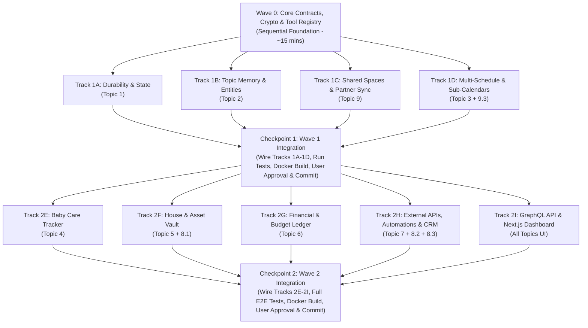

# MyPA Parallel Implementation Plan (`docs/PLAN.md`)

This document outlines the architecture and parallel execution plan for implementing Topics 1–9 from [`docs/FEATURES_EXPANSION.md`](file:///d:/MyPA/docs/FEATURES_EXPANSION.md). It is explicitly engineered for **maximum parallel execution** by multiple concurrent subagents with **zero file collisions**.

---

## 1. Architectural Decisions & Best Practices

1. **Modular Tool & Domain Registry (`ToolModule` Pattern)**:
   - Instead of modifying [`internal/orchestrator/engine.go`](file:///d:/MyPA/internal/orchestrator/engine.go) and [`internal/llm/tools.go`](file:///d:/MyPA/internal/llm/tools.go) for every new feature, the Orchestrator exposes a `ToolRegistry`.
   - Every domain package (`internal/domains/<domain>`) implements the `ToolModule` interface, providing its own Gemini `FunctionDeclaration` schemas, execution handler, and dynamic system prompt instructions.
2. **File-Per-Domain Database & Model Isolation**:
   - Models live in `internal/models/<domain>.go`.
   - GORM repositories live in `internal/db/<domain>_repo.go`.
   - Each domain registers its GORM models via `db.RegisterModels(...)` in `internal/db/migrations.go`.
3. **Internal Mutation & Notification Event Bus (`internal/events/bus.go`)**:
   - All domain write operations emit a standardized `MutationEvent`:
     ```go
     type MutationEvent struct {
         ID          string
         Topic       string // e.g., "baby", "house", "finance", "schedule", "memory"
         Action      string // e.g., "create", "update", "delete", "complete"
         EntityType  string // e.g., "BabyCareLog", "FinancialTransaction"
         EntityID    string
         ActorUserID string
         FamilyGroup string
         BeforeJSON  string
         AfterJSON   string
         Summary     string // Human-readable summary for partner notification & undo log
         Timestamp   time.Time
     }
     ```
   - This single abstraction powers:
     - **Topic 1 (Undo/Rollback & Audit)**: Automatically records snapshots in `mutation_logs`.
     - **Topic 9 (Shared Spaces & Partner Notifications)**: Automatically checks `SharedSpace` subscriptions for `Topic` + `FamilyGroup` and dispatches Telegram/WhatsApp notifications to subscribed family members.
     - **Topic 7 (Event-Driven Automations)**: Triggers `When -> If -> Then` user automations matching the event.
4. **Cryptography & Security Best Practices**:
   - **AES-256-GCM Encryption at Rest** (`internal/crypto/aes.go`): Used for PostgreSQL-persisted OAuth tokens (Topic 1.1) and external API connector credentials (Topic 7.1).
   - Key derivation uses `ENCRYPTION_KEY` from `.env` (with SHA-256 normalization to 32 bytes so any secret passphrase works safely, plus a deterministic fallback warning in dev/test).
5. **Default Family Sharing Policy**:
   - Within a `FamilyGroup`, topics `baby`, `house`, `finance`, and `family` default to **Shared** (`view: true, edit: true, notify: "instant"`), while `personal` and `work` default to **Private**, with full user override via chat tools or the Web Dashboard.

---

## 2. Execution Waves & Parallel Track Topology



---

## 3. Detailed Wave & Track Specifications

### Wave 0: Core Contracts, Crypto & Modular Tool Registry (Sequential Prerequisite)
*Purpose: Unlock 100% file-isolated parallel development for all subsequent tracks.*

- **Files to Create/Modify**:
  - `internal/crypto/aes.go` & `internal/crypto/aes_test.go`: AES-256-GCM `Encrypt([]byte, key)` and `Decrypt([]byte, key)` helpers.
  - `internal/events/bus.go` & `internal/events/bus_test.go`: Thread-safe `EventBus` with `Publish(ctx, MutationEvent)` and `Subscribe(handler)`.
  - `internal/orchestrator/registry.go` & `internal/orchestrator/registry_test.go`:
    - `CallContext` struct (holds `User`, `Message`, `DB`, `LLM`, `EventBus`, `SendNotificationFunc`).
    - `ToolModule` interface (`Name()`, `Declarations()`, `Execute()`, `SystemPromptSection()`).
    - `Registry` manager that aggregates declarations for `llm.Client` and dispatches unknown tool calls in `Engine.executeSingleTool`.
  - `internal/db/migrations.go`: `RegisterModel(models ...interface{})` slice so domain packages can register their GORM structs without editing `db.go` concurrently.
  - Hook `Registry` into [`internal/orchestrator/engine.go`](file:///d:/MyPA/internal/orchestrator/engine.go) and [`internal/llm/client.go`](file:///d:/MyPA/internal/llm/client.go) (preserving 100% backward compatibility with all existing tests).

---

### Wave 1: Core Platform Foundation (4 Parallel Subagent Tracks)

#### **Track 1A: Durability, Persistence & Data Integrity (Topic 1)**
- **Owned Files (Strictly Isolated)**:
  - `internal/models/durability.go`
  - `internal/db/durability_repo.go`
  - `internal/domains/durability/module.go`
  - `internal/domains/durability/module_test.go`
- **Models**:
  - `EncryptedCredential`: `{UserID (PK), Provider ("google_oauth" | "session"), Ciphertext []byte, UpdatedAt}`
  - `MutationLog`: `{ID (UUID), UserID, FamilyGroup, Topic, Action, EntityType, EntityID, BeforeJSON (jsonb), AfterJSON (jsonb), Summary, IsUndone bool, CreatedAt}`
  - `IdempotencyRecord`: `{Key (PK), UserID, ToolName, ResponseSummary, ExpiresAt}`
- **Capabilities & LLM Tools**:
  - **OAuth & State Fallback**: Dual-write helper that wraps Redis `GetOAuthToken`/`SetOAuthToken` with encrypted PostgreSQL fallback (`EncryptedCredential`).
  - **EventBus Subscriber**: Automatically persists every `MutationEvent` into `MutationLog` and registers an `UndoHandler` registry per `EntityType`.
  - **LLM Tools**:
    - `undo_last_action`: Reverts the user's (or family's) most recent mutation using `BeforeJSON` and marks `IsUndone = true`.
    - `list_recent_changes`: Lists recent AI mutations by topic with timestamps and actors.
    - `export_topic_data`: Exports structured data for any topic (`baby`, `house`, `finance`, `memory`, `schedule`) as formatted JSON or CSV text/attachment.

#### **Track 1B: Topic-Mapped Memory & Knowledge Graph (Topic 2)**
- **Owned Files (Strictly Isolated)**:
  - `internal/models/memory_v2.go`
  - `internal/db/memory_v2_repo.go`
  - `internal/domains/memory/module.go`
  - `internal/domains/memory/consolidation.go`
  - `internal/domains/memory/module_test.go`
- **Models**:
  - Extend `Memory` via `TopicMemory` (or migration columns on `memories`): `Topic string (index)`, `Subtopic string`, `Tags string (jsonb)`, `CreatedByUserID string`, `SupersededByID *uint`, `ValidFrom time.Time`, `ValidUntil *time.Time`, `IsPinned bool`.
  - `EntityProfile`: `{ID uint, UserID string, FamilyGroup string, Topic string (index), EntityType string, EntityName string, AttributesJSON string (jsonb), UpdatedByUserID string, UpdatedAt time.Time}` — "Living documents" (e.g., `BabyProfile`, `PropertyProfile`, `VehicleProfile`).
- **Capabilities & LLM Tools**:
  - **Hybrid Topic + Vector Retrieval**: Search active (`SupersededByID IS NULL`) memories filtered by inferred topic(s) + cosine similarity, plus inject matching `EntityProfile` cards into the system prompt.
  - **Automatic Superseding**: When saving a fact that updates an existing fact in the same topic/subtopic, mark the old row `SupersededByID`.
  - **Nightly Sleep Cycle (`ConsolidateMemories`)**: Background job callable by scheduler or tool to deduplicate memories and update `EntityProfile` JSONB cards.
  - **LLM Tools**:
    - `save_topic_memory`: Save a fact with explicit `topic`, `subtopic`, `tags[]`, `scope`, and optional `supersedes_memory_id`.
    - `search_topic_memories`: Query memories by `topic`, `tags`, and semantic query.
    - `upsert_entity_profile` & `get_entity_profile`: Deterministically create/update/read structured JSONB entity profiles (`baby`, `house`, `vehicle`, `family_member`).

#### **Track 1C: Shared Multi-User Spaces, Sync & Cross-User Notifications (Topic 9)**
- **Owned Files (Strictly Isolated)**:
  - `internal/models/shared.go`
  - `internal/db/shared_repo.go`
  - `internal/domains/shared/module.go`
  - `internal/domains/shared/notifier.go`
  - `internal/domains/shared/module_test.go`
- **Models**:
  - `SharedSpace`: `{ID uint, FamilyGroup string (index), Topic string (index), OwnerUserID string, SharedWithUserID string, CanView bool, CanEdit bool, NotifyMode string ("instant" | "digest" | "silent"), UpdatedAt time.Time}`
  - `SharedTaskReminder`: `{ID uint, FamilyGroup string (index), Topic string, Title string, DueTime *time.Time, CreatedByUserID string, AssignedToUserID string, IsCompleted bool, CompletedByUserID string, CompletedAt *time.Time, CreatedAt time.Time}`
- **Capabilities & LLM Tools**:
  - **Cross-User Notification Router (`Notifier`)**: Subscribes to `EventBus`. When User A mutates a shared topic (e.g. `baby`, `house`, `finance`), looks up partner(s) in `FamilyGroup` / `SharedSpace`. If `NotifyMode == "instant"`, immediately sends a formatted message (`"📢 [Shared • Baby] Sarah logged: ..."`) to the partner's last active platform (Telegram/WhatsApp).
  - **Shared Reminder/Task Hand-off**: When one partner completes a shared reminder/task, marks `CompletedByUserID`, cancels pending alerts for the other partner, and notifies them.
  - **LLM Tools**:
    - `configure_shared_topic`: Share/unshare a topic with family members and set `notify_mode` (`instant`, `digest`, `silent`).
    - `create_shared_reminder`: Create a family-shared reminder or task under a topic.
    - `complete_shared_reminder`: Claim/complete a shared reminder or task and notify the partner.
    - `list_shared_activity`: Query recent partner/family activity across shared topics with attribution (`created_by`, `completed_by`).

#### **Track 1D: Multi-Schedule Engine & Virtual Sub-Calendars (Topic 3 + Topic 9.3)**
- **Owned Files (Strictly Isolated)**:
  - `internal/models/schedule.go`
  - `internal/db/schedule_repo.go`
  - `internal/domains/schedule/module.go`
  - `internal/domains/schedule/module_test.go`
- **Models**:
  - `ScheduleEvent`: `{ID uint, ExternalGoogleEventID string, PartnerGoogleEventID string, UserID string, FamilyGroup string, Topic string (index), TagsJSON string (jsonb), Title string, Description string, StartTime time.Time (index), EndTime time.Time, RecurrenceRule string, SyncToGoogle bool, IsShared bool, CreatedByUserID string, CreatedAt time.Time}`
  - `TopicCalendarConfig`: `{ID uint, UserID string, Topic string, ColorID string, PrefixTag string, TargetCalendarID string, IncludeInMorningBriefing bool}`
- **Capabilities & LLM Tools**:
  - **Virtual Sub-Calendars on Single Google Calendar**: Automatically prefixes Google Calendar titles with `[Topic]` (e.g., `[Baby] Pediatrician Checkup`, `[House] Boiler Inspection`) and maps topics to Google Calendar `colorId`s, while also storing in PostgreSQL `schedule_events`.
  - **Internal-Only Schedules**: Supports `sync_to_google = false` for high-frequency internal schedules (e.g., every-3-hour feeding schedule) so the main Google Calendar isn't cluttered.
  - **Partner Calendar Sync (Topic 9.3)**: When `is_shared = true` (default for shared topics like `baby` and `house`), automatically syncs the event to the partner's connected Google Calendar as well (storing `PartnerGoogleEventID` to prevent duplicates and support updates/deletions) and emits a `MutationEvent`.
  - **LLM Tools**:
    - `schedule_topic_event`: Create a topic-tagged event (with `topic`, `tags`, `sync_to_google`, `is_shared`).
    - `list_topic_schedule`: Query schedule filtered by `topic`, `tags`, and time range (merges internal + Google events).
    - `configure_topic_calendar`: Customize how a topic appears (prefix, color, internal-only vs. Google sync, morning briefing inclusion).

---

### Checkpoint 1 (Integration Gate 1)
1. Wire Tracks 1A, 1B, 1C, and 1D into `cmd/orchestrator/main.go` and `internal/db/migrations.go`.
2. Run `go test -v ./internal/...` and verify all unit tests pass.
3. Run `docker-compose build` to verify container compilation.
4. Present Milestone 1 summary to the user and pause for commit approval.

---

### Wave 2: Life Domains, Automations & Dashboard UI (5 Parallel Subagent Tracks)

#### **Track 2E: Baby & Family Care Tracker (Topic 4)**
- **Owned Files (Strictly Isolated)**:
  - `internal/models/baby.go`
  - `internal/db/baby_repo.go`
  - `internal/domains/baby/module.go`
  - `internal/domains/baby/milestones.go`
  - `internal/domains/baby/module_test.go`
- **Models**:
  - `BabyProfile`: `{ID uint, FamilyGroup string (index), Name string, DateOfBirth time.Time, DueDate *time.Time, Gender string, BirthWeightGrams int, CurrentWeightGrams int, HeightCm float64, PediatricianInfo string, AllergiesNotes string, UpdatedByUserID string, UpdatedAt time.Time}`
  - `BabyCareLog`: `{ID uint, BabyID uint (index), FamilyGroup string (index), LogType string (index: "feeding" | "sleep" | "diaper" | "temperature" | "medication" | "milestone" | "measurement"), ValueNumeric float64, Unit string, Details string, Timestamp time.Time (index), LoggedByUserID string}`
  - `BabyInventoryItem`: `{ID uint, FamilyGroup string, ItemName string, QuantityRemaining float64, Unit string, LowThreshold float64, UpdatedAt time.Time}`
- **Capabilities & LLM Tools**:
  - **Dynamic Age & Milestone Engine**: Computes exact age in days/weeks/months and injects into the system prompt whenever a baby profile exists, along with upcoming age-based suggestions (vaccines, checkups, sleep windows, feeding transitions).
  - **Medication Cooldown Guardrail**: Checks last medication log timestamp before/when logging fever reducers (e.g., paracetamol/ibuprofen) and calculates when the next dose is safe.
  - **Emits `MutationEvent` (`Topic: "baby"`)**: Every log or profile update automatically triggers Partner Notification (Track 1C) and Undo support (Track 1A).
  - **LLM Tools**:
    - `upsert_baby_profile`: Set/update baby DOB, gender, weight, height, allergies, pediatrician.
    - `log_baby_care`: Log feeding, diaper, sleep, temperature, medication, or milestone.
    - `query_baby_logs_and_trends`: Get feeding totals, sleep averages, last medication time, or diaper counts over a period.
    - `get_baby_milestone_suggestions`: Get developmental, feeding, sleep, and medical checkup suggestions for the baby's exact current age.
    - `manage_baby_inventory`: Update or check supply levels (formula, diapers, Vitamin D drops).

#### **Track 2F: House Maintenance, Contracts & Vehicle Vault (Topic 5 + Topic 8.1)**
- **Owned Files (Strictly Isolated)**:
  - `internal/models/house.go`
  - `internal/db/house_repo.go`
  - `internal/domains/house/module.go`
  - `internal/domains/house/module_test.go`
- **Models**:
  - `HouseContractRecord`: `{ID uint, FamilyGroup string (index), RecordType string ("lease" | "mortgage" | "utility" | "warranty" | "insurance" | "receipt"), Title string, VendorOrLandlord string, ContactDetails string, Amount float64, Currency string, StartDate *time.Time, ExpirationOrRenewalDate *time.Time (index), NoticePeriodDays int, KeyTermsJSON string (jsonb), CreatedByUserID string, CreatedAt time.Time}`
  - `HomeMaintenanceItem`: `{ID uint, FamilyGroup string (index), TaskName string, Category string ("hvac" | "plumbing" | "appliance" | "pest_control" | "general"), IntervalDays int, LastCompletedAt *time.Time, NextDueAt time.Time (index), ContractorInfo string, Notes string, UpdatedByUserID string}`
  - `VehicleAsset`: `{ID uint, FamilyGroup string (index), Name string, LicensePlate string, InsuranceExpiry *time.Time, AnnualTestExpiry *time.Time, LastServiceDate *time.Time, CurrentMileageKm int, NextServiceMileageKm int, Notes string}`
- **Capabilities & LLM Tools**:
  - **Contract, Lease & Warranty Tracking**: Automatically schedules advance reminders (e.g. `ExpirationDate - NoticePeriodDays`) and links receipts to financial records.
  - **Preventive Maintenance Suggestions**: Suggests seasonal/interval home and vehicle maintenance tasks and tracks completion history.
  - **Emits `MutationEvent` (`Topic: "house"`)**: Syncs changes and notifications with partner.
  - **LLM Tools**:
    - `save_house_contract_or_receipt`: Store lease, mortgage, warranty, insurance, or home repair receipt metadata.
    - `list_house_contracts`: Query active contracts, expiring warranties, or landlord/vendor contacts.
    - `manage_home_maintenance`: Create, complete, or list preventive home maintenance tasks and seasonal suggestions.
    - `manage_vehicle_asset`: Log or query vehicle insurance, licensing test dates, mileage, and service intervals.

#### **Track 2G: Financial Tracking & Budget Intelligence (Topic 6)**
- **Owned Files (Strictly Isolated)**:
  - `internal/models/finance.go`
  - `internal/db/finance_repo.go`
  - `internal/domains/finance/module.go`
  - `internal/domains/finance/module_test.go`
- **Models**:
  - `FinancialTransaction`: `{ID uint, UserID string, FamilyGroup string (index), Type string ("expense" | "income"), Category string (index: "baby" | "house" | "groceries" | "utilities" | "dining" | "health" | "other"), Merchant string, Amount float64, Currency string, TransactionDate time.Time (index), IsShared bool, Source string ("chat" | "receipt_photo" | "email"), Notes string, CreatedAt time.Time}`
  - `CategoryBudget`: `{ID uint, FamilyGroup string (index), Category string, MonthlyLimit float64, Currency string, AlertThresholdPct float64}`
  - `RecurringBill`: `{ID uint, FamilyGroup string (index), Name string, Category string, ExpectedAmount float64, Currency string, BillingCycle string ("monthly" | "yearly"), NextDueDay int, AutoRenew bool}`
- **Capabilities & LLM Tools**:
  - **Budget Tracking & Anomaly Detection**: When logging an expense, checks two things automatically:
    1. Does total monthly spend in `Category` exceed `AlertThresholdPct` (e.g. 80% or 100%) of `CategoryBudget`?
    2. Is this bill >30% higher than historical average for the same merchant/category?
    - Returns immediate warnings in the tool output and emits a `MutationEvent` (`Topic: "finance"`).
  - **LLM Tools**:
    - `log_financial_transaction`: Record an expense or income (from text, receipt image, or email) with automatic anomaly & budget checks.
    - `get_financial_summary`: Aggregate spending/income by category, user, and date range vs. monthly budgets.
    - `set_category_budget`: Configure monthly budget limits per topic/category.
    - `manage_recurring_bills`: Add, update, or list recurring subscriptions and utility bills.

#### **Track 2H: On-Demand External APIs, User Automations & Runtime Customization (Topics 7, 8.2 & 8.3)**
- **Owned Files (Strictly Isolated)**:
  - `internal/models/automation.go`
  - `internal/db/automation_repo.go`
  - `internal/domains/automation/module.go`
  - `internal/domains/automation/runner.go`
  - `internal/domains/automation/module_test.go`
- **Models**:
  - `ExternalAPIConnector`: `{ID uint, UserID string, FamilyGroup string, Name string (index), BaseURL string, DefaultMethod string, EncryptedAuthHeaders []byte, Description string, CreatedAt time.Time}`
  - `AutomationRule`: `{ID uint, UserID string, FamilyGroup string, Name string, TriggerType string ("event_mutation" | "cron" | "keyword" | "threshold"), TriggerTopic string, ConditionJSON string (jsonb), ActionInstruction string, IsActive bool, CreatedAt time.Time}`
  - `UserPreference`: `{UserID string (PK), PreferredLanguage string, TonePersona string, DefaultCurrency string, QuietHoursStart string, QuietHoursEnd string, BriefingTopicsJSON string (jsonb), StandingInstructions string, UpdatedAt time.Time}`
  - `PersonalCRMContact`: `{ID uint, UserID string, FamilyGroup string, PersonName string, Relationship string, ImportantDatesJSON string (jsonb), GiftIdeasAndSizes string, MedicalNotes string, UpdatedAt time.Time}`
- **Capabilities & LLM Tools**:
  - **On-Demand API Connector**: Registers external REST/Webhook endpoints with AES-256-GCM encrypted auth headers and allows the LLM to invoke them safely via `call_external_api` (with SSRF protection blocking internal Docker/localhost IPs).
  - **Event-Driven Automation Engine**: Listens to `EventBus` (`MutationEvent`). If an active `AutomationRule` matches `TriggerTopic` and `ConditionJSON`, triggers the follow-up `ActionInstruction` or webhook.
  - **Runtime Customizability**: Injects user's `StandingInstructions`, `TonePersona`, `DefaultCurrency`, and `BriefingTopics` directly into the dynamic system prompt on every turn.
  - **LLM Tools**:
    - `register_external_api`, `list_external_apis`, `call_external_api`
    - `create_automation_rule`, `list_automation_rules`, `delete_automation_rule`
    - `update_user_preferences`, `get_user_preferences`
    - `upsert_personal_crm`, `query_personal_crm`

#### **Track 2I: GraphQL API & Next.js Dashboard Expansion**
- **Owned Files (Strictly Isolated)**:
  - `internal/graph/schema.graphqls`
  - `internal/graph/schema.resolvers.go` (regenerated via `gqlgen` with UTF-8 encoding)
  - `dashboard/src/app/` (new views/tabs for Memory Explorer, Shared Spaces, Life Domains: Baby/House/Finance, and Automations/APIs)
- **Capabilities**:
  - **GraphQL Queries & Mutations**: Expose Topic Memories, Entity Profiles, Shared Spaces, Schedule Events, Baby Care Logs, House Contracts, Financial Summaries, External APIs, and Mutation Audit Logs (with Rollback mutation).
  - **Dashboard Pages**:Overview cards & interactive management tables for topics, shared family permissions, finance budgets, baby care logs, and house contracts.

---

## 4. Verification & Guardrails Checklist (Per `AGENTS.md`)
- [ ] **Branch Check**: Confirm `dev` branch before every wave.
- [ ] **UTF-8 Encoding**: Ensure all Go and GraphQL files are written in UTF-8 without BOM.
- [ ] **Unit & E2E Tests**: Run `go test -v ./internal/...` at each checkpoint.
- [ ] **Full Container Build**: Run `docker-compose build` before requesting commit approval.
- [ ] **Documentation**: Update `README.md` and `docs/ROADMAP.md` in Wave 2 before final build.
