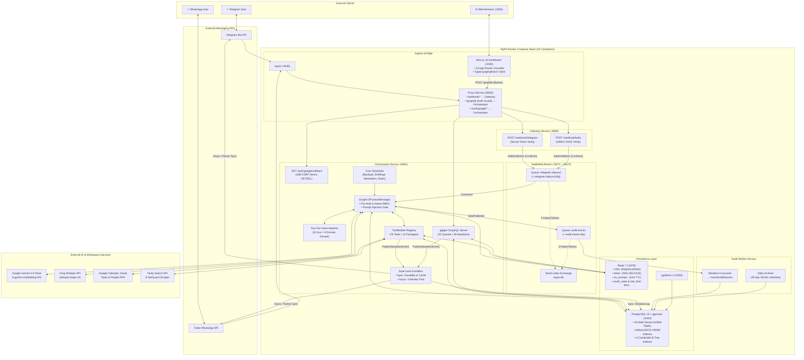
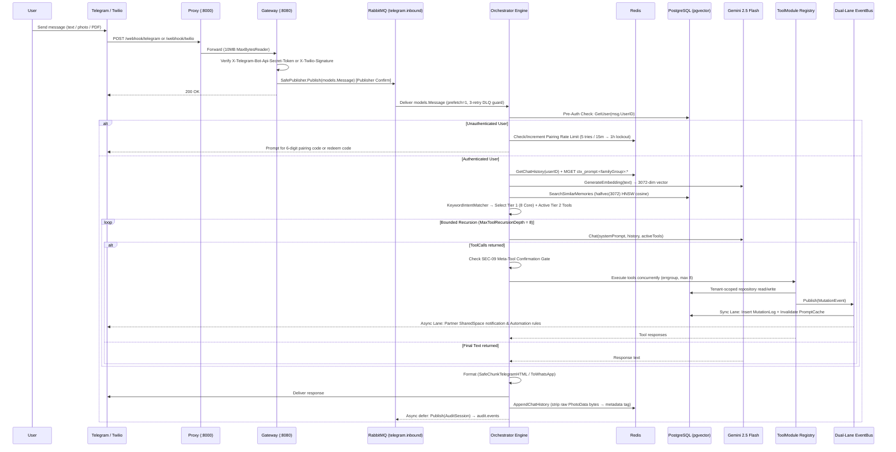

# MyPA — Complete Architecture Deep Dive

> [!NOTE]
> For the exhaustive database table definitions (29 GORM models), complete 70-tool parameter catalog, and 8-section Feature Development Playbook, see [`SYSTEM.md`](../SYSTEM.md).

---

## 1. High-Level System Architecture

---

## 2. Container Stack & Unified Multi-Target Dockerfile

All four Go microservices compile from a single root [`Dockerfile`](../Dockerfile) using BuildKit cache mounts (`/go/pkg/mod` and `/root/.cache/go-build`) and granular `COPY` directives (`internal/`, `config/`, `cmd/<service>/`):

| Container | Target / Image | Runtime Image | Host Port | Role |
| :--- | :--- | :--- | :---: | :--- |
| **`proxy`** | `proxy` | `gcr.io/distroless/static-debian12` | `127.0.0.1:8000` | Edge reverse proxy: `/webhook/*` → Gateway, `/graphql` (with auth header check) & `/auth/google/*` → Orchestrator |
| **`gateway`** | `gateway` | `gcr.io/distroless/static-debian12` | `127.0.0.1:8080` | Validates Telegram secret token & Twilio HMAC-SHA1 signature, normalizes payloads, publishes to RabbitMQ |
| **`orchestrator`** | `orchestrator` | `debian:12-slim` (`postgresql-client`) | `127.0.0.1:8081` | Reasoning engine, 70-tool `Registry`, dual-lane `EventBus`, OAuth2, GraphQL API, Cron scheduler |
| **`audit-worker`** | `audit-worker` | `gcr.io/distroless/static-debian12` | — | Consumes `audit.events`, writes `AuditSession` records, archives sessions >30 days to `/app/archives` JSONL |
| **`dashboard`** | `dashboard/Dockerfile` | `node:20-alpine` (Next.js standalone) | `127.0.0.1:3030` | Next.js 16 (React 19) Web Control Dashboard communicating via `http://proxy:8000/graphql` |
| **`rabbitmq`** | Official Image | `rabbitmq:3.13-management-alpine` | `127.0.0.1:5672`, `15672` | AMQP 0-9-1 broker with `mypa.dlx` dead-letter exchange and `.dlq` queues |
| **`redis`** | Official Image | `redis:7-alpine` (`--appendonly yes`) | `127.0.0.1:6379` | Hot conversation state, encrypted OAuth tokens, prompt cache, CSRF nonces, rate limiters |
| **`postgres`** | Official Image | `pgvector/pgvector:pg15` | `127.0.0.1:5432` | Relational + `pgvector` database (29 tables, HNSW `halfvec(3072)` & composite indexes) |
| **`pgadmin`** | Official Image | `dpage/pgadmin4` | `127.0.0.1:5050` | PostgreSQL administration console |
| **`ngrok`** | Official Image | `ngrok/ngrok:latest` | `127.0.0.1:4040` | Public HTTPS webhook tunnel to `proxy:8000` |

---

## 3. Core Execution Flows

### Flow 1: Conversational Turn & Two-Tier Tool Execution

### Flow 2: Voice Note Transcription (`whisper-large-v3`)
1. After passing the pre-auth check in `Engine.ProcessMessage`, voice notes (`VoiceFileID` on Telegram or `audio/*` `MediaURL` on WhatsApp) are downloaded in the Orchestrator.
2. WhatsApp media downloads validate the URL against `internal/twilio`'s HTTPS `*.twilio.com` / `*.twiliocdn.com` domain allowlist (capped at 25MB) before attaching Twilio BasicAuth credentials.
3. Audio bytes are sent to Groq Whisper (`whisper-large-v3`), a real-time `"🗣️ Transcribed: ..."` preview is sent to the user, and `msg.Text` proceeds through the standard conversational flow.

### Flow 3: Hardened Google OAuth2 (`/connect`)
1. User sends `/connect`.
2. Orchestrator generates a 32-byte cryptographically random hex nonce (`internal/crypto`), stores `oauth_state:<nonce> -> userID` in Redis with a 10-minute TTL, and sends the Google OAuth2 authorization URL.
3. On `GET /auth/google/callback`, Orchestrator atomically validates and consumes the nonce via Redis `GETDEL`, exchanges the authorization code for tokens, encrypts the token payload with HKDF-SHA256 salted AES-256-GCM, and dual-writes it to Redis (`token:<userID>`) and PostgreSQL (`encrypted_credentials`).

### Flow 4: Unified Snapshot Rollback (`/undo` & GraphQL `rollbackMutation`)
1. Every state-mutating tool or GraphQL mutation emits a `MutationEvent` containing `BeforeJSON` and `AfterJSON` snapshots, persisted synchronously into `mutation_logs`.
2. When a user sends `/undo` in chat, invokes `undo_last_action`, or clicks **Rollback** in the Web Dashboard (`/audit`), `durability.Module.Rollback` verifies positive tenant ownership, checks the entity against the 19-table allowlist (`ResolveRollbackTable`), restores the snapshot inside an atomic GORM transaction, and marks `is_undone = true`.

---

## 4. Modular `ToolModule` Catalog (70 Tools / 13 Packages)

Rather than a monolithic switch statement, all 70 tools are encapsulated in 13 `orchestrator.ToolModule` packages under [`internal/domains/`](../internal/domains):

| Package | Domain Group | Tool Count | Registered Tools |
| :--- | :--- | :---: | :--- |
| `registry` (built-in) | Tier 1 Core | 1 | `get_current_time` |
| `workspace_calendar` | `DomainCalendar` | 4 | `create_calendar_event`, `list_calendar_events`, `update_calendar_event`, `delete_calendar_event` |
| `workspace_gmail` | `DomainGmail` | 9 | `search_emails`, `read_email`, `draft_email_reply`, `archive_emails`, `soft_delete_emails`, `list_email_labels`, `apply_email_labels`, `create_email_label`, `unsubscribe_email` |
| `workspace_tasks` | `DomainTasks` | 6 | `list_task_lists`, `create_task_list`, `list_tasks`, `create_task`, `complete_task`, `delete_task` |
| `workspace_contacts` | `DomainContacts` | 2 | `search_contacts`, `create_contact` |
| `web_research` | Tier 1 Core | 2 | `search_web`, `fetch_webpage` |
| `durability` | Tier 1 Core / Audit | 3 | `undo_last_action`, `list_recent_changes`, `export_topic_data` |
| `memory` | Tier 1 Core / Memory | 5 | `remember_fact`, `save_topic_memory`, `search_topic_memories`, `upsert_entity_profile`, `get_entity_profile` |
| `shared` | `DomainShared` + Core | 5 | `schedule_reminder`, `configure_shared_topic`, `create_shared_reminder`, `complete_shared_reminder`, `list_shared_activity` |
| `schedule` | `DomainCalendar` | 5 | `schedule_topic_event`, `list_topic_schedule`, `configure_topic_calendar`, `delete_topic_event`, `update_topic_event` |
| `baby` | `DomainBaby` | 5 | `upsert_baby_profile`, `log_baby_care`, `query_baby_logs_and_trends`, `get_baby_milestone_suggestions`, `manage_baby_inventory` |
| `house` | `DomainHouse` | 4 | `save_house_contract_or_receipt`, `list_house_contracts`, `manage_home_maintenance`, `manage_vehicle_asset` |
| `finance` | `DomainFinance` | 4 | `log_financial_transaction`, `get_financial_summary`, `set_category_budget`, `manage_recurring_bills` |
| `automation` | `DomainAutomation` & `DomainContacts` | 15 | `register_external_api`, `list_external_apis`, `call_external_api`, `create_automation_rule`, `list_automation_rules`, `delete_automation_rule`, `update_user_preferences`, `get_user_preferences`, `upsert_personal_crm`, `query_personal_crm`, `schedule_workflow`, `list_workflows`, `delete_workflow` *(plus 2 internal helpers)* |

---

## 5. Dual-Layer Storage & Indexing Summary

| Store | Key / Table Group | Count | Highlights |
| :--- | :--- | :---: | :--- |
| **Redis 7** | `chat:*`, `token:*`, `ctx_prompt:*`, `oauth_state:*`, `pending_meta_tool:*`, `rate_limit:pairing:*` | 7 patterns | Stripped `PhotoData` history (<10KB/user), HKDF AES-256-GCM encrypted tokens, 10m dynamic prompt cache, 10m `GETDEL` OAuth nonces |
| **PostgreSQL 15 + `pgvector`** | Core, Durability, Memory v2, Shared, Schedule, Baby, House, Finance, Automation | 29 tables | Pool tuned (`25 max open / 10 idle`), `halfvec(3072)` HNSW cosine indexes on `memories` & `topic_memories`, 6 composite multi-tenant B-Tree indexes |
| **RabbitMQ 3.13** | `telegram.inbound`, `audit.events` + `.dlq` queues on `mypa.dlx` | 4 queues | Mutex-serialized `SafePublisher` with broker confirms, 3-attempt exponential backoff consumer retries, poison-pill isolation |
